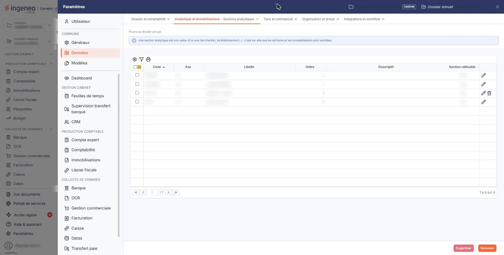

# Sections analytiques


**Où le trouver :** Panneau **Paramètres** › **Données** › **Analytique et immobilisations** › **Sections analytiques**



**En bref** — Cet écran tient les sections analytiques, c'est-à-dire les valeurs possibles à l'intérieur d'un axe ; communes à tout le dossier, elles servent ici à ventiler vos dotations.

* Pour créer une section : bouton \[Nouveau], choisissez l'axe, saisissez le code, le libellé et l'ordre, puis bouton \[Enregistrer].
* Pour retirer du service une section déjà employée : passez « Section utilisable » à « Non » plutôt que de la supprimer.
* Pour accéder à la liste si l'écran indique « Vous n'avez pas activé la gestion analytique. » : activez la comptabilité analytique dans le panneau « Paramètres », rubrique « Généraux », option « Configuration ».


Les sections analytiques définissent les différentes possibilités d'affectation au sein d'un axe. Par exemple, pour un axe « Localisation géographique », vous pourrez avoir les sections « Région Ouest », « Région Nord », « Région Est », « Région Sud » et « Ile-de-France ».

<figure><figcaption>
Écran « Sections analytiques » de la nouvelle interface
</figcaption></figure>

Une section appartient à un seul axe. Créez donc vos axes d'abord, dans l'option voisine « Axes analytiques », puis leurs sections ici.

Les axes et les sections sont communs à tout le dossier : ceux que vous créez ici sont les mêmes que ceux de la comptabilité, et inversement. Dans le module des immobilisations, ils vous servent à ventiler vos dotations.

## Si l'écran affiche « Vous n'avez pas activé la gestion analytique. »

C'est la première chose que vous pouvez rencontrer sur cet écran, et le message ne dit pas quoi faire. La gestion analytique n'est pas active sur votre dossier : l'écran est alors réduit à cette seule phrase, sans liste, sans champ et sans aucun bouton.

Le réglage se trouve dans le panneau « Paramètres », rubrique « Généraux », option « Configuration », rubrique « Informations », champ « Activer la comptabilité analytique : ». Répondez « Oui » et enregistrez : l'écran des sections affiche alors sa liste.

Ne vous laissez pas troubler par le vocabulaire : le message parle de « gestion analytique » et le paramètre de « comptabilité analytique ». Il s'agit du même réglage. Il porte sur l'ensemble du dossier annuel et concerne donc aussi les autres modules, la comptabilité au premier chef ; si vous travaillez dans un cabinet, assurez-vous que cette activation est bien voulue pour le dossier avant de la faire.

## La liste des sections

Une fois la gestion analytique activée, l'écran s'ouvre sur la liste de vos sections, tous axes confondus, avec six colonnes :

| Champ                  | Ce qu'il faut savoir                                                                                                                                                                       |
| ---------------------- | ------------------------------------------------------------------------------------------------------------------------------------------------------------------------------------------ |
| **Code**               | Le code que vous avez donné à la section.                                                                                                                                                  |
| **Axe**                | Le code de l'axe auquel elle appartient.                                                                                                                                                   |
| **Libellé**            | Son nom.                                                                                                                                                                                   |
| **Ordre**              | Son rang à l'intérieur de son axe.                                                                                                                                                         |
| **Descriptif**         | Le complément d'information que vous y avez associé. Notez que la colonne s'intitule « Descriptif » alors que le champ de la fiche s'intitule « Description » : c'est la même information. |
| **Section utilisable** | « Oui » ou « Non », selon que la section peut encore être employée.                                                                                                                        |

## Bouton \[Nouveau]

Il ouvre une fiche vide.

## La fiche d'une section — rubrique « Informations générales »

La fiche ne comporte qu'une rubrique et six champs.

| Champ                                                              | Ce qu'il faut savoir                                                                                                                                                                                                                                                                                                                                                                                                                                                                                                                                                                                                                                                                                                        |
| ------------------------------------------------------------------ | --------------------------------------------------------------------------------------------------------------------------------------------------------------------------------------------------------------------------------------------------------------------------------------------------------------------------------------------------------------------------------------------------------------------------------------------------------------------------------------------------------------------------------------------------------------------------------------------------------------------------------------------------------------------------------------------------------------------------- |
| 
<strong>Axe</strong> <em>Obligatoire</em>
                | La liste vous propose vos axes, chacun sous la forme de son code suivi de son libellé. Une section n'appartient qu'à un seul axe, et **l'axe n'est plus modifiable après le premier enregistrement** : en modification, la liste s'affiche verrouillée. Une section rattachée au mauvais axe est donc à supprimer et à recréer.                                                                                                                                                                                                                                                                                                                                                                                             |
| 
<strong>Code</strong> <em>Obligatoire</em>
               | 12 caractères au maximum. Il doit être unique **à l'intérieur de son axe** : deux axes différents peuvent employer le même code de section. Si le code est déjà pris dans l'axe choisi, le logiciel refuse l'enregistrement en affichant « Code déjà utilisé pour cet axe ». Comme l'axe, **le code n'est plus modifiable après le premier enregistrement**.                                                                                                                                                                                                                                                                                                                                                                |
| 
<strong>Libellé</strong> <em>Obligatoire</em>
            | 30 caractères au maximum. C'est le nom qui apparaîtra partout où la section est proposée, précédé de son code.                                                                                                                                                                                                                                                                                                                                                                                                                                                                                                                                                                                                              |
| **Description**                                                    | C'est une zone de plusieurs lignes.                                                                                                                                                                                                                                                                                                                                                                                                                                                                                                                                                                                                                                                                                         |
| 
<strong>Ordre</strong> <em>Obligatoire</em>
              | De 1 à 999. Il définit l'ordre d'apparition de la section dans la fenêtre de ventilation, lors de la saisie d'une écriture ou de l'affichage de la répartition d'une écriture. Le logiciel vous le propose de lui-même — il place la nouvelle section à la suite des sections déjà créées dans l'axe — et vous pouvez le modifier. Si vous saisissez un rang déjà pris, la section vient s'y insérer et les rangs des sections suivantes sont automatiquement recalculés. Si vous saisissez un rang supérieur au nombre de sections de l'axe, le logiciel le ramène à la dernière position. C'est donc un classement, pas une référence : ne l'employez pas comme un identifiant, il change quand vous insérez une section. |
| 
<strong>Section utilisable</strong> <em>Obligatoire</em>
 | Répondez « Oui » ou « Non ». Le logiciel vous l'explique dans son infobulle : « Si vous répondez « Non » cette section ne sera plus utilisable dans les ventilations analytiques. » Une section neuve est proposée à « Oui ». C'est ce champ qui vous permet de **retirer du service** une section devenue obsolète sans la supprimer, ce qui préserve les écritures qui l'emploient déjà. Vous ne pouvez pas répondre « Non » à une section employée par une ventilation type : le logiciel refuse et vous indique la ventilation concernée.                                                                                                                                                                               |

## Bouton \[Enregistrer]

Il enregistre la fiche et vous ramène à la liste. Selon les droits qui vous sont accordés, il peut ne pas vous être proposé.

## Bouton \[Retour]

Il revient à la liste sans rien enregistrer.

## Supprimer une section

La suppression s'obtient par le pictogramme de la ligne, ou par le bouton **\[Supprimer]** de la barre basse, qui agit sur les lignes que vous avez cochées.

Une section employée n'est pas supprimable. Le logiciel l'écarte dans quatre cas : elle est employée sur une ligne d'écriture ; elle entre dans la répartition d'une ventilation type ; elle est employée dans un budget ; ou bien c'est la dernière section de son axe et cet axe est rattaché à au moins un compte. Dans une suppression portant sur plusieurs lignes, les sections libres sont supprimées et les autres sont laissées en place.

Retenez donc le bon réflexe : une section qui ne doit plus servir se passe à « Non » sur le champ « Section utilisable ». La suppression est réservée à une section créée par erreur et jamais employée.

Selon les droits qui vous sont accordés, la suppression peut ne pas vous être proposée.

## Bouton \[Importer]

Lorsqu'il vous est proposé, il ouvre une fenêtre d'import qui vous permet de reprendre vos axes et vos sections depuis un fichier, et de télécharger la trame à remplir. Ce bouton dépend d'un droit du module de comptabilité : il peut ne pas apparaître selon votre profil.
