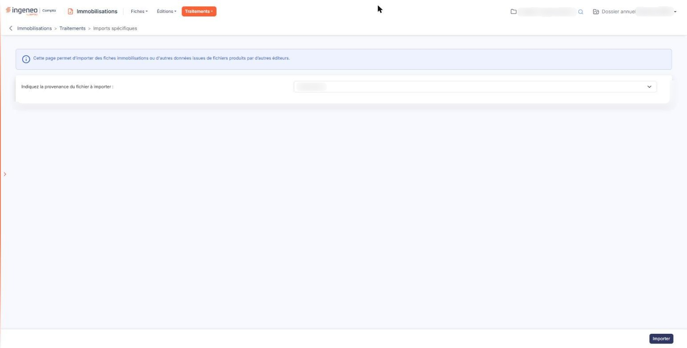

# Imports spécifiques


**Où le trouver :** Menu **Traitements › Imports spécifiques**



**En bref** — Cet écran reprend directement les fichiers d'export de Cegid Expert ©, Quadra ©, Sage Génération Experts (Coala) © ou Isacompta © (y compris ses emprunts), sans passer par la trame d'import du module.

* Pour importer : choisissez la provenance du fichier, bouton \[Importer], désignez le fichier, puis lancez l'import.
* Pour effacer le compte rendu du dernier import : bouton \[Purger le rapport].


Certains éditeurs produisent des fichiers d'export qui leur sont propres. Cette option vous permet de les reprendre directement, sans avoir à recopier les informations dans la trame d'import du module.

<figure><figcaption>
Écran « Imports spécifiques » de la nouvelle interface
</figcaption></figure>

C'est ce qui la distingue de l'option « Import » du même menu : celle-ci attend la trame Excel du logiciel, celle-là le fichier d'un éditeur reconnu, tel qu'il sort de son logiciel d'origine. Si votre logiciel de départ ne figure pas dans la liste ci-dessous, c'est l'option « Import » qu'il vous faut.

Le texte affiché en tête de l'écran le résume : « Cette page permet d'importer des fiches immobilisations ou d'autres données issues de fichiers produits par d'autres éditeurs. »

## Champ « Indiquez la provenance du fichier à importer : »

C'est le seul champ de l'écran, et il est obligatoire. Il est positionné sur « Sélectionnez » à l'ouverture. Cinq provenances sont reconnues, dans cet ordre : « Cegid Expert © », « Quadra © », « Sage Génération Experts (Coala) © », « Isacompta © » et « Isacompta © - Emprunts ».

Dès que vous choisissez une provenance, le logiciel affiche sous le champ un texte qui lui est propre, et ce texte porte deux informations que vous ne trouverez nulle part ailleurs dans l'écran.

La première est le **périmètre de ce que le fichier permet de reprendre, qui n'est pas le même selon la provenance** :

* depuis « Cegid Expert © » et depuis « Quadra © » : les localisations, les familles, les comptes et les immobilisations ;
* depuis « Sage Génération Experts (Coala) © » : **les comptes et les immobilisations seulement** — ni localisations, ni familles ;
* depuis « Isacompta © » : les comptes, les immobilisations et les subventions d'investissements ;
* depuis « Isacompta © - Emprunts » : les comptes d'emprunt et les emprunts — leurs échéanciers sont recalculés par Ingeneo Compta.

La seconde est la **règle de collision**, et elle n'est pas la même pour toutes les provenances. Pour « Cegid Expert © », « Quadra © » et « Sage Génération Experts (Coala) © » : si certaines fiches à importer ont le même identifiant que des fiches déjà existantes dans votre dossier annuel, elles ne sont tout simplement pas importées. Le logiciel ne les met pas à jour et ne crée pas de doublon : il les laisse de côté. Pour « Isacompta © » : si certaines fiches à importer ont le même identifiant que des fiches déjà existantes dans votre dossier annuel, le fichier n'est pas importé. Pour « Isacompta © - Emprunts » : la comparaison porte sur le code de l'emprunt — si certains emprunts à importer ont le même code que des emprunts déjà existants dans votre dossier annuel, le fichier n'est pas importé. Vérifiez donc, avant un import, si votre dossier contient déjà des fiches — sans quoi, avec les trois premières provenances, vous pourriez croire que le fichier a été refusé, alors que ses fiches ont simplement été écartées une à une.

## Bouton \[Importer]

Il n'apparaît que si votre profil vous autorise l'import spécifique. Il est toujours actif, mais il ne fait rien sans provenance : si vous n'en avez pas choisi, le logiciel vous répond simplement de sélectionner la provenance du fichier à importer.

Sinon, il ouvre une fenêtre d'import dans laquelle vous désignez le fichier à reprendre. Le fichier est obligatoire, et seule l'extension attendue par la provenance retenue est proposée : un fichier d'extension .sav pour « Cegid Expert © » et pour « Quadra © », un fichier d'extension .csv pour « Sage Génération Experts (Coala) © ». La fenêtre porte à son tour un bouton d'import, qui lance le traitement, et un bouton d'annulation, qui la referme sans rien reprendre.

Le logiciel examine alors le fichier. S'il constate que le format du fichier ne correspond pas à la provenance que vous avez choisie, il ne refuse pas : il vous le signale, en nommant le format qu'il a détecté, et vous demande de confirmer que vous voulez tout de même l'importer dans le format choisi.

Un fichier « Cegid Expert © » ou « Quadra © » peut aussi être refusé d'emblée, et le logiciel vous dit alors pourquoi, dans la fenêtre elle-même : le fichier est vide, il est incomplet, ses informations d'exercice sont introuvables ou invalides, le dossier d'origine est tenu en francs, ou encore l'exercice d'export du fichier ne correspond ni à l'exercice en cours ni au précédent.

Quand le traitement a eu lieu, le logiciel ouvre une fenêtre de rapport d'import qui vous rappelle le nom du fichier traité et vous dit d'un mot si l'import s'est correctement déroulé ou s'il a rencontré des erreurs. Fermez-la : l'écran se recharge et affiche le compte rendu détaillé.

## Le compte rendu du dernier import

Tant que vous n'avez lancé aucun import, l'écran se limite au texte d'introduction, à la provenance et au bouton d'import. Dès qu'un import a été réalisé, il affiche en plus la **date du dernier import** avec son heure, le **fichier** traité, et la liste détaillée de ce que le logiciel a constaté. Les lignes en anomalie s'affichent en rouge, les autres en vert.

Corrigez ce qui doit l'être, puis relancez l'import : le compte rendu précédent est alors remplacé par le nouveau. Vous ne conservez donc jamais qu'un seul compte rendu, celui du dernier import.

## Bouton \[Purger le rapport]

Il n'apparaît que lorsqu'un compte rendu est présent, et si votre profil vous y autorise. Il supprime le compte rendu de votre dernier import pour le module, après vous avoir demandé confirmation. La purge ne porte que sur le compte rendu : les données déjà importées ne sont pas remises en cause.
