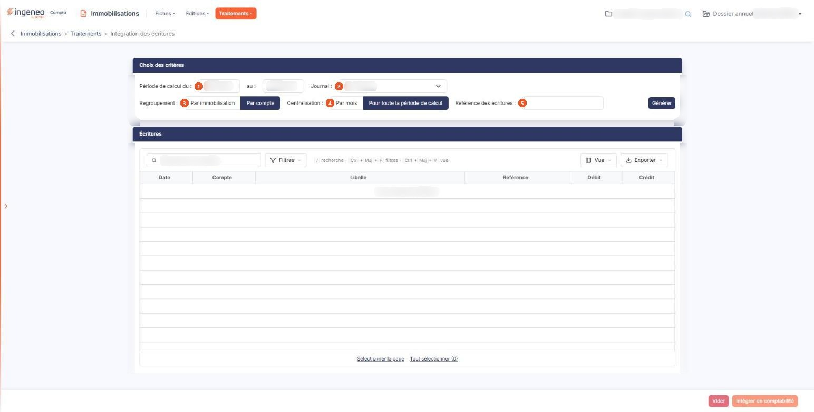

# Intégration des écritures


**Où le trouver :** Menu **Traitements › Intégration des écritures**



**En bref** — Cet écran passe en comptabilité les écritures issues de vos fiches immobilisations, en deux temps : génération et vérification dans une grille, puis intégration en comptabilité.

* Pour préparer les écritures : choisissez la période, le journal, le regroupement et la centralisation, puis bouton \[Générer].
* Pour écrire en comptabilité : vérifiez la grille « Écritures », puis bouton \[Intégrer en comptabilité].
* Pour repartir sur un nouveau jeu : bouton \[Vider], qui ne touche pas aux écritures déjà intégrées.


Cette option permet de passer en comptabilité les écritures qui découlent de vos fiches immobilisations : dotations aux amortissements, amortissements dérogatoires, dépréciations et reprises de dépréciation, écritures de sortie, quote-part personnelle des véhicules, et quote-part des subventions d'investissement virée au résultat.

<figure><figcaption>
Écran « Intégration des écritures » de la nouvelle interface
</figcaption></figure>

L'écran se déroule en deux temps, et c'est le point à retenir : vous **générez** d'abord les écritures, qui s'affichent alors dans une grille où vous pouvez les vérifier, les corriger ou en supprimer ; vous les **intégrez** ensuite en comptabilité. Rien n'est écrit en comptabilité avant cette seconde étape. Tant que vous n'avez pas intégré, vous pouvez régénérer autant de fois que vous le souhaitez.

## Rubrique « Choix des critères »

| Champ                          | Ce qu'il faut savoir                                                                                                                                                                                                                                                                                                                                                                                                                                                                                                                                                                                                                                                                        |
| ------------------------------ | ------------------------------------------------------------------------------------------------------------------------------------------------------------------------------------------------------------------------------------------------------------------------------------------------------------------------------------------------------------------------------------------------------------------------------------------------------------------------------------------------------------------------------------------------------------------------------------------------------------------------------------------------------------------------------------------- |
| 1. **Période de calcul du**    | 
<strong>au :</strong> les dates de début et de fin de la période pour laquelle vous voulez générer les écritures. Le logiciel propose par défaut le premier et le dernier jour de l'exercice. Les deux dates sont obligatoires. La date de fin ne peut être ni antérieure à la date de début, ni en dehors de la <strong>période de saisie</strong> autorisée pour le dossier annuel. Cette période de saisie peut aller au-delà de la date de clôture de l'exercice : la date de fin proposée par le calendrier peut donc dépasser le 31 décembre d'un exercice civil, ce qui est normal. Si vous modifiez la date de début, le calendrier de la date de fin se recale aussitôt.
 |
| 2. **Journal**                 | Le journal dans lequel les écritures seront intégrées. La liste vous propose les journaux du dossier dont le type est « OD » ou « Situation » — elle dépend donc de votre paramétrage et n'est pas la même d'un dossier à l'autre. Elle se positionne par défaut sur le journal d'intégration des écritures paramétré dans le panneau « Paramètres », rubrique « Immobilisations », option « Comptes », rubrique « Autres paramètres ». Vous pouvez en changer, par exemple pour porter une situation intermédiaire dans un journal de situation.                                                                                                                                           |
| 3. **Regroupement**            | Choisissez « Par immobilisation » pour obtenir le détail fiche par fiche, ou « Par compte » pour n'obtenir qu'une ligne par compte. « Par compte » est le choix proposé par défaut.                                                                                                                                                                                                                                                                                                                                                                                                                                                                                                         |
| 4. **Centralisation**          | Choisissez « Par mois » pour obtenir un jeu d'écritures par mois de la période, daté de la fin de chaque mois, ou « Pour toute la période de calcul » pour n'obtenir qu'un seul jeu daté de la fin de la période. C'est ce second choix qui est proposé par défaut.                                                                                                                                                                                                                                                                                                                                                                                                                         |
| 5. **Référence des écritures** | La référence qui sera reprise dans toutes les lignes d'écritures générées, sur 20 caractères au maximum. Si vous laissez ce champ vide, le logiciel y porte le code de l'immobilisation, sauf lorsque le regroupement est demandé par compte : la notion d'immobilisation n'a alors plus de sens sur la ligne.                                                                                                                                                                                                                                                                                                                                                                              |

Les écritures relatives à une immobilisation **sortie** échappent à cette règle de date : elles sont toujours datées de la date effective de sortie portée sur la fiche, et non de la fin du mois ou de la fin de la période.

## Bouton \[Générer]

Il lance le calcul et affiche le résultat dans la grille de la rubrique « Écritures ». Il vide au préalable la grille si elle contenait déjà des écritures : vous ne risquez pas d'empiler deux générations.

Ce bouton n'apparaît que si votre profil vous autorise la génération des écritures.

Une immobilisation peut être **écartée** du calcul sans que cela empêche les autres d'être générées. Le logiciel affiche alors, en haut de la page, un message d'avertissement qui vous énumère, immobilisation par immobilisation, la raison pour laquelle ses écritures n'ont pas été produites :

* son paramétrage d'amortissement est incomplet — durée totale ou date de début d'amortissement manquante ;
* sa ventilation analytique n'est pas complète ;
* aucun compte fournisseur n'est renseigné pour sa sortie par remboursement, ou le compte indiqué n'existe pas dans les comptes auxiliaires de l'exercice.

Corrigez la fiche concernée, puis régénérez.

Si un paramétrage indispensable manque, le logiciel refuse en revanche la génération et affiche, en haut de la page, un message d'erreur qui vous invite à vérifier le paramétrage du journal d'intégration des écritures, ou celui des comptes de subventions d'investissement, dans l'option « Comptes » de la rubrique « Immobilisations » du panneau « Paramètres ». Lorsque c'est le journal qui manque, le bouton \[Intégrer en comptabilité] reste inactif tant que le paramétrage n'a pas été corrigé.

## Rubrique « Écritures »

Tant que vous n'avez rien généré, cette grille affiche « Aucun élément à afficher. ». Après génération, elle présente les lignes d'écritures proposées, en six colonnes : **Date**, **Compte**, **Libellé**, **Référence**, **Débit** et **Crédit**. Toutes sont triables, et la barre de la grille porte trois boutons — Bouton \[Filtres], Bouton \[Vue] et Bouton \[Exporter] — ainsi que deux commandes de sélection, « Sélectionner la page » et « Tout sélectionner », cette dernière annonçant entre parenthèses le nombre de lignes qu'elle retiendrait.

Ces lignes ne sont encore que des propositions : elles vivent dans votre écran, pas en comptabilité. Chaque ligne porte deux pictogrammes :

le pictogramme de **modification** ouvre la fenêtre « Modification d'une ligne », où vous retrouvez la date, le compte, le libellé, la référence, le débit et le crédit de la ligne. Débit et crédit s'excluent : dès que vous saisissez l'un, le logiciel efface l'autre. le bouton de validation de la fenêtre reporte votre correction dans la grille, le bouton d'annulation la referme sans rien changer ;

le pictogramme de **suppression** retire la ligne de la grille, immédiatement et sans demander confirmation. La ligne n'est pas perdue pour autant : une nouvelle génération la reproduira.

Corriger ou supprimer une ligne ne modifie aucune fiche immobilisation : c'est un ajustement du seul jeu d'écritures que vous êtes en train de préparer. Attention toutefois : si vous supprimez ou modifiez une ligne sans sa contrepartie, vos écritures ne seront plus équilibrées et l'intégration sera refusée.

## Les boutons du bas de l'écran

Le bas de l'écran porte \[Vider] et \[Intégrer en comptabilité], **inactifs tant que la grille est vide** : ils ne servent que sur un jeu d'écritures généré. \[Intégrer en comptabilité] n'apparaît que si votre profil vous y autorise.

## Le fichier des écritures (menu du bouton \[Exporter])

Le menu du bouton \[Exporter] de la grille propose, selon vos droits, l'entrée « Exporter en CSV (avec le type d'écriture) » : elle télécharge sur votre poste un fichier CSV nommé « ecritures\_immos.csv ». Ce fichier porte, en plus des colonnes de la grille, le type d'écriture et l'identifiant d'écriture. C'est une sortie de contrôle, destinée à être relue ou reprise dans un tableur.

## Bouton \[Intégrer en comptabilité]

C'est lui qui écrit en comptabilité. Les lignes de la grille sont enregistrées directement dans le fichier des écritures du dossier — et non dans une grille d'import à valider ensuite. Elles y portent la source « Immobilisations : Intégration des écritures », qui permet de les reconnaître.

Avant d'écrire, le logiciel vérifie quatre choses et refuse l'intégration si l'une échoue, en vous indiquant précisément laquelle :

* qu'il y a bien des écritures à intégrer, et qu'un journal est paramétré ;
* que toutes les dates d'écritures sont dans la période de saisie du dossier annuel — le message vous donne les dates fautives ;
* que les écritures sont équilibrées, jour par jour ;
* que tous les comptes mouvementés existent bien — le message vous donne les comptes introuvables.

Le mois-journal de destination doit également être ouvert : s'il est verrouillé, l'intégration est refusée avec le message du contrôle de verrou.

Si le journal contient **déjà** des écritures produites par cette même opération, aux mêmes dates, le logiciel ne les double pas : il vous ouvre une fenêtre « Confirmation » qui vous annonce ce qu'il va faire. Ou bien il pourra supprimer les écritures précédentes avant d'intégrer les nouvelles, ou bien il ne pourra pas — parce que certaines ont été lettrées ou validées — et les nouvelles écritures seront alors intégrées à leur suite, ce qui vous laisse un doublon à traiter en comptabilité. Confirmez ou renoncez en connaissance de cause.

Lorsque tout s'est bien passé, le logiciel vous confirme que les écritures ont bien été intégrées. L'intégration est **définitive** du point de vue de cet écran : pour revenir en arrière, c'est en comptabilité qu'il faut agir, sur les écritures produites.

## Bouton \[Vider]

Il purge les écritures présentes dans la grille, sans demander confirmation, afin de repartir sur un nouveau jeu. Il n'agit que sur la grille : les écritures déjà intégrées en comptabilité ne sont pas concernées.

## Bon à savoir

Le jeu d'écritures que vous préparez est attaché à la société et au dossier annuel dans lesquels vous l'avez généré : si vous changez de société ou d'exercice, vous retrouvez la grille vide.
