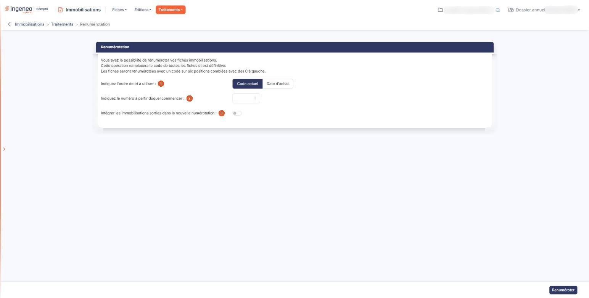

# Renumérotation


**Où le trouver :** Menu **Traitements › Renumérotation**



**En bref** — Cet écran renumérote, de façon définitive, le code de toutes les fiches immobilisations du dossier annuel, sur six positions, selon le code actuel ou la date d'achat.

* Pour renuméroter : choisissez l'ordre de tri, le numéro de départ et le sort des immobilisations sorties, puis bouton \[Renuméroter].
* Relire vos trois choix avant de cliquer : le bouton \[Renuméroter] agit sans confirmation, et l'opération est définitive.


Cette option permet de renuméroter les fiches immobilisations de votre dossier annuel, par exemple pour remettre de l'ordre dans une numérotation devenue disparate au fil des reprises et des imports.

<figure><figcaption>
Écran « Renumérotation » de la nouvelle interface
</figcaption></figure>

L'écran affiche en tête, et c'est la seule mise en garde qu'il porte, les trois choses que vous devez savoir avant de commencer :

* l'opération remplace le code de **toutes** les fiches : il n'y a pas de sélection possible, ni par famille, ni par localisation, ni ligne à ligne ;
* elle est **définitive** ;
* les fiches sont renumérotées avec un code sur **six positions comblées avec des zéros à gauche** : le numéro 1 donne le code 000001, le numéro 250 donne 000250.

L'ancien code n'est pas perdu pour autant : chaque fiche reçoit dans son historique une ligne d'événement « Fiche renumérotée le… par… Ancien code :… ». C'est par là que vous retrouverez la correspondance entre l'ancienne et la nouvelle numérotation, fiche par fiche.

## Rubrique « Renumérotation » — les trois choix

| Champ                                                                     | Ce qu'il faut savoir                                                                                                                                                                                                                                                                                                                                                                                                        |
| ------------------------------------------------------------------------- | --------------------------------------------------------------------------------------------------------------------------------------------------------------------------------------------------------------------------------------------------------------------------------------------------------------------------------------------------------------------------------------------------------------------------- |
| 1. **Indiquez l'ordre de tri à utiliser**                                 | Il détermine dans quel ordre les fiches vont recevoir les numéros. Avec « Code actuel », qui est le choix proposé par défaut, les fiches sont numérotées dans l'ordre de leur code d'aujourd'hui : la numérotation est simplement resserrée, sans changer l'ordre auquel vous êtes habitué. Avec « Date d'achat », elles sont numérotées de la plus ancienne acquisition à la plus récente : le code devient chronologique. |
| 2. **Indiquez le numéro à partir duquel commencer**                       | Le premier numéro à attribuer. Le logiciel propose 1. Le nombre est entier, sans décimale, et ne peut pas dépasser 999 999, ce qui est cohérent avec le code sur six positions. Choisissez un numéro de départ supérieur à 1 si vous voulez réserver les premiers codes, par exemple par tranches de familles d'immobilisations.                                                                                            |
| 3. **Intégrer les immobilisations sorties dans la nouvelle numérotation** | Cet interrupteur est positionné sur Non. Laissé sur Non, les fiches déjà sorties conservent leur code actuel et ne sont pas touchées ; le logiciel prend garde de ne pas réattribuer un code qu'elles utilisent déjà, en sautant le numéro concerné. Positionné sur Oui, les fiches sorties sont renumérotées comme les autres et prennent leur place dans la nouvelle suite.                                               |

## Bouton \[Renuméroter]

🛑 **Il lance immédiatement la renumérotation, sans vous demander confirmation.** C'est le seul bouton de l'écran : il n'y a ni annulation, ni retour, ni aperçu du résultat avant exécution. Relisez donc vos trois choix avant de cliquer.

Pendant le traitement, le logiciel affiche une fenêtre de progression qui fait défiler le code et le libellé de la fiche en cours, l'avancement en pourcentage et en nombre de fiches traitées sur le total, une barre de progression et une estimation du temps restant. Cette fenêtre ne peut pas être abandonnée : elle n'a pas de croix de fermeture, et son bouton de fermeture ne devient actif qu'à la fin. Laissez-la travailler jusqu'au bout.

À la fin, le logiciel vous annonce que la renumérotation est terminée et vous indique le **nombre d'immobilisations renumérotées**, ainsi que la durée de l'opération lorsqu'elle a atteint cinquante secondes.

## Ce que la renumérotation entraîne ailleurs

Si la numérotation automatique est activée dans le panneau « Paramètres », rubrique « Immobilisations », option « Configuration », le logiciel met à jour le **prochain numéro** à l'issue du traitement, pour qu'il se place à la suite de la nouvelle numérotation. Vous n'avez donc pas à le corriger à la main.

Le code d'une immobilisation est en revanche repris dans d'autres endroits du logiciel — la référence des écritures générées depuis l'option « Intégration des écritures » en est le cas le plus visible. Une renumérotation en cours d'exercice fait donc que les écritures déjà intégrées portent encore les anciens codes. C'est une raison de plus pour ne renuméroter qu'en connaissance de cause, de préférence en début d'exercice.
