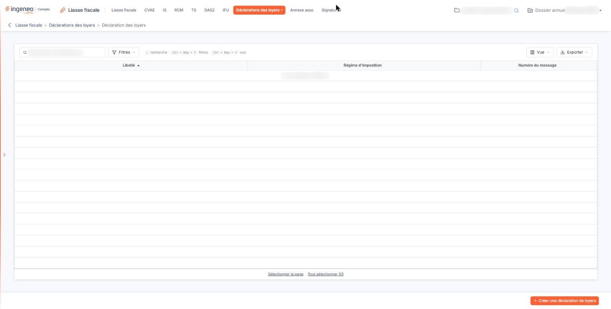
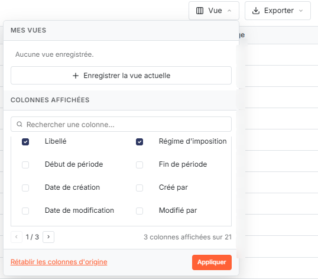
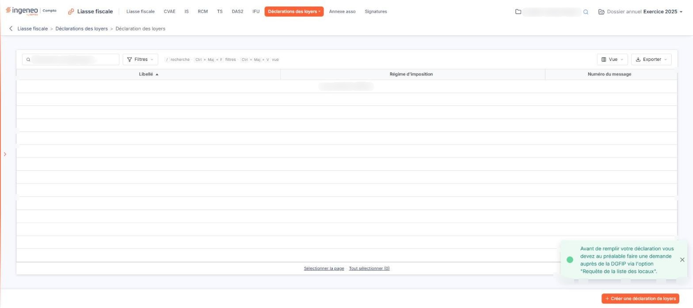

# Déclaration des loyers


**Où le trouver :** Menu **Déclarations des loyers › Déclaration des loyers**



**En bref** — Cet écran crée les déclarations des loyers à partir de la liste des locaux obtenue de l'administration fiscale, puis permet de les remplir, valider et télétransmettre comme une liasse fiscale.

* Pour créer une déclaration : bouton \[Créer une déclaration de loyers], puis bouton \[Enregistrer] ; une ligne est créée par local.
* Pour la compléter : ouvrez ses formulaires, saisissez le loyer de chaque local et, s'il y a lieu, la date de fin d'occupation, puis validez et télétransmettez.


Vous ne pouvez créer une déclaration des loyers que si vous avez préalablement effectué la requête de la liste des locaux et obtenu cette liste des services fiscaux. Le formulaire de la déclaration contiendra autant de lignes que de locaux présents dans la liste.

<figure><figcaption>
Écran « Déclaration des loyers » de la nouvelle interface
</figcaption></figure>

L'écran présente la liste des déclarations de loyers déjà créées pour le dossier annuel ; tant que vous n'en avez créé aucune, il affiche « Aucun élément à afficher. ».

Une fois créée, la déclaration des loyers fonctionne de la même manière que les liasses fiscales : vous la remplissez, la validez, puis la télétransmettez. Reportez-vous à l'aide du chapitre « Liasse fiscale » pour plus d'informations.

## Les colonnes affichées

<figure><figcaption>
Rubrique « Les colonnes affichées »
</figcaption></figure>

Trois colonnes sont affichées par défaut : **Libellé**, **Régime d'imposition** et **Numéro du message**, qui est la référence de la télétransmission. La liste est triée sur le libellé, par ordre croissant ; vous pouvez la trier sur chacune des trois colonnes en cliquant sur son titre.

Le bouton **\[Vue]**, au-dessus de la liste, ouvre un menu dont la rubrique « Colonnes affichées » liste les vingt et une colonnes disponibles, à cocher ou à décocher, avec un champ « Rechercher une colonne… » et trois pages que l'on parcourt avec les flèches « ‹ » et « › ». Le bouton **\[Appliquer]** valide vos choix et le bouton **\[Rétablir les colonnes d'origine]** remet la présentation d'origine.

Les autres colonnes disponibles y figurent dans cet ordre : Début de période, Fin de période, Date de création, Créé par, Date de modification, Modifié par, Date de validation, Validé par, Date de clôture, Clôturé par, Date de transmission, Transmis par, Partenaire, Déclaration de test, Campagne, Code de l'utilisateur de la transmission, Date du retour de la transmission et Statut du retour de la transmission.

Au-dessus de la liste, la barre « Rechercher une déclaration… » filtre sur le libellé, et le bouton **\[Filtres]** permet de poser des critères sur les colonnes. Le bouton **\[Exporter]** ouvre un menu qui donne accès à l'impression et aux exports de la liste affichée : « Aperçu édition HTML », « Imprimer », « Exporter en Excel », « Exporter en PDF » et « Envoyer la liste par e-mail ».

Il n'y a plus de case à cocher : un clic sur une ligne la sélectionne. Sous la liste, les liens « Sélectionner la page » et « Tout sélectionner » étendent la sélection à la page affichée ou à toutes les pages. La sélection sert à la suppression.

## Bouton \[Créer une déclaration de loyers]

<figure><figcaption>
Bouton [Créer une déclaration de loyers]
</figcaption></figure>

<figure><figcaption>
Bouton [Créer une déclaration de loyers]
</figcaption></figure>

Placé en bas à droite de l'écran, hors de la liste, il ouvre la fiche de création de la déclaration. Ce bouton n'apparaît que si vous avez le droit de créer une déclaration des loyers.

Si aucune requête de liste des locaux n'a été faite pour la société, la fiche ne s'ouvre pas : un message s'affiche dans un encadré, en bas à droite de l'écran, avec le texte suivant, et vous restez sur la liste.

« Avant de remplir votre déclaration vous devez au préalable faire une demande auprès de la DGFIP via l'option "Requête de la liste des locaux". »

Ce message disparaît de lui-même au bout de quelques secondes ; vous pouvez aussi le fermer par sa croix. Rejoignez ensuite l'option « Requête de la liste des locaux » du menu « Déclarations des loyers ».

Si une requête a bien été faite mais que l'administration fiscale n'a retourné aucun local, le logiciel affiche à la place un message rappelant le libellé de votre dernière demande et vous invitant à en suivre le retour depuis cette même option.

## La fiche de création et le formulaire de la déclaration

Lorsque la liste des locaux est disponible, le bouton **\[Créer une déclaration de loyers]** ouvre la fiche de création de la déclaration. Le bouton **\[Enregistrer]** la crée. Pour quitter la fiche sans rien enregistrer, cliquez sur la flèche « Revenir en arrière », à gauche du fil d'Ariane.

A l'enregistrement, le logiciel construit le formulaire de la déclaration à partir de la liste des locaux : il crée une ligne par local et y reporte ce que l'administration fiscale lui a communiqué — la référence du local, son numéro invariant, la précision sur son adresse et son propriétaire.

Il vous reste donc, pour chaque local, à saisir le **montant du loyer** et, s'il y a lieu, la **date de fin d'occupation**. Ces deux informations sont les seules que l'administration fiscale ne connaît pas.

## La suppression de plusieurs déclarations

Elle supprime en une seule fois les déclarations que vous avez sélectionnées dans la liste, à l'exception de celles qui ont été transmises sans être en test. Elle n'est proposée que si vous avez le droit de supprimer une déclaration des loyers.

## Les commandes de chaque ligne

Chaque déclaration de la liste propose des commandes, dans la dernière colonne et au survol de la souris :

* la modification : elle rouvre la fiche de la déclaration pour en corriger les informations ;
* l'accès aux formulaires : il ouvre les formulaires de la déclaration, où vous saisissez les loyers de chaque local, puis validez et télétransmettez ;
* la duplication : elle ouvre la fiche préremplie d'après celle-ci, la nouvelle déclaration n'étant créée qu'à l'enregistrement de cette fiche ;
* le suivi de la télédéclaration : il ouvre une fenêtre présentant l'historique des messages échangés avec votre partenaire de télétransmission au sujet de cette déclaration ; un bouton **\[Impression]** vous permet d'en obtenir la totalité du texte au format PDF ;
* l'envoi par mail : il ouvre la fenêtre d'envoi de la déclaration par courriel ;
* la suppression : elle supprime cette seule déclaration, à condition qu'elle n'ait pas été transmise ou qu'elle soit en test.

Trois de ces commandes dépendent de vos droits : l'accès aux formulaires du droit de consulter une déclaration, la suppression du droit de la supprimer, la modification du droit d'en créer.
