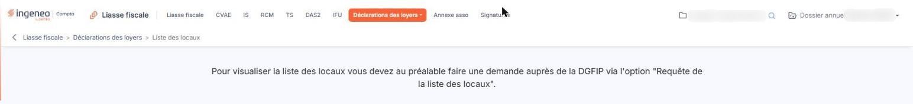

# Liste des locaux


**Où le trouver :** Menu **Déclarations des loyers › Liste des locaux**



**En bref** — Cet écran présente, en consultation seulement, les locaux retournés par l'administration fiscale en réponse à la dernière requête de la liste des locaux.

* Si l'écran n'affiche qu'une phrase : créez d'abord une demande dans l'option « Requête de la liste des locaux » du menu « Déclarations des loyers ».


La liste des locaux contient toutes les informations qui ont été retournées par l'administration fiscale suite à l'envoi de la requête de la liste des locaux. Elle est en consultation seulement : ces informations viennent de l'administration et ne sont pas modifiables.

<figure><figcaption>
Écran « Liste des locaux » de la nouvelle interface
</figcaption></figure>

Chaque nouvelle réponse de l'administration fiscale, avec une nouvelle liste, purge l'éventuelle liste précédente : l'écran présente toujours les locaux de la dernière demande.

## Tant qu'aucune demande n'a été faite

L'écran ne contient alors qu'une phrase, et aucun bouton :

« Pour visualiser la liste des locaux vous devez au préalable faire une demande auprès de la DGFIP via l'option "Requête de la liste des locaux". »

Cette phrase n'est pas un lien : rejoignez vous-même l'option « Requête de la liste des locaux » du menu « Déclarations des loyers » pour créer la demande.
