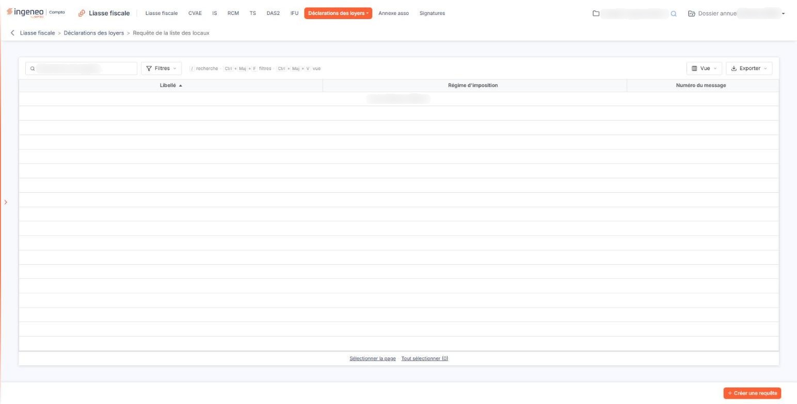
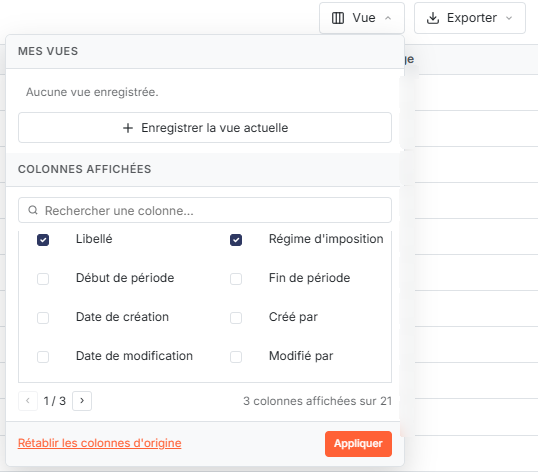
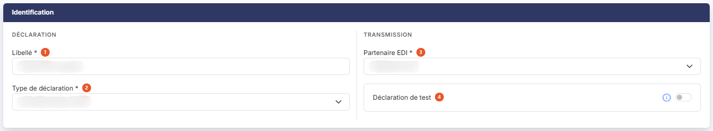

# Requête de la liste des locaux


**Où le trouver :** Menu **Déclarations des loyers › Requête de la liste des locaux**



**En bref** — Cet écran crée la requête qui demande à l'administration fiscale la liste des locaux associés au Siren de la société : c'est le point de départ obligatoire de toute déclaration de loyers.

* Pour créer une requête : bouton \[Créer une requête], nommez-la, choisissez le partenaire EDI, puis bouton \[Enregistrer].
* Pour l'envoyer : ouvrez ses formulaires, puis validez, clôturez et télétransmettez-la comme une liasse fiscale.
* Pour récupérer la réponse : ouvrez le suivi de la télédéclaration de la requête.


La requête de la liste des locaux permet d'identifier la société déclarante auprès de l'administration fiscale et de demander la liste des locaux associés au numéro de Siren présent dans la requête.

<figure><figcaption>
Écran « Requête de la liste des locaux » de la nouvelle interface
</figcaption></figure>

L'administration fiscale retourne un message EDI contenant la liste des locaux, et cette liste est intégrée dans l'option « Liste des locaux ». C'est donc par cet écran que commence toute déclaration de loyers.

L'écran présente la liste des requêtes déjà créées pour le dossier annuel. Tant que vous n'en avez créé aucune, il affiche « Aucun élément à afficher. ».

## Les colonnes affichées

<figure><figcaption>
Rubrique « Les colonnes affichées »
</figcaption></figure>

Trois colonnes sont affichées par défaut : **Libellé** (celui que vous avez donné à la requête), **Régime d'imposition** et **Numéro du message**, qui est la référence de la télétransmission. Vous pouvez trier la liste sur chacune d'elles en cliquant sur son titre.

Le bouton **\[Vue]**, au-dessus de la liste, ouvre un menu dont la rubrique « Colonnes affichées » liste les vingt et une colonnes disponibles, à cocher ou à décocher, avec un champ « Rechercher une colonne… » et trois pages que l'on parcourt avec les flèches « ‹ » et « › ». Le bouton **\[Appliquer]** valide vos choix et le bouton **\[Rétablir les colonnes d'origine]** remet la présentation d'origine.

Les autres colonnes disponibles y figurent dans cet ordre : Début de période, Fin de période, Date de création, Créé par, Date de modification, Modifié par, Date de validation, Validé par, Date de clôture, Clôturé par, Date de transmission, Transmis par, Partenaire, Déclaration de test, Campagne, Code de l'utilisateur de la transmission, Date du retour de la transmission et Statut du retour de la transmission.

Au-dessus de la liste, la barre « Rechercher une requête… » filtre sur le libellé, et le bouton **\[Filtres]** permet de poser des critères sur les colonnes. Le bouton **\[Exporter]** ouvre un menu qui donne accès à l'impression et aux exports de la liste affichée : « Aperçu édition HTML », « Imprimer », « Exporter en Excel », « Exporter en PDF » et « Envoyer la liste par e-mail ».

Il n'y a plus de case à cocher : un clic sur une ligne la sélectionne. Sous la liste, les liens « Sélectionner la page » et « Tout sélectionner » étendent la sélection à la page affichée ou à toutes les pages. La sélection sert à la suppression.

## Bouton \[Créer une requête]

<figure><figcaption>
Bouton [Créer une requête]
</figcaption></figure>

Placé en bas à droite de l'écran, hors de la liste, il ouvre la fiche de création d'une requête, décrite ci-dessous. Ce bouton n'apparaît que si vous avez le droit de créer une requête.

## La suppression de plusieurs requêtes

Elle supprime en une seule fois les requêtes que vous avez sélectionnées dans la liste, à l'exception de celles qui ont été transmises sans être en test. Elle n'est proposée que si vous avez le droit de supprimer une requête.

## La fiche de création — rubrique « Identification »

<figure><figcaption>
Rubrique « La fiche de création »
</figcaption></figure>

La fiche ne comporte qu'une rubrique, « Identification », partagée en deux blocs : « Déclaration », qui porte le libellé et le type de déclaration, et « Transmission », qui porte le partenaire EDI et la déclaration de test. Trois de ses quatre champs sont obligatoires.

| Champ                      | Ce qu'il faut savoir                                                                                                                                                                                                                                                                                                                                                                |
| -------------------------- | ----------------------------------------------------------------------------------------------------------------------------------------------------------------------------------------------------------------------------------------------------------------------------------------------------------------------------------------------------------------------------------- |
| 1. **Libellé**             | Nommez la requête, en cent caractères au maximum. C'est ce libellé qui vous permettra de la reconnaître dans la liste et de suivre son retour ; la saisie commence dans ce champ.                                                                                                                                                                                                   |
| 2. **Type de déclaration** | La seule valeur proposée est « Liste des locaux (LOC) », et elle est déjà sélectionnée.                                                                                                                                                                                                                                                                                             |
| 3. **Partenaire EDI**      | Choisissez le partenaire qui transmettra la requête à l'administration fiscale, parmi « Jedeclare.com », « ASP ONE », « NET DECLARATION » et « TDNIM ». « Jedeclare.com » est proposé par défaut.                                                                                                                                                                                   |
| 4. **Déclaration de test** | Ce champ n'est pas obligatoire et vaut « Non » par défaut. Comme l'indique son pictogramme d'information : « Une déclaration de test sera transmise à votre partenaire EDI mais ne sera pas prise en compte par l'Administration fiscale. Vous pouvez utiliser une déclaration de test pour, par exemple, vous assurer que la transmission des déclarations se fait correctement. » |

Le bouton **\[Enregistrer]** crée la requête et vous ramène à la liste ; il n'apparaît que si vous avez le droit d'enregistrer une requête. Pour quitter la fiche sans rien enregistrer, cliquez sur la flèche « Revenir en arrière », placée à gauche du fil d'Ariane, en haut de l'écran : elle vous ramène à la liste.

## Les commandes de chaque ligne

Une fois la requête créée, sa ligne porte, dans sa dernière colonne et au survol de la souris, des commandes dont l'affichage dépend de vos droits :

* la modification : elle rouvre la fiche de la requête pour en corriger les informations ;
* l'accès aux formulaires : il ouvre les formulaires de la requête, où vous complétez l'identification de la société déclarante, puis vous validez, clôturez et télétransmettez la requête, exactement comme une liasse fiscale ;
* le suivi de la télédéclaration : il ouvre une fenêtre présentant l'historique des messages échangés avec votre partenaire de télétransmission au sujet de cette requête, et un bouton **\[Impression]** vous permet d'en obtenir la totalité du texte au format PDF. C'est aussi ce suivi qui rapatrie la réponse : lorsque l'administration fiscale a répondu, le suivi récupère la liste des locaux et l'intègre dans l'option « Liste des locaux ». Le fichier de suivi d'une requête de liste des locaux contient un bloc supplémentaire, par rapport à toute autre télédéclaration, intitulé « Avis de récupération des locaux » ;
* la suppression : elle supprime cette seule requête, à condition qu'elle n'ait pas été transmise ou qu'elle soit en test.

Si la réponse de l'administration fiscale comporte une anomalie, les locaux ne sont pas intégrés.

Trois de ces commandes dépendent de vos droits : l'accès aux formulaires du droit de consulter une requête, la suppression du droit de la supprimer, la modification du droit d'en créer.
