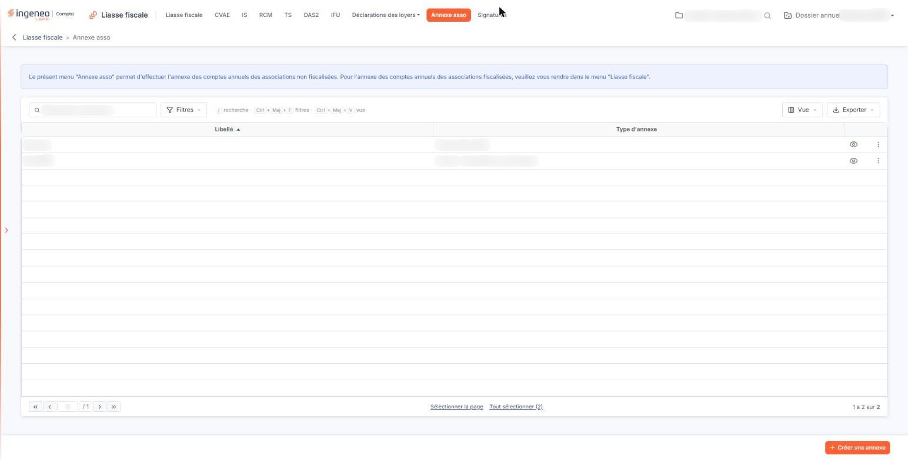
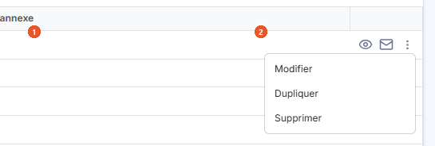
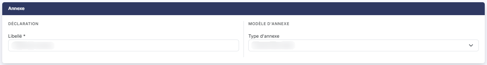

# Annexe asso


**Où le trouver :** Menu **Annexe asso**



**En bref** — Cet écran établit l'annexe des comptes annuels des associations non fiscalisées. Pour une association fiscalisée, l'annexe se prépare dans le menu « Liasse fiscale ».

* Pour créer une annexe : bouton \[Créer une annexe], renseignez le libellé et le type d'annexe, puis bouton \[Enregistrer].
* Pour la remplir : pictogramme « Accès aux formulaires » de la ligne.
* Pour supprimer des annexes : sélectionnez les lignes, puis bouton \[Supprimer] du bandeau.


Cette option permet d'établir l'annexe des comptes annuels des associations. L'écran l'annonce lui-même par une phrase affichée au-dessus de la liste : « Le présent menu "Annexe asso" permet d'effectuer l'annexe des comptes annuels des associations non fiscalisées. Pour l'annexe des comptes annuels des associations fiscalisées, veuillez vous rendre dans le menu "Liasse fiscale". »

<figure><figcaption>
Écran « Annexe asso » de la nouvelle interface
</figcaption></figure>

C'est la première distinction à faire, et elle commande le choix de l'option : vous venez ici pour une association **non fiscalisée**. Si l'association que vous gérez est **fiscalisée**, son annexe se prépare avec sa liasse, dans le menu « Liasse fiscale », et non ici.

L'écran présente la liste des annexes du dossier annuel. Vous y créez une annexe, vous l'ouvrez pour la remplir, vous la dupliquez ou vous la supprimez.

## La liste des annexes

<figure><figcaption>
Rubrique « La liste des annexes »
</figcaption></figure>

<figure><figcaption>
Bouton [Créer une annexe]
</figcaption></figure>

<figure><figcaption>
Bouton [Créer une annexe]
</figcaption></figure>

<figure><figcaption>
Bouton [Supprimer]
</figcaption></figure>

La liste présente deux colonnes, toutes deux triables : cliquez sur le titre de l'une d'elles pour trier la liste.

| Champ                | Ce qu'il faut savoir                                                                                                                                                                                                                                                                                                                                                                                                                                                                                                                                                                                                                                                                                                                                                                                                                                                                                                                                                                                                                                                                                                                                                                                                                                                                                                                                                                                                                                                                                                                                                                                                                                                                                                                                                                                                                                                                                                                                                                                                                                                                                                                                                                                                                  |
| -------------------- | ------------------------------------------------------------------------------------------------------------------------------------------------------------------------------------------------------------------------------------------------------------------------------------------------------------------------------------------------------------------------------------------------------------------------------------------------------------------------------------------------------------------------------------------------------------------------------------------------------------------------------------------------------------------------------------------------------------------------------------------------------------------------------------------------------------------------------------------------------------------------------------------------------------------------------------------------------------------------------------------------------------------------------------------------------------------------------------------------------------------------------------------------------------------------------------------------------------------------------------------------------------------------------------------------------------------------------------------------------------------------------------------------------------------------------------------------------------------------------------------------------------------------------------------------------------------------------------------------------------------------------------------------------------------------------------------------------------------------------------------------------------------------------------------------------------------------------------------------------------------------------------------------------------------------------------------------------------------------------------------------------------------------------------------------------------------------------------------------------------------------------------------------------------------------------------------------------------------------------------- |
| 1. **Libellé**       | Le nom que vous avez donné à l'annexe au moment de la créer ; c'est sous ce nom que vous la retrouverez.                                                                                                                                                                                                                                                                                                                                                                                                                                                                                                                                                                                                                                                                                                                                                                                                                                                                                                                                                                                                                                                                                                                                                                                                                                                                                                                                                                                                                                                                                                                                                                                                                                                                                                                                                                                                                                                                                                                                                                                                                                                                                                                              |
| 1. **Libellé**       | Donnez à l'annexe un nom qui vous permette de la reconnaître dans la liste.                                                                                                                                                                                                                                                                                                                                                                                                                                                                                                                                                                                                                                                                                                                                                                                                                                                                                                                                                                                                                                                                                                                                                                                                                                                                                                                                                                                                                                                                                                                                                                                                                                                                                                                                                                                                                                                                                                                                                                                                                                                                                                                                                           |
| 2. **Type d'annexe** | 
Le type d'annexe retenu, c'est-à-dire le modèle de formulaires sur lequel l'annexe est bâtie. À l'ouverture, la liste est triée par libellé croissant. Le nombre d'annexes présentes et la page affichée sont rappelés sous la liste. Les commandes de chaque ligne sont regroupées en fin de ligne, à droite ; elles apparaissent au survol de la ligne. Deux pictogrammes sont proposés directement, et leur infobulle en donne le nom : - pictogramme « Œil », infobulle Accès aux formulaires : ouvre l'annexe elle-même, c'est-à-dire l'écran de saisie de ses formulaires ; - pictogramme « Enveloppe », infobulle Envoyer par mail : ouvre la fenêtre d'envoi de l'annexe par courriel. Les trois autres commandes sont réunies sous le pictogramme « Autres actions » (trois points verticaux), qui ouvre un petit menu : - « Modifier » : ouvre la fiche d'identification de l'annexe, celle où figurent son libellé et son type ; - « Dupliquer » : crée une nouvelle annexe à l'identique de celle-ci ; - « Supprimer » : supprime l'annexe. Retenez que « Modifier » n'ouvre pas les formulaires : c'est « Accès aux formulaires » qui donne accès au contenu de l'annexe. Selon les droits qui vous sont accordés, certaines de ces commandes peuvent ne pas vous être proposées. Au-dessus de la liste, l'écran propose une zone de recherche « Rechercher une annexe… » et les boutons [Filtres], [Vue] et [Exporter]. Le bouton [Exporter] ouvre un menu qui donne accès à l'impression et aux exports de la liste : « Aperçu édition HTML », « Imprimer », « Exporter en Excel », « Exporter en PDF » et « Envoyer la liste par e-mail ». Sous la liste, les liens « Sélectionner la page » et « Tout sélectionner » permettent de sélectionner les lignes de la page ou toutes les lignes. bouton <strong>[Créer une annexe]</strong> Placé en bas à droite de l'écran, il disparaît tant qu'une ligne de la liste est sélectionnée. Il ouvre une fiche vierge pour créer une annexe. Cette fiche ne comporte qu'une rubrique, « Annexe », partagée en deux blocs côte à côte qui portent chacun un champ : « Déclaration » pour le libellé, « Modèle d'annexe » pour le type.
 |
| 2. **Type d'annexe** | Choisissez le type d'annexe à établir. La liste ne propose que les types disponibles pour le dossier annuel sur lequel vous êtes positionné ; il peut donc n'y en avoir qu'un seul.                                                                                                                                                                                                                                                                                                                                                                                                                                                                                                                                                                                                                                                                                                                                                                                                                                                                                                                                                                                                                                                                                                                                                                                                                                                                                                                                                                                                                                                                                                                                                                                                                                                                                                                                                                                                                                                                                                                                                                                                                                                   |

bouton **\[Enregistrer]** : il crée l'annexe et vous ramène à la liste.

Pour revenir à la liste sans rien créer, cliquez sur la flèche « Revenir en arrière », à gauche du fil d'Ariane en haut de l'écran.

bouton **\[Supprimer]**

Cliquez sur une ligne de la liste pour la sélectionner : un bandeau indique alors « 1 annexe sélectionnée – toutes les pages » et propose ce bouton, que vous utilisez pour supprimer la sélection. La commande « Supprimer » du menu « Autres actions » de la ligne rend le même service pour une seule annexe.
