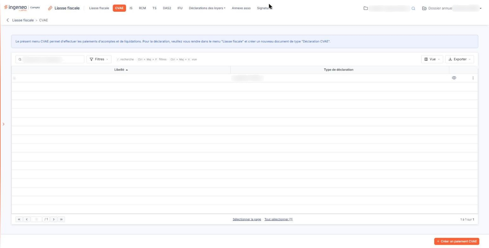
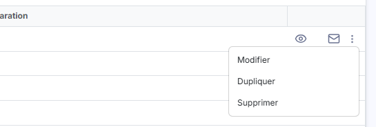
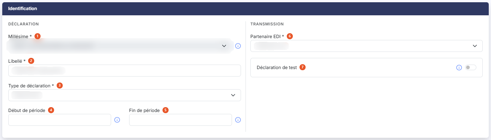
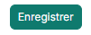
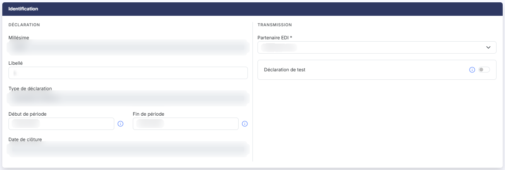

# CVAE


**Où le trouver :** Menu **CVAE**



**En bref** — Cet écran gère les paiements de CVAE, acomptes et liquidation, et leur télétransmission. La déclaration de CVAE, elle, se crée dans le menu "Liasse fiscale".

* Pour créer un paiement : bouton \[Créer un paiement CVAE], complétez la fiche d'identification, puis bouton \[Enregistrer].
* Pour créer l'acompte suivant : menu « Autres actions » de la ligne, « Dupliquer », puis reprenez le libellé et les périodes.
* Pour compléter les imprimés et demander la télétransmission : pictogramme « Accès aux formulaires » de la ligne.


Le menu "CVAE" permet d'établir les **paiements** de la cotisation sur la valeur ajoutée des entreprises — acomptes et liquidation — et de les télétransmettre à votre partenaire EDI.

<figure><figcaption>
Écran « CVAE » de la nouvelle interface
</figcaption></figure>

Le logiciel rappelle ce périmètre par une phrase affichée au-dessus de la liste : "Le présent menu CVAE permet d'effectuer les paiements d'acomptes et de liquidations. Pour la déclaration, veuillez vous rendre dans le menu "Liasse fiscale" et créer un nouveau document de type "Déclaration CVAE"."

Retenez donc cette distinction, qui est la première source de confusion sur cet écran : la **déclaration** de CVAE ne se saisit pas ici, mais dans le menu "Liasse fiscale", sous la forme d'un document dont le type est une déclaration de CVAE. Le présent menu ne porte que les paiements.

## La liste des paiements du dossier annuel

<figure><figcaption>
Bouton [Supprimer]
</figcaption></figure>

L'écran se compose de la phrase de renvoi ci-dessus, d'une barre d'outils, d'une liste et, en bas à droite de l'écran, d'un bouton de création. Il n'y a pas d'onglet. La barre d'outils comprend, de gauche à droite, une zone « Rechercher un paiement… », le bouton **\[Filtres]** (il permet d'ajouter un critère sur une colonne ; un lien « Vider les filtres » les efface), le bouton **\[Vue]** et le bouton **\[Exporter]**.

La liste comporte deux colonnes, toutes deux triables :

| Champ                   | Ce qu'il faut savoir                                                                                                             |
| ----------------------- | -------------------------------------------------------------------------------------------------------------------------------- |
| **Libellé**             | Le libellé que vous avez donné au paiement lors de sa création. C'est le tri proposé par défaut.                                 |
| **Type de déclaration** | L'un des deux types de paiement possibles, suivi de son code entre parenthèses — "Acompte (CVAE\_A)" ou "Liquidation (CVAE\_L)". |

La liste ne comporte aucune colonne d'état d'avancement et aucun total. Elle n'a plus de case à cocher : un clic sur une ligne la sélectionne. Sous la liste, les liens « Sélectionner la page » et « Tout sélectionner (n) » sélectionnent les lignes de la page affichée ou celles de toutes les pages. Dès qu'une ligne est sélectionnée, un bandeau bleu marine apparaît en bas de l'écran, avec le nombre de paiements sélectionnés et le bouton **\[Supprimer]** (voir le paragraphe c).

Le bouton **\[Vue]** ouvre un menu qui permet d'enregistrer la vue actuelle (« Mes vues ») et de choisir les colonnes affichées : outre « Libellé » et « Type de déclaration », affichées par défaut, une vingtaine de colonnes sont proposées (début et fin de période, date de création, créé par, date de modification, modifié par…), avec un lien « Rétablir les colonnes d'origine ». Le bouton **\[Exporter]** ouvre un menu : « Aperçu » (édition HTML), « Imprimer » (Ctrl+P), « Exporter en Excel », « Exporter en PDF » et « Envoyer la liste par e-mail ».

## Les commandes de chaque ligne

<figure><figcaption>
Rubrique « Les commandes de chaque ligne »
</figcaption></figure>

Les commandes d'une ligne apparaissent au survol de la ligne, à son extrémité droite. Sont proposés en direct « Accès aux formulaires » (pictogramme en forme d'œil), l'emplacement du suivi de la télédéclaration, puis « Envoyer par mail » (enveloppe) ; vient ensuite « Autres actions » (trois points), qui ouvre un menu de trois entrées : « Modifier », « Dupliquer » et « Supprimer ». Certains n'apparaissent que si vous disposez du droit correspondant sur la fonction "Paiement CVAE".

**Pictogramme « Œil » — Accès aux formulaires**

Il ouvre l'écran de saisie des formulaires du paiement, celui dans lequel vous complétez les imprimés et depuis lequel vous demandez la télétransmission. Cet écran fonctionne de la même manière que pour une liasse fiscale : reportez-vous à l'option "Liasse fiscale" de la présente aide pour son détail.

**Pictogramme « Suivi de la télédéclaration »**

Il ouvre une fenêtre présentant l'historique des messages échangés avec votre partenaire de télétransmission au sujet de ce paiement. Un bouton **\[Impression]** vous permet d'en obtenir la totalité du texte au format PDF ; le fichier produit reprend la nature du flux, le code de la société gérée et le libellé de la télédéclaration.

Ce pictogramme prend place entre « Accès aux formulaires » et « Envoyer par mail ». Son emplacement ne se remplit que si le partenaire EDI retenu est "Jedeclare.com".

**Pictogramme « Enveloppe » — Envoyer par mail**

Il ouvre la fenêtre d'envoi par courrier électronique du document.

**« Autres actions » — Modifier**

Il ouvre la fiche d'identification du paiement, décrite au paragraphe d) ci-dessous. Cette entrée est réservée aux utilisateurs autorisés à créer un paiement de CVAE.

**« Autres actions » — Dupliquer**

Il recopie le paiement sélectionné et ouvre aussitôt la fiche d'identification de la copie, afin que vous en repreniez le libellé et les périodes. C'est le moyen le plus rapide de créer l'acompte suivant à partir du précédent.

**« Autres actions » — Supprimer**

Il supprime le paiement de CVAE, après confirmation, à condition qu'il n'ait pas été transmis ou qu'il soit en test. Cette entrée, la dernière du menu, est réservée aux utilisateurs autorisés à supprimer un paiement de CVAE.

## Le bouton de création et le bandeau de sélection

bouton **\[Créer un paiement CVAE]**

Placé en bas à droite de l'écran, hors de la liste, il ouvre la fiche d'identification d'un nouveau paiement de CVAE, décrite ci-dessous. Il disparaît tant qu'une ligne est sélectionnée. Ce bouton est réservé aux utilisateurs autorisés à créer un paiement de CVAE.

bouton **\[Supprimer]**

Placé dans le bandeau de sélection, il supprime en une seule fois les paiements que vous avez sélectionnés dans la liste, à l'exception de ceux qui ont été transmis sans être en test. Ce bouton est réservé aux utilisateurs autorisés à supprimer un paiement de CVAE.

## La fiche d'identification, à la création

<figure><figcaption>
Rubrique « La fiche d'identification, à la création »
</figcaption></figure>

<figure><figcaption>
Bouton [Enregistrer]
</figcaption></figure>

La fiche ne comporte qu'une seule rubrique, "Identification", partagée en deux blocs : "Déclaration", qui regroupe le millésime, le libellé, le type de déclaration et les deux dates de période, et "Transmission", qui regroupe le partenaire EDI et la déclaration de test. Les champs suivis d'un astérisque sont obligatoires.

| Champ                                                                  | Ce qu'il faut savoir                                                                                                                                                                                                                                                                                                                                                                                                                                                                                                                                                                 |
| ---------------------------------------------------------------------- | ------------------------------------------------------------------------------------------------------------------------------------------------------------------------------------------------------------------------------------------------------------------------------------------------------------------------------------------------------------------------------------------------------------------------------------------------------------------------------------------------------------------------------------------------------------------------------------ |
| 
1. <strong>Millésime</strong> <em>Obligatoire</em>
           | La campagne déclarative à laquelle rattacher le paiement, présentée avec ses dates de début et de fin. Le logiciel ne propose que les millésimes ouverts : lorsqu'une seule campagne est ouverte, le sélecteur ne contient qu'un choix et il est grisé. Si deux choix vous sont proposés, le premier correspond à la campagne en cours, qui va bientôt se terminer, et le second à la campagne suivante, qui sera bientôt active : si vous ne pouvez pas transmettre avant la date de fin du premier choix, retenez le second pour saisir vos informations sur le nouveau millésime. |
| 
2. <strong>Libellé</strong> <em>Obligatoire</em>
             | Le nom sous lequel le paiement apparaîtra dans la liste. Choisissez-le suffisamment explicite pour distinguer les acomptes successifs de la liquidation.                                                                                                                                                                                                                                                                                                                                                                                                                             |
| 
3. <strong>Type de déclaration</strong> <em>Obligatoire</em>
 | "Acompte (CVAE\_A)" ou "Liquidation (CVAE\_L)". Dès que vous faites ce choix, le logiciel renseigne automatiquement le début et la fin de période avec les bornes de l'exercice en cours ; vous pouvez ensuite les modifier.                                                                                                                                                                                                                                                                                                                                                         |
| 4. **Début de période**                                                | Pour un acompte comme pour un solde, le début de la période est le début de l'exercice en cours.                                                                                                                                                                                                                                                                                                                                                                                                                                                                                     |
| 5. **Fin de période**                                                  | Pour un acompte comme pour un solde, la fin de la période est la fin de l'exercice en cours.                                                                                                                                                                                                                                                                                                                                                                                                                                                                                         |
| 
6. <strong>Partenaire EDI</strong> <em>Obligatoire</em>
      | Le partenaire qui assurera la transmission à l'administration fiscale. Quatre choix vous sont proposés : "Jedeclare.com", "ASP ONE", "NET DECLARATION" et "TDNIM".                                                                                                                                                                                                                                                                                                                                                                                                                   |
| 7. **Déclaration de test**                                             | Positionnez cet interrupteur sur "Oui" pour transmettre une déclaration de test. Elle sera bien transmise à votre partenaire EDI, mais ne sera pas prise en compte par l'administration fiscale : c'est le moyen de vous assurer, par exemple, que la transmission de vos déclarations fonctionne correctement. L'interrupteur est proposé sur "Non".                                                                                                                                                                                                                                |

Le bouton **\[Enregistrer]** se trouve en bas à droite de l'écran. Pour revenir à la liste sans enregistrer, utilisez la flèche « Revenir en arrière », à gauche du fil d'Ariane, en haut de l'écran.

## La même fiche, en modification

<figure><figcaption>
Rubrique « La même fiche, en modification »
</figcaption></figure>

Lorsque vous rouvrez un paiement déjà créé, la rubrique "Identification" ne se présente pas tout à fait de la même manière :

* le **Millésime** et le **Type de déclaration** ne sont plus modifiables : ils s'affichent en lecture seule. Pour changer l'un des deux, créez un nouveau paiement ;
* le **Libellé** n'est plus signalé comme obligatoire ;
* un champ **Date de clôture :** apparaît, non modifiable. Il n'existe pas à la création.

Les autres champs — début et fin de période, partenaire EDI, déclaration de test — restent modifiables.
