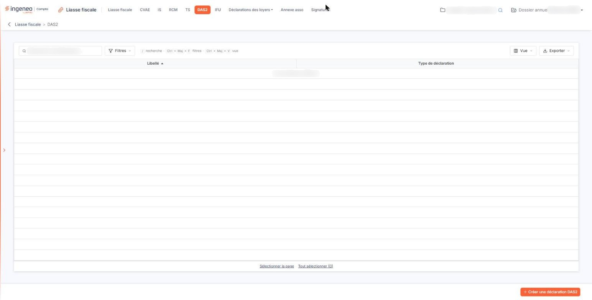
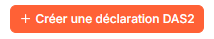
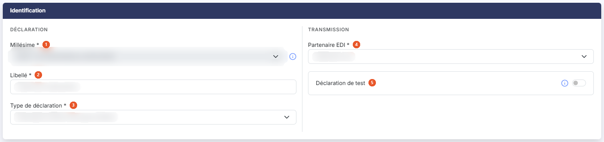

# DAS2


**Où le trouver :** Menu **DAS2**



**En bref** — Cet écran gère les déclarations d'honoraires DAS2 : création, modification, duplication, suppression et accès à la saisie de leurs formulaires.

* Pour créer une déclaration : bouton \[Créer une déclaration DAS2], renseignez le libellé et le partenaire EDI, puis bouton \[Enregistrer].
* Pour supprimer des déclarations : sélectionnez les lignes, puis bouton \[Supprimer] du bandeau de sélection.


## La liste des déclarations

<figure><figcaption>
Écran « DAS2 » de la nouvelle interface
</figcaption></figure>

Le logiciel affiche directement la liste des déclarations DAS2 déjà créées sur le dossier annuel en cours. La liste n'a pas d'onglet. Une barre d'outils placée au-dessus de la grille porte un champ « Rechercher une déclaration… », le bouton **\[Filtres]**, le bouton **\[Vue]** et le bouton **\[Exporter]** ; en l'absence de filtre, tout ce qui existe est présenté d'un seul tenant.

Deux colonnes sont affichées, l'une et l'autre triables en cliquant sur leur en-tête :

| Champ                   | Ce qu'il faut savoir                                                                                                                                   |
| ----------------------- | ------------------------------------------------------------------------------------------------------------------------------------------------------ |
| **Libellé**             | Le libellé que vous avez donné à la déclaration lors de sa création. C'est lui qui vous permet de la reconnaître : donnez-lui donc un libellé parlant. |
| **Type de déclaration** | La nature de la déclaration. La fiche d'identification, elle, l'affiche suivie de son code, « Déclarations DAS2 Honoraires (DAS2) ».                   |

Sous la grille, les liens « Sélectionner la page » et « Tout sélectionner (n) » sélectionnent les déclarations de la page affichée ou de toutes les pages. Le bouton **\[Vue]** ouvre un menu « Colonnes affichées » qui permet de choisir les colonnes, avec un lien « Rétablir les colonnes d'origine », et le bouton **\[Exporter]** ouvre un menu de cinq entrées : « Aperçu édition HTML », « Imprimer », « Exporter en Excel », « Exporter en PDF » et « Envoyer la liste par e-mail ».

Tant qu'aucune déclaration n'a été créée, la liste affiche la seule mention « Aucun élément à afficher. » ; la barre d'outils, les flèches de tri et les liens « Sélectionner la page » et « Tout sélectionner (0) » restent néanmoins affichés.

## Les boutons de la liste

<figure><figcaption>
Bouton [Créer une déclaration DAS2]
</figcaption></figure>

bouton **\[Créer une déclaration DAS2]**

Placé en bas à droite de l'écran, hors de la grille, il ouvre une fiche d'identification vide, pour créer une déclaration. Voir le paragraphe d).

## La fiche d'identification, à la création

<figure><figcaption>
Rubrique « La fiche d'identification, à la création »
</figcaption></figure>

La fiche ne comporte qu'une rubrique, **Identification**, présentée en deux colonnes : à gauche le bloc « Déclaration » (**Millésime**, **Libellé**, **Type de déclaration**), à droite le bloc « Transmission » (**Partenaire EDI**, **Déclaration de test**). Les champs suivis d'un astérisque sont obligatoires.

| Champ                                                                  | Ce qu'il faut savoir                                                                                                                                                                                                                                                                                                                                                                                                                                                                                                                       |
| ---------------------------------------------------------------------- | ------------------------------------------------------------------------------------------------------------------------------------------------------------------------------------------------------------------------------------------------------------------------------------------------------------------------------------------------------------------------------------------------------------------------------------------------------------------------------------------------------------------------------------------ |
| 
1. <strong>Millésime</strong> <em>Obligatoire</em>
           | La campagne déclarative à laquelle rattacher la déclaration, présentée avec ses dates d'ouverture et de fermeture. Lorsqu'une seule campagne est disponible, la liste n'offre que cette valeur et n'est pas modifiable. Un pictogramme d'information rappelle à côté du champ que, si deux choix vous sont proposés, le premier correspond à la campagne en cours qui va bientôt se terminer et le second à la prochaine campagne : si vous ne pouvez pas transmettre la liasse avant la date de fin du premier choix, utilisez le second. |
| 
2. <strong>Libellé</strong> <em>Obligatoire</em>
             | Le nom que vous donnez à la déclaration. C'est ce libellé qui apparaît dans la liste.                                                                                                                                                                                                                                                                                                                                                                                                                                                      |
| 
3. <strong>Type de déclaration</strong> <em>Obligatoire</em>
 | La nature de la déclaration à établir. Une seule valeur vous est proposée, « Déclarations DAS2 Honoraires (DAS2) ».                                                                                                                                                                                                                                                                                                                                                                                                                        |
| 
4. <strong>Partenaire EDI</strong> <em>Obligatoire</em>
      | Le partenaire par lequel la déclaration sera transmise. Quatre valeurs vous sont proposées — « Jedeclare.com », proposé par défaut, « ASP ONE », « NET DECLARATION » et « TDNIM ».                                                                                                                                                                                                                                                                                                                                                         |
| 5. **Déclaration de test**                                             | Répondez Oui pour transmettre une déclaration de test. Une déclaration de test sera transmise à votre partenaire EDI mais ne sera pas prise en compte par l'Administration fiscale. Vous pouvez utiliser une déclaration de test pour, par exemple, vous assurer que la transmission des déclarations se fait correctement. La réponse Non est proposée par défaut.                                                                                                                                                                        |

La fiche ne comporte donc que cinq champs : à la différence des options « IS », « RCM » et « TS », elle ne vous demande ni **Début de période :** ni **Fin de période :**. Le logiciel reprend lui-même, comme période déclarée, les dates du dossier annuel en cours. Cette fiche est en tout point identique à celle de l'option « IFU », au type de déclaration près.

Pour fermer la fiche :

bouton **\[Enregistrer]**

Enregistre la déclaration et vous ramène à la liste.

**Revenir à la liste**

La fiche ne porte plus de bouton de retour : cliquez sur la flèche « Revenir en arrière », à gauche du fil d'Ariane, pour revenir à la liste sans rien enregistrer.
