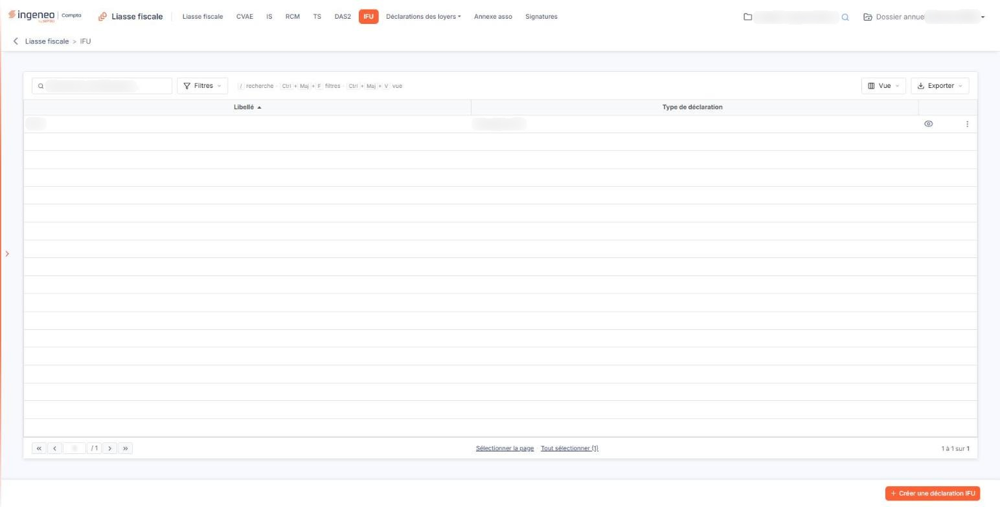
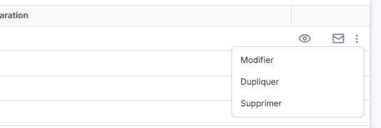
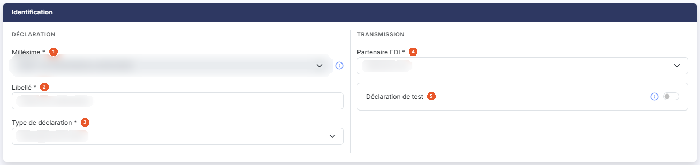
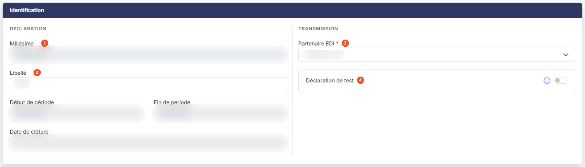

# IFU


**Où le trouver :** Menu **IFU**



**En bref** — Cet écran gère les imprimés fiscaux uniques (IFU) : création, modification, duplication, suppression et accès à la saisie de leurs formulaires.

* Pour créer une déclaration : bouton \[Créer une déclaration IFU], renseignez le libellé et le partenaire EDI, puis bouton \[Enregistrer].
* Pour saisir les formulaires : pictogramme « Accès aux formulaires » de la ligne.
* Pour en créer une à partir d'une autre : menu « Autres actions », « Dupliquer », complétez la fiche, puis bouton \[Enregistrer].


## La liste des déclarations

<figure><figcaption>
Écran « IFU » de la nouvelle interface
</figcaption></figure>

Le logiciel affiche directement la liste des déclarations IFU déjà créées sur le dossier annuel en cours. La liste n'a pas d'onglet. Une barre d'outils placée au-dessus de la grille porte un champ « Rechercher une déclaration… », le bouton **\[Filtres]**, le bouton **\[Vue]** et le bouton **\[Exporter]** ; en l'absence de filtre, tout ce qui existe est présenté d'un seul tenant.

Deux colonnes sont affichées, l'une et l'autre triables en cliquant sur leur en-tête :

| Champ                   | Ce qu'il faut savoir                                                                                                                                                                                                                             |
| ----------------------- | ------------------------------------------------------------------------------------------------------------------------------------------------------------------------------------------------------------------------------------------------ |
| **Libellé**             | Le libellé que vous avez donné à la déclaration lors de sa création. C'est lui qui vous permet de la reconnaître : donnez-lui donc un libellé parlant.                                                                                           |
| **Type de déclaration** | La nature de la déclaration. Cette option ne couvre qu'une nature : la colonne porte donc la même valeur sur toutes les lignes, « Déclarations IFU ». La fiche d'identification, elle, l'affiche suivie de son code, « Déclarations IFU (IFU) ». |

Sous la grille, les liens « Sélectionner la page » et « Tout sélectionner (n) » sélectionnent les déclarations de la page affichée ou de toutes les pages ; un clic sur une ligne la sélectionne aussi. Le bouton **\[Vue]** ouvre un menu « Colonnes affichées » qui permet de choisir les colonnes, avec un lien « Rétablir les colonnes d'origine », et le bouton **\[Exporter]** ouvre un menu de cinq entrées : « Aperçu édition HTML », « Imprimer », « Exporter en Excel », « Exporter en PDF » et « Envoyer la liste par e-mail ».

## Les commandes de chaque ligne

<figure><figcaption>
Rubrique « Les commandes de chaque ligne »
</figcaption></figure>

Les commandes d'une ligne apparaissent à son extrémité droite, au survol ou quand la ligne est sélectionnée. Deux sont directes, « Accès aux formulaires » et « Envoyer par mail » ; les autres sont réunies sous « Autres actions » (trois points), qui ouvre un menu de trois entrées. Elles n'apparaissent que si vos droits sur l'option le permettent.

Pictogramme « Œil », infobulle « Accès aux formulaires » : ouvre la saisie des formulaires de la déclaration. Cet écran est décrit dans l'option « Liasse fiscale » du module.

Pictogramme « Enveloppe », infobulle « Envoyer par mail » : ouvre la fenêtre d'envoi de la déclaration par courriel.

Infobulle « Autres actions » : ouvre un menu de trois entrées. « Modifier » ouvre la fiche d'identification de la déclaration, décrite au paragraphe d) ci-dessous. « Dupliquer » recopie la déclaration dans une nouvelle fiche d'identification, que vous complétez avant de l'enregistrer. « Supprimer » supprime la déclaration.

## Les boutons de la liste

<figure><figcaption>
Bouton [Créer une déclaration IFU]
</figcaption></figure>

<figure><figcaption>
Bouton [Supprimer] du bandeau de sélection
</figcaption></figure>

bouton **\[Créer une déclaration IFU]**

Placé en bas à droite de l'écran, hors de la grille, et masqué tant qu'une ligne est sélectionnée, il ouvre une fiche d'identification vide, pour créer une déclaration. Voir le paragraphe d).

**Bouton \[Supprimer] du bandeau de sélection**

Il apparaît en bas de l'écran, dans un bandeau qui annonce le nombre de déclarations sélectionnées (« 1 déclaration IFU sélectionnée »), dès qu'au moins une ligne est sélectionnée, et supprime les déclarations sélectionnées.

## La fiche d'identification, à la création

<figure><figcaption>
Rubrique « La fiche d'identification, à la création »
</figcaption></figure>

La fiche ne comporte qu'une rubrique, **Identification**, présentée en deux colonnes : à gauche le bloc « Déclaration » (**Millésime**, **Libellé**, **Type de déclaration**), à droite le bloc « Transmission » (**Partenaire EDI**, **Déclaration de test**). Les champs suivis d'un astérisque sont obligatoires.

| Champ                                                                  | Ce qu'il faut savoir                                                                                                                                                                                                                                                                                                                                                                                                                                                                                                                       |
| ---------------------------------------------------------------------- | ------------------------------------------------------------------------------------------------------------------------------------------------------------------------------------------------------------------------------------------------------------------------------------------------------------------------------------------------------------------------------------------------------------------------------------------------------------------------------------------------------------------------------------------ |
| 
1. <strong>Millésime</strong> <em>Obligatoire</em>
           | La campagne déclarative à laquelle rattacher la déclaration, présentée avec ses dates d'ouverture et de fermeture. Lorsqu'une seule campagne est disponible, la liste n'offre que cette valeur et n'est pas modifiable. Un pictogramme d'information rappelle à côté du champ que, si deux choix vous sont proposés, le premier correspond à la campagne en cours qui va bientôt se terminer et le second à la prochaine campagne : si vous ne pouvez pas transmettre la liasse avant la date de fin du premier choix, utilisez le second. |
| 
2. <strong>Libellé</strong> <em>Obligatoire</em>
             | Le nom que vous donnez à la déclaration. C'est ce libellé qui apparaît dans la liste.                                                                                                                                                                                                                                                                                                                                                                                                                                                      |
| 
3. <strong>Type de déclaration</strong> <em>Obligatoire</em>
 | La nature de la déclaration à établir. Une seule valeur vous est proposée, « Déclarations IFU (IFU) ».                                                                                                                                                                                                                                                                                                                                                                                                                                     |
| 
4. <strong>Partenaire EDI</strong> <em>Obligatoire</em>
      | Le partenaire par lequel la déclaration sera transmise. Quatre valeurs vous sont proposées — « Jedeclare.com », proposé par défaut, « ASP ONE », « NET DECLARATION » et « TDNIM ».                                                                                                                                                                                                                                                                                                                                                         |
| 5. **Déclaration de test**                                             | Répondez Oui pour transmettre une déclaration de test. Une déclaration de test sera transmise à votre partenaire EDI mais ne sera pas prise en compte par l'Administration fiscale. Vous pouvez utiliser une déclaration de test pour, par exemple, vous assurer que la transmission des déclarations se fait correctement. La réponse Non est proposée par défaut.                                                                                                                                                                        |

La fiche ne comporte que cinq champs : elle ne vous demande ni **Début de période :** ni **Fin de période :**. Le logiciel reprend lui-même, comme période déclarée, les dates du dossier annuel en cours ; vous les retrouvez, en lecture seule, lorsque vous rouvrez la déclaration.

Pour fermer la fiche :

bouton **\[Enregistrer]**

Enregistre la déclaration et vous ramène à la liste.

**Revenir à la liste**

La fiche ne porte plus de bouton de retour : cliquez sur la flèche « Revenir en arrière », à gauche du fil d'Ariane, pour revenir à la liste sans rien enregistrer.

## La fiche d'identification, à la modification

<figure><figcaption>
Rubrique « La fiche d'identification, à la modification »
</figcaption></figure>

Lorsque vous rouvrez une déclaration par l'entrée « Modifier » du menu « Autres actions », le logiciel ne vous présente plus la même fiche : la rubrique garde son titre, **Identification**, mais elle compte sept champs. Elle reste présentée en deux colonnes : le bloc « Déclaration » (**Millésime**, **Libellé**, **Début de période**, **Fin de période**, **Date de clôture**) et le bloc « Transmission » (**Partenaire EDI**, **Déclaration de test**).

| Champ                                                             | Ce qu'il faut savoir                                                                                                                                                                                                                                                           |
| ----------------------------------------------------------------- | ------------------------------------------------------------------------------------------------------------------------------------------------------------------------------------------------------------------------------------------------------------------------------ |
| 1. **Millésime**                                                  | Devient une zone grisée non modifiable, qui affiche la date de début de la campagne — et non plus le millésime suivi de ses deux dates. L'astérisque d'obligation disparaît.                                                                                                   |
| 2. **Libellé**                                                    | Reste modifiable. L'astérisque d'obligation disparaît.                                                                                                                                                                                                                         |
| 
3. <strong>Partenaire EDI</strong> <em>Obligatoire</em>
 | Reste modifiable, avec les mêmes quatre valeurs. C'est le seul champ de la fiche qui conserve son astérisque d'obligation.                                                                                                                                                     |
| 4. **Déclaration de test**                                        | Reste modifiable comme à la création.                                                                                                                                                                                                                                          |
| **Début de période**                                              | **Fin de période :** apparaissent — elles n'existent pas à la création — et affichent les bornes du dossier annuel dans lequel la déclaration a été créée. Toutes deux sont désactivées : vous ne pouvez pas les changer, et elles n'offrent pas de pictogramme de calendrier. |
| **Date de clôture**                                               | Apparaît, elle aussi désactivée. Elle n'existe pas à la création.                                                                                                                                                                                                              |

Le **Type de déclaration :** n'est pas repris : il ne s'affiche qu'à la création. Pour retrouver la nature d'une déclaration déjà enregistrée, lisez la colonne **Type de déclaration :** de la liste.

Enregistrez vos changements par le bouton **\[Enregistrer]**, ou quittez la fiche sans rien conserver par la flèche « Revenir en arrière » du fil d'Ariane.
