# Liasse fiscale


**Où le trouver :** Menu **Liasse fiscale**



**En bref** — Cet écran réunit toutes les opérations de la liasse fiscale : création des déclarations, saisie, contrôle et validation des formulaires, édition et télétransmission. L'annexe des comptes annuels s'y établit aussi.

* Pour créer une liasse : bouton \[Créer une liasse], complétez la rubrique « Identification », puis bouton \[Enregistrer].
* Pour vérifier et valider : pictogramme « Accès aux formulaires », bouton \[Contrôle global], corrigez les erreurs affichées par le bouton \[Liste des erreurs], puis bouton \[Valider la déclaration].
* Pour transmettre : bouton \[Clôturer], puis bouton \[Transmettre].


## La liste des liasses

<figure>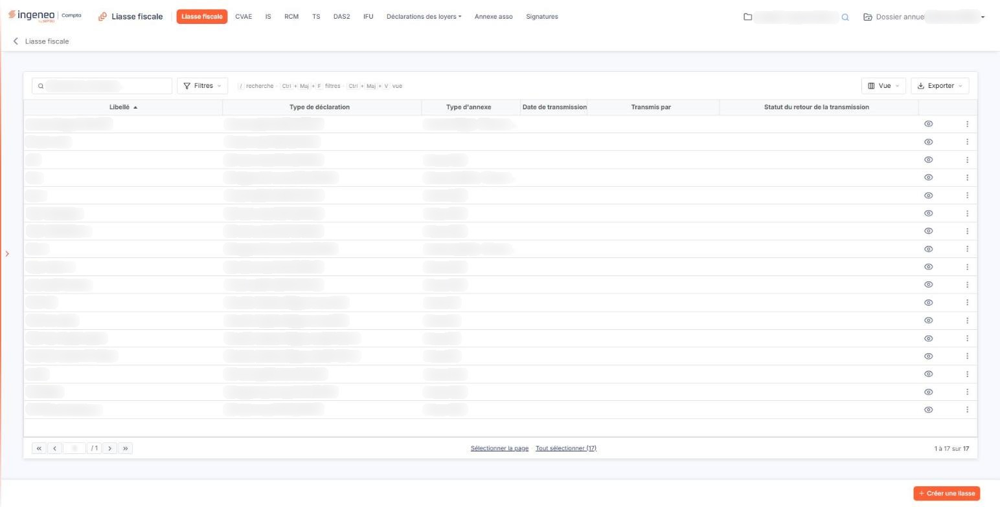<figcaption>
Écran « Liasse fiscale » de la nouvelle interface
</figcaption></figure>

<figure>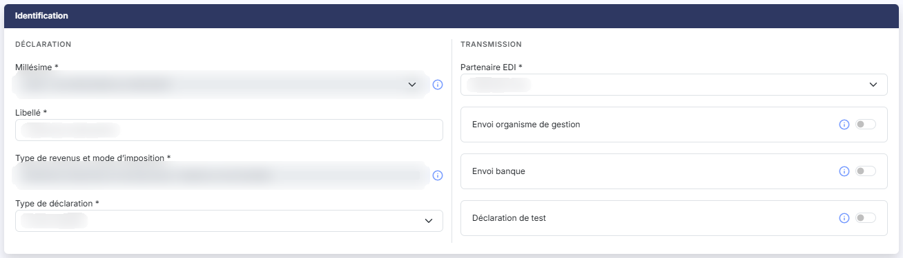<figcaption>
Rubrique « Identification »
</figcaption></figure>

<figure><figcaption>
Bouton [Supprimer] du bandeau de sélection
</figcaption></figure>

<figure>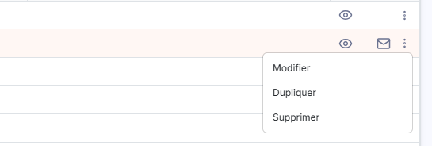<figcaption>
Rubrique « Les commandes d'une ligne »
</figcaption></figure>

L'écran est composé d'une barre d'outils, d'une grille et d'un bouton de création en bas à droite. Il ne comporte pas d'onglet : toutes les liasses du dossier annuel en cours sont affichées tant qu'aucun filtre n'est posé. La barre d'outils porte un champ « Rechercher une liasse… », le Bouton \[Filtres], le Bouton \[Vue] et le Bouton \[Exporter].

**1) Les colonnes de la grille**

| Champ                   | Ce qu'il faut savoir                                                                                                                                                  |
| ----------------------- | --------------------------------------------------------------------------------------------------------------------------------------------------------------------- |
| **Libellé**             | Le libellé que vous avez saisi à la création de la liasse. La grille est triée sur cette colonne par ordre croissant à l'ouverture.                                   |
| **Type de déclaration** | Le régime de la déclaration, suivi de son code entre parenthèses — par exemple « IS réel normal (2065-BI-RN-IS) ».                                                    |
| **Type d'annexe**       | Le modèle d'annexe retenu pour la liasse. Cette colonne est vide lorsque la liasse ne comporte pas d'annexe : c'est un état normal, et non une information manquante. |

**Date de transmission**, **Transmis par** et **Statut du retour de la transmission** : ces trois colonnes, affichées à droite des précédentes, rendent compte de la télétransmission de la liasse. Elles restent vides tant que la liasse n'a pas été transmise.

Sous la grille, les liens « Sélectionner la page » et « Tout sélectionner (n) » sélectionnent les liasses de la page affichée ou de toutes les pages ; un clic sur une ligne la sélectionne aussi. Le Bouton \[Filtres] ouvre un menu qui invite à « Ajouter un critère sur… » une colonne, avec le lien « Vider les filtres » et le Bouton \[Filtrer]. Le Bouton \[Vue] ouvre un menu « Colonnes affichées », où vous choisissez les colonnes à afficher parmi celles proposées (six sont affichées par défaut sur vingt-sept), puis le Bouton \[Appliquer] ; le lien « Rétablir les colonnes d'origine » revient à l'affichage initial, et « Enregistrer la vue actuelle » range votre choix sous « Mes vues ». Le Bouton \[Exporter] ouvre un menu de cinq entrées : « Aperçu édition HTML », « Imprimer », « Exporter en Excel », « Exporter en PDF » et « Envoyer la liste par e-mail ».

**2) Les commandes d'une ligne**

Les commandes d'une ligne apparaissent à droite de la ligne, au survol ou quand la ligne est sélectionnée. Trois sont directes ; les trois autres sont réunies sous « Autres actions » (trois points). L'infobulle de chaque commande en donne le nom :

* pictogramme « Œil », infobulle **Accès aux formulaires** : ouvre l'écran de travail de la déclaration, décrit à partir du paragraphe c) ;
* infobulle **Suivi de la télédéclaration** : affiche les avis de dépôt, de contrôle et de réception — voir le paragraphe i). Cet emplacement ne se remplit qu'une fois la liasse transmise, et seulement si le partenaire EDI retenu est "Jedeclare.com" : tant qu'aucun envoi n'a été effectué, il reste vide, sans pictogramme ni infobulle ;
* pictogramme « Enveloppe », infobulle **Envoyer par mail** : ouvre la fenêtre d'envoi de la liasse par courriel ;
* infobulle **Autres actions** : ouvre un menu de trois entrées — **Modifier** : ouvre la fiche d'identification de la liasse, c'est-à-dire les données d'en-tête décrites au paragraphe b) ;
* **Dupliquer** : crée une nouvelle liasse à l'identique ;
* **Supprimer** : supprime la liasse et tous ses formulaires.

Retenez que la commande « Modifier » n'ouvre pas les formulaires : c'est la commande « Accès aux formulaires » qui donne accès au contenu de la déclaration.

Selon les droits qui vous sont accordés, certains de ces pictogrammes peuvent ne pas vous être proposés.

bouton **\[Créer une liasse]**

Placé en bas à droite de l'écran, hors de la grille, et masqué tant qu'une ligne est sélectionnée, il ouvre la fiche de création d'une liasse, décrite au paragraphe suivant.

**Bouton \[Supprimer] du bandeau de sélection**

Il n'apparaît que lorsqu'au moins une liasse est sélectionnée : un bandeau en bas de l'écran annonce alors « 1 liasse sélectionnée » (ou le nombre retenu), avec le lien « Tout désélectionner ». Le bouton supprime les liasses sélectionnées.

## Création d'une liasse

<figure><figcaption>
Rubrique « Questionnaire d'aide à la préparation de l'annexe »
</figcaption></figure>

<figure><figcaption>
Rubrique « Questionnaire d'aide à la préparation de l'annexe »
</figcaption></figure>

<figure>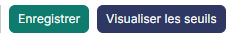<figcaption>
Bouton [Enregistrer]
</figcaption></figure>

<figure>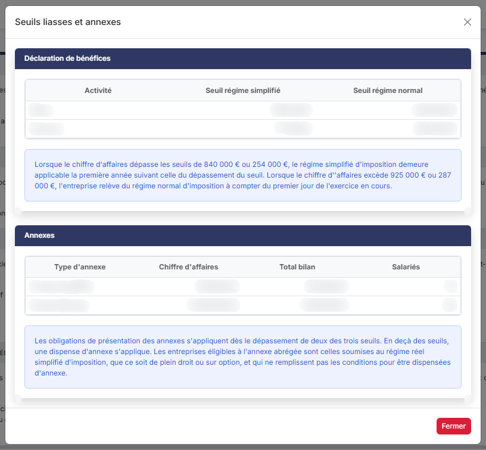<figcaption>
Bouton [Visualiser les seuils]
</figcaption></figure>

La fiche s'ouvre sur la seule rubrique « Identification ». Deux rubriques supplémentaires apparaissent dès que vous avez choisi un type de déclaration qui comporte une annexe.

**1) Rubrique « Identification »**

La rubrique se présente en deux colonnes : à gauche le bloc « Déclaration » (**Millésime**, **Libellé**, **Type de revenus et mode d'imposition**, **Type de déclaration**), à droite le bloc « Transmission » (**Partenaire EDI**, puis les options d'envoi et la déclaration de test, chacune dans son encadré). Les champs sont décrits ci-dessous dans cet ordre.

| Champ                                          | Ce qu'il faut savoir                                                                                                                                                                                                                                                                                                                                                                                                                                                                                                                                                                                                                                                                                                                                                                                                                                                                                                                                                                                                                                                                                                                                                                                                                        |
| ---------------------------------------------- | ------------------------------------------------------------------------------------------------------------------------------------------------------------------------------------------------------------------------------------------------------------------------------------------------------------------------------------------------------------------------------------------------------------------------------------------------------------------------------------------------------------------------------------------------------------------------------------------------------------------------------------------------------------------------------------------------------------------------------------------------------------------------------------------------------------------------------------------------------------------------------------------------------------------------------------------------------------------------------------------------------------------------------------------------------------------------------------------------------------------------------------------------------------------------------------------------------------------------------------------- |
| **Millésime**                                  | Il désigne la campagne déclarative. Généralement, il est affecté automatiquement et le champ est grisé, car une seule campagne est active. Si le sélecteur contient deux choix, le premier correspond à la campagne en cours, qui va bientôt se terminer, et le second à la prochaine campagne, qui sera bientôt active. Si vous ne pouvez pas transmettre la liasse avant la date de fin du premier choix, retenez le second pour renseigner vos informations sur le nouveau millésime, qui sera opérationnel à la date de début indiquée.                                                                                                                                                                                                                                                                                                                                                                                                                                                                                                                                                                                                                                                                                                 |
| **Libellé**                                    | Il vous permet d'identifier précisément votre télédéclaration ; c'est lui qui s'affiche dans la première colonne de la grille.                                                                                                                                                                                                                                                                                                                                                                                                                                                                                                                                                                                                                                                                                                                                                                                                                                                                                                                                                                                                                                                                                                              |
| **Type de revenus et mode d'imposition**       | Cette valeur est reprise du paramétrage « Multimodules », qui se trouve désormais dans le panneau « Paramètres » — ouvert par l'entrée « Paramètres » de la barre latérale (en bas de la liste ; hors tableau de bord, ouvrez d'abord la barre par la poignée du bord gauche) —, rubrique « Généraux », onglet « Configuration ». Elle n'est pas modifiable ici : pour la changer, rendez-vous dans cet onglet, rubrique « Type de revenus et mode d'imposition ».                                                                                                                                                                                                                                                                                                                                                                                                                                                                                                                                                                                                                                                                                                                                                                          |
| **Type de déclaration**                        | En fonction du type de revenus indiqué, le logiciel vous propose les différents types de déclarations disponibles. Si vous ne trouvez pas celui que vous cherchez, assurez-vous d'avoir renseigné le bon type de revenus.                                                                                                                                                                                                                                                                                                                                                                                                                                                                                                                                                                                                                                                                                                                                                                                                                                                                                                                                                                                                                   |
| **Partenaire EDI**                             | 
Il s'agit de l'organisme vers qui le flux EDI de la télédéclaration est envoyé, et qui se charge ensuite de le transmettre aux services fiscaux. Vous devez disposer d'un compte auprès de cet organisme pour effectuer vos télédéclarations. Les identifiants du compte doivent être renseignés dans le module « Dossier permanent », menu « Social », sous-menu « Etablissement ». Si vous disposez de plusieurs établissements qui effectuent des télédéclarations avec des comptes différents, vous devrez les renseigner pour chaque établissement. Le rattachement d'une société gérée à un établissement du cabinet s'opère dans le module « Administration », menu « Société gérée ».
                                                                                                                                                                                                                                                                                                                                                                                                                                                                                                                               |
| **Envoi organisme de gestion**                 | 
Si la société adhère à un organisme de gestion, activez cette option. Elle a deux effets : ajouter des formulaires spécifiques à renseigner et à destiner aux organismes de gestion, et déclencher chez le partenaire EDI l'envoi spécifique à l'organisme. L'envoi aux organismes de gestion ne concerne que les régimes BA régime réel normal, BA régime simplifié, BNC déclaration contrôlée, BIC réel normal et BIC réel simplifié. Si vous avez renseigné un organisme de gestion dans le dossier permanent, le choix est automatiquement activé et l'organisme est prérenseigné. Si vous en avez saisi plusieurs, le choix est automatiquement activé mais vous devez désigner l'organisme en cliquant sur la loupe et en le sélectionnant dans la liste. Si vous saisissez directement quelques caractères dans la cellule de saisie de l'organisme, la recherche se fait sur tout le fichier des organismes, comme si vous n'aviez rien renseigné dans le dossier permanent. Activer cette option fait disparaître la ligne « Envoi banque » : les deux envois s'excluent, et c'est le partenaire EDI qui l'impose. À l'inverse, activer « Envoi banque » fait disparaître la ligne « Envoi organisme de gestion ».
 |
| **Organisme de Gestion**                       | 
Il s'agit du nom de l'organisme auquel adhère la société. Tous les organismes sont référencés dans le logiciel. Saisissez quelques lettres de sa raison sociale pour afficher des propositions, ou recherchez-le à l'aide du pictogramme « Loupe ». Si un organisme est absent de la liste, n'hésitez pas à créer un ticket dans le module « Maintenance » pour le signaler. Les organismes de gestion peuvent être de type « Association » ou de type « Centre de gestion », et certains types de déclarations ne peuvent être faits qu'avec un certain type d'organisme. Si la déclaration que vous indiquez est incompatible avec le type d'organisme choisi, le logiciel affiche un message d'erreur.
                                                                                                                                                                                                                                                                                                                                                                                                                                                                                                                         |
| **Référence auprès de l'organisme de gestion** | Il s'agit de l'identifiant de la société gérée au sein de l'organisme de gestion.                                                                                                                                                                                                                                                                                                                                                                                                                                                                                                                                                                                                                                                                                                                                                                                                                                                                                                                                                                                                                                                                                                                                                           |
| **Envoi banque**                               | Cette option permet d'envoyer la télédéclaration à une banque.                                                                                                                                                                                                                                                                                                                                                                                                                                                                                                                                                                                                                                                                                                                                                                                                                                                                                                                                                                                                                                                                                                                                                                              |
| **Banque**                                     | Le sélecteur vous permet de choisir, parmi les différentes banques de la société gérée, celle à laquelle il faut envoyer la télédéclaration. La liste des banques se paramètre dans le module « Banque ».                                                                                                                                                                                                                                                                                                                                                                                                                                                                                                                                                                                                                                                                                                                                                                                                                                                                                                                                                                                                                                   |
| **Déclaration de test**                        | 
Si vous activez cette option, votre télédéclaration sera transmise à votre partenaire EDI mais ne sera pas prise en compte par l'Administration fiscale. Vous pouvez l'utiliser, par exemple, pour vous assurer que la transmission des déclarations se fait correctement, ou pour vérifier que vos identifiants sont valides avant l'échéance. <strong>2) Rubrique « Annexe »</strong> Cette rubrique n'apparaît qu'après le choix d'un type de déclaration, et seulement pour les déclarations qui comportent une annexe.
                                                                                                                                                                                                                                                                                                                                                                                                                                                                                                                                                                                                                                                                                                    |
| **L'entreprise est-elle dispensée d'annexe**   | Si vous répondez Oui, la rubrique se réduit à cette seule question et le questionnaire décrit ci-dessous disparaît.                                                                                                                                                                                                                                                                                                                                                                                                                                                                                                                                                                                                                                                                                                                                                                                                                                                                                                                                                                                                                                                                                                                         |
| **Type de personne**                           | Morale ou physique. Ce choix a une incidence sur le modèle d'annexe à renseigner.                                                                                                                                                                                                                                                                                                                                                                                                                                                                                                                                                                                                                                                                                                                                                                                                                                                                                                                                                                                                                                                                                                                                                           |
| **Total du bilan**                             | Valeur facultative, proposée préremplie et modifiable.                                                                                                                                                                                                                                                                                                                                                                                                                                                                                                                                                                                                                                                                                                                                                                                                                                                                                                                                                                                                                                                                                                                                                                                      |
| **Chiffre d'affaires**                         | Valeur facultative, proposée préremplie et modifiable.                                                                                                                                                                                                                                                                                                                                                                                                                                                                                                                                                                                                                                                                                                                                                                                                                                                                                                                                                                                                                                                                                                                                                                                      |
| **Effectif**                                   | Valeur facultative, proposée préremplie et modifiable.                                                                                                                                                                                                                                                                                                                                                                                                                                                                                                                                                                                                                                                                                                                                                                                                                                                                                                                                                                                                                                                                                                                                                                                      |
| **Type d'entreprise**                          | Régime simplifié, petite entreprise ou moyenne entreprise. Ce choix définit les formulaires présents par défaut dans l'annexe, conformément à l'article 811-12 du règlement ANC 2022-06.                                                                                                                                                                                                                                                                                                                                                                                                                                                                                                                                                                                                                                                                                                                                                                                                                                                                                                                                                                                                                                                    |
| **Type d'annexe**                              | Le sélecteur contient les modèles d'annexes applicables, en fonction du type de revenus et mode d'imposition, du type de déclaration et du type de personne. C'est cette valeur qui s'affiche dans la troisième colonne de la grille, et c'est elle qui commande l'existence du mode « Annexe » sur l'écran des formulaires.                                                                                                                                                                                                                                                                                                                                                                                                                                                                                                                                                                                                                                                                                                                                                                                                                                                                                                                |

**3) Rubrique « Questionnaire d'aide à la préparation de l'annexe »**

Le titre de cette rubrique porte le millésime de l'annexe retenue — par exemple « Questionnaire d'aide à la préparation de l'annexe 2025 ». Elle rassemble dix-neuf questions auxquelles vous répondez par un interrupteur Oui / Non ; deux d'entre elles offrent un troisième choix, « NA », pour « non applicable ».

Les questions sont réparties en quatre rubriques, dans cet ordre : « Règles et méthodes comptables », « Faits de l'exercice », « Immobilisations et actifs », « Capital, gouvernance et parties liées ». Les voici, dans l'ordre de l'écran :

* « Règles et méthodes comptables » : L'entité déroge-t-elle aux règles générales d'établissement et de présentation des comptes annuels ?
* Y a-t-il eu des changement de réglementation comptable au cours de l'exercice ?
* Y a-t-il eu des changement de méthode à l'initiative de l'entité au cours de l'exercice ?
* Y a-t-il eu des changement d'estimation au cours de l'exercice ?
* Y a-t-il eu des correction d'erreurs au cours de l'exercice ?
* « Faits de l'exercice » : Y a-t-il eu des événements significatifs postérieurs à la clôture ?
* Y a-t-il eu des faits caractéristiques de l'exercice ?
* Les renseignements généraux du dossier permanent doivent-ils être reportés dans l'annexe ?
* La société fait-elle l'objet de comptes consolidés ?
* « Immobilisations et actifs » : Des immobilisations ont-elles été dépréciées au cours de l'exercice ?
* Des immobilisations ont-elles été réévaluées au cours de l'exercice ?
* Les frais de développement sont-ils inscrit à l'actif du bilan ? — trois choix : NA, Oui, Non
* Le fonds commercial est-il inscrit à l'actif du bilan ?
* Les coûts d'emprunts sont-ils incorporés dans les coûts d'acquisition ou de production des immobilisations incorporelles et corporelles ? — trois choix : NA, Oui, Non
* « Capital, gouvernance et parties liées » : La société a-t'elle emis des actions/parts sociales pendant l'exercice ?
* La société dispose t'elle d'un commissaire aux comptes ?
* Y a-t-il eu des transactions avec des parties liées ?
* Y a-t-il eu des transactions avec les principaux actionnaires et organes d'administration, de direction ou de surveillance ?
* Y a-t-il eu des avances, crédits, engagements ou des rémunérations avec les membres d'organes d'administration, de direction ou de surveillance ?

Certaines réponses font apparaître des champs complémentaires, et ce n'est pas toujours la réponse positive qui les déclenche. Ils ne s'affichent pas sous la question concernée mais dans un bandeau « Précisions », au bas de la rubrique « Immobilisations et actifs », qui reste masqué tant qu'aucun d'eux n'est demandé. Pour les frais de développement, la réponse « Oui » fait apparaître le champ **Durée d'amortissement des frais de développement** et la réponse « Non » le champ **Montant comptabilisé en charge pour l'exercice** : les deux ne sont jamais proposés ensemble, et la réponse « NA » n'en propose aucun. Pour les coûts d'emprunts, la réponse « Oui » fait apparaître une question supplémentaire, « Les coûts d'emprunts sont-ils directement attribuable à une immobilisations ? », puis le champ **Taux de capitalisation retenu**. Pour le fonds commercial, la réponse positive fait apparaître le montant et les durées.

bouton **\[Enregistrer]**

Il déclenche la création de la liasse et de tous les formulaires de votre télédéclaration, et vous y donne directement accès.

bouton **\[Visualiser les seuils]**

Il ouvre une fenêtre rappelant les seuils légaux, en deux volets.

Le volet « Déclaration de bénéfices » donne, par activité, le seuil du régime simplifié et celui du régime normal. Lorsque le chiffre d'affaires dépasse les seuils de 840 000 € ou 254 000 €, le régime simplifié d'imposition demeure applicable la première année suivant celle du dépassement ; lorsqu'il excède 925 000 € ou 287 000 €, l'entreprise relève du régime normal d'imposition à compter du premier jour de l'exercice en cours.

Le volet « Annexes » donne, par type d'annexe, les seuils de chiffre d'affaires, de total du bilan et de nombre de salariés. Les obligations de présentation des annexes s'appliquent dès le dépassement de deux des trois seuils ; en deçà, une dispense d'annexe s'applique. Les entreprises éligibles à l'annexe abrégée sont celles soumises au régime réel simplifié d'imposition, de plein droit ou sur option, et qui ne remplissent pas les conditions pour être dispensées d'annexe.

**Revenir à la liste des liasses**

La fiche ne porte plus de bouton de retour : pour la quitter et revenir à la liste des liasses, cliquez sur la flèche « Revenir en arrière », à gauche du fil d'Ariane, en haut de l'écran.

## L'accès aux formulaires

<figure>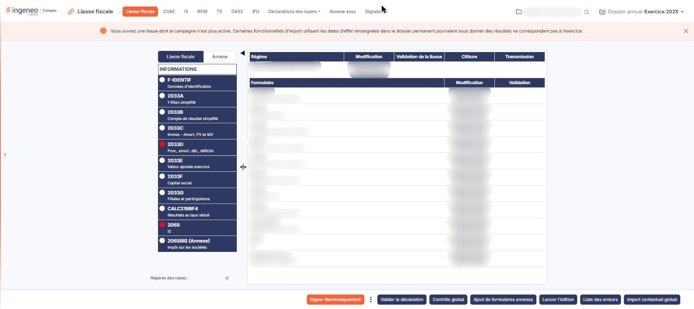<figcaption>
Rubrique « L'accès aux formulaires »
</figcaption></figure>

La commande « Accès aux formulaires » d'une ligne de la grille ouvre l'écran de travail de la déclaration. C'est là que vous consultez, complétez, contrôlez, validez et transmettez les formulaires.

Si la date de fin de production de la campagne à laquelle la liasse est rattachée est dépassée, une fenêtre « Information » s'affiche à l'ouverture et vous avertit en ces termes : « Vous ouvrez une liasse dont la campagne n'est plus active. Certaines fonctionnalités d'import utilisant les dates d'effet renseignées dans le dossier permanent pourraient vous donner des résultats ne correspondant pas à l'exercice. » Elle ne comporte qu'un bouton, bouton **\[OK]**, et bloque l'écran jusqu'à ce que vous l'ayez fermée. Comme cette date dépend du régime, deux liasses d'un même exercice ne déclenchent pas nécessairement l'avertissement toutes les deux. Sur une liasse dans ce cas, la dévalidation et la déclôture sont par ailleurs refusées, avec un message qui vous en donne la raison.

L'écran est composé de trois zones : un panneau à gauche, qui porte la liste des formulaires ; un panneau à droite, qui affiche soit la synthèse de la déclaration, soit le formulaire sélectionné ; et une barre de boutons en pied de page, sur toute la largeur. Le panneau de gauche se redimensionne par sa poignée, et se replie entièrement par la flèche située entre les deux panneaux.

À l'ouverture, vous êtes positionné tout en haut de la liste, sur le choix « INFORMATIONS ». À ce stade, les boutons du pied de page concernent toute la déclaration.

**1) La liste des formulaires**

Chaque élément de la liste porte une pastille de couleur, le code du formulaire en gras, et son intitulé en dessous. Quelques formulaires n'ont pas d'intitulé : leur élément ne comporte alors qu'une seule ligne.

Le premier élément de la liste n'est pas un formulaire : c'est l'entrée « INFORMATIONS », qui affiche la synthèse de la déclaration dans le panneau de droite.

Deux suffixes qualifient un code de formulaire : « (Annexe) » désigne un formulaire annexe ajouté à la liasse, et « (R » suivi d'un numéro désigne une répétition d'un formulaire.

Selon le régime, la liste ne comporte pas nécessairement de formulaire d'identification : c'est le cas des régimes de Nouvelle-Calédonie, dont les codes de formulaires sont par ailleurs préfixés « NC- ».

**D'où vient cette liste** : à la création de la liasse, le logiciel constitue son socle de formulaires à partir des formulaires prévus pour le régime retenu. Ce socle est ensuite confronté, à chaque affichage, au référentiel du régime : le panneau présente ce qui figure dans les deux. Vous complétez enfin ce socle par vos propres ajouts et suppressions de formulaires annexes, qui sont conservés.

Il en résulte que **deux liasses de même régime peuvent légitimement ne pas présenter les mêmes formulaires** : la différence tient à ce qui a été ajouté ou retiré sur chacune. Ne cherchez donc pas à comparer deux déclarations formulaire par formulaire pour en déduire une anomalie.

La suppression d'un formulaire n'accepte que les formulaires **annexes** et les formulaires **répétés**. Un formulaire du socle n'est pas supprimable, et le logiciel vous le dit par un message si vous le tentez.

**Trois cas où un formulaire existe sans être visible dans le panneau**

* la bascule « Liasse fiscale » / « Annexe » filtre la liste : un formulaire d'annexe n'apparaît pas en mode liasse, et réciproquement ;
* un formulaire retiré du référentiel du régime disparaît du panneau tout en restant enregistré : son historique est préservé, mais vous n'y avez plus accès ;
* la case de dépôt à néant **ne retire pas** le formulaire du panneau : elle en verrouille les cellules. Un formulaire à néant reste donc présent et consultable.

**2) Les pastilles de contrôle**

La pastille qui précède chaque formulaire rend compte de son état de contrôle et de validation :

* **blanche** : aucune anomalie n'a été relevée sur ce formulaire. C'est aussi l'état d'un formulaire qui n'a pas encore été contrôlé : la pastille blanche ne distingue pas les deux situations ;
* **autre couleur** : le formulaire porte au moins une erreur ; la couleur dépend de la nature de l'erreur, « Anomalie » ou « Bloquante » ;
* **verte** : le formulaire est validé et ne porte aucune erreur.

Les erreurs l'emportent sur la validation : un formulaire validé qui porte encore une erreur reste signalé par la couleur de l'erreur, et non en vert.

**3) Repères des cases**

En pied du panneau de gauche, l'interrupteur « Repères des cases » agit sur l'affichage des codes de cases dans les formulaires.

Positionné sur Non, qui est l'état par défaut, une colonne étroite précède chaque colonne de saisie et affiche le code de la case correspondante ; les cellules calculées, elles, n'affichent pas leur code.

Positionné sur Oui, un code apparaît en surimpression dans le coin supérieur gauche de **chaque** cellule, y compris les cellules calculées et les cases à cocher. Autrement dit, l'interrupteur ne fait pas apparaître les codes : il complète ceux qui manquent.

**4) La synthèse « INFORMATIONS »**

Le panneau de droite présente alors deux tableaux superposés.

Le premier tient sur une seule ligne et donne l'état de la déclaration : **Régime**, **Modification** (la date, l'heure et le nom de l'utilisateur), **Validation de la liasse**, **Clôture** et **Transmission**. Ces trois dernières colonnes restent vides tant que le jalon correspondant n'a pas été franchi.

Le second donne une ligne par formulaire de la déclaration, dans le même ordre que le panneau de gauche, avec trois colonnes : **Formulaire** (le code puis l'intitulé), **Modification** et **Validation**.


Attention à la lecture de la colonne **Modification** : elle est mise à jour dès l'ouverture d'un formulaire, même si vous n'y saisissez rien. Elle ne distingue donc pas un formulaire consulté d'un formulaire modifié. La seule ouverture de l'écran d'accès aux formulaires suffit d'ailleurs à estampiller le formulaire d'identification, sans que vous l'ayez ouvert, ainsi que la date portée par la déclaration elle-même dans le tableau du dessus.


En mode annexe, ce premier tableau ne porte que trois colonnes : **Régime**, **Modification** et **Validation de l'annexe** ; les colonnes **Clôture** et **Transmission** disparaissent.

## Les boutons de la déclaration

<figure><figcaption>
Bouton [Valider la déclaration]
</figcaption></figure>

<figure>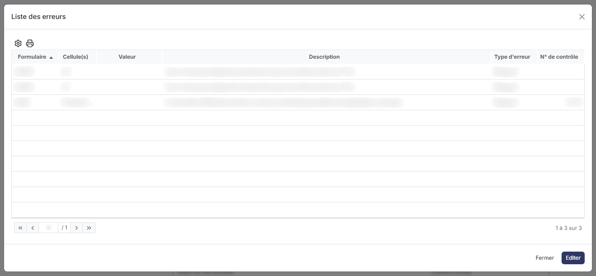<figcaption>
Bouton [Liste des erreurs]
</figcaption></figure>

<figure>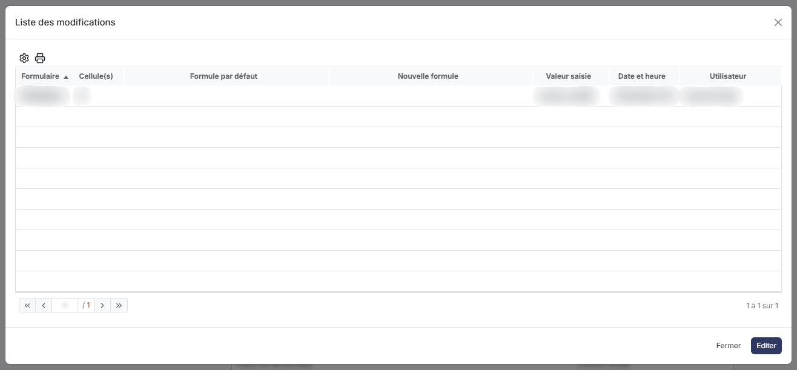<figcaption>
Bouton [Liste des modifications]
</figcaption></figure>

<figure><figcaption>
Bouton [Valider l'annexe]
</figcaption></figure>

<figure>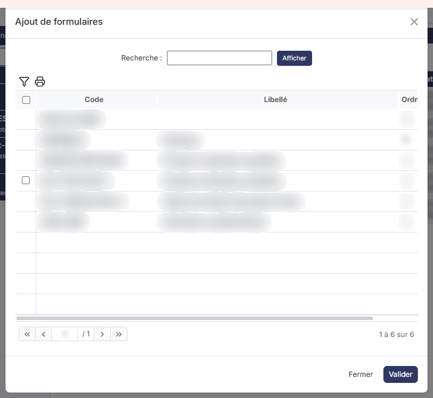<figcaption>
Bouton [Ajout de formulaires]
</figcaption></figure>

Les boutons ci-dessous sont ceux du pied de page lorsque le choix « INFORMATIONS » est sélectionné : ils portent alors sur l'ensemble de la déclaration.

Trois d'entre eux ne figurent pas dans la barre elle-même : bouton **\[Recalculer]**, bouton **\[Envoyer par mail]** et bouton **\[Liste des modifications]** sont rangés dans le menu « Plus d'actions », que vous ouvrez par le pictogramme à trois points verticaux placé à l'extrémité droite de la barre. Les autres s'affichent dans la barre, dans l'ordre où ils sont présentés ci-dessous.

Deux d'entre eux changent de libellé, sans changer de fonction, dès qu'un formulaire est ouvert : bouton **\[Valider la déclaration]** devient bouton **\[Valider le formulaire]**, et bouton **\[Contrôle global]** devient bouton **\[Contrôle formulaire]**. En mode annexe, ce sont bouton **\[Valider l'annexe]** et bouton **\[Ajout de formulaires]**. Si vous cherchez un bouton à son libellé, pensez donc à vérifier dans quel contexte vous vous trouvez.

**1) Bouton \[Valider la déclaration]**

Il permet de valider l'ensemble des formulaires simultanément. Avant la validation, un contrôle global est relancé.

La validation empêche la modification d'un formulaire, que ce soit directement ou par un recalcul global. Les formulaires validés sont précédés d'une pastille verte.

**2) Bouton \[Dévalider]**

Il n'apparaît que si une validation de la déclaration, ou de tous ses formulaires un par un, a été lancée.

**3) Bouton \[Contrôle global]**

Il vérifie la cohérence des données saisies dans l'ensemble des formulaires de la déclaration : il effectue les contrôles programmés pour chaque formulaire — par exemple que la cellule VD est bien égale à VA + VB — et rectifie les écarts d'arrondis en mode sans décimale.

Les erreurs trouvées sont de nature « Anomalie », qui n'empêche pas la validation du formulaire, ou « Bloquante », qui l'empêche. Après le contrôle, les formulaires portant au moins une anomalie sont précédés d'une pastille de la couleur de l'erreur, selon sa nature, et ceux sans erreur restent précédés d'une pastille blanche.

Pendant le traitement, une fenêtre « Contrôle » affiche le formulaire en cours de traitement, le nombre de formulaires traités, le nombre d'erreurs et une barre de progression. À la fin, la première ligne indique « Contrôles terminés ». Le détail des erreurs se consulte ensuite par bouton **\[Liste des erreurs]**, qui apparaît en pied de page.

Ce bouton modifie la déclaration : il rectifie les arrondis et enregistre le résultat des contrôles. Ne le déclenchez donc pas pour une simple consultation.

**4) Bouton \[Signer électroniquement]**

Il lance la signature électronique de la déclaration auprès de Jesignexpert.com et vous redirige vers ce service. Si la communication échoue, le logiciel affiche un message d'erreur intitulé « Erreur lors de la signature ».

Ce bouton n'apparaît que si le service Jesignexpert est actif et si le droit de signature électronique de la liasse vous est accordé. Le suivi des demandes de signature se consulte dans le menu « Signatures » du module.

**5) Bouton \[Liste des modifications]**

Il affiche la liste de toutes les modifications effectuées, pour l'ensemble des formulaires, par rapport au préparamétrage de chaque cellule : modifications de formules ou saisie directe de valeurs. Pour chaque modification, la liste indique l'information initiale, la modification opérée, le nom de l'opérateur et la date de la dernière modification.

Le champ « N° de contrôle » est un numéro interne au logiciel, qui pourra aider le service technique si vous le sollicitez dans la résolution des erreurs de votre déclaration.

**6) Bouton \[Liste des erreurs]**

Il n'est présent que si un contrôle a relevé des erreurs. Il affiche toutes les erreurs détectées, avec les informations permettant de faciliter leur correction ; le type d'erreur, « Anomalie » ou « Bloquante », vous indique si le formulaire pourra être validé.

Le champ « N° de contrôle » est ici encore un numéro interne au logiciel. Vous avez la possibilité d'éditer la liste des erreurs.

**7) Revenir à la liste des liasses**

La barre ne porte plus de bouton pour quitter la liasse : cliquez sur la flèche « Revenir en arrière », à gauche du fil d'Ariane, qui vous ramène à la liste des liasses. Ce retour n'a aucune incidence sur l'enregistrement de vos changements, qui sont sauvegardés à chaque modification dans un formulaire.

Les boutons suivants n'apparaissent qu'à certains stades de la déclaration.

**8) Bouton \[Clôturer]**

Il clôture la télédéclaration. Lorsque la déclaration est clôturée, elle peut désormais être télétransmise.

**9) Bouton \[Déclôturer]**

Il n'apparaît que lorsque la déclaration a été clôturée.

Il n'est pas possible de déclôturer une liasse qui a été télédéclarée.

**10) Bouton \[Télécharger EDI]**

Il permet de télécharger le fichier EDI généré lors de la clôture, à des fins d'analyse, de sauvegarde ou d'export vers un autre logiciel.

**11) Bouton \[Transmettre]**

Il envoie la liasse au partenaire EDI.

Pour effectuer une télédéclaration, vous devez, d'une part, avoir entré les identifiants du compte du cabinet auprès du partenaire EDI dans le module « Dossier permanent », menu « Social », option « Etablissements », rubrique « Identifiants pour les télédéclarations », pour l'établissement du cabinet réalisant la télédéclaration ; et, d'autre part, avoir rattaché la société gérée à cet établissement dans le module « Dossier permanent », menu « Identité », option « Fiche société », rubrique « Etablissement déclarant ».

Pour en suivre la réception, reportez-vous au paragraphe i).

## Saisie d'un formulaire

<figure>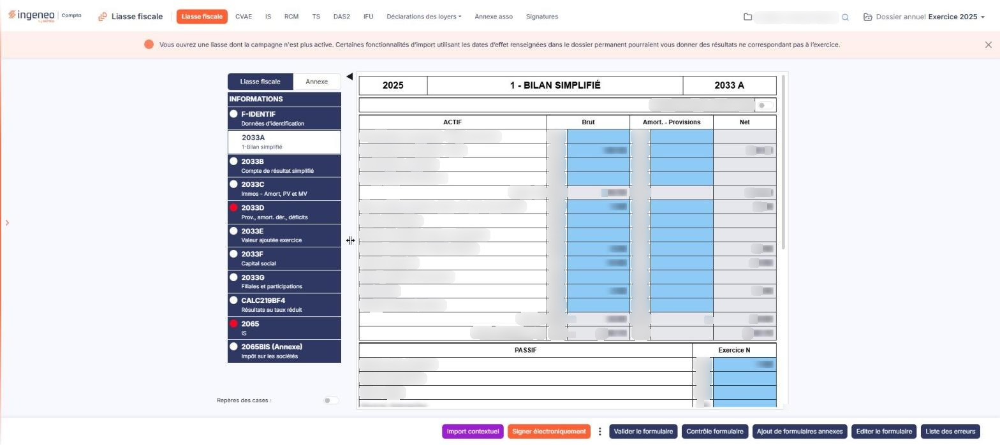<figcaption>
Rubrique « Saisie d'un formulaire »
</figcaption></figure>

Pour accéder à un formulaire, cliquez sur son libellé dans le panneau de gauche, ou sur sa ligne dans le tableau de droite si vous êtes positionné sur « INFORMATIONS ».

Vous restez sur le même écran : le panneau de gauche ne change pas, seuls le panneau de droite et la barre de boutons sont remplacés. Le fil « Fonction en cours » vous indique où vous êtes, sous la forme « Liasse fiscale > 2050 - Bilan - actif ».

À la création de la liasse, chaque formulaire est automatiquement calculé une première fois avec toutes les données présentes dans le logiciel.

**1) Le bandeau et le dépôt à néant**

Le formulaire s'ouvre sur un bandeau de trois cellules : le millésime à gauche, le titre officiel du feuillet au centre, le code du formulaire à droite.

Sur les formulaires qui l'admettent, la case « Si déposé à néant, cochez la case » figure immédiatement sous le bandeau et permet de déposer le formulaire à néant ; le formulaire d'identification, lui, n'en comporte pas. La cocher vide toutes les cellules du formulaire, ainsi que toutes les formules modifiées et toutes les valeurs saisies manuellement, et verrouille les cellules ; le formulaire reste présent dans la liste.

Si vous décochez la case, toutes les cellules sont recalculées avec les valeurs par défaut. Attention : si un import contextuel est prévu pour le formulaire, il n'est pas relancé automatiquement à ce stade.

**2) Les cellules**

Un formulaire est un feuillet affiché en entier, que vous parcourez par la barre de défilement du panneau de droite : il n'y a pas de pagination interne. Selon le formulaire, les lignes sont regroupées par rubriques titrées sur toute la largeur — par exemple « A - IDENTIFICATION DE L'ENTREPRISE », « B - RÉGIME FISCAL », « C - PÉRIODES », « D - MONNAIE » sur le formulaire d'identification — ou séparées par de simples lignes de total.

Les cellules ne sont pas toutes monétaires. Vous rencontrerez, selon les formulaires, des montants, du texte, des dates et des listes déroulantes. Une cellule accepte au plus dix caractères.

Leur aspect vous indique ce que vous pouvez en faire :

* sur **fond bleu clair**, la cellule est modifiable ; elle est généralement alimentée par une formule qui utilise les écritures comptables ;
* sur **fond gris**, la cellule est calculée et n'est pas modifiable ; sa formule utilise d'autres cellules du formulaire — une somme, par exemple — ou, dans l'annexe, une cellule de la liasse fiscale ;

Une cellule peut aussi être alimentée par un **import contextuel**, c'est-à-dire en allant chercher une information qui n'est pas calculable depuis les écritures mais qui est présente ailleurs dans le logiciel — la liste des actionnaires renseignée dans le module « Dossier permanent », par exemple — ou par **saisie manuelle**.

Certaines cellules sont **répétables** : elles sont suivies d'une case portant le signe « + », et un clic sur ce signe ajoute une ligne de la même cellule. Pour supprimer une cellule répétée, cliquez sur le signe « - » apparu à sa droite. Les cellules répétables peuvent aussi être créées automatiquement lors de certains imports contextuels.

Les cellules de type **« Nom et adresse »** regroupent plusieurs données qui doivent être envoyées dans un seul bloc. C'est pourquoi, à l'affichage, tous les éléments sont concaténés et séparés par des points-virgules, alors que la saisie traite chaque élément séparément. Les caractères « + » (plus), « : » (deux points) et « ' » (apostrophe) y sont interdits.

**3) Les blocs de texte**

Certains formulaires, essentiellement dans l'annexe, ne sont ni une grille de montants ni une fiche de champs : ils se composent d'un ou plusieurs blocs de texte et d'un ou plusieurs tableaux. Un bloc de texte est un éditeur de texte enrichi, avec sa barre d'outils de mise en forme, qui occupe le panneau de droite ; son bandeau porte l'intitulé du formulaire et un interrupteur « Editable ».

## Les boutons d'un formulaire ouvert

<figure>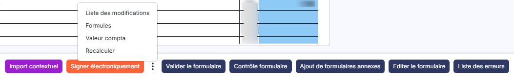<figcaption>
Bouton [Valeur compta]
</figcaption></figure>

<figure>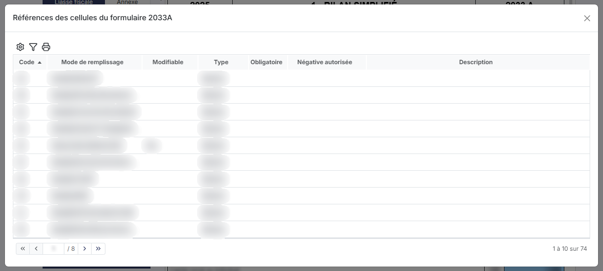<figcaption>
Bouton [Formules]
</figcaption></figure>

Dès qu'un formulaire est ouvert, la barre de pied de page change. bouton **\[Lancer l'édition]**, bouton **\[Envoyer par mail]** et bouton **\[Import contextuel global]** disparaissent ; bouton **\[Valider la déclaration]** et bouton **\[Contrôle global]** changent de libellé ; et les boutons ci-dessous apparaissent. bouton **\[Recalculer]**, bouton **\[Ajout de formulaires annexes]**, bouton **\[Signer électroniquement]**, bouton **\[Liste des erreurs]** et bouton **\[Liste des modifications]** restent présents, et fonctionnent comme décrit au paragraphe d) — à ceci près que les listes d'erreurs et de modifications ne portent alors que sur le formulaire ouvert.

Le menu « Plus d'actions », au bout de la barre, contient alors bouton **\[Liste des modifications]**, bouton **\[Formules]**, bouton **\[Valeur compta]** et bouton **\[Recalculer]** ; les autres boutons s'affichent dans la barre.

**1) Bouton \[Valeur compta]**

Par défaut, les liasses sont affichées avec les valeurs arrondies, telles qu'elles partiront dans le fichier EDI. Ce bouton bascule l'affichage sur les valeurs de la comptabilité, avec le nombre de décimales paramétré dans le paramétrage « Multimodules » (panneau « Paramètres », rubrique « Généraux », onglet « Configuration ») ; son libellé devient alors bouton **\[Valeur EDI]**, qui vous ramène à l'affichage arrondi. Le mode retenu reste actif si vous naviguez vers un autre formulaire, tant que vous n'avez pas rebasculé.

Il est probable que vous constatiez de petits écarts sur les parties entières des nombres entre les deux affichages : c'est tout à fait normal, du fait des arrondis successifs appliqués lors des calculs.

**2) Bouton \[Valider le formulaire]**

Il fonctionne comme la validation complète de la déclaration, mais seulement pour le formulaire sur lequel vous êtes positionné. Si le formulaire ne contient pas d'erreur et est validé, le logiciel vous positionne automatiquement sur le formulaire suivant.

**3) Bouton \[Contrôle formulaire]**

Il fonctionne comme bouton **\[Contrôle global]**, mais sur le seul formulaire ouvert.

**4) Bouton \[Répéter le formulaire]**

Il est parfois nécessaire de disposer de plusieurs exemplaires du même formulaire — essentiellement des annexes : ce sont les formulaires « répétables ». Ce bouton n'apparaît que sur un formulaire répétable, et crée un exemplaire supplémentaire, dont le code est suivi de la lettre « R » et du numéro de la répétition, entre parenthèses. Les répétitions d'un même formulaire sont toujours insérées les unes à la suite des autres.

**5) Bouton \[Supprimer le formulaire]**

Il n'est présent que si vous êtes positionné sur un formulaire annexe ou répété, et permet de le supprimer — en cas d'erreur de chargement, par exemple. Un formulaire du socle de la liasse n'est pas supprimable.

**6) Bouton \[Formules]**

Il ouvre une fenêtre intitulée « Références des cellules du formulaire », suivie du code du formulaire ouvert : vous y consultez la référence de chaque cellule et la formule qui l'alimente. C'est une fenêtre de consultation, que vous pouvez laisser ouverte pendant que vous travaillez dans le formulaire et redimensionner à votre convenance.

**7) Revenir à la liste des formulaires**

La barre ne porte plus de bouton pour quitter le formulaire : pour revenir à la liste des formulaires, cliquez sur « INFORMATIONS » dans le panneau de gauche. La flèche « Revenir en arrière » du fil d'Ariane, elle, ne revient pas à la liste des formulaires : elle quitte la liasse et vous ramène à la liste des liasses. Il n'a aucune incidence sur l'enregistrement de vos changements, qui sont sauvegardés à chaque modification dans un formulaire.

## L'annexe

<figure>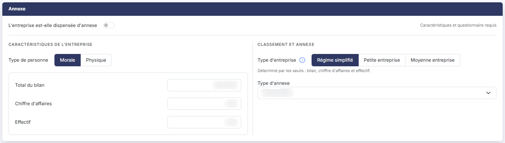<figcaption>
Rubrique « Annexe »
</figcaption></figure>

<figure>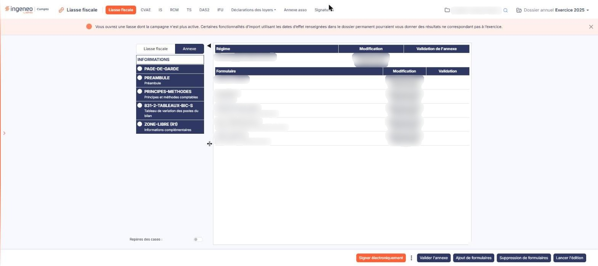<figcaption>
Rubrique « L'annexe »
</figcaption></figure>

L'annexe n'est pas un écran distinct : c'est un **mode** de l'écran d'accès aux formulaires. Elle est créée en même temps que la liasse.

Pour y accéder, sélectionnez le choix « Annexe » sur la bascule située en tête du panneau de gauche, qui vous permet de passer des formulaires de la liasse à ceux de l'annexe. Cette bascule n'apparaît que si un type d'annexe a été retenu sur la fiche de la liasse : une liasse sans annexe ne la présente pas.

La navigation se fait exactement de la même manière que dans la liasse : vous êtes positionné tout en haut de la liste sur le choix « INFORMATIONS », le panneau de gauche porte les formulaires de l'annexe et le panneau de droite la synthèse. Les formulaires sont identifiés par l'article du référentiel normatif, et l'un d'eux peut contenir un ou plusieurs blocs de texte et un ou plusieurs tableaux.

Pour l'annexe des comptes annuels des associations non fiscalisées, ne passez pas par ce mode mais par le menu « Annexe asso » du module.

**1) Ce qui change en mode annexe**

Le tableau de synthèse ne porte plus que trois colonnes : **Régime**, **Modification** et **Validation de l'annexe**.

Le pied de page ne présente que cinq boutons — bouton **\[Valider l'annexe]**, bouton **\[Ajout de formulaires]**, bouton **\[Suppression de formulaires]**, bouton **\[Lancer l'édition]** et bouton **\[Signer électroniquement]** —, suivis du menu « Plus d'actions », qui contient bouton **\[Liste des modifications]** et bouton **\[Recalculer]**. Pour quitter l'annexe et revenir à la liste des liasses, utilisez la flèche « Revenir en arrière » du fil d'Ariane. Le contrôle global, l'envoi par courriel, l'import contextuel global et la liste des erreurs ne sont pas proposés sur l'annexe.

**2) Bouton \[Valider l'annexe]**

Il valide l'ensemble des formulaires de l'annexe simultanément. La validation empêche la modification d'un formulaire, directement ou par un recalcul global. Les formulaires validés sont précédés d'une pastille verte.

Une fois une validation lancée, un bouton **\[Dévalider l'annexe]** apparaît : il dévalide tous les formulaires qui l'avaient été, et leur pastille repasse au blanc.

**3) Bouton \[Ajout de formulaires]**

Il ouvre, à droite de l'écran, le panneau « Ajout de formulaires ». Ce panneau présente une grille des formulaires de l'annexe (colonnes **Code**, **Libellé** et **Ordre**), avec un champ « Rechercher un formulaire… » et les boutons \[Filtres] et \[Exporter]. Un clic sur une ligne la sélectionne ; le pied du panneau indique alors le nombre de formulaires sélectionnés et propose bouton **\[Ajouter un formulaire]** (ou « Ajouter les N formulaires » pour une sélection de plusieurs) pour les réintégrer à l'annexe. Il n'y a plus de bouton \[Valider] : la croix de l'en-tête referme le panneau sans rien ajouter.

**4) Bouton \[Suppression de formulaires]**

Il ouvre, à droite de l'écran, le panneau « Suppression de formulaires », de même présentation que celui de l'ajout (grille Code, Libellé, Ordre, recherche, \[Filtres], \[Exporter]). Un clic sur une ligne la sélectionne ; le pied du panneau propose alors bouton **\[Supprimer le formulaire]** (ou « Supprimer les N formulaires » pour une sélection de plusieurs), qui permet de retirer plusieurs formulaires de l'annexe en une seule fois. Un formulaire ainsi retiré peut être réintégré par bouton **\[Ajout de formulaires]**.

**5) Sur un formulaire de l'annexe**

Les boutons sont ceux décrits au paragraphe f). bouton **\[Valider le formulaire]** ne valide que le formulaire ouvert. bouton **\[Supprimer le formulaire]** retire le formulaire de l'annexe, et vous pourrez le réintégrer par bouton **\[Ajout de formulaires]**. Sur un formulaire composé uniquement de blocs de texte, bouton **\[Valeur compta]** et bouton **\[Contrôle formulaire]** ne sont pas proposés, faute de cellule chiffrée.

## Suivi de la télédéclaration

Le pictogramme d'une ligne de la grille dont l'infobulle indique « Suivi de la télédéclaration », placé entre « Accès aux formulaires » et « Envoyer par mail », vous permet de visualiser le suivi de la déclaration transmise. Cet emplacement de la colonne de commandes n'est pas toujours occupé : les deux conditions qui gouvernent l'apparition du pictogramme sont indiquées au paragraphe b).
