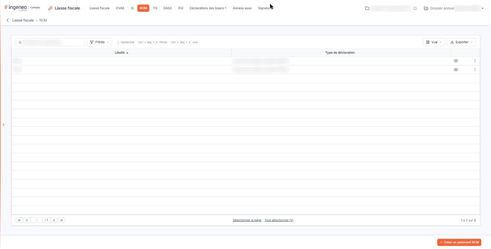
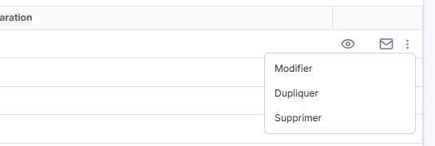
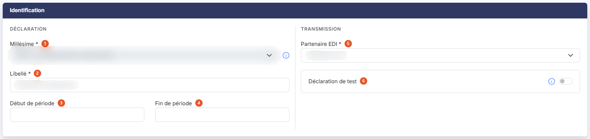
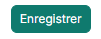
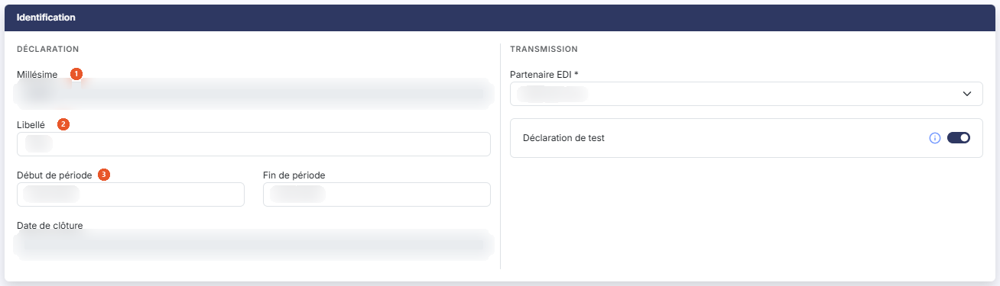

# RCM


**Où le trouver :** Menu **RCM**



**En bref** — Cet écran gère les déclarations de Revenus de Capitaux Mobiliers : création, modification, duplication, suppression et accès à la saisie de leurs formulaires.

* Pour créer une déclaration : bouton \[Créer un paiement RCM], renseignez le libellé, la période et le partenaire EDI, puis bouton \[Enregistrer].
* Pour saisir les formulaires : pictogramme « Accès aux formulaires » de la ligne.
* Pour corriger l'identification : menu « Autres actions » de la ligne, puis « Modifier ».


## La liste des déclarations

<figure><figcaption>
Écran « RCM » de la nouvelle interface
</figcaption></figure>

<figure><figcaption>
Bouton [Supprimer]
</figcaption></figure>

Le logiciel affiche directement la liste des déclarations RCM déjà créées sur le dossier annuel en cours. Il n'y a pas d'onglet. Au-dessus de la liste, une barre d'outils comprend, de gauche à droite, une zone « Rechercher un paiement… », le bouton **\[Filtres]** (il permet d'ajouter un critère sur une colonne ; un lien « Vider les filtres » les efface), le bouton **\[Vue]** et le bouton **\[Exporter]**.

Deux colonnes sont affichées, l'une et l'autre triables en cliquant sur leur en-tête :

| Champ                   | Ce qu'il faut savoir                                                                                                                                                                                                                  |
| ----------------------- | ------------------------------------------------------------------------------------------------------------------------------------------------------------------------------------------------------------------------------------- |
| **Libellé**             | Le libellé que vous avez donné à la déclaration lors de sa création. C'est lui qui vous permet de la reconnaître : donnez-lui donc un libellé parlant.                                                                                |
| **Type de déclaration** | La nature de la déclaration, suivie de son code entre parenthèses — pour cette option, « Revenus de capitaux mobiliers (RCM) ». Cette valeur est posée par le logiciel : la fiche d'identification ne vous demande pas de la choisir. |

La liste n'a plus de case à cocher : un clic sur une ligne la sélectionne. Sous la liste, les liens « Sélectionner la page » et « Tout sélectionner (n) » sélectionnent les lignes de la page affichée ou celles de toutes les pages. Dès qu'une ligne est sélectionnée, un bandeau apparaît en bas de l'écran, avec le nombre de déclarations sélectionnées et le bouton **\[Supprimer]** (voir le paragraphe c).

Le bouton **\[Vue]** ouvre un menu qui permet d'enregistrer la vue actuelle et de choisir les colonnes affichées, avec un lien « Rétablir les colonnes d'origine ». Le bouton **\[Exporter]** ouvre un menu : « Aperçu » (édition HTML), « Imprimer » (Ctrl+P), « Exporter en Excel », « Exporter en PDF » et « Envoyer la liste par e-mail ».

## Les commandes de chaque ligne

<figure><figcaption>
Rubrique « Les commandes de chaque ligne »
</figcaption></figure>

Les commandes d'une ligne apparaissent au survol de la ligne, à son extrémité droite. Elles n'apparaissent que si vos droits sur l'option le permettent.

Pictogramme « Œil », infobulle « Accès aux formulaires » : ouvre la saisie des formulaires de la déclaration. Cet écran est décrit dans l'option « Liasse fiscale » du module.

Pictogramme « Enveloppe », infobulle « Envoyer par mail » : ouvre la fenêtre d'envoi de la déclaration par courriel.

Pictogramme « Autres actions » (trois points) : ouvre un menu de trois entrées. « Modifier » ouvre la fiche d'identification de la déclaration, décrite au paragraphe d) ci-dessous ; « Dupliquer » recopie la déclaration dans une nouvelle fiche d'identification, que vous complétez avant de l'enregistrer ; « Supprimer », la dernière entrée, supprime la déclaration.

## Le bouton de création et le bandeau de sélection

bouton **\[Créer un paiement RCM]**

Placé en bas à droite de l'écran, hors de la liste, il ouvre une fiche d'identification vide, pour créer une déclaration. Il disparaît tant qu'une ligne est sélectionnée. Voir le paragraphe d).

bouton **\[Supprimer]**

Placé dans le bandeau de sélection, il supprime toutes les déclarations que vous avez sélectionnées dans la liste.

## La fiche d'identification, à la création

<figure><figcaption>
Rubrique « La fiche d'identification, à la création »
</figcaption></figure>

<figure><figcaption>
Bouton [Enregistrer]
</figcaption></figure>

La fiche ne comporte qu'une rubrique, **Identification**, partagée en deux blocs : « Déclaration », qui regroupe les champs propres à la déclaration et à sa période, et « Transmission », qui regroupe le partenaire EDI et la déclaration de test. Les champs suivis d'un astérisque sont obligatoires.

| Champ                                                             | Ce qu'il faut savoir                                                                                                                                                                                                                                                                                                                                                                                                                                                                                                                       |
| ----------------------------------------------------------------- | ------------------------------------------------------------------------------------------------------------------------------------------------------------------------------------------------------------------------------------------------------------------------------------------------------------------------------------------------------------------------------------------------------------------------------------------------------------------------------------------------------------------------------------------ |
| 
1. <strong>Millésime</strong> <em>Obligatoire</em>
      | La campagne déclarative à laquelle rattacher la déclaration, présentée avec ses dates d'ouverture et de fermeture. Lorsqu'une seule campagne est disponible, la liste n'offre que cette valeur et n'est pas modifiable. Un pictogramme d'information rappelle à côté du champ que, si deux choix vous sont proposés, le premier correspond à la campagne en cours qui va bientôt se terminer et le second à la prochaine campagne : si vous ne pouvez pas transmettre la liasse avant la date de fin du premier choix, utilisez le second. |
| 
2. <strong>Libellé</strong> <em>Obligatoire</em>
        | Le nom que vous donnez à la déclaration, sur cent caractères au plus. C'est ce libellé qui apparaît dans la liste.                                                                                                                                                                                                                                                                                                                                                                                                                         |
| 3. **Début de période**                                           | Le premier jour de la période déclarée. Le champ est vide à la création ; vous le saisissez au clavier ou dans le calendrier qui s'ouvre lorsque vous cliquez dans le champ.                                                                                                                                                                                                                                                                                                                                                               |
| 4. **Fin de période**                                             | Le dernier jour de la période déclarée, saisi de la même façon.                                                                                                                                                                                                                                                                                                                                                                                                                                                                            |
| 
5. <strong>Partenaire EDI</strong> <em>Obligatoire</em>
 | Le partenaire par lequel la déclaration sera transmise. Quatre valeurs vous sont proposées — « Jedeclare.com », proposé par défaut, « ASP ONE », « NET DECLARATION » et « TDNIM ».                                                                                                                                                                                                                                                                                                                                                         |
| 6. **Déclaration de test**                                        | Répondez Oui pour transmettre une déclaration de test. Une déclaration de test sera transmise à votre partenaire EDI mais ne sera pas prise en compte par l'Administration fiscale. Vous pouvez utiliser une déclaration de test pour, par exemple, vous assurer que la transmission des déclarations se fait correctement. La réponse Non est proposée par défaut.                                                                                                                                                                        |

La fiche RCM est la seule du module à ne pas vous demander de type de déclaration — les options « IS », « TS », « DAS2 » et « IFU » le demandent toutes : cette option ne couvre qu'une nature de déclaration, et le logiciel la pose lui-même. C'est cette valeur que vous retrouvez dans la colonne **Type de déclaration :** de la liste.

Deux commandes ferment la fiche :

bouton **\[Enregistrer]**

Placé en bas à droite de l'écran, il enregistre la déclaration et vous ramène à la liste.

**Flèche « Revenir en arrière »**

Placée à gauche du fil d'Ariane, en haut de l'écran, elle revient à la liste sans rien enregistrer.

## La fiche d'identification, à la modification

<figure><figcaption>
Rubrique « La fiche d'identification, à la modification »
</figcaption></figure>

Lorsque vous rouvrez une déclaration par l'entrée « Modifier » du menu « Autres actions », la rubrique **Identification** ne vous présente plus tout à fait les mêmes champs :

| Champ                   | Ce qu'il faut savoir                                                                                                                                                                                                         |
| ----------------------- | ---------------------------------------------------------------------------------------------------------------------------------------------------------------------------------------------------------------------------- |
| 1. **Millésime**        | N'est plus une liste mais une zone grisée non modifiable, qui affiche l'année de la campagne — l'astérisque d'obligation et le pictogramme d'information disparaissent tous les deux.                                        |
| 2. **Libellé**          | , **Partenaire EDI \* :** et **Déclaration de test :** restent modifiables comme à la création ; l'astérisque disparaît du **Libellé :**, qui reste néanmoins la seule façon de reconnaître votre déclaration dans la liste. |
| 3. **Début de période** | **Fin de période :** restent saisissables, avec le calendrier qui s'ouvre lorsque vous cliquez dans le champ, et affichent les dates enregistrées.                                                                           |
| **Date de clôture**     | Apparaît, en zone grisée non modifiable. Elle n'existe pas à la création.                                                                                                                                                    |

Le même bouton **\[Enregistrer]** et la même flèche « Revenir en arrière » ferment la fiche.
