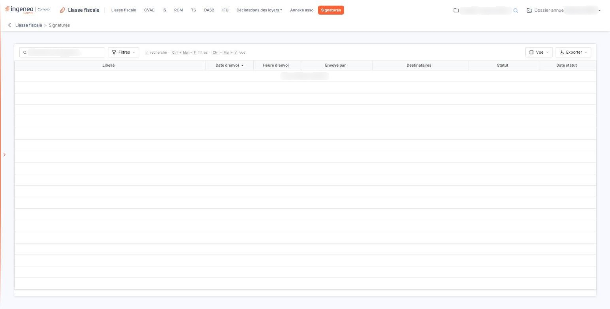

# Signatures


**Où le trouver :** Menu **Signatures**



**En bref** — Cet écran de consultation suit les liasses adressées en signature électronique : date et heure d'envoi, auteur, destinataires, statut et date du statut.

* Pour rafraîchir l'avancement d'une demande : troisième pictogramme de la ligne, qui met à jour le statut et récupère le document signé.
* Pour retrouver une demande par son état : bouton \[Filtres], critère sur la colonne Statut, puis bouton \[Filtrer].


Cette option vous permet de suivre les liasses que vous avez adressées en signature électronique. C'est un écran de consultation : vous n'y créez rien, vous n'y modifiez rien, et il ne comporte aucun bouton de création ni de suppression.

<figure><figcaption>
Écran « Signatures » de la nouvelle interface
</figcaption></figure>

La liste s'alimente d'elle-même : chaque fois que vous adressez une liasse en signature électronique, le logiciel inscrit ici la demande. Tant que vous n'avez envoyé aucune liasse en signature, la liste est vide et affiche « Aucun élément à afficher. ».

Le même écran existe dans plusieurs modules, chacun présentant les demandes de signature qui lui sont propres : vous ne trouvez donc ici que des liasses fiscales.

## La liste des demandes de signature

La liste présente sept colonnes, toutes triables : cliquez sur le titre de l'une d'elles pour trier la liste.

| Champ             | Ce qu'il faut savoir                                                                                                                                                               |
| ----------------- | ---------------------------------------------------------------------------------------------------------------------------------------------------------------------------------- |
| **Libellé**       | Le nom du document adressé en signature.                                                                                                                                           |
| **Date d'envoi**  | La date à laquelle la demande de signature a été adressée.                                                                                                                         |
| **Heure d'envoi** | L'heure de cet envoi. La date et l'heure sont ainsi portées par deux colonnes distinctes, ce qui vous permet de trier séparément sur l'une ou sur l'autre.                         |
| **Envoyé par**    | L'utilisateur qui a demandé la signature.                                                                                                                                          |
| **Destinataires** | Les adresses de courrier électronique auxquelles la demande de signature a été adressée.                                                                                           |
| **Statut**        | L'état d'avancement de la signature. Ce n'est pas le logiciel qui le détermine : c'est le service de signature électronique qui le lui renvoie, et le logiciel l'affiche tel quel. |
| **Date statut**   | La date à laquelle cet état a été constaté pour la dernière fois.                                                                                                                  |

Cette liste n'offre ni sélection de lignes ni lien « Sélectionner la page » : rien ne s'y sélectionne, puisque aucune action ne porte sur un ensemble de lignes. En revanche vous disposez, au-dessus d'elle, d'une zone de recherche « Rechercher une signature… » et des boutons \[Filtres], \[Vue] et \[Exporter]. Le bouton \[Exporter] ouvre un menu qui donne accès à l'impression et aux exports de la liste : « Aperçu édition HTML », « Imprimer », « Exporter en Excel », « Exporter en PDF » et « Envoyer la liste par e-mail ».

Le bouton \[Filtres] ouvre un volet « Filtrer » : vous y ajoutez un critère en choisissant une colonne dans la liste « + Ajouter un critère sur… », qui propose les sept colonnes dans l'ordre de la liste, puis vous cliquez sur le bouton \[Filtrer]. Retenez que pour la colonne **Statut :** vous saisissez vous-même, tout ou partie du libellé de l'état recherché, en vous appuyant sur ce que la colonne affiche : ce n'est pas une liste de valeurs à choisir.

## Les commandes de chaque ligne

Trois pictogrammes sont proposés sur chaque ligne, chacun soumis à une autorisation particulière : ils n'apparaissent donc que si votre profil vous les accorde.

* le premier vous permet de visualiser le document à l'écran ;
* le deuxième vous permet de le télécharger sur votre poste de travail ;
* le troisième interroge le service de signature électronique, met à jour le statut et la date de statut de la ligne, et récupère le document signé lorsqu'il est disponible. C'est par lui que vous rafraîchissez l'avancement d'une demande.
