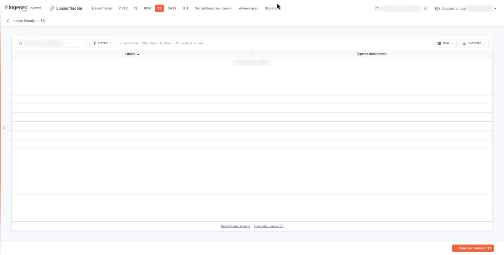
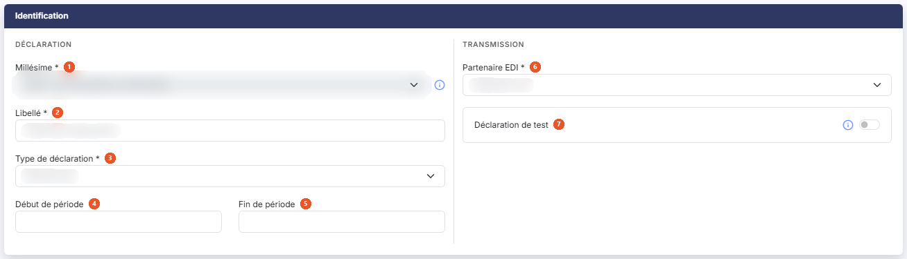
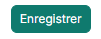

# TS


**Où le trouver :** Menu **TS**



**En bref** — Cet écran gère les déclarations liées à la Taxe sur les Salaires : relevés de versements provisionnels et déclarations annuelles.

* Pour créer une déclaration : bouton \[Créer un paiement TS], choisissez « Déclaration annuelle (TS\_DA) » ou « Relevé de versement provisionnel (TS\_RVP) », puis bouton \[Enregistrer].
* Pour supprimer des déclarations : sélectionnez les lignes, puis bouton \[Supprimer] du bandeau de sélection.


## La liste des déclarations

<figure><figcaption>
Écran « TS » de la nouvelle interface
</figcaption></figure>

Le logiciel affiche directement la liste des déclarations TS déjà créées sur le dossier annuel en cours. Il n'y a pas d'onglet. Au-dessus de la liste, une barre d'outils comprend, de gauche à droite, une zone « Rechercher un paiement… », le bouton **\[Filtres]** (il permet d'ajouter un critère sur une colonne ; un lien « Vider les filtres » les efface), le bouton **\[Vue]** et le bouton **\[Exporter]**.

Deux colonnes sont affichées, l'une et l'autre triables en cliquant sur leur en-tête :

| Champ                   | Ce qu'il faut savoir                                                                                                                                                                                       |
| ----------------------- | ---------------------------------------------------------------------------------------------------------------------------------------------------------------------------------------------------------- |
| **Libellé**             | Le libellé que vous avez donné à la déclaration lors de sa création. C'est lui qui vous permet de la reconnaître : donnez-lui donc un libellé parlant.                                                     |
| **Type de déclaration** | La nature de la déclaration, suivie de son code entre parenthèses — « Déclaration annuelle (TS\_DA) » ou « Relevé de versement provisionnel (TS\_RVP) », selon le type que vous avez choisi dans la fiche. |

La liste n'a plus de case à cocher : un clic sur une ligne la sélectionne. Sous la liste, les liens « Sélectionner la page » et « Tout sélectionner (n) » sélectionnent les lignes de la page affichée ou celles de toutes les pages.

Tant qu'aucune déclaration n'a été créée, la liste affiche la seule mention « Aucun élément à afficher. » ; les en-têtes de colonnes, avec leur flèche de tri, et les liens « Sélectionner la page » et « Tout sélectionner (0) » restent néanmoins affichés.

## Le bouton de création

bouton **\[Créer un paiement TS]**

Placé en bas à droite de l'écran, hors de la liste, il ouvre une fiche d'identification vide, pour créer une déclaration. Voir le paragraphe d).

## La fiche d'identification, à la création

<figure><figcaption>
Rubrique « La fiche d'identification, à la création »
</figcaption></figure>

<figure><figcaption>
Bouton [Enregistrer]
</figcaption></figure>

La fiche ne comporte qu'une rubrique, **Identification**, partagée en deux blocs : « Déclaration », qui regroupe les champs propres à la déclaration et à sa période, et « Transmission », qui regroupe le partenaire EDI et la déclaration de test. Les champs suivis d'un astérisque sont obligatoires.

| Champ                                                                  | Ce qu'il faut savoir                                                                                                                                                                                                                                                                                                                                                                                                                                                                                                                       |
| ---------------------------------------------------------------------- | ------------------------------------------------------------------------------------------------------------------------------------------------------------------------------------------------------------------------------------------------------------------------------------------------------------------------------------------------------------------------------------------------------------------------------------------------------------------------------------------------------------------------------------------ |
| 
1. <strong>Millésime</strong> <em>Obligatoire</em>
           | La campagne déclarative à laquelle rattacher la déclaration, présentée avec ses dates d'ouverture et de fermeture. Lorsqu'une seule campagne est disponible, la liste n'offre que cette valeur et n'est pas modifiable. Un pictogramme d'information rappelle à côté du champ que, si deux choix vous sont proposés, le premier correspond à la campagne en cours qui va bientôt se terminer et le second à la prochaine campagne : si vous ne pouvez pas transmettre la liasse avant la date de fin du premier choix, utilisez le second. |
| 
2. <strong>Libellé</strong> <em>Obligatoire</em>
             | Le nom que vous donnez à la déclaration. C'est ce libellé qui apparaît dans la liste.                                                                                                                                                                                                                                                                                                                                                                                                                                                      |
| 
3. <strong>Type de déclaration</strong> <em>Obligatoire</em>
 | 
La nature de la déclaration à établir. Deux valeurs vous sont proposées, en plus du choix initial « Sélectionnez » : « Déclaration annuelle (TS_DA) » « Relevé de versement provisionnel (TS_RVP) »
                                                                                                                                                                                                                                                                                                                           |
| 4. **Début de période**                                                | Le premier jour de la période déclarée. Le champ est vide à la création ; vous le saisissez au clavier ou dans le calendrier qui s'ouvre lorsque vous cliquez dans le champ.                                                                                                                                                                                                                                                                                                                                                               |
| 5. **Fin de période**                                                  | Le dernier jour de la période déclarée, saisi de la même façon.                                                                                                                                                                                                                                                                                                                                                                                                                                                                            |
| 
6. <strong>Partenaire EDI</strong> <em>Obligatoire</em>
      | Le partenaire par lequel la déclaration sera transmise. Quatre valeurs vous sont proposées — « Jedeclare.com », proposé par défaut, « ASP ONE », « NET DECLARATION » et « TDNIM ».                                                                                                                                                                                                                                                                                                                                                         |
| 7. **Déclaration de test**                                             | Répondez Oui pour transmettre une déclaration de test. Une déclaration de test sera transmise à votre partenaire EDI mais ne sera pas prise en compte par l'Administration fiscale. Vous pouvez utiliser une déclaration de test pour, par exemple, vous assurer que la transmission des déclarations se fait correctement. La réponse Non est proposée par défaut.                                                                                                                                                                        |

Deux commandes ferment la fiche :

bouton **\[Enregistrer]**

Placé en bas à droite de l'écran, il enregistre la déclaration et vous ramène à la liste.

**Flèche « Revenir en arrière »**

Placée à gauche du fil d'Ariane, en haut de l'écran, elle revient à la liste sans rien enregistrer.
