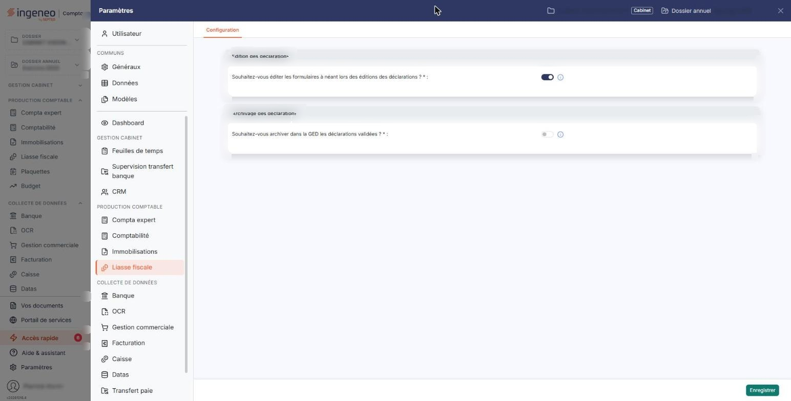

# Configuration


**Où le trouver :** Panneau **Paramètres** › **Liasse fiscale** › **Configuration**



**En bref** — Cet écran fixe deux choix communs à toutes les déclarations du module : la présence des formulaires à néant dans les éditions et l'archivage des déclarations dans la GED.

* Pour archiver automatiquement les déclarations : activez « Souhaitez-vous archiver dans la GED les déclarations validées ? », choisissez l'arborescence, puis bouton \[Enregistrer].
* Pour abandonner vos modifications : quittez l'onglet, puis bouton \[Continuer sans enregistrer].


Cet écran ne s'ouvre plus par un menu « Paramètres » du module, qui a disparu : il se trouve dans le panneau « Paramètres », que vous ouvrez par l'entrée « Paramètres » de la barre latérale (en bas de la liste ; hors tableau de bord, ouvrez d'abord la barre par la poignée du bord gauche), rubrique « Liasse fiscale », onglet « Configuration ».

<figure><figcaption>
Écran « Configuration » de la nouvelle interface
</figcaption></figure>

Cette option regroupe les deux choix qui s'appliquent à toutes les déclarations du module : ce que contiennent leurs éditions, et si le logiciel en conserve une copie dans la GED de la société gérée.

L'écran comporte deux rubriques. La première ne pose qu'une question ; la seconde en pose une, puis une deuxième qui n'apparaît que si vous avez activé la première. Chacune se règle par un interrupteur, que vous activez ou désactivez ; les trois sont obligatoires. Chaque question est accompagnée d'un pictogramme d'information, la lettre « i » cerclée : le texte s'affiche dans une infobulle lorsque vous passez la souris sur le pictogramme, et disparaît quand vous l'en retirez.

## Rubrique « Edition des déclarations »

**Souhaitez-vous éditer les formulaires à néant lors des éditions des déclarations ?** : activez l'interrupteur pour que les formulaires sans montant figurent dans les éditions, désactivez-le pour ne sortir que les formulaires servis.

Comme l'indique son pictogramme d'information : « Si vous indiquez "Non", l'option "Avec les formulaires à "Néant"" sera positionnée à "Non" par défaut lors du lancement de l'édition d'une déclaration, et l'édition archivée dans la GED lors de la télétransmission n'inclura pas les formulaires à néant. »

Votre réponse n'interdit donc rien : elle fixe la valeur proposée par défaut au lancement d'une édition, que vous pouvez encore changer à ce moment-là. En revanche, elle s'applique sans recours à l'édition archivée automatiquement dans la GED lors de la télétransmission.

Cette rubrique ne comporte pas d'autre question.

## Rubrique « Archivage des déclarations »

| Champ                                                                            | Ce qu'il faut savoir                                                                                                                                                                                                                                                                                                                                                                                                                                                                                                                                                         |
| -------------------------------------------------------------------------------- | ---------------------------------------------------------------------------------------------------------------------------------------------------------------------------------------------------------------------------------------------------------------------------------------------------------------------------------------------------------------------------------------------------------------------------------------------------------------------------------------------------------------------------------------------------------------------------- |
| **Souhaitez-vous archiver dans la GED les déclarations validées ?**              | 
Activez l'interrupteur pour que le logiciel enregistre automatiquement dans la GED de la société gérée une copie de chaque déclaration télétransmise. Comme l'indique son pictogramme d'information : « Si vous indiquez "Oui", chaque déclaration télétransmise sera enregistrée dans la GED. Un répertoire y sera automatiquement créé, pour chaque dossier annuel, lors de la télétransmission d'une déclaration dans le dossier annuel. » L'activer fait apparaître la question suivante, qui n'a pas d'objet sans lui ; le désactiver la fait disparaître.
 |
| **Souhaitez-vous une arborescence avec années puis les types de déclarations ?** | Vous choisissez ici comment les copies sont classées dans la GED. L'interrupteur est activé par défaut.                                                                                                                                                                                                                                                                                                                                                                                                                                                                      |

Comme l'indique le pictogramme d'information de cette question :

* « Si vous répondez « Oui », un répertoire sera créé par année civile avec des sous-répertoires par type de déclaration » ;
* « si vous répondez "Non", un répertoire sera créé pour chaque type de déclaration avec des sous-répertoires par année civile. »

## Bouton \[Enregistrer]

<figure><figcaption>
Bouton [Enregistrer]
</figcaption></figure>

Il enregistre les réponses des deux rubriques. C'est le seul bouton de l'écran, et il n'apparaît que si vous avez le droit d'enregistrer les paramètres généraux de la liasse fiscale. Pour abandonner une modification, quittez l'onglet sans cliquer sur ce bouton : le logiciel affiche alors la fenêtre « Modifications non enregistrées », où bouton **\[Continuer sans enregistrer]** vous laisse quitter l'onglet sans rien enregistrer et bouton **\[Enregistrer et quitter]** enregistre vos changements avant de quitter. Après \[Continuer sans enregistrer], votre saisie n'est pas effacée : si vous revenez sur l'onglet sans avoir fermé le panneau, vous la retrouvez telle que vous l'aviez laissée, toujours non enregistrée.
