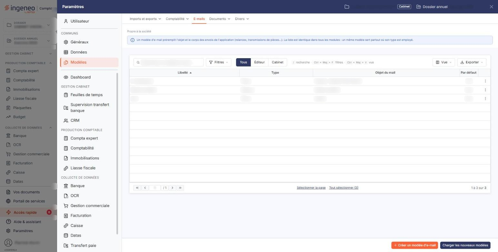
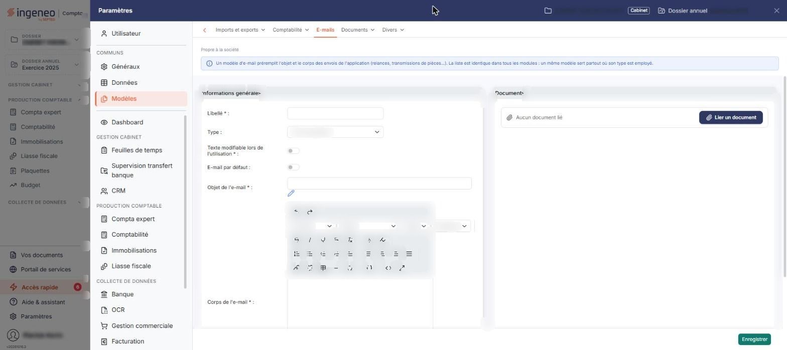
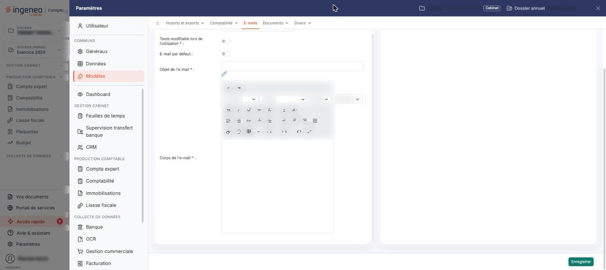
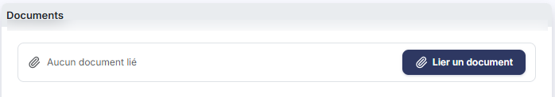
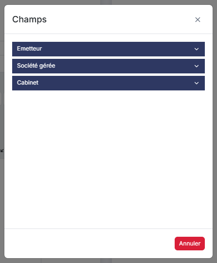

# E-mails


**Où le trouver :** Panneau **Paramètres** › **Modèles** › **E-mails**



**En bref** — Cet écran prépare l'objet et le texte des e-mails envoyés par le logiciel, pour chaque type d'envoi ; le modèle par défaut est proposé automatiquement au moment de l'envoi.

* Pour créer un modèle : bouton \[Créer un modèle d'e-mail], renseignez le libellé, l'objet et le corps, puis bouton \[Enregistrer].
* Pour récupérer les modèles préparés par Ingeneo Compta : bouton \[Charger les nouveaux modèles].


Cette option permet de préparer, une fois pour toutes, l'objet et le texte des e-mails que le logiciel envoie : envoi de pièces, envoi de déclarations, relance, courrier client… Vous rédigez ici le message ; vous le retrouvez ensuite proposé au moment de l'envoi, sans avoir à le réécrire.

<figure><figcaption>
Écran « E-mails » de la nouvelle interface
</figcaption></figure>

Chaque modèle est rattaché à un type d'envoi. Pour un même type, vous pouvez désigner celui que le logiciel proposera automatiquement : c'est le modèle « par défaut ».

Les modèles sont communs à tous les modules qui envoient des e-mails. Vous retrouvez donc dans cette liste des modèles préparés depuis un autre module, et le type vous indique à quel envoi chacun est destiné.

## La liste des modèles

La liste présente quatre colonnes, toutes triables : cliquez sur le titre de l'une d'elles pour trier la liste.

| Champ             | Ce qu'il faut savoir                                                                                                                                                                                                                                                            |
| ----------------- | ------------------------------------------------------------------------------------------------------------------------------------------------------------------------------------------------------------------------------------------------------------------------------- |
| **Libellé**       | Le nom que vous avez donné au modèle ; c'est sous ce nom que vous le reconnaîtrez au moment de l'envoi.                                                                                                                                                                         |
| **Type**          | Le type d'envoi auquel le modèle est rattaché. Prenez garde : cette colonne affiche le type sous une forme abrégée, qui n'est pas celle du champ **Type :** de la fiche du modèle. Ainsi la mention « Piece » dans la liste correspond au type « Envoi de pièces » de la fiche. |
| **Objet du mail** | L'objet du message. Il s'agit de la même information que le champ **Objet de l'e-mail :** de la fiche, sous un libellé différent.                                                                                                                                               |
| **Par défaut**    | « Oui » si ce modèle est celui que le logiciel proposera automatiquement pour son type d'envoi, « Non » dans le cas contraire. Selon la largeur de votre écran, le titre de cette colonne peut apparaître tronqué.                                                              |

Sur chaque ligne, le pictogramme « Modifier » permet de modifier le modèle, le pictogramme « Dupliquer » de le dupliquer pour en créer un nouveau à partir de celui-ci, et le pictogramme « Autres actions » (trois points) donne accès à la suppression.

Au-dessus de la liste, l'écran propose une zone de recherche « Rechercher un modèle d'e-mail… », les boutons « Filtres », « Vue » et « Exporter », ainsi que les liens « Sélectionner la page » et « Tout sélectionner ».

bouton **\[Créer un modèle d'e-mail]**

Il ouvre une fiche vierge pour créer un modèle d'e-mail. La fiche comporte deux rubriques, décrites aux paragraphes b) et c).

bouton **\[Charger les nouveaux modèles]**

Il récupère dans votre fichier les modèles d'e-mails préparés par Ingeneo Compta qui n'y figurent pas encore, ou qui ont été mis à jour depuis leur chargement.

## Rubrique « Informations générales »

<figure><figcaption>
Rubrique « Informations générales »
</figcaption></figure>

<figure><figcaption>
Rubrique « Informations générales »
</figcaption></figure>

| Champ                                                                                  | Ce qu'il faut savoir                                                                                                   |
| -------------------------------------------------------------------------------------- | ---------------------------------------------------------------------------------------------------------------------- |
| **Libellé**                                                                            | Il ne se saisit qu'à la création : sur un modèle déjà enregistré, ce champ est grisé et ne peut plus être modifié.     |
| **Type**                                                                               | Le type d'envoi auquel le modèle est destiné. La liste proposée dépend du module dans lequel l'écran est ouvert.       |
| 
<strong>Texte modifiable lors de l'utilisation</strong> <em>Obligatoire</em>
 | Interrupteur, activé ou désactivé.                                                                                     |
| **E-mail par défaut**                                                                  | Activez cette option pour que ce modèle soit celui que le logiciel propose automatiquement pour son type d'envoi.      |
| **Objet de l'e-mail**                                                                  | C'est l'objet du message. Le pictogramme placé à droite du champ ouvre la fenêtre « Champs » décrite au paragraphe d). |
| **Corps de l'e-mail**                                                                  | Vous saisissez ici le texte du message dans un éditeur de texte enrichi.                                               |

## Rubrique « Documents »

<figure><figcaption>
Rubrique « Documents »
</figcaption></figure>

Cette rubrique permet de joindre des documents au modèle.

## La fenêtre « Champs »

<figure><figcaption>
Rubrique « La fenêtre « Champs » »
</figcaption></figure>

Cette fenêtre, ouverte par le pictogramme en regard de l'objet, présente les champs disponibles pour ce type de modèle. Ils sont regroupés par catégories, que vous dépliez d'un clic ; chaque catégorie déplie un tableau de deux colonnes : le code et le libellé.

bouton **\[Annuler]** : il ferme la fenêtre sans rien insérer.

## Enregistrement de la fiche

<figure><figcaption>
Rubrique « Enregistrement de la fiche »
</figcaption></figure>

bouton **\[Enregistrer]** : il valide votre saisie.
