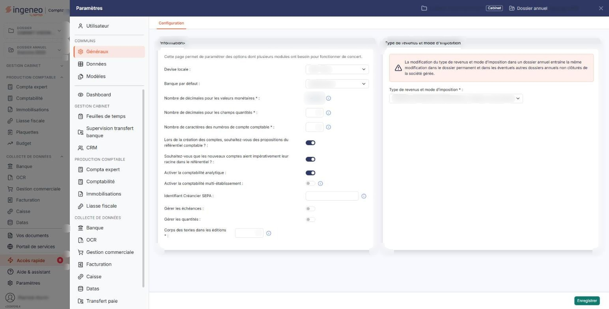

# Multimodules


**Où le trouver :** Panneau **Paramètres** › **Généraux** › **Configuration**



**En bref** — Cet écran regroupe les paramètres dont plusieurs modules ont besoin : décimales, longueur des comptes, échéances, analytique, devise, banque par défaut et type de revenus et mode d'imposition.

* Pour indiquer le régime de la société : lisez l'avertissement en rouge, choisissez le « Type de revenus et mode d’imposition », puis bouton \[Enregistrer].
* Pour gérer les échéances : activez « Gérer les échéances », choisissez les délais de règlement par défaut, puis bouton \[Enregistrer].


Cette option est ainsi nommée parce qu'elle regroupe des paramètres dont plusieurs modules ont besoin pour fonctionner de concert. L'écran l'annonce lui-même par la phrase « Cette page permet de paramétrer des options dont plusieurs modules ont besoin pour fonctionner de concert. »

<figure><figcaption>
Écran « Multimodules » de la nouvelle interface
</figcaption></figure>

L'écran se compose de deux rubriques, sans onglet ni liste. Les champs suivis d'un astérisque sont obligatoires. Certaines questions n'apparaissent qu'en fonction de vos réponses aux précédentes : la liste des champs affichés n'est donc pas la même pour tous les dossiers.

## Rubrique « Paramètres - Informations relevant de plusieurs modules »

| Champ                                                                                                | Ce qu'il faut savoir                                                                                                                                                                                                                                                                                                                                                                                                                                                                                                                                                                                                                                                                                   |
| ---------------------------------------------------------------------------------------------------- | ------------------------------------------------------------------------------------------------------------------------------------------------------------------------------------------------------------------------------------------------------------------------------------------------------------------------------------------------------------------------------------------------------------------------------------------------------------------------------------------------------------------------------------------------------------------------------------------------------------------------------------------------------------------------------------------------------ |
| 
<strong>Nombre de décimales pour les valeurs monétaires</strong> <em>Obligatoire</em>
      | 
Il peut prendre les valeurs 0, 1, 2, 3 et 4. Bien qu'il soit obligatoire, ce champ n'est <strong>pas saisissable</strong> : il s'affiche en lecture seule. Pour le faire modifier, prenez contact avec le service technique, comme vous y invite son pictogramme d'information.
                                                                                                                                                                                                                                                                                                                                                                                                              |
| 
<strong>Nombre de décimales pour les champs quantités</strong> <em>Obligatoire</em>
        | Son pictogramme d'information rappelle qu'il va de 0 à 4.                                                                                                                                                                                                                                                                                                                                                                                                                                                                                                                                                                                                                                              |
| 
<strong>Nombre de caractères des numéros de compte comptable</strong> <em>Obligatoire</em>
 | 
Comme l'indique son pictogramme d'information, la valeur doit être comprise entre 6 et 12 caractères, et la modification est effectuée sur le dossier annuel en cours ainsi que sur les deux dossiers annuels précédents, afin de conserver les possibilités de comparaison. <strong>Lors de la création des comptes, souhaitez-vous des propositions du référentiel comptable ? :</strong> interrupteur, activé ou désactivé. Activer cet interrupteur fait apparaître la question suivante ; le désactiver la fait disparaître. <strong>Souhaitez-vous que les nouveaux comptes aient impérativement leur racine dans le référentiel ? :</strong> interrupteur, activé ou désactivé.
 |
| **Identifiant Créancier SEPA**                                                                       | Comme l'indique son pictogramme d'information, l'Identifiant Créancier SEPA (ICS) est obligatoire si vous souhaitez générer des ordres de prélèvements SEPA ; cette information est à récupérer auprès de votre banque.                                                                                                                                                                                                                                                                                                                                                                                                                                                                                |
| **Gérer les échéances**                                                                              | 
Interrupteur, activé ou désactivé. Activer l'interrupteur précédent fait apparaître une question supplémentaire :
                                                                                                                                                                                                                                                                                                                                                                                                                                                                                                                                                                            |
| **Renseigner automatiquement les échéances pour les fournisseurs et les clients**                    | 
Comme le rappelle son pictogramme d'information, l'échéance est renseignée automatiquement pour les comptes dont les échéances sont gérées. Activer cette seconde question fait apparaître à son tour deux listes, précédées de la phrase « Pour les comptes dont les paramètres d'échéances ne sont pas définis, les paramètres ci-dessous s'appliquent. » :
                                                                                                                                                                                                                                                                                                                                |
| **Délai de règlement par défaut des fournisseurs**                                                   | Le délai qui s'applique aux fournisseurs pour lesquels aucun délai propre n'a été défini.                                                                                                                                                                                                                                                                                                                                                                                                                                                                                                                                                                                                              |
| **Délai de règlement par défaut des clients**                                                        | 
Le délai qui s'applique aux clients pour lesquels aucun délai propre n'a été défini. Les deux listes proposent les mêmes valeurs : « A date de facture », « Fin de mois », « 30 jours », « 45 Jours », « 30 jours fin de mois », « 30 jours fin décade », « 45 jours fin de mois », « 60 jours », « 60 jours fin décade » et « 90 jours ». Tant que vous n'avez rien choisi, la liste affiche « Sélectionnez ».
                                                                                                                                                                                                                                                                              |
| **Activer la comptabilité analytique**                                                               | Interrupteur, activé ou désactivé.                                                                                                                                                                                                                                                                                                                                                                                                                                                                                                                                                                                                                                                                     |
| **Activer la comptabilité multi-établissement**                                                      | En activant cette option, vous devrez affecter les écritures à un établissement. Les établissements doivent être créés dans le module « Dossier permanent », menu « Social », option « Etablissements ».                                                                                                                                                                                                                                                                                                                                                                                                                                                                                               |
| **Gérer les quantités**                                                                              | Interrupteur, activé ou désactivé.                                                                                                                                                                                                                                                                                                                                                                                                                                                                                                                                                                                                                                                                     |
| **Devise locale**                                                                                    | La liste propose les devises du référentiel, sous la forme du code international suivi du libellé, par exemple « EUR - Euro ».                                                                                                                                                                                                                                                                                                                                                                                                                                                                                                                                                                         |
| **Banque par défaut**                                                                                | Liste déroulante alimentée par les banques du dossier ; tant que vous n'avez rien choisi, elle affiche « Sélectionnez ».                                                                                                                                                                                                                                                                                                                                                                                                                                                                                                                                                                               |
| 
<strong>Corps des textes dans les éditions</strong> <em>Obligatoire</em>
                   | Ce paramètre détermine la taille d'affichage des textes standards dans les éditions ; sa valeur doit être comprise entre 8 et 18.                                                                                                                                                                                                                                                                                                                                                                                                                                                                                                                                                                      |

## Rubrique « Type de revenus et mode d'imposition »

Un avertissement en rouge ouvre cette rubrique : « La modification du type de revenus et mode d’imposition dans un dossier annuel entraîne la même modification dans le dossier permanent et dans les éventuels autres dossiers annuels non clôturés de la société gérée. » Lisez-le avant toute modification : la portée de ce changement dépasse le dossier annuel sur lequel vous êtes positionné.

**Type de revenus et mode d’imposition** \* : indiquez le régime auquel est soumise la société gérée. La liste propose « Bénéfices Agricoles », « Bénéfices Industriels et Commerciaux / Impôts sur le Revenu », « Bénéfices Industriels et Commerciaux / Impôts sur les Sociétés », « Bénéfices Non Commerciaux », « Non imposable », « Nouvelle-Calédonie », « Revenus Fonciers », « Revenus Fonciers Professionnels » et « Revenus Fonciers professionnels et non professionnels ». Tant que vous n'avez rien choisi, la liste affiche « Sélectionnez ».

Prenez garde aux deux dernières valeurs, qui se ressemblent beaucoup : « Revenus Fonciers Professionnels » ne couvre que les revenus professionnels, tandis que « Revenus Fonciers professionnels et non professionnels » couvre les deux.

bouton **\[Enregistrer]**

Il enregistre l'ensemble des paramètres de l'écran. C'est le seul bouton de cet écran : il n'y a ni retour, ni annulation, ni impression.
