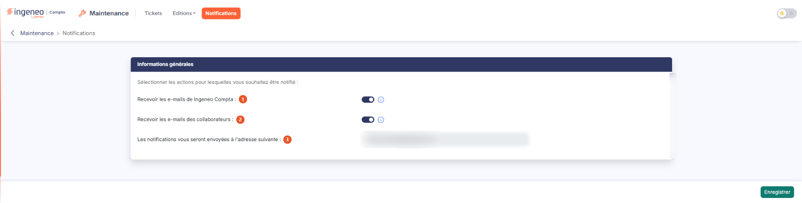

# Notifications


**Où le trouver :** Menu **Notifications**



**En bref** — Cet écran vous permet de choisir les actions sur vos tickets pour lesquelles vous recevez un e-mail. Le réglage vous est propre et ne modifie pas celui de vos collègues.

* Pour être averti des commentaires, fermetures et réouvertures de vos tickets par Ingeneo Compta : activez l'interrupteur « Recevoir les e-mails de Ingeneo Compta », puis bouton \[Enregistrer].
* Pour être averti des commentaires de vos collaborateurs sur vos tickets : activez l'interrupteur « Recevoir les e-mails des collaborateurs », puis bouton \[Enregistrer].


## Rubrique « Informations générales »

<figure><figcaption>
Écran « Notifications » de la nouvelle interface
</figcaption></figure>

L'écran ne comporte qu'une seule rubrique, introduite par la phrase « Sélectionner les actions pour lesquelles vous souhaitez être notifié : », et composée de trois lignes.

| Champ                                                              | Ce qu'il faut savoir                                                                                                                                                                                                                                                           |
| ------------------------------------------------------------------ | ------------------------------------------------------------------------------------------------------------------------------------------------------------------------------------------------------------------------------------------------------------------------------ |
| 1. **Recevoir les e-mails de Ingeneo Compta**                      | Interrupteur (« activé » ou « désactivé »). Si l'interrupteur est activé, à chaque fois qu'un intervenant de Ingeneo Compta ajoutera un commentaire à l'un de vos tickets, ou si l'un de vos tickets est fermé ou rouvert par Ingeneo Compta, vous serez averti par un e-mail. |
| 2. **Recevoir les e-mails des collaborateurs**                     | Interrupteur. Si l'interrupteur est activé, à chaque fois qu'un de vos collaborateurs ajoutera un commentaire à l'un de vos tickets, vous serez averti par un e-mail.                                                                                                          |
| 3. **Les notifications vous seront envoyées à l'adresse suivante** | Cette zone affiche l'adresse e-mail à laquelle le logiciel vous écrit. Elle est grisée : l'adresse ne se saisit pas ici.                                                                                                                                                       |

## Les actions

bouton **\[Enregistrer]**

Il conserve vos choix ; le logiciel affiche ensuite une fenêtre « Confirmation » vous indiquant que vos modifications ont bien été enregistrées.

Ce bouton n'apparaît que si votre profil vous autorise à enregistrer ce réglage ; à défaut, l'écran reste consultable.
