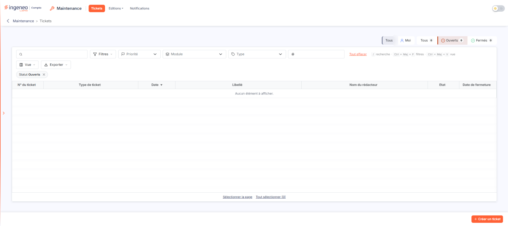
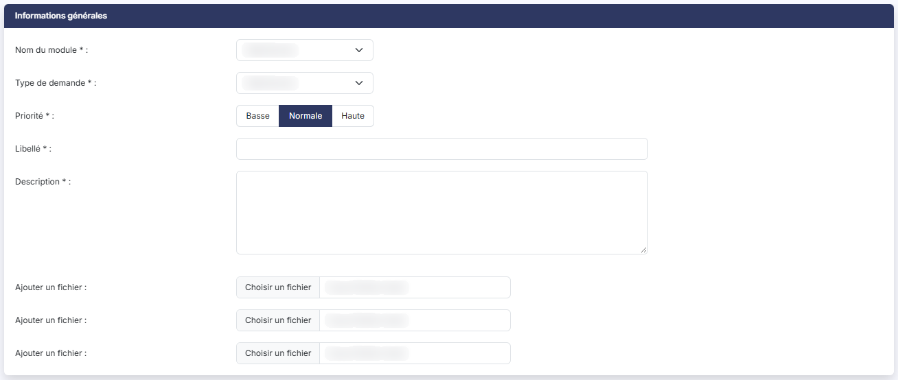

# Tickets


**Où le trouver :** Menu **Tickets**



**En bref** — Cet écran sert à poser vos questions à Ingeneo Compta sous forme de tickets : question sur l'utilisation, manque fonctionnel ou bug, un seul sujet par ticket, avec le suivi des réponses.

* Pour créer un ticket : choisissez le « Nom du module » concerné (champ obligatoire), puis le « Type de demande » (Question sur l’utilisation, Manque fonctionnel ou Bug).
* Pour indiquer l'urgence : choisissez la « Priorité » (champ obligatoire) ; Basse, Normale, ou Haute si votre demande vous empêche de finaliser une tâche.
* Pour décrire votre demande : saisissez un « Libellé », repris dans la liste, puis une « Description » précise (champ obligatoire) ; joignez au besoin des copies d'écran avec « Ajouter un fichier ».


* une question sur le fonctionnement de l’application,
* un manque fonctionnel que vous voudriez voir ajouter,
* un bug (dysfonctionnement) de l’application,
* une demande d'intégration,
* une demande de restauration.

<figure><figcaption>
Écran « Tickets » de la nouvelle interface
</figcaption></figure>

**La liste des tickets**

L'option Tickets du module Maintenance présente la liste des tickets (fil d'Ariane « Maintenance > Tickets ») sur sept colonnes : **N° du ticket**, **Type de ticket**, **Date**, **Libellé**, **Nom du rédacteur**, **Etat** et **Date de fermeture**.

Au-dessus de la liste, un bandeau placé à droite porte deux groupes de boutons juxtaposés : le premier, « Tous » ou « Moi », limite la liste aux tickets que vous avez créés ; le second, « Tous », « Ouverts » ou « Fermés », la limite selon le statut du ticket, chaque choix portant le nombre de tickets correspondants. Sous le bandeau, une barre porte le champ « Rechercher un ticket… », le bouton \[Filtres], la liste « Priorité », les listes « Module » et « Type », le champ « N° de ticket » et le lien « Tout effacer », qui n'apparaît que lorsqu'un filtre est posé ; la ligne suivante porte les boutons \[Vue] et \[Exporter]. Sous la liste, Bouton \[Sélectionner la page] et Bouton \[Tout sélectionner (N)] sélectionnent respectivement les lignes de la page et tous les tickets.

Les deux groupes de boutons et la liste « Priorité » offrent les choix « Tous » et « Moi » ; « Tous », « Ouverts » et « Fermés » ; et, pour la priorité, « Basse », « Normale » et « Haute ». À l'ouverture de l'écran, seuls les tickets « Ouverts » sont affichés : une pastille « Statut Ouverts » figure sous la barre, et « Tout effacer » remet le statut sur « Tous ».

Le bouton \[Créer un ticket] se trouve en bas de l'écran.

**a) Création d’un nouveau ticket**

| Champ                  | Ce qu'il faut savoir                                                                                                                                                                                                                                                                                                                                                                                                                                                                                                                                                                            |
| ---------------------- | ----------------------------------------------------------------------------------------------------------------------------------------------------------------------------------------------------------------------------------------------------------------------------------------------------------------------------------------------------------------------------------------------------------------------------------------------------------------------------------------------------------------------------------------------------------------------------------------------- |
| **Nom du module**      | Champ obligatoire. Choisissez le module concerné par votre demande.                                                                                                                                                                                                                                                                                                                                                                                                                                                                                                                             |
| **Type de demande**    | 
Choisissez le type de votre demande entre les trois possibilités suivantes : • Question sur l’utilisation : malgré la consultation de l’aide en ligne et de vos collègues, vous ne parvenez pas à trouver le mode opératoire pour effectuer une tâche ou un traitement. • Manque fonctionnel : vous souhaitez voir ajouter une fonctionnalité qui n’existe pas dans l’application. • Bug : vous avez observé un dysfonctionnement de l’application et/ou vous avez eu un message d’erreur du type « Une erreur est survenue » qui vous a bloqué dans l’utilisation du logiciel.
 |
| **Priorité**           | 
Champ obligatoire. Choisissez entre : • Basse : à utiliser surtout pour les problèmes de forme ou de confort d’utilisation ne présentant pas de caractère d’urgence. • Haute : pour le cas où votre demande est bloquante c’est-à-dire vous empêche, par exemple, de finaliser une tâche. • Normale : à utiliser pour tous les autres cas.
                                                                                                                                                                                                                                      |
| **Libellé**            | Entrez le titre de votre ticket qui sera repris dans la liste.                                                                                                                                                                                                                                                                                                                                                                                                                                                                                                                                  |
| **Description**        | Champ obligatoire. Entrez le descriptif détaillé de votre demande. Plus votre description sera précise, plus votre demande aura de chance d’être traitée rapidement.                                                                                                                                                                                                                                                                                                                                                                                                                            |
| **Ajouter un fichier** | Pour documenter votre demande, vous pouvez joindre tous types de fichiers et notamment des copies d’écran, des éditions PDF, des fichiers Word ou Excel.                                                                                                                                                                                                                                                                                                                                                                                                                                        |

## Autres vues de l'écran

<figure><figcaption>
Création d'un nouveau ticket
</figcaption></figure>
