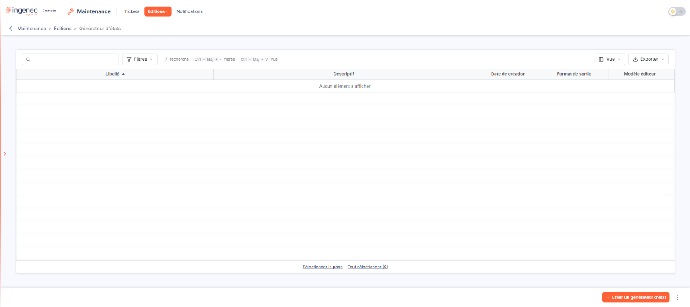
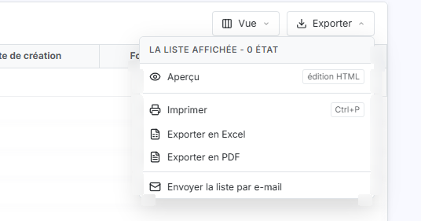
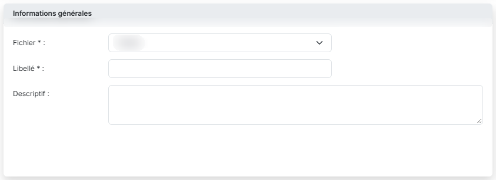
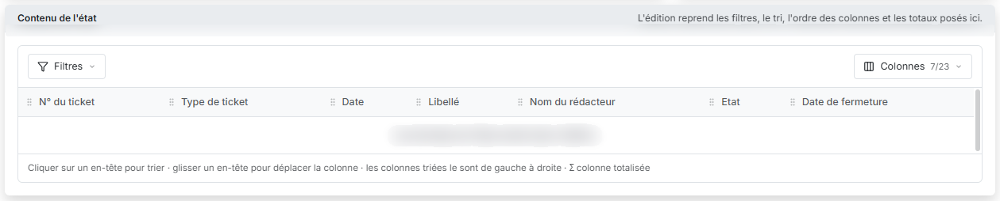
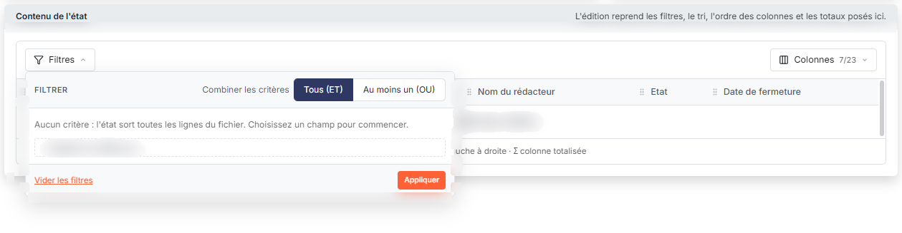
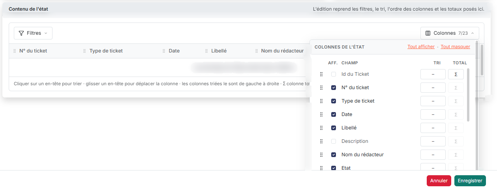
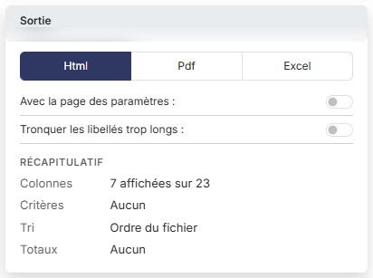
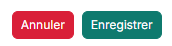

# Générateur d'états


**Où le trouver :** Menu **Editions › Générateur d'états**



**En bref** — Le générateur d'états vous permet de composer, mémoriser et relancer vos propres éditions de la liste des tickets, avec les colonnes et critères de votre choix.

* Pour créer un état : bouton \[Créer un générateur d'état], le « Fichier » Tickets est déjà sélectionné, donnez un « Libellé », réglez les colonnes, puis bouton \[Enregistrer].
* Pour choisir les colonnes d'un seul geste : bouton \[Colonnes], liens « Tout afficher » ou « Tout masquer ».
* Pour régler la sortie : choisissez le « Format de sortie » (« Html », « Pdf » ou « Excel »), puis bouton \[Enregistrer].


Le générateur d'états vous permet de composer vos propres éditions, de les mémoriser et de les relancer aussi souvent que nécessaire. Dans ce module, il porte sur un seul fichier : **Tickets**. C'est donc l'outil qui vous permet d'éditer votre liste de tickets selon vos propres critères, avec les colonnes de votre choix.

<figure><figcaption>
Écran « Générateur d'états » de la nouvelle interface
</figcaption></figure>

Son intérêt principal est là : les champs proposés vont au-delà des colonnes affichées par la liste des tickets. Vous y trouvez par exemple les intervenants qui ont fermé, modifié ou rouvert un ticket, ou encore le dossier annuel concerné, qui ne figurent pas dans la grille.

## La liste de vos états

<figure><figcaption>
Bouton [Exporter]
</figcaption></figure>

L'écran s'ouvre sur la liste des états que vous avez déjà créés, décrits par cinq colonnes : **Libellé**, **Descriptif**, **Date de création**, **Format de sortie** et **Modèle éditeur**. Tant qu'aucun état n'a été enregistré, la liste affiche « Aucun élément à afficher. ».

bouton **\[Créer un générateur d'état]**

Placé en bas à droite de l'écran, il ouvre à droite le panneau « Nouvel état », qui est la fiche d'un nouvel état (voir ci-dessous).

bouton **\[Exporter]**

Il ouvre un menu qui propose les entrées « Aperçu édition HTML », « Imprimer », « Exporter en Excel », « Exporter en PDF » et « Envoyer la liste par e-mail ».

## La fiche d'un état

<figure><figcaption>
Rubrique « b) La fiche d'un état »
</figcaption></figure>

<figure><figcaption>
Rubrique « b) La fiche d'un état »
</figcaption></figure>

<figure><figcaption>
Bouton [Filtres]
</figcaption></figure>

<figure><figcaption>
Bouton [Colonnes]
</figcaption></figure>

<figure><figcaption>
Rubrique « b) La fiche d'un état »
</figcaption></figure>

<figure><figcaption>
Bouton [Enregistrer]
</figcaption></figure>

<figure><figcaption>
Bouton [Annuler]
</figcaption></figure>

La fiche s'ouvre dans un panneau à droite de l'écran, intitulé « Nouvel état », et se compose de trois cartes : « Informations générales », « Sortie » et « Contenu de l'état ».

Dans la première, le **Fichier** à éditer est déjà sélectionné — ici, **Tickets** est le seul proposé (champ obligatoire) —, donnez un **Libellé** à votre état (champ obligatoire) et éventuellement un **Descriptif**.

La carte « Contenu de l'état » présente un aperçu des colonnes de l'édition. Le fichier étant déjà sélectionné, l'état dispose d'emblée de vingt-trois champs, dont sept sont affichés par défaut : **N° du ticket**, **Type de ticket**, **Date**, **Libellé**, **Nom du rédacteur**, **Etat** et **Date de fermeture**. Deux menus la composent : le bouton **\[Filtres]**, qui sert à poser des critères et dans lequel vous réglez « Combiner les critères » sur « Tous (ET) », pour que toutes les conditions soient respectées, ou « Au moins un (OU) », pour qu'une condition au moins le soit ; et le bouton **\[Colonnes]**, qui indique le nombre de colonnes affichées (« 7/23 ») et liste les champs avec, pour chacun, une case d'affichage, un choix de tri et une totalisation, ainsi que les liens « Tout afficher » et « Tout masquer ». Une phrase sous l'aperçu rappelle que l'on clique sur un en-tête pour trier, que l'on glisse un en-tête pour déplacer la colonne, que les colonnes triées le sont de gauche à droite et que le signe Σ marque une colonne totalisée.

La carte « Sortie » commande la présentation du résultat : un choix de format **Html**, **Pdf** ou **Excel**, placé en tête, puis l'interrupteur **Avec la page des paramètres** et les réglages propres au format. Le choix du format modifie les réglages proposés : en « Html », l'interrupteur **Tronquer les libellés trop longs** est affiché ; en « Pdf », il est remplacé par l'interrupteur **Masquer les entêtes et pieds de page** et par le choix **Orientation** (« Portrait » ou « Paysage ») ; en « Excel », seul l'interrupteur **Masquer les entêtes et pieds de page** est proposé. Les interrupteurs sont désactivés à l'ouverture. Un « Récapitulatif » résume l'état en cours de composition : colonnes affichées, critères, tri et totaux.

Le fonctionnement détaillé du générateur d'états, commun à tous les modules où il est présent, est décrit dans le chapitre « Généralités » en tête de la présente aide.

bouton **\[Enregistrer]**

Il enregistre l'état.

bouton **\[Annuler]**

Il referme le panneau sans rien enregistrer ; vous retrouvez la liste de vos états. Si vous avez modifié quelque chose, une fenêtre « Abandon des modifications » vous demande de confirmer l'abandon.
