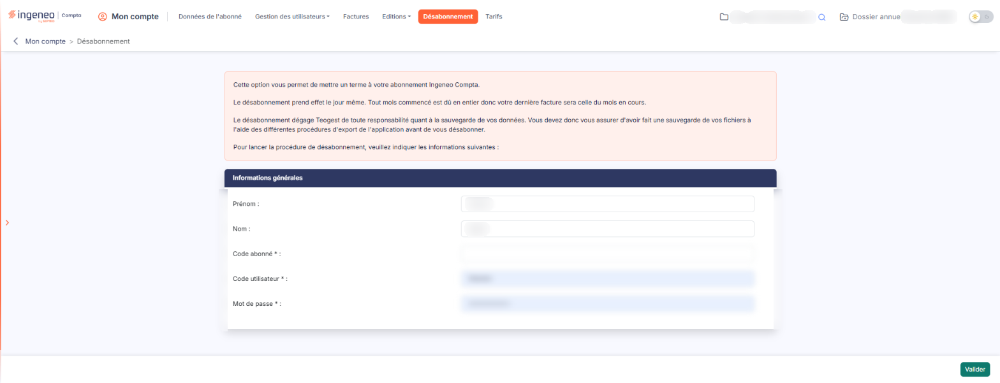

# Désabonnement


**Où le trouver :** Menu **Désabonnement**



**En bref** — Cet écran permet de demander la résiliation de votre abonnement. Il est lourd de conséquences : lisez-le en entier, car le désabonnement prend effet le jour même.

* Pour demander votre désabonnement : renseignez le Code abonné, le Code utilisateur et le Mot de passe, bouton \[Valider], puis confirmez dans la fenêtre « Confirmation ».
* Avant de valider : exportez vos fichiers, la sauvegarde de vos données vous incombe.


* **le désabonnement prend effet le jour même** ;
* **tout mois commencé est dû en entier** : votre dernière facture sera celle du mois en cours ;
* **la sauvegarde de vos données vous incombe.** Le désabonnement dégage l'éditeur de toute responsabilité à ce titre : vous devez donc vous assurer d'avoir exporté vos fichiers, à l'aide des différentes procédures d'export de l'application, **avant** de vous désabonner. Une fois la procédure lancée, plus rien ne garantit que vous pourrez encore le faire.

<figure><figcaption>
Écran « Désabonnement » de la nouvelle interface
</figcaption></figure>

**a) Rubrique « Informations générales »**

C'est la seule rubrique de l'écran. Elle porte cinq champs ; les trois paragraphes rappelés ci-dessus, puis la phrase « Pour lancer la procédure de désabonnement, veuillez indiquer les informations suivantes : », figurent dans l'encadré placé juste au-dessus d'elle. Les trois derniers sont obligatoires, signalés par un astérisque.

| Champ                                                            | Ce qu'il faut savoir                                                                                                                                                                                                                   |
| ---------------------------------------------------------------- | -------------------------------------------------------------------------------------------------------------------------------------------------------------------------------------------------------------------------------------- |
| **Prénom**                                                       | Votre prénom, prérempli avec celui de l'utilisateur connecté.                                                                                                                                                                          |
| **Nom**                                                          | Votre nom, prérempli lui aussi.                                                                                                                                                                                                        |
| 
<strong>Code abonné</strong> <em>Obligatoire</em>
      | Le code de votre abonnement. Il doit être **exactement celui de l'abonnement sous lequel vous êtes connecté** ; sinon le logiciel refuse la demande. Vous ne pouvez donc pas désabonner un autre compte que le vôtre depuis cet écran. |
| 
<strong>Code utilisateur</strong> <em>Obligatoire</em>
 | Votre propre code utilisateur, celui avec lequel vous vous êtes connecté.                                                                                                                                                              |
| 
<strong>Mot de passe</strong> <em>Obligatoire</em>
     | Votre mot de passe de connexion, saisi en clair masqué.                                                                                                                                                                                |

Ces trois champs obligatoires ne servent donc pas à désigner l'abonnement à résilier : ils vous demandent de **confirmer votre identité**, afin qu'une demande aussi lourde ne puisse pas être lancée par mégarde, ni par quelqu'un qui aurait trouvé votre poste ouvert.

**b) Bouton \[Valider]**

C'est le seul bouton de l'écran, et il n'y a ni bouton d'annulation ni retour : pour quitter l'écran sans rien faire, utilisez simplement une autre option de la barre de menu.

Le logiciel ouvre une fenêtre de confirmation intitulée « Confirmation », qui pose la question **« Confirmez-vous la demande de désabonnement ? »**. La demande n'est enregistrée que si vous acceptez ; si vous refusez, rien n'est fait et vous restez sur l'écran, vos saisies conservées.

Une fois la confirmation acceptée, le logiciel affiche le message « Votre demande de désabonnement a bien été prise en compte, un conseiller prendra contact avec vous pour s'assurer que vous êtes bien l'auteur de cette demande et la confirmer. »

Le logiciel adresse alors **deux e-mails** :

* l'un **à vous**, à l'adresse électronique enregistrée dans votre fiche utilisateur, intitulé « Désabonnement aux logiciels … ». Il rappelle la date et l'heure d'enregistrement de la demande, le code abonné concerné, votre nom et votre code utilisateur, et annonce la prise de contact du service commercial. C'est votre preuve : si vous ne le recevez pas, c'est que l'adresse de votre fiche utilisateur est absente ou erronée ;
* l'autre **au service commercial de l'éditeur**, qui reprend les mêmes informations.

Un conseiller prend systématiquement contact avec l'auteur de la demande, pour s'assurer qu'il en est bien à l'origine et confirmer la procédure. Le désabonnement ne se règle donc pas entièrement dans cet écran : la validation enregistre une demande datée, et c'est cet échange qui la mène à son terme. Si vous avez validé par erreur, signalez-le à ce moment-là — ou prenez contact sans attendre.

Une **seconde demande est refusée** : si un désabonnement a déjà été enregistré pour votre abonnement, le logiciel affiche « Votre demande de désabonnement à déjà été enregistrée pour le … », suivi de la date retenue (le message est reproduit ici tel qu'il s'affiche), et ne modifie rien. Il n'est donc pas possible de renouveler ou de corriger la demande par cet écran.
