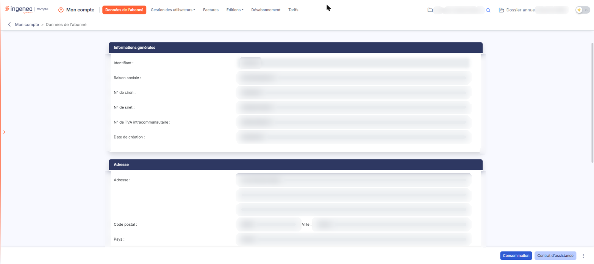
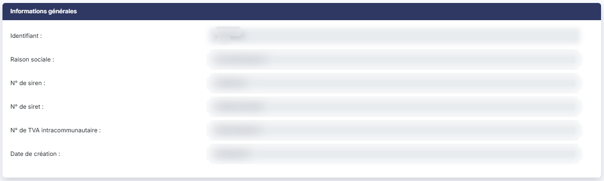
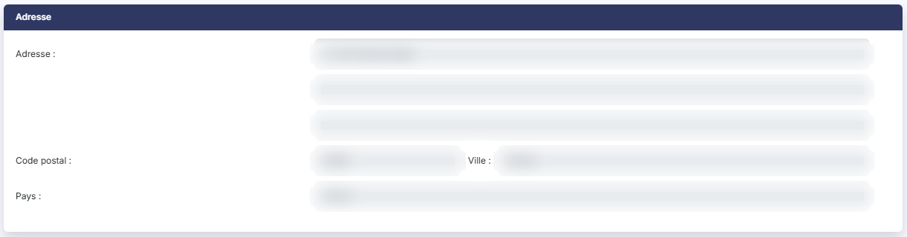
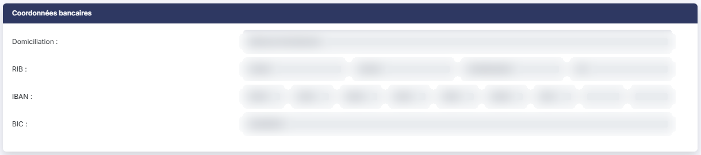
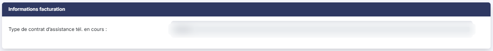
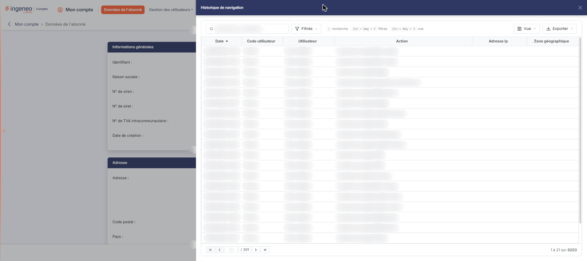
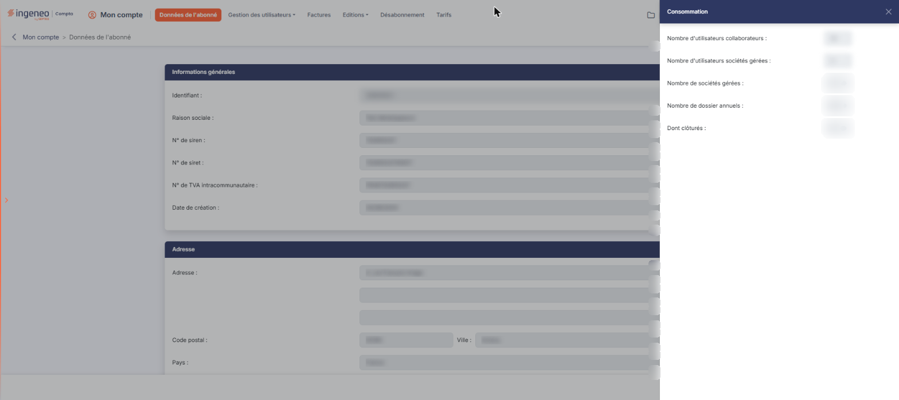
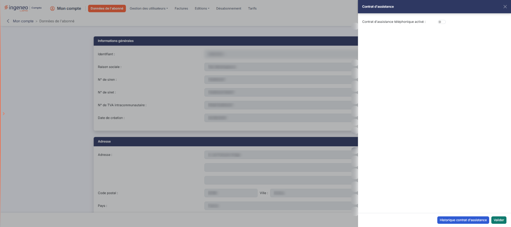
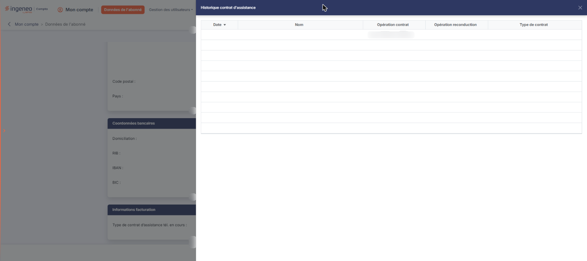

# Données de l'abonné


**Où le trouver :** Menu **Données de l'abonné**



**En bref** — Cet écran d'entrée du module présente, en consultation, les informations de votre abonnement qui servent à votre facturation, et donne accès à l'historique de navigation et à votre consommation.

* Pour voir votre consommation : bouton \[Consommation].
* Pour consulter les connexions de vos utilisateurs : menu ⋮ en bas à droite, entrée « Historique de navigation ».
* Pour faire modifier une information : écrivez à l'Administration des ventes (adv@teogest.com), les champs n'étant pas modifiables.


Cette page vous présente les informations dont Ingeneo Compta dispose sur votre abonnement et qui servent à votre facturation, et elle donne accès à trois consultations : l'historique de navigation de vos utilisateurs, votre consommation et votre contrat d'assistance téléphonique.

<figure><figcaption>
Écran « Données de l'abonné » de la nouvelle interface
</figcaption></figure>

La page est entièrement en **consultation** : tous les champs sont grisés, aucun n'est modifiable et il n'y a aucun bouton d'enregistrement. Si vous souhaitez faire modifier l'une de ces informations, il vous faut adresser un e-mail à notre service Administration des ventes : adv@teogest.com.

**a) Rubrique « Informations générales »**

Elle reprend l'identité de votre abonnement : **Identifiant :** le code de votre abonné, celui que vos utilisateurs saisissent pour se connecter ; **Raison sociale :** ; **N° de siren :** ; **N° de siret :** ; **N° de TVA intracommunautaire :** ; **Date de création :** la date d'ouverture de votre abonnement.

**b) Rubrique « Adresse »**

Il s'agit de l'adresse à laquelle Ingeneo Compta vous adresse ses factures : **Adresse :** sur trois lignes, dont seule la première porte le libellé ; **Code postal :** et **Ville :** sur la même ligne ; **Pays :**.

**c) Rubrique « Coordonnées bancaires »**

Ce sont les coordonnées du compte sur lequel vos règlements sont prélevés lorsque vous avez opté pour le prélèvement automatique : **Domiciliation :** le nom de votre agence ; **RIB :** présenté en quatre zones (code banque, code guichet, numéro de compte et clé) ; **IBAN :** présenté en neuf zones de quatre caractères, les zones inutilisées restant vides ; **BIC :**.

**d) Rubrique « Informations facturation »**

Cette rubrique contient une seule information, **Type de contrat d'assistance tél. en cours :**, qui indique quel type de contrat d'assistance téléphonique est en cours. La valeur « Aucun » signifie que vous n'êtes pas inscrit à l'assistance téléphonique.

**e) Entrée « Historique de navigation »**

Cette entrée du menu à trois points (⋮), placé en bas à droite de l'écran à côté des boutons \[Consommation] et \[Contrat d'assistance], ouvre à droite de l'écran un volet « Historique de navigation » qui permet d'afficher des informations horodatées relatives à la navigation des utilisateurs dans l'application.

La grille présente les colonnes **Date**, **Code utilisateur**, **Utilisateur**, **Action**, **Adresse Ip** et **Zone géographique**. Vous pouvez effectuer les opérations de tri habituelles, rechercher un utilisateur dans le champ « Rechercher un utilisateur… » et poser des critères avec le bouton \[Filtres] ; le bouton \[Vue] règle les colonnes affichées, et le bouton \[Exporter] permet d'imprimer la liste affichée (entrée « Imprimer »), de l'exporter en Excel ou en PDF, d'en obtenir un aperçu ou de l'envoyer par e-mail.

**f) Bouton \[Contrat d'assistance]**

Ce bouton n'est disponible que pour les abonnés dont le mode de facturation est selon les utilisateurs.

Il ouvre un volet à droite de l'écran dans lequel vous pouvez vous inscrire ou vous désinscrire de l'assistance téléphonique.

bouton **\[Historique contrat d'assistance]** : présent en bas de ce volet, il permet de visualiser toutes les actions d'inscription et de désinscription qui ont été effectuées.

Les trois commandes ci-dessus n'apparaissent que si votre profil vous en donne le droit.

## Autres vues de l'écran

<figure><figcaption>
Informations générales
</figcaption></figure>

<figure><figcaption>
Adresse
</figcaption></figure>

<figure><figcaption>
Coordonnées bancaires
</figcaption></figure>

<figure><figcaption>
Informations facturation
</figcaption></figure>

<figure><figcaption>
Entrée « Historique de navigation »
</figcaption></figure>

<figure><figcaption>
Bouton [Consommation]
</figcaption></figure>

<figure><figcaption>
Bouton [Contrat d'assistance]
</figcaption></figure>

<figure><figcaption>
Bouton [Historique contrat d'assistance]
</figcaption></figure>
