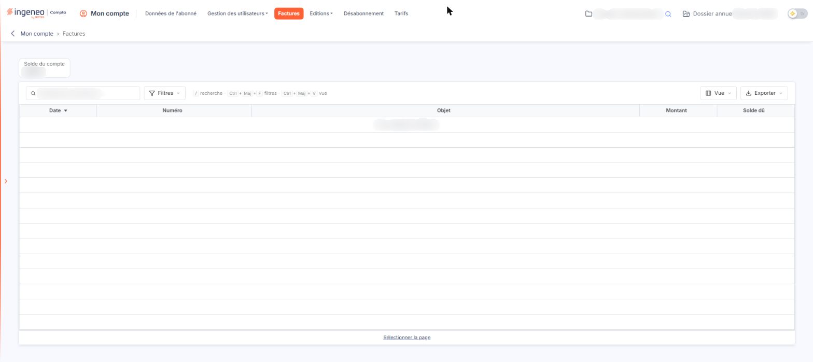

# Factures


**Où le trouver :** Menu **Factures**



**En bref** — Cet écran présente les factures de votre abonnement et le solde de votre compte, et permet de les consulter à tout moment.

* Pour afficher une facture : pictogramme « Œil » de sa ligne.
* Pour retrouver une facture : champ « Rechercher une facture… », ou bouton \[Filtres].
* Pour voir le détail d'une facture : pictogramme d'édition de sa ligne, puis bouton \[Visualiser].


Cette option présente les factures de votre abonnement et permet de les consulter à tout moment.

<figure><figcaption>
Écran « Factures » de la nouvelle interface
</figcaption></figure>

Chaque mois, une facture vous est adressée correspondant au nombre d'utilisateurs inscrits par module. C'est l'inscription d'un utilisateur à un module qui entraîne la facturation, et non le fait qu'il se soit connecté ou non durant le mois. Le tarif est dégressif, par module, en fonction du nombre d'utilisateurs facturés ; les tarifs en vigueur sont présentés dans l'option « Tarifs » du module.

Les factures vous sont adressées par e-mail et restent consultables ici.

## Ce que présente l'écran

**Solde du compte** : cette vignette, qui ne se saisit pas, est placée au-dessus de la liste. Il totalise les soldes dus de toutes vos factures et de tous vos avoirs : c'est le montant qu'il vous reste à régler.

La liste présente cinq colonnes : la **Date** de la facture, son **Numéro**, son **Objet**, son **Montant** et son **Solde dû**. Ces cinq colonnes peuvent être triées en cliquant sur leur titre. Tant qu'aucune facture n'a été émise, la liste affiche le message « Aucun élément à afficher. » et le solde du compte reste à zéro. Au-dessus de la liste, une barre propose un champ « Rechercher une facture… » et les boutons \[Filtres], \[Vue] et \[Exporter].

Aucun bouton d'action ne figure au bas de cet écran.
