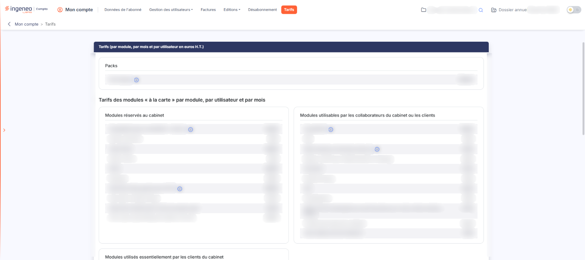
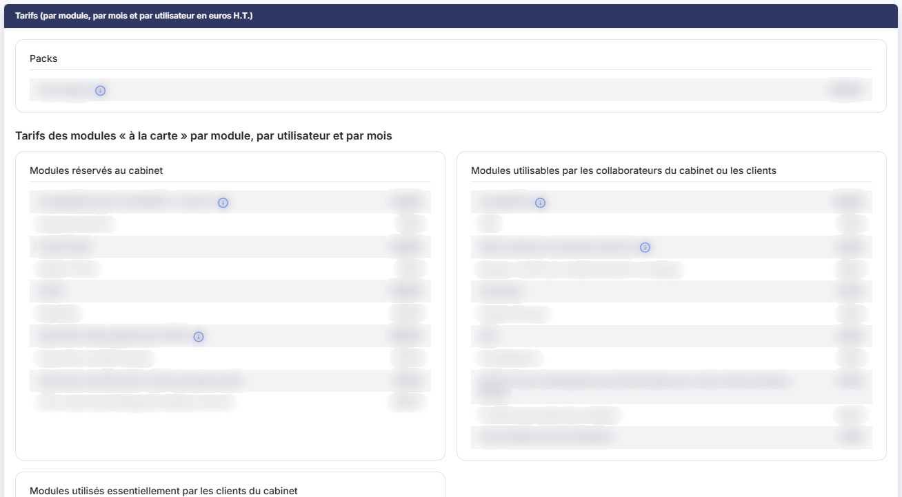
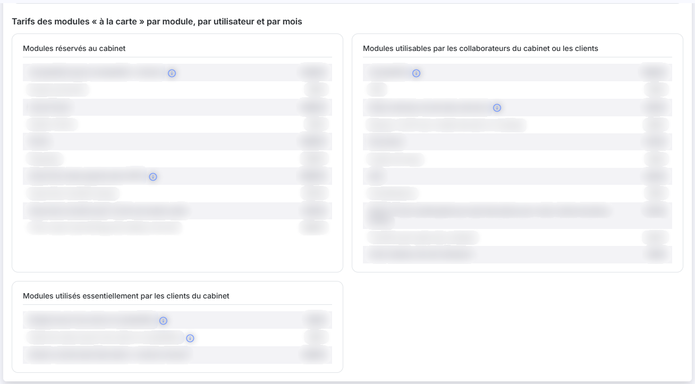
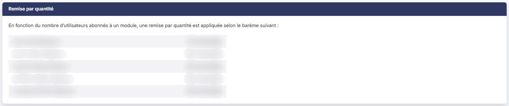
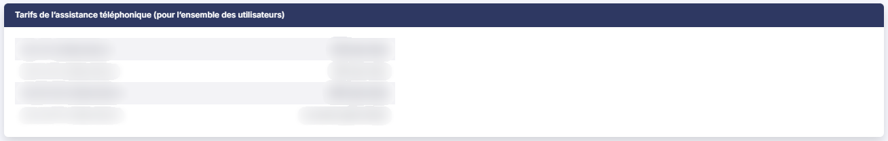
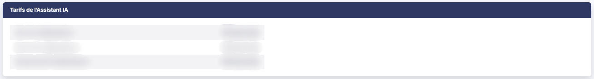
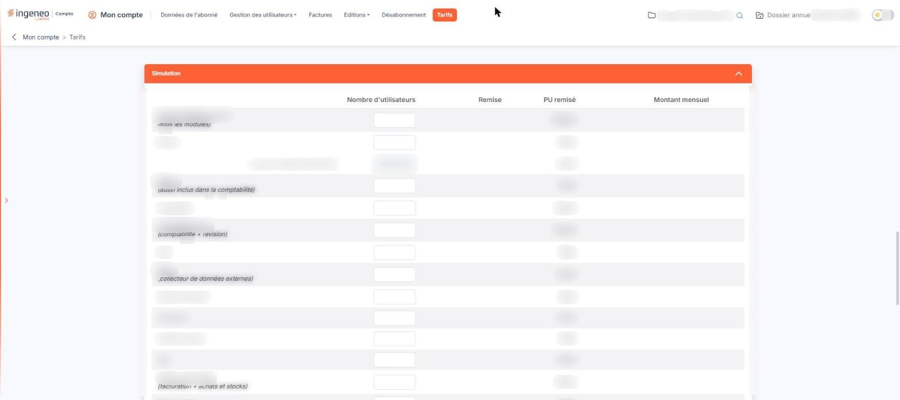

# Tarifs


**Où le trouver :** Menu **Tarifs**



**En bref** — Cet écran présente les tarifs en vigueur de votre abonnement et permet de simuler le coût mensuel en indiquant, service par service, le nombre d'utilisateurs envisagé.

* Pour chiffrer un abonnement : cliquez sur le bandeau « Simulation », saisissez le nombre d'utilisateurs de chaque service, puis lisez le Total.
* Pour voir le détail d'une remise : pictogramme « i » orange de la ligne, qui ouvre la fenêtre « Détail du prix ».
* Pour conserver la simulation : bouton \[Imprimer], car rien n'est enregistré.


**a) Rubrique « Packs »**

<figure><figcaption>
Écran « Tarifs » de la nouvelle interface
</figcaption></figure>

Cette rubrique donne le prix des packs, c'est-à-dire des abonnements donnant accès à un ensemble de modules plutôt qu'à des modules choisis un à un. Une ligne par pack proposé. Un pictogramme **« i »** en fin de ligne précise ce que le pack comprend et ce qu'il ne comprend pas : placez le pointeur de la souris dessus pour afficher le texte.

**b) Rubrique « Tarifs des modules « à la carte » par module, par utilisateur et par mois »**

Cette rubrique donne le prix de chaque module pris séparément. Elle se compose de trois listes, présentées dans cet ordre :

* **Modules réservés au cabinet** : les modules qu'un cabinet utilise pour son propre travail et qu'il ne peut pas ouvrir à ses clients ;
* **Modules utilisable par les collaborateurs du cabinet ou les clients** : les modules que vous pouvez abonner indifféremment pour vos collaborateurs et pour vos clients ;
* **Module utilisés essentiellement par les clients du cabinet** : les modules destinés en premier lieu aux clients du cabinet.

Chaque liste comporte deux colonnes sans intitulé : le nom du module et son prix. Lorsque le prix d'un module s'accompagne d'un complément facturé à l'unité — un compte bancaire relevé automatiquement, un bulletin de paie traité, une société gérée recevant des pièces par e-mail — ce complément figure entre parenthèses dans le nom du module.

Certaines lignes portent un pictogramme **« i »**.

**c) Rubrique « Remise par quantité »**

Cette rubrique présente le barème de remise appliqué en fonction du nombre d'utilisateurs abonnés à un même module : une ligne par tranche d'utilisateurs, avec le taux de remise correspondant.

**Le taux atteint ne s'applique pas à la totalité des utilisateurs, mais tranche par tranche.** Le logiciel compte les utilisateurs de la première tranche au prix plein, ceux de la tranche suivante au taux de cette tranche, et ainsi de suite jusqu'à la tranche atteinte. C'est la raison pour laquelle le total ne correspond jamais au nombre d'utilisateurs multiplié par un prix unique : si vous vérifiez une simulation ligne à ligne, faites-le tranche par tranche.

**d) Rubrique « Tarifs de l'assistance téléphonique (pour l'ensemble des utilisateurs) »**

L'assistance téléphonique ne se facture pas par utilisateur mais au forfait mensuel, pour l'ensemble des utilisateurs du compte. Le tableau donne une ligne par tranche de nombre de collaborateurs, avec le montant mensuel correspondant ; au-delà de la dernière tranche chiffrée, le tarif est établi sur devis après étude.

**e) Rubrique « Tarifs de l'Assistant IA »**

L'Assistant IA se facture lui aussi au forfait mensuel, par tranche de nombre de collaborateurs, et non par utilisateur.

**f) Rubrique « Simulation »**

Cette rubrique vous permet de chiffrer vous-même un abonnement. Elle est repliée à l'ouverture de l'écran : cliquez sur son bandeau orange « Simulation » pour la déployer. Elle présente un tableau d'une ligne par service, dont les colonnes sont, dans l'ordre : le nom du service, **Nombre d'utilisateurs**, **Remise**, **PU remisé** et **Montant mensuel**. La dernière ligne du tableau, **Total :**, cumule les montants mensuels.

À l'ouverture, la colonne **PU remisé** affiche le prix unitaire plein de chaque service et aucun montant n'est calculé. Saisissez le nombre d'utilisateurs envisagé sur les seules lignes qui vous intéressent : le logiciel calcule aussitôt la remise et le montant mensuel de la ligne, et met le total à jour.

La colonne **Remise** affiche le taux de remise **moyen** obtenu sur l'ensemble des utilisateurs saisis, et non le taux de la tranche atteinte : c'est pourquoi vous y lirez un pourcentage qui ne figure dans aucune ligne du barème de la rubrique « Remise par quantité ». La colonne **PU remisé** reste, elle, affichée au prix unitaire plein, alors que le calcul emploie bien les prix remisés de chaque tranche.

Trois lignes de complément — le prix par compte bancaire traité, le nombre de sociétés gérées qui reçoivent des pièces par e-mail et le prix par bulletin traité — sont grisées à l'ouverture.

Dès qu'une remise s'applique sur une ligne — c'est-à-dire à partir de onze utilisateurs saisis, la première tranche du barème étant au prix plein —, un pictogramme **« i »** orange apparaît à l'extrémité de cette ligne. Cliquez dessus : le logiciel ouvre la fenêtre « Détail du prix », qui donne le décompte complet du calcul, tranche par tranche — le nombre d'abonnements de chaque tranche, le taux de remise appliqué, le prix unitaire remisé correspondant et le sous-total, puis le nombre total d'abonnements et le montant total. Refermez la fenêtre par son bouton **\[OK]** ou par la croix de fermeture.

La simulation n'est pas enregistrée : l'écran ne comporte aucun bouton d'enregistrement, et les valeurs saisies sont perdues dès que vous quittez l'option. Le logiciel n'y crée ni ne modifie aucun abonnement — une simulation n'engage à rien.

bouton **\[Imprimer]**

Situé en bas à droite de la rubrique « Simulation », sous la ligne **Total :**.

Certains noms de service diffèrent légèrement entre les tableaux de tarifs et le tableau de simulation ; il s'agit bien, dans chaque cas, du même module.

La ligne **Supervision alertes** du tableau de simulation ne porte aucun prix unitaire, et ce service ne figure dans aucune des listes de tarifs ci-dessus : une saisie sur cette ligne ne produit ni remise ni montant.

## Autres vues de l'écran

<figure><figcaption>
Packs
</figcaption></figure>

<figure><figcaption>
Tarifs des modules « à la carte » par module, par utilisateur et par mois
</figcaption></figure>

<figure><figcaption>
Remise par quantité
</figcaption></figure>

<figure><figcaption>
Tarifs de l'assistance téléphonique (pour l'ensemble des utilisateurs)
</figcaption></figure>

<figure><figcaption>
Tarifs de l'Assistant IA
</figcaption></figure>

<figure><figcaption>
Simulation
</figcaption></figure>
