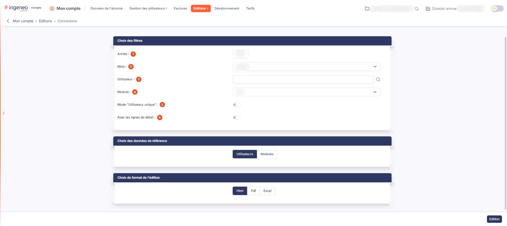

# Connexions


**Où le trouver :** Menu **Editions › Connexions**



**En bref** — Cette édition présente, pour un mois donné, le nombre de connexions jour par jour de vos utilisateurs aux modules du logiciel, par utilisateur ou par module.

* Pour éditer un mois : choisissez l'Année et le Mois, puis bouton \[Edition].
* Pour présenter les résultats par module : choisissez « Modules » dans les données de référence, puis bouton \[Edition].
* Pour obtenir le détail : activez « Avec les lignes de détail », puis bouton \[Edition] ; le document ajoute une ligne par module (ou par utilisateur si la référence retenue est le module).


Cette édition présente, pour un mois donné, le nombre de connexions jour par jour de vos utilisateurs aux modules du logiciel. Vous pouvez la présenter par utilisateur ou par module.

<figure><figcaption>
Écran « Connexions » de la nouvelle interface
</figcaption></figure>

## Rubrique « Choix des filtres »

| Champ                              | Ce qu'il faut savoir                                                                                                                                                                                                                                                                                                                                                                                                                                                                           |
| ---------------------------------- | ---------------------------------------------------------------------------------------------------------------------------------------------------------------------------------------------------------------------------------------------------------------------------------------------------------------------------------------------------------------------------------------------------------------------------------------------------------------------------------------------- |
| 1. **Année**                       | Par défaut, le logiciel propose l'année en cours.                                                                                                                                                                                                                                                                                                                                                                                                                                              |
| 2. **Mois**                        | L'édition est toujours réalisée pour un mois donné, à choisir parmi les douze mois de l'année. Par défaut, le logiciel propose le mois en cours.                                                                                                                                                                                                                                                                                                                                               |
| 3. **Utilisateur**                 | Malgré son libellé au singulier, ce champ accepte **plusieurs utilisateurs**. Le pictogramme « Loupe » placé à sa droite ouvre un panneau de sélection intitulé « Utilisateurs », à droite de l'écran, où vous cliquez sur autant de lignes que nécessaire ; le pied du panneau porte alors le bouton \[+ Ajouter l'utilisateur] (« + Ajouter les utilisateurs » à partir de deux lignes), et la croix de l'en-tête le referme sans rien reporter. Laissé vide, il vaut tous les utilisateurs. |
| 4. **Module**                      | Par défaut, le logiciel propose le choix « Tous » ; vous pouvez restreindre l'édition à un seul module en le choisissant dans la liste. Outre les modules auxquels vous êtes abonné, la liste propose deux entrées particulières : une entrée en tête de liste portant le nom du logiciel, qui correspond à la connexion au logiciel lui-même, et « Aide en ligne », qui correspond aux ouvertures de l'aide.                                                                                  |
| 5. **Mode « Utilisateur unique »** | Interrupteur, proposé désactivé.                                                                                                                                                                                                                                                                                                                                                                                                                                                               |
| 6. **Avec les lignes de détail**   | Désactivé, le document ne donne, pour chaque bloc, que le total de chaque journée. Activé, il ajoute une ligne par module lorsque la référence retenue est l'utilisateur, et une ligne par utilisateur lorsque la référence retenue est le module.                                                                                                                                                                                                                                             |

## Rubrique « Choix des données de référence »

Indiquez si vous souhaitez obtenir les résultats par « Utilisateurs » — le choix proposé par défaut — ou par « Modules ». C'est ce choix qui détermine ce que représente chaque bloc du document : un utilisateur, ou un module.

## Rubrique « Choix du format de l'édition »

Vous avez le choix entre trois formats :

* « Html » : c'est le format sélectionné par défaut, et le plus rapide à s'afficher ;
* « Pdf » : pour ce format, vous devez indiquer l'orientation de la page. Le document comportant une colonne par jour du mois, c'est « Paysage » qui est proposée par défaut ici. Ce choix d'orientation n'apparaît que pour ce format ;
* « Excel » : le document est généré sous forme de fichier de tableur.

bouton **\[Edition]**

Placé en bas à droite de l'écran, il lance la production du document. Ce bouton n'apparaît que si vous avez le droit de lancer cette édition.

Au format « Html », **le document s'ouvre dans un nouvel onglet de votre navigateur** : l'écran de paramétrage reste ouvert derrière, avec vos choix intacts. Aucun écran d'attente n'apparaît ; si vous ne voyez rien se produire, vérifiez que votre navigateur n'a pas bloqué l'ouverture de l'onglet.

## Ce que contient le document

Le document s'intitule « Statistiques de connexions ». Sous le titre, un cartouche rappelle le nom du cabinet, la « Période » retenue (le mois et l'année), la date et l'heure d'édition et le nom de la personne qui l'a lancée. Une synthèse donne ensuite le nombre de connexions, le nombre d'utilisateurs, le nombre de modules et le nombre de « Jours avec connexion » sur le nombre de jours du mois. La mention « Paramètres de l'édition » rappelle enfin les filtres et la présentation choisie (par exemple « Tous les modules · Utilisateurs : tous · par utilisateur »), complétée de la mention « avec lignes de détail » lorsque vous les avez demandées, ou de la mention « mode "Utilisateur unique" » lorsque vous avez retenu ce mode.

Vient ensuite un **bloc par utilisateur**, ou un **bloc par module** selon la référence retenue. Chaque bloc porte le nom de l'utilisateur ou du module, suivi de son nombre total de connexions, puis d'un tableau qui présente **une colonne par jour du mois**, du 1 au 31 (chaque jour est accompagné de l'initiale de son jour de la semaine), et une dernière colonne **TOTAL**. Le tableau comporte une ligne, libellée « Connexions », qui donne le nombre de connexions de chaque journée ; une cellule vide signifie qu'aucune connexion n'a été enregistrée ce jour-là.

Si vous avez demandé les lignes de détail, ces lignes complètent le tableau de chaque bloc, une par module — ou par utilisateur — concerné.

La présentation par module produit un document nettement plus long que la présentation par utilisateur, chaque module et chaque type d'événement y faisant l'objet d'un bloc.
