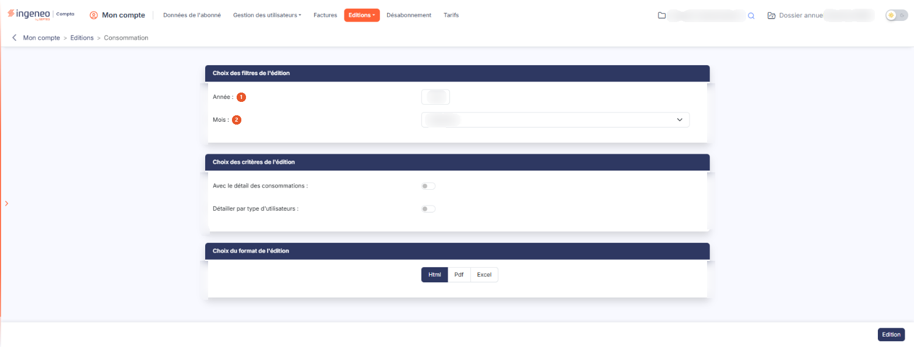

# Consommation


**Où le trouver :** Menu **Editions › Consommation**



**En bref** — Cette édition présente, pour un mois donné, les consommations qui vous sont facturées en fin de mois, afin de vérifier vos factures.

* Pour éditer la consommation d'un mois : choisissez l'Année et le Mois, puis bouton \[Edition].
* Pour voir qui consomme quoi : activez « Avec le détail des consommations », puis bouton \[Edition].
* Pour choisir le format : « Html », « Pdf » ou « Excel », puis bouton \[Edition].


Cette édition présente, pour un mois donné, les consommations qui vous sont facturées en fin de mois. Les données qu'elle contient vous permettent de vérifier les factures qui vous sont adressées.

<figure><figcaption>
Écran « Consommation » de la nouvelle interface
</figcaption></figure>

## Rubrique « Choix des filtres de l'édition »

| Champ        | Ce qu'il faut savoir                                                                                                                                  |
| ------------ | ----------------------------------------------------------------------------------------------------------------------------------------------------- |
| 1. **Année** | Par défaut, le logiciel propose l'année du mois précédent. Vous pouvez la modifier pour éditer la consommation d'un mois plus ancien.                 |
| 2. **Mois**  | L'édition est toujours réalisée pour un mois donné, à choisir parmi les douze mois de l'année. Par défaut, le logiciel propose le **mois précédent**. |

Seules les consommations **déjà calculées** sont restituées, c'est-à-dire celles qui ont donné lieu à facturation.

## Rubrique « Choix des critères de l'édition »

Le critère « Avec le détail des consommations » est un interrupteur, proposé désactivé.

Un second critère, « Détailler par type d'utilisateurs », est proposé en dessous, lui aussi sous la forme d'un interrupteur désactivé.

## Rubrique « Choix du format de l'édition »

Vous avez le choix entre trois formats :

* « Html » : c'est le format sélectionné par défaut, et le plus rapide à s'afficher ;
* « Pdf » : pour ce format, vous devez indiquer l'orientation de la page, « Portrait » — proposée par défaut — ou « Paysage ». Ce choix d'orientation n'apparaît que pour ce format ;
* « Excel » : le document est généré sous forme de fichier de tableur.

bouton **\[Edition]**

Placé en bas à droite de l'écran, il lance la production du document. Ce bouton n'apparaît que si vous avez le droit de lancer cette édition.

Au format « Html », **le document s'ouvre dans un nouvel onglet de votre navigateur** : l'écran de paramétrage reste ouvert derrière, avec vos choix intacts, et vous pouvez relancer l'édition avec d'autres critères sans les ressaisir. Aucun écran d'attente n'apparaît ; si vous ne voyez rien se produire, vérifiez que votre navigateur n'a pas bloqué l'ouverture de l'onglet.

## Ce que contient le document

Le document porte en titre le mois retenu, par exemple « Consommation pour le mois de juillet 2026 », et présente un **tableau unique**, trié par libellé de service.

Sans aucun critère, ce tableau comporte deux colonnes : le **Libellé** du service et la **Quantité** consommée dans le mois. Les services non facturés sont signalés par la mention « (Non facturé) » accolée à leur libellé, dans la même cellule.

Le document ne comporte pas de ligne de total général : le rapprochement avec votre facture se fait ligne à ligne.
