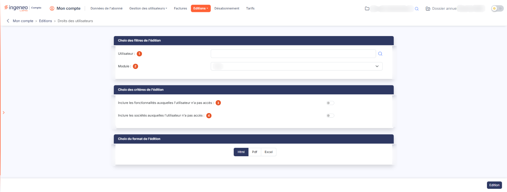
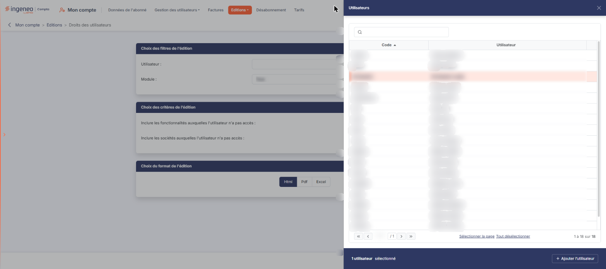

# Droits des utilisateurs


**Où le trouver :** Menu **Editions › Droits des utilisateurs**



**En bref** — Cette édition présente, pour chaque utilisateur retenu, ses droits module par module et les sociétés gérées auxquelles il a accès, sans ouvrir chaque fiche.

* Pour éditer les droits de personnes précises : pictogramme « Loupe » du champ Utilisateur, cliquez sur leurs lignes, bouton \[+ Ajouter l'utilisateur] (« + Ajouter les utilisateurs » à partir de deux lignes), puis bouton \[Edition].
* Pour voir aussi les refus : activez « Inclure les fonctionnalités auxquelles l'utilisateur n'a pas accès », puis bouton \[Edition].


Cette édition présente, pour chaque utilisateur retenu, la liste des droits qui lui sont attribués — module par module — et la liste des sociétés gérées auxquelles il a accès. Elle vous permet de contrôler les droits que vous avez accordés sans avoir à ouvrir la fiche de chaque utilisateur.

<figure><figcaption>
Écran « Droits des utilisateurs » de la nouvelle interface
</figcaption></figure>

## Rubrique « Choix des filtres de l'édition »

| Champ              | Ce qu'il faut savoir                                                                                                                                                                                                                                                                                                                                                                                                                                                                                                                                                                                                                                                                                                                          |
| ------------------ | --------------------------------------------------------------------------------------------------------------------------------------------------------------------------------------------------------------------------------------------------------------------------------------------------------------------------------------------------------------------------------------------------------------------------------------------------------------------------------------------------------------------------------------------------------------------------------------------------------------------------------------------------------------------------------------------------------------------------------------------- |
| 1. **Utilisateur** | 
Malgré son libellé au singulier, ce champ accepte <strong>plusieurs utilisateurs</strong>. Le pictogramme « Loupe » placé à sa droite ouvre un panneau de sélection intitulé « Utilisateurs », à droite de l'écran, où vous cliquez sur autant de lignes que nécessaire ; les utilisateurs retenus s'affichent ensuite dans le champ. Si vous laissez ce champ <strong>vide</strong>, l'édition porte sur <strong>tous les utilisateurs</strong> de l'abonnement, sans message ni demande de confirmation. Le document produit peut alors être très long : chaque utilisateur y occupe un bloc complet, avec ses droits sur chaque module et ses accès aux sociétés. Renseignez le champ si vous ne visez qu'une ou deux personnes.
 |
| 2. **Module**      | Par défaut, le logiciel propose le choix « Tous ». Vous pouvez restreindre l'édition à un seul module en le choisissant dans la liste.                                                                                                                                                                                                                                                                                                                                                                                                                                                                                                                                                                                                        |

## Le panneau de sélection des utilisateurs

<figure><figcaption>
Rubrique « Le panneau de sélection des utilisateurs »
</figcaption></figure>

Il présente une liste à deux colonnes, le **Code** de l'utilisateur et son nom sous la colonne **Utilisateur**, toutes deux triables en cliquant sur leur titre. Il n'y a plus de case à cocher : un clic sur une ligne la sélectionne, et les liens « Sélectionner la page » et « Tout désélectionner », au pied de la liste, règlent la sélection. Utilisez aussi le pied de liste pour changer de page.

Le champ de recherche « Rechercher par utilisateur… » (précédé d'une loupe), placé au-dessus de la liste, permet de restreindre la liste à un utilisateur précis : il n'y a plus de bouton \[Afficher]. Dès qu'une ligne est sélectionnée, le pied du panneau indique le nombre d'utilisateurs sélectionnés et porte le bouton \[+ Ajouter l'utilisateur] (« + Ajouter les utilisateurs » à partir de deux lignes), qui reporte votre sélection dans l'écran. Il n'y a ni bouton \[Valider] ni bouton \[Annuler] : pour renoncer, fermez le panneau par la croix de son en-tête.

## Rubrique « Choix des critères de l'édition »

| Champ                                                                     | Ce qu'il faut savoir            |
| ------------------------------------------------------------------------- | ------------------------------- |
| 3. **Inclure les fonctionnalités auxquelles l'utilisateur n'a pas accès** | Interrupteur proposé désactivé. |
| 4. **Inclure les sociétés auxquelles l'utilisateur n'a pas accès**        | Interrupteur proposé désactivé. |

## Rubrique « Choix du format de l'édition »

Vous avez le choix entre trois formats :

* « Html » : c'est le format sélectionné par défaut, et le plus rapide à s'afficher ;
* « Pdf » : pour ce format, vous devez indiquer l'orientation de la page, « Portrait » — proposée par défaut — ou « Paysage ». Ce choix d'orientation n'apparaît que pour ce format ;
* « Excel » : le document est généré sous forme de fichier de tableur.

bouton **\[Edition]**

Placé en bas à droite de l'écran, il lance la production du document. Ce bouton n'apparaît que si vous avez le droit de lancer cette édition.

Au format « Html », **le document s'ouvre dans un nouvel onglet de votre navigateur** : l'écran de paramétrage reste ouvert derrière, avec vos choix intacts. Aucun écran d'attente n'apparaît ; si vous ne voyez rien se produire, vérifiez que votre navigateur n'a pas bloqué l'ouverture de l'onglet.

## Ce que contient le document

Le document s'intitule « Droits des utilisateurs ». Sous le titre, un cartouche rappelle le nom du cabinet, la date et l'heure d'édition et le nom de la personne qui l'a lancée ; une synthèse donne le nombre d'utilisateurs, le nombre de modules et le nombre d'utilisateurs qui ont accès à toutes les sociétés (rapporté au nombre total d'utilisateurs), puis la mention « Paramètres de l'édition » rappelle vos filtres (par exemple « Utilisateurs : tous · Module : tous »). Le document se compose ensuite d'un **bloc par utilisateur** retenu.

Chaque bloc s'ouvre par un encadré d'identification portant le code et le nom de l'utilisateur, son **Type** et son **Rôle**.

Vient ensuite le tableau « DROITS PAR MODULE », à trois colonnes **MODULE**, **PROFIL** et **DROITS** : une ligne par module sur lequel l'utilisateur porte un profil, avec son nom de profil et la mention de ses droits. Trois mentions sont possibles :

* « Tous » : l'utilisateur a toutes les fonctionnalités du module ;
* « Tous (autoprogressif) » : il les a toutes, et le profil est autoprogressif — les fonctionnalités ajoutées ultérieurement au module lui seront accordées automatiquement ;
* « Personnalisés » : seule cette mention fait apparaître, sous la ligne du module, la liste détaillée des fonctionnalités accordées, présentées dans l'arborescence des menus du module.

Le bloc se termine par la section « SOCIÉTÉS GÉRÉES ACCESSIBLES ». Lorsque l'utilisateur bénéficie d'un accès général, cette section porte la seule phrase « L'utilisateur a accès automatiquement à toutes les sociétés. ».
