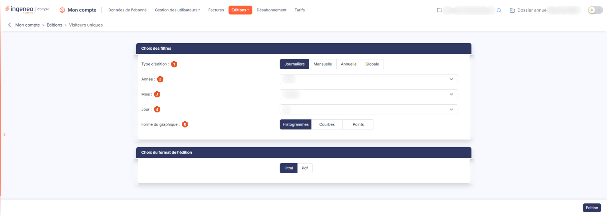

# Visiteurs uniques


**Où le trouver :** Menu **Editions › Visiteurs uniques**



**En bref** — Cette édition présente, sous forme de graphique, le nombre d'utilisateurs qui se sont connectés au logiciel sur une période donnée, chacun n'étant compté qu'une fois par période.

* Pour choisir la période : sélectionnez le Type d'édition « Journalière », « Mensuelle », « Annuelle » ou « Globale », puis les dates demandées.
* Pour changer le tracé : choisissez « Histogrammes », « Courbes » ou « Points » dans Forme du graphique, puis bouton \[Edition].


Cette édition présente, sous forme de graphique, le nombre d'utilisateurs qui se sont connectés au logiciel sur une période donnée.

<figure><figcaption>
Écran « Visiteurs uniques » de la nouvelle interface
</figcaption></figure>

## Rubrique « Choix des filtres »

| Champ                     | Ce qu'il faut savoir                                                                                                                                                                                                                                                                                                                                                                                                                                                                           |
| ------------------------- | ---------------------------------------------------------------------------------------------------------------------------------------------------------------------------------------------------------------------------------------------------------------------------------------------------------------------------------------------------------------------------------------------------------------------------------------------------------------------------------------------- |
| 1. **Type d'édition**     | 
Ce choix commande à la fois la période mesurée et ce que représente chaque barre ou chaque point du graphique : • « Journalière » : chaque barre représente une <strong>heure</strong> de la journée. • « Mensuelle » : chaque barre représente un <strong>jour</strong> du mois. • « Annuelle » : chaque barre représente un <strong>mois</strong> de l'année. • « Globale » : chaque barre représente une <strong>année</strong>, depuis la création de votre abonnement.
 |
| 2. **Année**              | La liste ne propose que les années pour lesquelles votre abonnement dispose d'un historique. Par défaut, le logiciel propose l'année en cours.                                                                                                                                                                                                                                                                                                                                                 |
| 3. **Mois**               | Par défaut, le logiciel propose le mois en cours.                                                                                                                                                                                                                                                                                                                                                                                                                                              |
| 4. **Jour**               | Par défaut, le logiciel propose le jour en cours.                                                                                                                                                                                                                                                                                                                                                                                                                                              |
| 5. **Forme du graphique** | Choisissez la représentation souhaitée, « Histogrammes » — proposée par défaut —, « Courbes » ou « Points ».                                                                                                                                                                                                                                                                                                                                                                                   |

## Rubrique « Choix du format de l'édition »

Cette édition n'est proposée qu'en deux formats : « Html » — proposé par défaut, le document s'affiche à l'écran — et « Pdf ». Cette édition ne propose pas de sortie au format Excel, contrairement aux autres éditions du module. Le choix « Pdf » fait apparaître, sous les formats, un second choix d'**orientation** entre « Portrait » (proposé par défaut) et « Paysage ».

bouton **\[Edition]**

Il lance la production du document. Placé en bas à droite de l'écran, ce bouton n'apparaît que si vous avez le droit de lancer cette édition.

Au format « Html », **le document s'ouvre dans un nouvel onglet de votre navigateur** : l'écran de paramétrage reste ouvert dans l'onglet d'origine, avec vos choix intacts, ce qui vous permet d'enchaîner plusieurs périodes ou plusieurs formes de graphique. Aucun écran d'attente n'apparaît ; si vous ne voyez rien se produire, vérifiez que votre navigateur n'a pas bloqué l'ouverture de l'onglet.

## Ce que contient le document

Le document tient sur une seule page et ne comporte qu'un **bandeau de titre et un graphique**. Le titre rappelle le découpage et la période retenus : « Nombre de visiteurs uniques par heure pour le 31 août 2026 » pour une édition journalière, « … par jour pour le mois de Août 2026 » pour une édition mensuelle, « … par mois pour l'année 2026 » pour une édition annuelle, et « Nombre de visiteurs uniques par an depuis la création de l'abonnement » pour une édition globale.

Le graphique porte la valeur de chaque période au-dessus de sa barre — y compris les périodes sans aucun visiteur, qui portent la valeur zéro. Il est produit sous forme d'image : vous pouvez l'imprimer ou le copier tel quel, mais non en récupérer les valeurs sous forme de données. Le document ne comporte ni tableau de chiffres, ni total.
