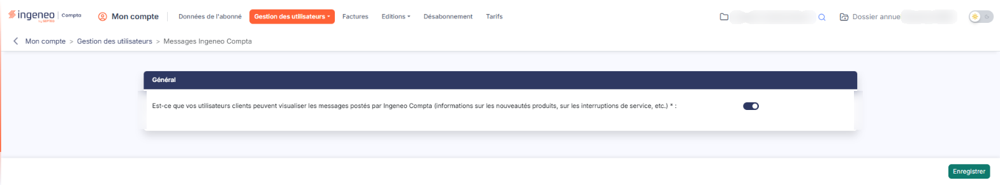

# Messages Ingeneo Compta


**Où le trouver :** Menu **Gestion des utilisateurs › Messages Ingeneo Compta**



**En bref** — Cet écran permet de décider si vos utilisateurs clients voient les messages publiés par Ingeneo Compta (indisponibilités, nouveautés). Vos collaborateurs les reçoivent toujours.

* Pour que vos clients voient ces messages : activez l'interrupteur de la rubrique « Général », puis bouton \[Enregistrer].
* Pour qu'ils ne les voient plus : désactivez l'interrupteur, puis bouton \[Enregistrer].


Des messages sont régulièrement publiés à destination des utilisateurs du logiciel, notamment pour prévenir des indisponibilités de service et présenter les nouvelles fonctionnalités apportées par les mises à jour.

<figure><figcaption>
Écran « Messages Ingeneo Compta » de la nouvelle interface
</figcaption></figure>

C'est vous qui décidez s'ils peuvent être adressés aux utilisateurs clients de votre cabinet, ce qui est conseillé.

## Rubrique « Général »

**Est-ce que vos utilisateurs clients peuvent visualiser les messages postés par Ingeneo Compta (informations sur les nouveautés produits, sur les interruptions de service, etc.) :** interrupteur activé, vos utilisateurs clients voient ces messages comme vos collaborateurs.

bouton **\[Enregistrer]**

Ce bouton enregistre votre choix. Il s'applique à l'ensemble de votre abonnement, et non à un utilisateur en particulier.
