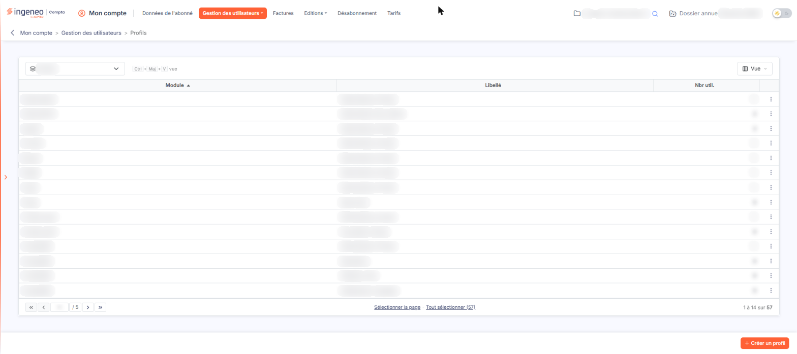
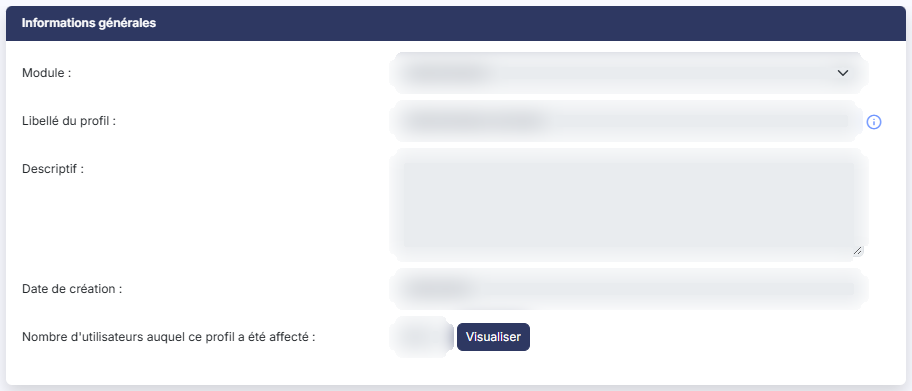
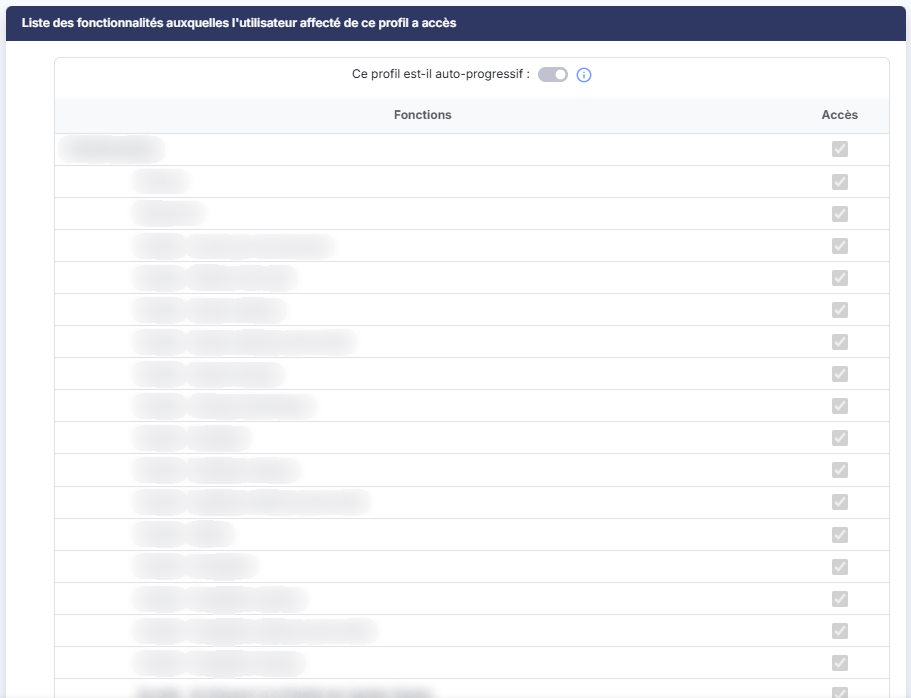
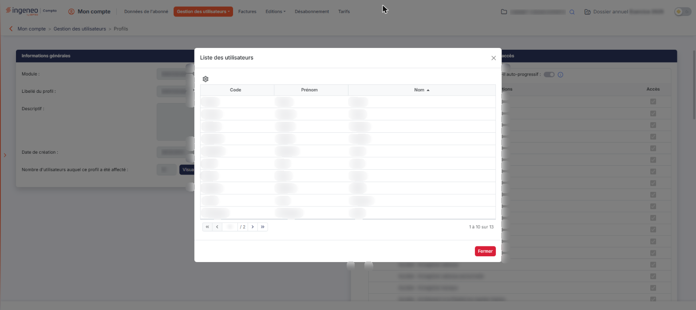
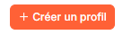
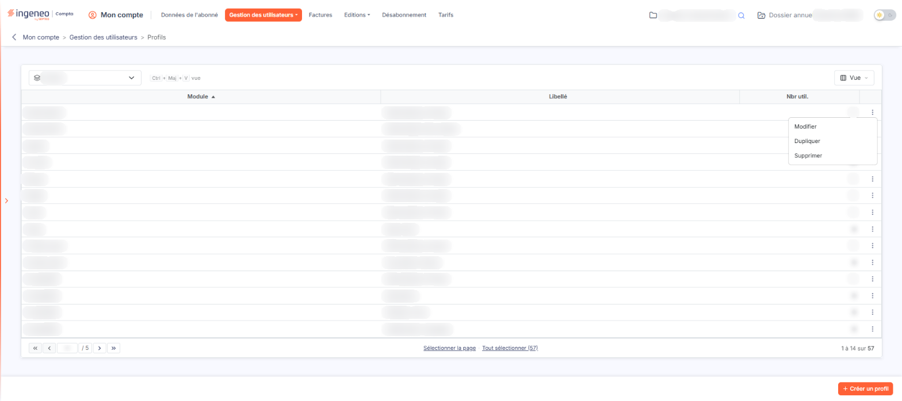

# Profils


**Où le trouver :** Menu **Gestion des utilisateurs › Profils**



**En bref** — Cet écran permet de créer, modifier, dupliquer et supprimer les profils d'utilisation, qui listent pour un module les fonctions auxquelles un utilisateur a accès.

* Pour créer un profil : bouton \[Créer un profil], choisissez le Module, saisissez le Libellé du profil, cochez les fonctions autorisées, puis bouton \[Enregistrer].
* Pour partir d'un profil existant : menu ⋮ de sa ligne, « Dupliquer », indiquez le nouveau libellé, puis bouton \[Enregistrer].
* Pour supprimer des profils : sélectionnez-les, puis bouton \[Supprimer], si aucun utilisateur ne les utilise.


Un profil d'utilisation correspond à la liste des fonctions auxquelles a accès un utilisateur, pour un module donné. Cette page vous permet de créer, modifier, dupliquer et supprimer vos profils.

<figure><figcaption>
Écran « Profils » de la nouvelle interface
</figcaption></figure>

**a) La liste des profils**

La liste déroulante « Module », à gauche de la barre située au-dessus de la grille, permet de n'afficher que les profils d'un module ; à l'ouverture de la page, aucun module n'est choisi et tous les profils sont listés. À droite de la barre, le bouton \[Vue] règle les colonnes affichées ; cet écran n'a ni champ de recherche, ni bouton \[Filtres], ni bouton \[Exporter].

La grille contient une ligne par profil et trois colonnes : **Module**, **Libellé** et **Nbr util.** qui indique le nombre d'utilisateurs auxquels le profil est affecté. Ces trois colonnes sont triables.

Il n'y a plus de case à cocher : un clic sur une ligne la sélectionne, et les liens « Sélectionner la page » et « Tout sélectionner » sous la grille étendent la sélection. La barre de pagination, au bas de la grille, indique le nombre total de profils et vous permet de passer d'une page à l'autre.

Chaque ligne porte à droite un bouton à trois points (⋮) dont le menu propose :

* « Modifier », qui ouvre le profil en modification,
* « Supprimer », qui le supprime,
* « Dupliquer », qui le duplique.

En bas de l'écran, à droite :

* bouton **\[Créer un profil]** : il ouvre une fiche vierge ;
* bouton **\[Supprimer]**, qui apparaît dans le bandeau de sélection (« 1 profil sélectionné », « Tout désélectionner ») dès qu'une ligne est sélectionnée : il supprime les profils que vous avez sélectionnés dans la grille.

**b) Rubrique « Informations générales »**

| Champ                                                    | Ce qu'il faut savoir                                                                                                                                                                                                                                                                                                                                                                                                                                                                                                                                                                                                                                                                                                                                                                                                                                                                                                                                                                                                                                                                                                                                                                                                                                                                                                                                                                                                                                                                                                                                                                                                                                                                                                                                                                                                                                                                                                                                                                                                                                                                                                                                                                                   |
| -------------------------------------------------------- | ------------------------------------------------------------------------------------------------------------------------------------------------------------------------------------------------------------------------------------------------------------------------------------------------------------------------------------------------------------------------------------------------------------------------------------------------------------------------------------------------------------------------------------------------------------------------------------------------------------------------------------------------------------------------------------------------------------------------------------------------------------------------------------------------------------------------------------------------------------------------------------------------------------------------------------------------------------------------------------------------------------------------------------------------------------------------------------------------------------------------------------------------------------------------------------------------------------------------------------------------------------------------------------------------------------------------------------------------------------------------------------------------------------------------------------------------------------------------------------------------------------------------------------------------------------------------------------------------------------------------------------------------------------------------------------------------------------------------------------------------------------------------------------------------------------------------------------------------------------------------------------------------------------------------------------------------------------------------------------------------------------------------------------------------------------------------------------------------------------------------------------------------------------------------------------------------------ |
| **Module**                                               | Un profil est toujours relatif à un module. Le sélecteur propose la liste de tous les modules actifs dans l'application. Quand vous choisissez un module, le logiciel affiche la liste des fonctionnalités dont l'accès est paramétrable. Le module est obligatoire à la création du profil.                                                                                                                                                                                                                                                                                                                                                                                                                                                                                                                                                                                                                                                                                                                                                                                                                                                                                                                                                                                                                                                                                                                                                                                                                                                                                                                                                                                                                                                                                                                                                                                                                                                                                                                                                                                                                                                                                                           |
| **Descriptif**                                           | —                                                                                                                                                                                                                                                                                                                                                                                                                                                                                                                                                                                                                                                                                                                                                                                                                                                                                                                                                                                                                                                                                                                                                                                                                                                                                                                                                                                                                                                                                                                                                                                                                                                                                                                                                                                                                                                                                                                                                                                                                                                                                                                                                                                                      |
| **Date de création**                                     | Renseignée par le logiciel et non modifiable. À la création, elle est préremplie à la date du jour.                                                                                                                                                                                                                                                                                                                                                                                                                                                                                                                                                                                                                                                                                                                                                                                                                                                                                                                                                                                                                                                                                                                                                                                                                                                                                                                                                                                                                                                                                                                                                                                                                                                                                                                                                                                                                                                                                                                                                                                                                                                                                                    |
| **Nombre d'utilisateurs auquel ce profil a été affecté** | 
Cette information n'est visible que lors de la modification d'un profil ; le logiciel vous indique le nombre d'utilisateurs auxquels le profil a été affecté. Dès que ce nombre est supérieur à zéro, un bouton apparaît à sa droite. bouton <strong>[Visualiser]</strong> : il ouvre la fenêtre « Liste des utilisateurs », qui donne le <strong>Code</strong>, le <strong>Prénom</strong> et le <strong>Nom</strong> de chacun des utilisateurs concernés. bouton <strong>[Fermer]</strong> : il referme cette fenêtre. <strong>c) Rubrique « Liste des fonctionnalités auxquelles l'utilisateur affecté de ce profil a accès »</strong> Le tableau contient la liste de toutes les fonctions du logiciel pour lesquelles l'accès est paramétrable. Une fonction peut donc correspondre à une option ou une sous-option d'un menu comme à un pictogramme ou à un bouton de la zone action du bas de l'écran. Il comporte deux colonnes : <strong>Fonctions</strong>, où les fonctions sont présentées en arborescence — rubrique, sous-rubrique puis fonction —, et <strong>Accès</strong>, qui porte une case à cocher par ligne. Ce tableau n'a ni tri, ni filtre, ni pagination : il s'affiche d'un seul bloc et vous le parcourez en faisant défiler la page. Pour autoriser l'accès à une fonctionnalité, il suffit de cocher la boîte sur la ligne correspondante. Si vous cochez une fonction correspondant à un bouton situé sur une page d'une sous-option d'un menu, le logiciel cochera automatiquement la sous-option et l'option du menu qui permettent d'y accéder. A l'inverse, si vous décochez une fonction correspondant à une option du menu, le logiciel décochera toutes les fonctions des niveaux inférieurs. La case à cocher située dans l'en-tête de la colonne <strong>Accès</strong> vous permet de cocher, ou de décocher, toutes les lignes en une seule fois. Tant que vous n'avez pas choisi de module, cette rubrique n'affiche ni l'option d'auto-progressivité ni le tableau, mais le seul message « Aucune fonctionnalité n'est liée à ce module. ». Le tableau apparaît dès que vous sélectionnez un module, toutes cases décochées.
 |
| **Ce profil est-il auto-progressif**                     | Si vous activez cet interrupteur cela signifie que ce profil donne accès à toutes les fonctions du module concerné ainsi qu'à toutes les nouvelles qui seront mises en ligne au fil du temps sans que vous n'ayez à les activer. Le pictogramme d'information affiché à droite de l'option porte l'infobulle suivante : « Un profil auto-progressif a accès à toutes les fonctionnalités actuelles mais également à toutes les nouvelles qui seront mises en ligne au fil du temps sans que vous n'ayez à les activer. »                                                                                                                                                                                                                                                                                                                                                                                                                                                                                                                                                                                                                                                                                                                                                                                                                                                                                                                                                                                                                                                                                                                                                                                                                                                                                                                                                                                                                                                                                                                                                                                                                                                                               |

Le fait d'activer l'interrupteur active toutes les fonctions et le fait de désactiver une seule fonction le désactive.

**d) Les boutons de la fiche**

* bouton **\[Enregistrer]**, en bas à droite : il valide vos saisies ;
* **Flèche « Revenir en arrière »**, à gauche du fil d'Ariane : elle quitte la fiche sans enregistrer.

**e) Les profils non modifiables**

Les profils ayant pour libellé "Administrateur principal" pour les modules "Mon compte" et "Administration" ne sont pas modifiables (ni, a fortiori, supprimables) car ils sont utilisés avec le rôle "Administrateur principal".

Reportez-vous à la gestion des rôles pour avoir plus d'explication sur ces profils non modifiables.

Vous avez néanmoins la possibilité de dupliquer ces profils pour en créer de nouveaux qui seront modifiables.

Sur la fiche d'un tel profil, un pictogramme d'information est affiché à droite du libellé et vous en avertit : « Le profil "Administrateur principal" n'est pas modifiable ». Le sélecteur de module, le libellé, le descriptif et l'option d'auto-progressivité sont grisés, les cases de la colonne **Accès** sont cochées et grisées, l'en-tête de cette colonne ne porte plus de case à cocher, et le bouton d'enregistrement n'est pas affiché : seule la flèche « Revenir en arrière » subsiste.

## Autres vues de l'écran

<figure><figcaption>
Informations générales
</figcaption></figure>

<figure><figcaption>
Liste des fonctionnalités auxquelles l'utilisateur affecté de ce profil a accès
</figcaption></figure>

<figure><figcaption>
Bouton [Visualiser]
</figcaption></figure>

<figure><figcaption>
Bouton [Créer un profil]
</figcaption></figure>

<figure><figcaption>
La liste des profils
</figcaption></figure>
