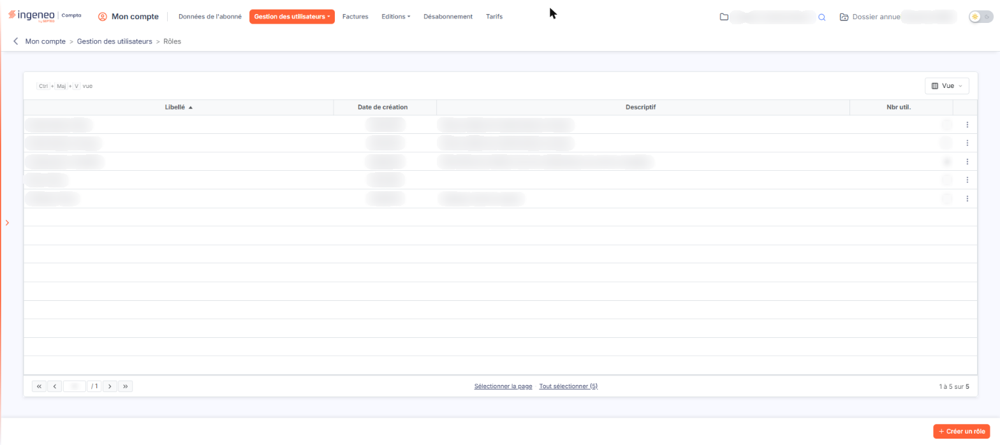
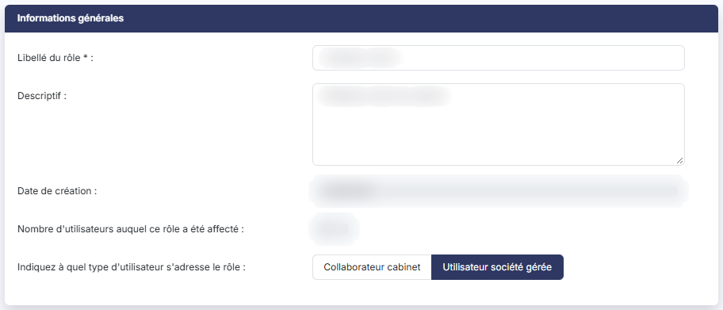
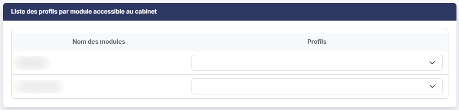
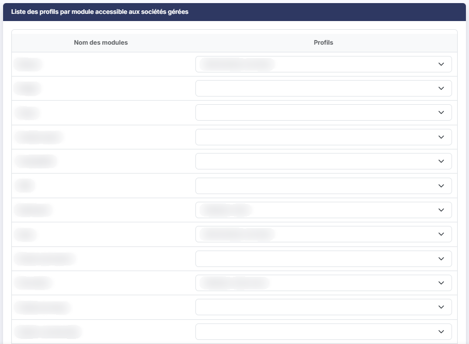
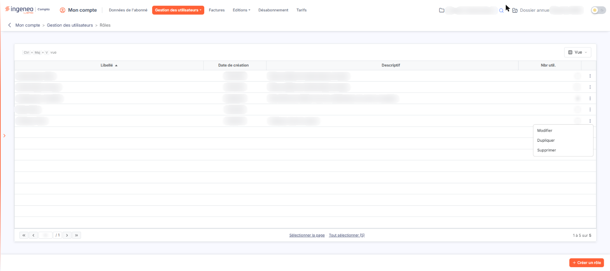

# Rôles


**Où le trouver :** Menu **Gestion des utilisateurs › Rôles**



**En bref** — Cet écran permet de créer, modifier, dupliquer et supprimer des rôles, qui regroupent des profils de plusieurs modules pour attribuer en une fois à un utilisateur les droits dont il a besoin.

* Pour créer un rôle : bouton \[Créer un rôle], saisissez le Libellé du rôle, choisissez un profil pour chaque module, puis bouton \[Enregistrer].
* Pour partir d'un rôle existant : menu ⋮ de sa ligne, puis « Dupliquer ».
* Pour supprimer des rôles : sélectionnez-les, puis bouton \[Supprimer], si aucun utilisateur ne les utilise.


Un rôle est un regroupement de profils de plusieurs modules : il vous permet d'attribuer en une seule fois, à un utilisateur, les droits dont il a besoin dans chacun des modules. Cette page vous permet de créer, modifier, dupliquer et supprimer vos rôles. L'utilisation des rôles est facultative : vous pouvez affecter des profils à un utilisateur sans lui affecter de rôle.

<figure><figcaption>
Écran « Rôles » de la nouvelle interface
</figcaption></figure>

**a) La liste des rôles**

La grille contient une ligne par rôle et quatre colonnes : **Libellé**, **Date de création**, **Descriptif** et **Nbr util.** qui indique le nombre d'utilisateurs auxquels le rôle est affecté. Il n'y a pas de filtre au-dessus de cette grille.

La barre placée au-dessus de la grille ne comporte que le bouton \[Vue], qui fonctionne comme sur toutes les listes de l'application et est décrit dans la page « Les listes » : il n'y a ni champ de recherche, ni Bouton \[Filtres], ni Bouton \[Exporter]. Un clic sur une ligne la sélectionne ; dans le pied de la grille, « Sélectionner la page » et « Tout sélectionner » sélectionnent les lignes de la page affichée ou toutes les lignes, et le compteur (« 1 à 5 sur 5 ») ainsi que la barre de pagination indiquent le nombre total de rôles et vous permettent de passer d'une page à l'autre.

Chaque ligne se termine par un menu « ⋮ » (trois points) qui propose trois commandes :

* « Modifier » ouvre le rôle en modification,
* « Dupliquer » le duplique,
* « Supprimer » le supprime.

En bas de l'écran, à droite :

* bouton **\[Créer un rôle]** : il ouvre une fiche vierge ;
* bouton **\[Supprimer]** : dès qu'une ou plusieurs lignes sont sélectionnées, il figure dans le bandeau de sélection affiché au bas de l'écran (avec « Tout désélectionner ») et supprime les rôles sélectionnés.

**b) Rubrique « Informations générales »**

| Champ                                                                          | Ce qu'il faut savoir                                                                                                                                                                                                                                                                                                                      |
| ------------------------------------------------------------------------------ | ----------------------------------------------------------------------------------------------------------------------------------------------------------------------------------------------------------------------------------------------------------------------------------------------------------------------------------------- |
| **Libellé du rôle**                                                            | Il s'agit de l'identifiant du rôle qui sera notamment repris dans le sélecteur lors de l'affectation d'un rôle à un utilisateur.                                                                                                                                                                                                          |
| **Descriptif**                                                                 | —                                                                                                                                                                                                                                                                                                                                         |
| **Date de création**                                                           | Renseignée par le logiciel et non modifiable. À la création, elle est préremplie à la date du jour.                                                                                                                                                                                                                                       |
| **Nombre d'utilisateurs auquel ce rôle a été affecté**                         | 
Cette information n'est visible que lors de la modification d'un rôle ; le logiciel vous indique le nombre d'utilisateurs auxquels le rôle a été affecté. Dès que ce nombre est supérieur à zéro, un bouton apparaît à sa droite. bouton <strong>[Visualiser]</strong> : il vous permet d'obtenir la liste de ces utilisateurs.
 |
| **Indiquez à quel type d'utilisateur s'adresse le rôle**                       | Deux boutons, « Collaborateur cabinet » et « Utilisateur société gérée », dont un seul peut être actif ; à la création d'un rôle, « Collaborateur cabinet » l'est par défaut. Ce choix détermine les modules proposés dans la rubrique « Liste des profils par module accessible au cabinet ».                                            |
| **Choisissez ce type d'utilisateur avant de commencer à affecter les profils** | Lorsque vous passez d'un bouton à l'autre, le logiciel recharge la liste des modules du cabinet et les profils que vous y aviez déjà sélectionnés sont remis à vide.                                                                                                                                                                      |

**c) Rubriques « Liste des profils par module accessible au cabinet » et « Liste des profils par module accessible aux sociétés gérées »**

Le rôle étant une sorte de " super profil ", vous devez indiquer, pour chaque module, le profil d'utilisation qui sera attribué.

Les deux rubriques sont construites de la même façon : une colonne **Nom des modules**, qui liste un module par ligne, et une colonne **Profils**, qui présente sur chaque ligne un sélecteur proposant les profils que vous avez créés pour ce module. Ces tableaux n'ont ni tri, ni filtre, ni pagination.

Pour ne pas donner d'accès au module, il suffit de ne pas affecter de profil.

Un module pour lequel vous n'avez encore créé aucun profil présente un sélecteur vide : commencez par créer le profil dans la page « Profils ».

La première rubrique porte les droits sur les données du cabinet, la seconde ceux sur les données des sociétés gérées. Cette seconde liste ne contient pas les modules qui sont réservés à une utilisation par les cabinets.

Dans les cabinets, il y a deux types d'utilisateurs : les collaborateurs du cabinet et les utilisateurs des clients pour lesquels le cabinet leur a ouvert un accès. Le paramétrage des rôles doit donc gérer ces deux types d'utilisateurs, et c'est l'objet du choix décrit au paragraphe b).

### Cas d'un rôle destiné à un « Collaborateur cabinet »

Vous paramétrez les droits dont dispose l'utilisateur lorsqu'il est connecté aux données du cabinet, dans la rubrique « Liste des profils par module accessible au cabinet », et les droits dont il dispose quand il est connecté aux données des clients du cabinet (appelés "Sociétés gérées" dans l'application Ingeneo Compta), dans la rubrique « Liste des profils par module accessible aux sociétés gérées ».

La liste des modules du cabinet est alors complète : elle contient aussi les modules qui sont réservés à une utilisation par les cabinets.

### Cas d'un rôle destiné à un « Utilisateur société gérée »

Vous paramétrez les droits dont dispose l'utilisateur lorsqu'il est connecté aux données de sa (ou ses) société(s), dans la rubrique « Liste des profils par module accessible aux sociétés gérées », et les droits dont il dispose quand il est connecté aux données du cabinet, dans la rubrique « Liste des profils par module accessible au cabinet ». En effet, pour certains modules, le cabinet peut ouvrir des accès restreints à ses clients (partage de la GED par exemple).

La liste des modules du cabinet est alors réduite aux seuls modules que le cabinet peut partager avec ses clients.

**d) Les boutons de la fiche**

* bouton **\[Enregistrer]** : il valide vos saisies ;
* **Flèche « Revenir en arrière »**, à gauche du fil d'Ariane (le bouton \[Retour] n'est plus affiché) : elle quitte la fiche sans enregistrer et sans demander de confirmation.

**e) Le rôle "Administrateur principal"**

Afin qu'un abonné ne puisse par mégarde s'interdire l'accès à son abonnement, le rôle "Administrateur principal" dispose de quelques restrictions :

* son libellé et sa description ne sont pas modifiables.

Sur sa fiche, un pictogramme d'information est affiché à droite du libellé et vous en avertit : « Le rôle "Administrateur principal" n'est que partiellement modifiable ». Le descriptif est grisé. Le choix du type d'utilisateur, lui, n'est pas affiché du tout. Dans la liste des profils par module, les lignes dont le profil ne peut pas être changé portent également un pictogramme d'information — « Le profil affecté au module "Administration" n'est pas modifiable. » — et leur sélecteur est désactivé. Les autres lignes restent modifiables : le bouton d'enregistrement est donc bien présent.

## Autres vues de l'écran

<figure><figcaption>
Informations générales
</figcaption></figure>

<figure><figcaption>
Liste des profils par module accessible au cabinet
</figcaption></figure>

<figure><figcaption>
Liste des profils par module accessible aux sociétés gérées
</figcaption></figure>

<figure><figcaption>
Bouton [Créer un rôle]
</figcaption></figure>

<figure><figcaption>
La liste des rôles
</figcaption></figure>
