# Gestion des utilisateurs — présentation


**Où le trouver :** Menu **Gestion des utilisateurs › Utilisateurs**



**En bref** — Cette page de présentation explique comment paramétrer les accès à vos données : profils par module, rôles regroupant plusieurs profils, puis utilisateurs auxquels ils sont affectés.

* Pour donner des droits : créez d'abord les « Profils », puis éventuellement les « Rôles », puis affectez-les dans « Utilisateurs ».
* Pour autoriser vos utilisateurs clients à voir les messages Ingeneo Compta : option « Messages Ingeneo Compta ».


La gestion des utilisateurs et de leurs droits d'accès est une composante fondamentale de l'utilisation d'Ingeneo Compta puisque c'est ici que seront paramétrées toutes les autorisations d'accès (et de modification) aux données gérées par l'application.

<figure>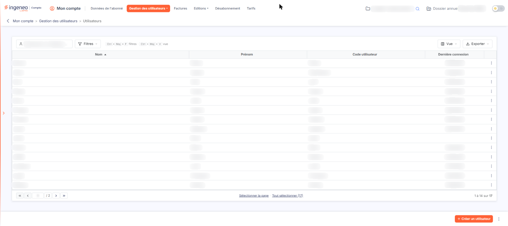<figcaption>
Écran « Utilisateurs » de la nouvelle interface
</figcaption></figure>

Cette rubrique regroupe quatre options, dans cet ordre : « Utilisateurs », « Profils », « Rôles » et « Messages Ingeneo Compta ».

Il vous faut tout d'abord créer des profils d'utilisation pour chaque module, ensuite il faut (éventuellement) créer des "rôles d'utilisation" auxquels sont affectés les profils des modules puis enfin les utilisateurs auxquels seront affectés les rôles.

Un profil d'utilisation correspond à une liste de fonctions auxquelles l'utilisateur aura accès pour un module donné.

Par exemple, on pourra créer pour le module "Facturation", un profil "Visualisation uniquement" dans lequel on ne donnera pas les droits de modification des factures.

On pourra également créer un profil "Accès complet" qui donnera accès à toutes les fonctionnalités du module.

Donc, pour chaque utilisateur et pour chaque module auquel vous souhaitez lui donner accès, vous devrez lui affecter un profil.

Un rôle est un regroupement de profils de plusieurs modules qui permet de simplifier l'attribution et la gestion des droits quand il y a beaucoup d'utilisateurs.

Par exemple, on pourra créer un rôle "Comptable" qui aura le profil "Accès complet" pour le module "Comptabilité" et le module "Facturation", et un rôle "Assistante commerciale" qui n'aura que le profil "Visualisation seulement" pour le module "Facturation" et le module "GED". Ainsi, pour chaque nouvelle assistante commerciale, il suffira de lui affecter le rôle défini.

**L'utilisation des rôles est facultative** puisqu'on peut affecter des profils à un utilisateur sans lui affecter obligatoirement de rôle.

## Autres vues de l'écran

<figure>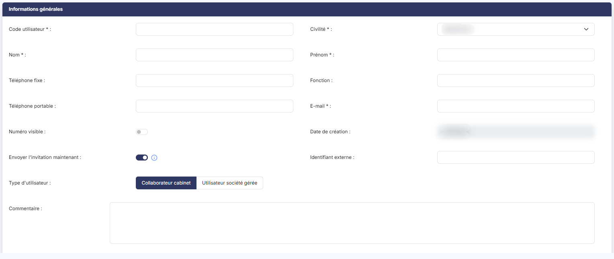<figcaption>
Informations générales
</figcaption></figure>

<figure>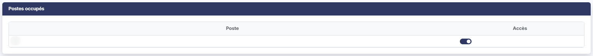<figcaption>
Postes occupés
</figcaption></figure>

<figure>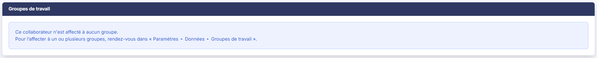<figcaption>
Groupes de travail
</figcaption></figure>

<figure>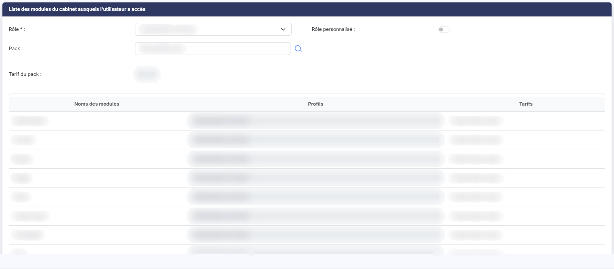<figcaption>
Liste des modules du cabinet auxquels l'utilisateur a accès
</figcaption></figure>

<figure>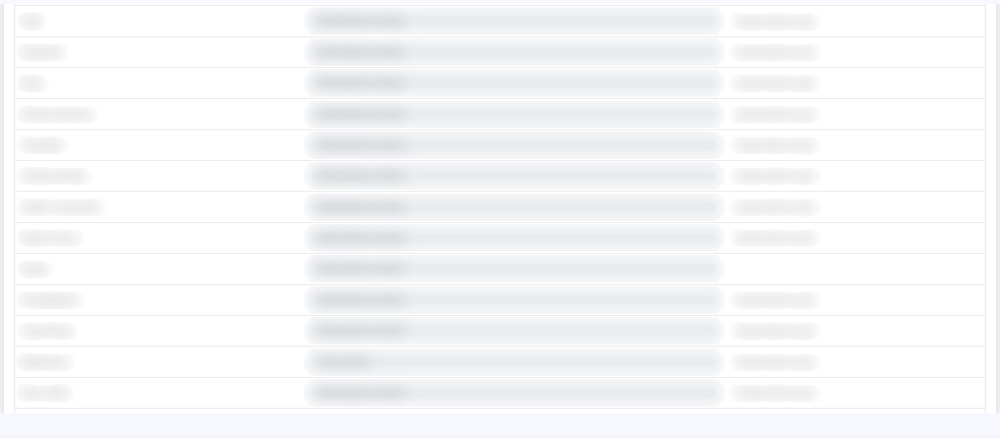<figcaption>
Liste des modules du cabinet auxquels l'utilisateur a accès
</figcaption></figure>

<figure>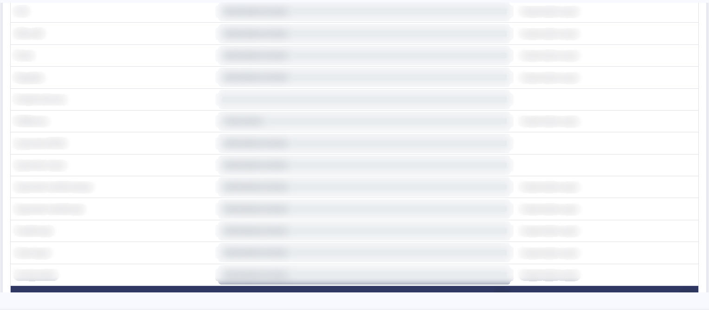<figcaption>
Liste des modules du cabinet auxquels l'utilisateur a accès
</figcaption></figure>

<figure>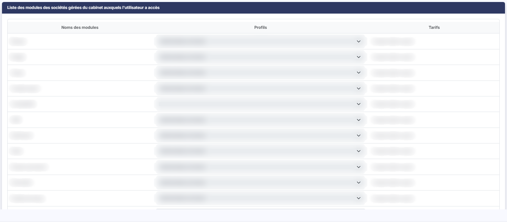<figcaption>
Liste des modules des sociétés gérées du cabinet auxquels l'utilisateur a accès
</figcaption></figure>

<figure>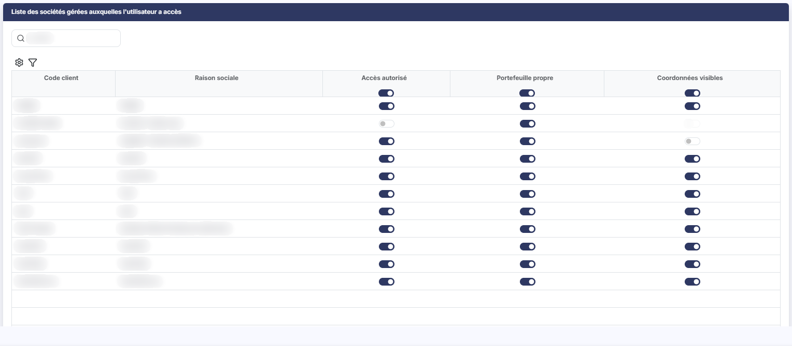<figcaption>
Liste des sociétés gérées auxquelles l'utilisateur a accès
</figcaption></figure>

<figure>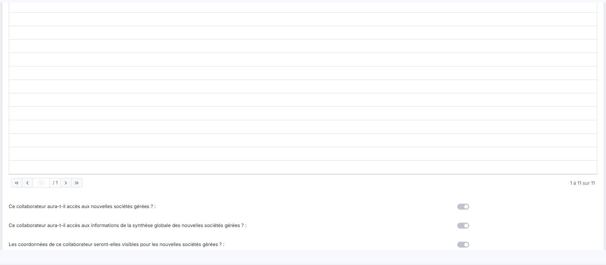<figcaption>
Liste des sociétés gérées auxquelles l'utilisateur a accès
</figcaption></figure>

<figure>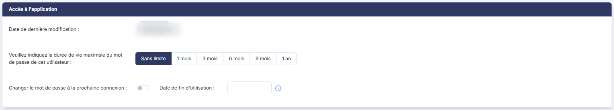<figcaption>
Accès à l'application
</figcaption></figure>

<figure>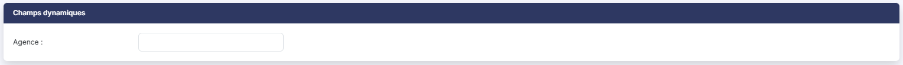<figcaption>
Champs dynamiques
</figcaption></figure>

<figure>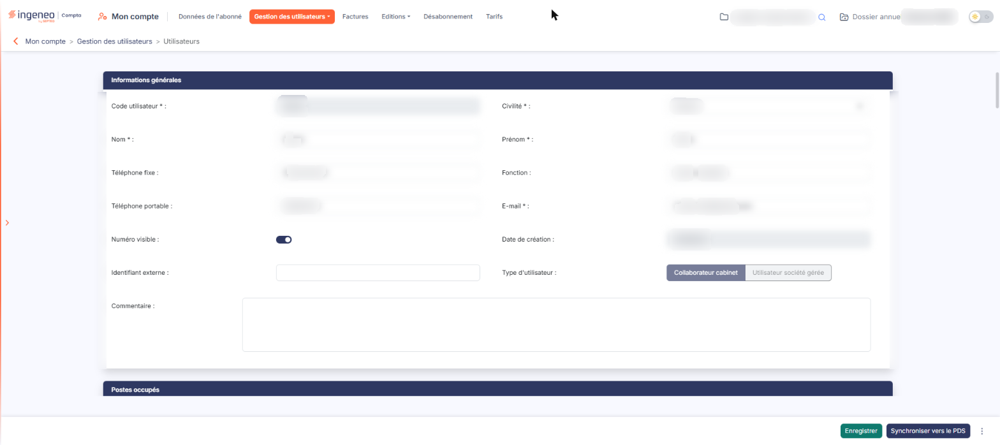<figcaption>
La fiche d'un utilisateur
</figcaption></figure>

<figure>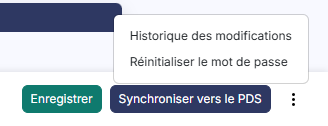<figcaption>
Entrée « Historique des modifications » du menu « Autres actions »
</figcaption></figure>

<figure>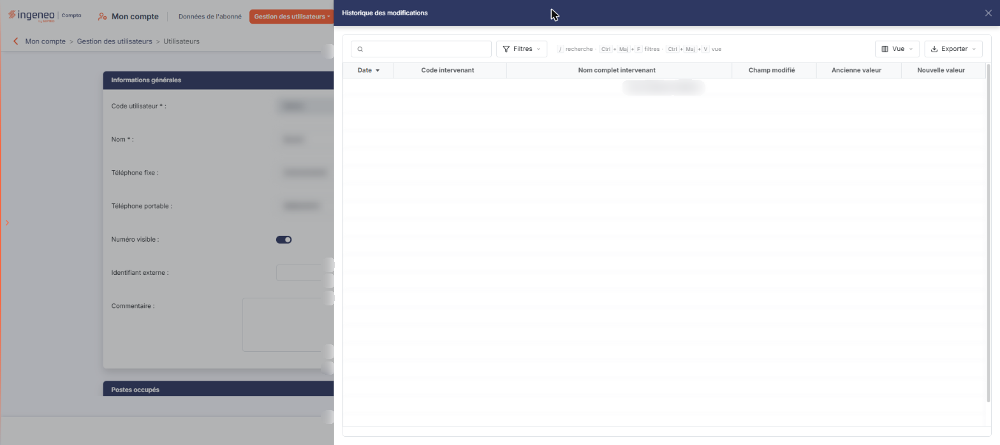<figcaption>
Entrée « Historique des modifications » du menu « Autres actions »
</figcaption></figure>

<figure><figcaption>
Bouton [Créer un utilisateur]
</figcaption></figure>

<figure>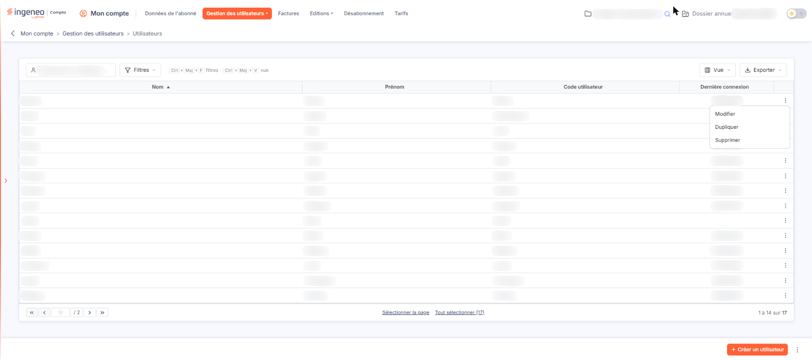<figcaption>
La liste des utilisateurs
</figcaption></figure>

<figure>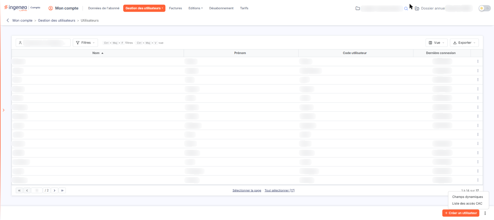<figcaption>
Entrée « Champs dynamiques » du menu ⋮
</figcaption></figure>

<figure>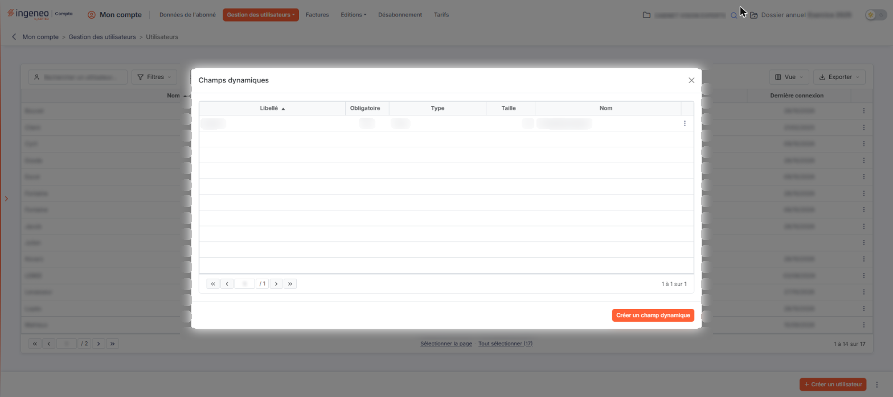<figcaption>
Entrée « Champs dynamiques » du menu ⋮
</figcaption></figure>

<figure>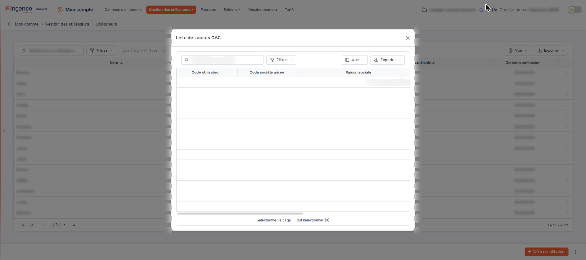<figcaption>
Entrée « Liste des accès CAC » du menu ⋮
</figcaption></figure>

<figure>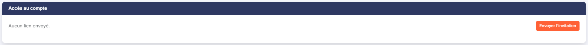<figcaption>
Accès au compte
</figcaption></figure>

<figure>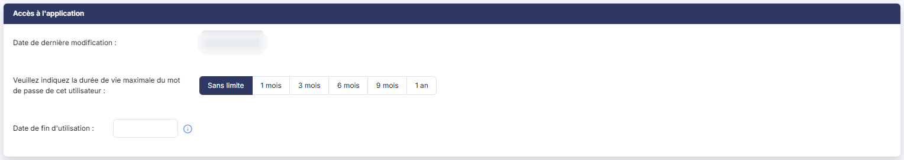<figcaption>
Accès à l'application
</figcaption></figure>
