# Utilisateurs


**Où le trouver :** Menu **Gestion des utilisateurs › Utilisateurs**



**En bref** — Cet écran présente les utilisateurs de votre abonnement et permet de créer, modifier, dupliquer et supprimer leurs fiches, avec leurs modules, leurs sociétés gérées et les règles de leur mot de passe.

* Pour créer un utilisateur : bouton \[Créer un utilisateur], renseignez le Code utilisateur, la Civilité, le Nom, le Prénom et l'E-mail, laissez activé « Envoyer l'invitation maintenant » (l'utilisateur choisit lui-même son mot de passe), puis bouton \[Enregistrer].
* Pour redonner l'accès à un utilisateur qui a perdu son mot de passe : ouvrez sa fiche, puis menu « Autres actions » du pied de la fiche, entrée « Réinitialiser le mot de passe ».
* Pour supprimer des utilisateurs : sélectionnez leurs lignes, puis bouton \[Supprimer] du bandeau de sélection.


Cette option présente la liste des utilisateurs de votre abonnement et permet de créer, de modifier, de dupliquer et de supprimer leurs fiches. C'est dans la fiche d'un utilisateur que vous définissez les modules auxquels il a accès, les sociétés gérées qu'il peut consulter, ainsi que les règles applicables à son mot de passe.

<figure>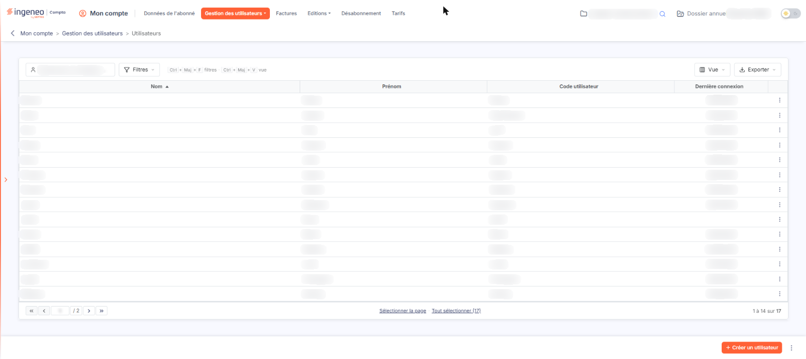<figcaption>
Écran « Utilisateurs » de la nouvelle interface
</figcaption></figure>

## La liste des utilisateurs

<figure>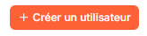<figcaption>
Bouton [Créer un utilisateur]
</figcaption></figure>

<figure>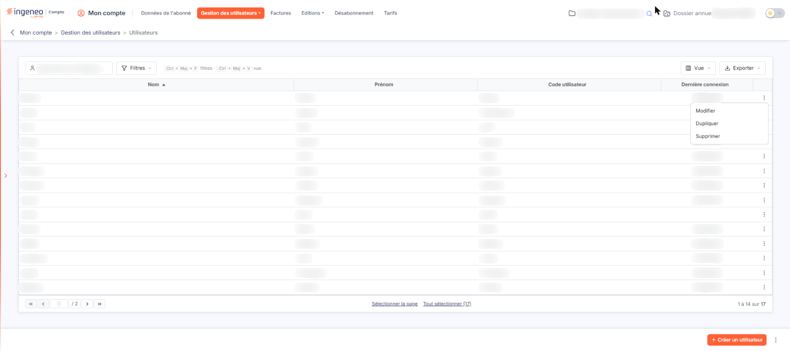<figcaption>
Rubrique « La liste des utilisateurs »
</figcaption></figure>

<figure>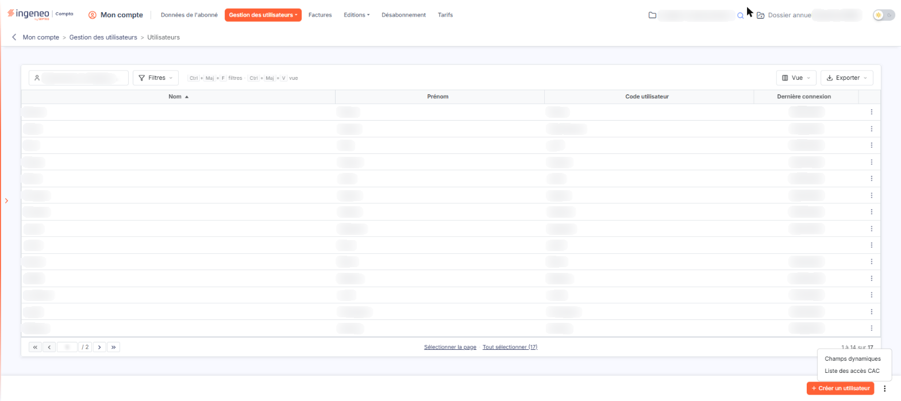<figcaption>
Rubrique « Entrée « Champs dynamiques » du menu ⋮ »
</figcaption></figure>

<figure>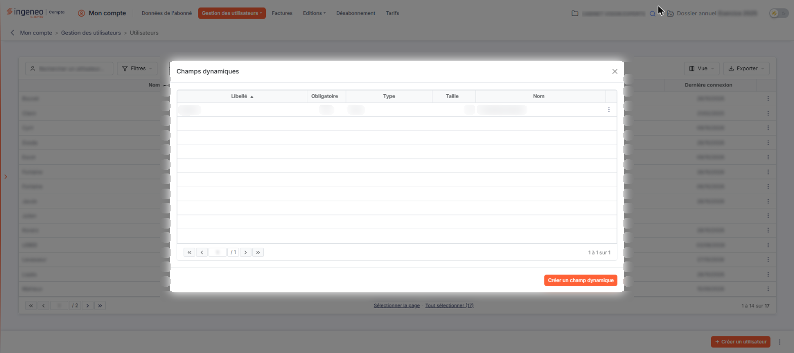<figcaption>
Rubrique « Entrée « Champs dynamiques » du menu ⋮ »
</figcaption></figure>

<figure>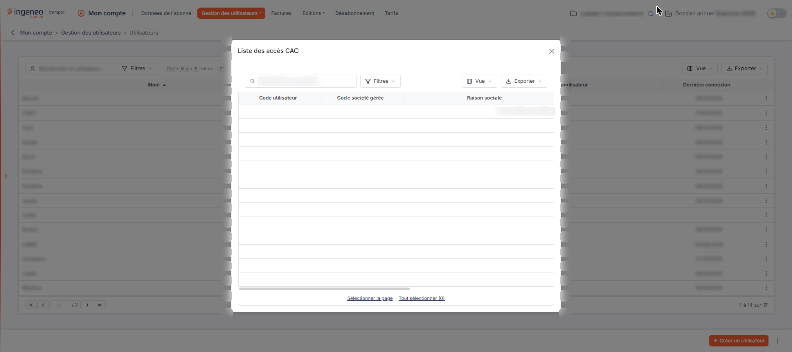<figcaption>
Rubrique « Entrée « Liste des accès CAC » du menu ⋮ »
</figcaption></figure>

Au-dessus de la liste, le champ « Rechercher un utilisateur… » vous permet de rechercher un utilisateur. À côté, le bouton \[Filtres] permet de poser des critères sur les colonnes ; à droite de la barre, le bouton \[Vue] règle les colonnes affichées et le bouton \[Exporter] ouvre les options d'impression et d'export de la liste (« Aperçu », « Imprimer », « Exporter en Excel », « Exporter en PDF », « Envoyer la liste par e-mail »).

La liste présente quatre colonnes : **Nom**, **Prénom**, **Code utilisateur** et **Dernière connexion**. Ces quatre colonnes peuvent être triées en cliquant sur leur titre ; le tri initial est établi sur le nom. La colonne **Dernière connexion** reste vide pour un utilisateur qui ne s'est jamais connecté.

Chaque ligne porte à droite un bouton à trois points (⋮), dont le menu propose « Modifier », « Dupliquer » et « Supprimer » : « Modifier » ouvre la fiche de l'utilisateur. Il n'y a plus de case à cocher : un clic sur une ligne la sélectionne, et un bandeau de sélection s'affiche alors (« 1 utilisateur sélectionné », « Tout désélectionner » et le bouton \[Supprimer]). Sous la liste, les liens « Sélectionner la page » et « Tout sélectionner » étendent la sélection ; la pagination et le compteur de lignes figurent au même endroit.

bouton **\[Créer un utilisateur]**

Ce bouton, placé en bas à droite de l'écran, ouvre une fiche vierge pour créer un utilisateur.

**Entrée « Champs dynamiques » du menu ⋮**

Cette entrée du menu à trois points (⋮) placé en bas à droite de l'écran, à droite du bouton \[Créer un utilisateur], ouvre une fenêtre qui permet d'ajouter des champs de votre choix aux fiches de vos utilisateurs. La fenêtre présente les champs déjà définis, avec leur **Libellé**, le fait qu'ils soient **Obligatoire** ou non, leur **Type**, leur **Taille** et leur **Nom** ; le bouton à trois points (⋮) de chaque ligne donne accès à ses actions, le bouton **\[Créer un champ dynamique]** permet de définir un champ supplémentaire et la croix de l'en-tête de la fenêtre ramène à la liste des utilisateurs. Reportez-vous au chapitre « Généralités / Fonctionnement général / Champs dynamiques » de la présente aide en ligne pour plus d'informations sur la gestion de ces champs.

**Bouton \[Supprimer] du bandeau de sélection**

Ce bouton, qui n'apparaît qu'une fois une ligne sélectionnée, supprime les utilisateurs dont vous avez sélectionné la ligne.

**Entrée « Liste des accès CAC » du menu ⋮**

Cette entrée du même menu à trois points (⋮) ouvre une fenêtre présentant les accès accordés aux commissaires aux comptes, avec le **Code utilisateur**, le **Code société gérée**, la **Raison sociale**, la **Date d'ouverture**, la **Date de fermeture** et le nom de l'utilisateur qui a ouvert l'accès (**Créé par**). Si aucun accès n'a été ouvert, la fenêtre affiche le message « Aucun élément à afficher. ». Pour rappel, l'ouverture d'un accès pour un commissaire aux comptes se fait dans le module « Comptabilité expert », écran Révision, par l'icône « Dossiers de révision » de son en-tête. La fenêtre est une liste dotée de sa propre recherche (« Rechercher une société… ») et des boutons \[Filtres], \[Vue] et \[Exporter] ; elle se ferme par la croix de son en-tête.

## La fiche d'un utilisateur

<figure>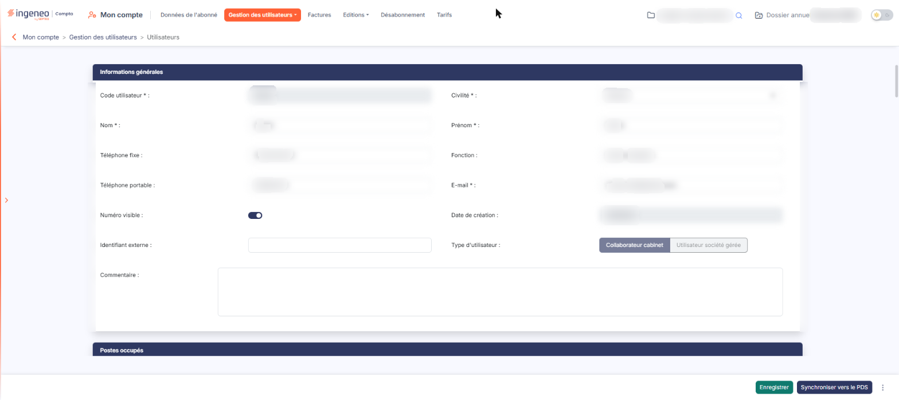<figcaption>
Rubrique « La fiche d'un utilisateur »
</figcaption></figure>

La fiche est organisée en rubriques, affichées les unes sous les autres dans l'ordre suivant : « Informations générales », « Postes occupés », « Groupes de travail », « Liste des modules du cabinet auxquels l'utilisateur a accès », « Liste des modules des sociétés gérées du cabinet auxquels l'utilisateur a accès », « Liste des sociétés gérées auxquelles l'utilisateur a accès », « Accès à l'application », « Accès au compte » et « Champs dynamiques ». La rubrique « Accès au compte » n'apparaît que dans la fiche d'un utilisateur existant ; la rubrique « Champs dynamiques » n'apparaît que si vous avez défini au moins un champ dynamique.

## Rubrique « Informations générales »

<figure>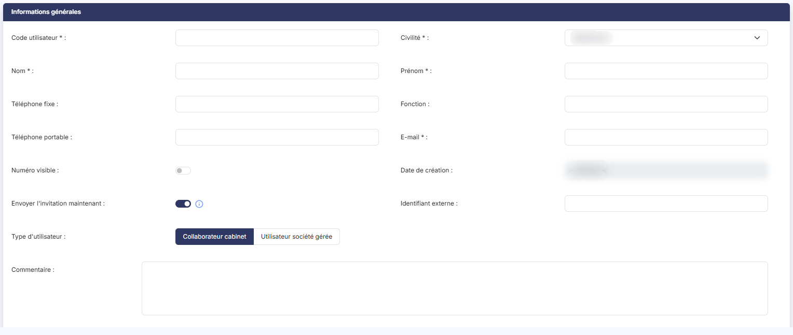<figcaption>
Rubrique « Informations générales »
</figcaption></figure>

| Champ                                   | Ce qu'il faut savoir                                                                                                                                                                                                                                                                                                                                                                                                                                               |
| --------------------------------------- | ------------------------------------------------------------------------------------------------------------------------------------------------------------------------------------------------------------------------------------------------------------------------------------------------------------------------------------------------------------------------------------------------------------------------------------------------------------------ |
| 1. **Code utilisateur**                 | C'est le code qui sera utilisé lors de la connexion. Il doit être composé d'au moins six caractères (et de vingt au plus) et n'accepte que les lettres, les chiffres, les tirets haut et bas et le point. Il ne se saisit qu'à la création : dans une fiche existante, le champ est grisé.                                                                                                                                                                         |
| 2. **Civilité**                         | Choisissez « Madame » ou « Monsieur ».                                                                                                                                                                                                                                                                                                                                                                                                                             |
| 3. **Nom**                              | —                                                                                                                                                                                                                                                                                                                                                                                                                                                                  |
| 4. **Prénom**                           | —                                                                                                                                                                                                                                                                                                                                                                                                                                                                  |
| 5. **Téléphone fixe**                   | —                                                                                                                                                                                                                                                                                                                                                                                                                                                                  |
| 6. **Fonction**                         | —                                                                                                                                                                                                                                                                                                                                                                                                                                                                  |
| 7. **Téléphone portable**               | Ce numéro sert aussi à recevoir les codes d'authentification renforcée.                                                                                                                                                                                                                                                                                                                                                                                            |
| 8. **E-mail**                           | Cette adresse est fondamentale car c'est grâce à elle que le logiciel reconnaît les expéditeurs qui souhaitent, par exemple, envoyer des documents dans leur GED. C'est aussi pourquoi une même adresse e-mail ne peut être affectée qu'à un seul utilisateur.                                                                                                                                                                                                     |
| 9. **Numéro visible**                   | Ce paramètre porte sur le téléphone portable. L'interrupteur désactivé laisse le numéro enregistré dans la fiche — et continue donc de recevoir les codes d'authentification — mais il n'est plus affiché dans les fiches de contacts du tableau de bord. Activé, le numéro y est visible.                                                                                                                                                                         |
| 10. **Date de création**                | Date de création de la fiche. Ce champ n'est jamais modifiable ; à la création, il est pré-rempli à la date du jour.                                                                                                                                                                                                                                                                                                                                               |
| 11. **Envoyer l'invitation maintenant** | Interrupteur présent uniquement à la création, proposé activé. Il n'y a plus de champ « Mot de passe » à saisir : activé, l'utilisateur reçoit par e-mail un lien, valable 7 jours, pour choisir lui-même son mot de passe (l'infobulle du pictogramme (i) le rappelle) ; désactivé, l'invitation s'envoie plus tard depuis sa fiche, dans la rubrique « Accès au compte ».                                                                                        |
| 12. **Identifiant externe**             | —                                                                                                                                                                                                                                                                                                                                                                                                                                                                  |
| 13. **Type d'utilisateur**              | Indiquez s'il s'agit d'un « Collaborateur cabinet » ou d'un « Utilisateur société gérée », c'est-à-dire d'un client du cabinet. Ce choix commande le contenu de plusieurs rubriques de la fiche : la liste des modules du cabinet, les paramètres d'accès aux sociétés gérées et l'affichage de la rubrique « Groupes de travail ». Il ne se fait qu'à la création : dans une fiche existante, les deux boutons sont inactifs et le type ne peut plus être changé. |
| 14. **Commentaire**                     | —                                                                                                                                                                                                                                                                                                                                                                                                                                                                  |
| **Créé par**                            | Nom complet de l'utilisateur qui a créé la fiche. Ce champ n'apparaît que dans une fiche existante, et seulement si le créateur est connu.                                                                                                                                                                                                                                                                                                                         |

## Rubrique « Postes occupés »

<figure>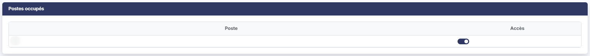<figcaption>
Rubrique « Postes occupés »
</figcaption></figure>

Cette rubrique présente la liste des postes de travail que vous avez définis dans « Paramètres », « Données », « Organisation et temps », « Postes ». Pour chaque poste, l'interrupteur de la colonne **Accès**, activé ou désactivé, indique si l'utilisateur occupe ce poste. À la création d'une fiche, tous les postes sont désactivés.

## Rubrique « Groupes de travail »

<figure>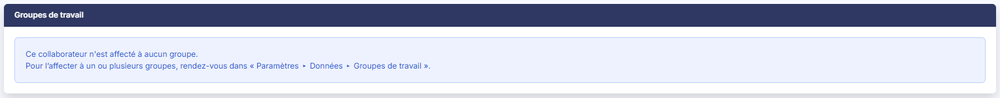<figcaption>
Rubrique « Groupes de travail »
</figcaption></figure>

Cette rubrique rappelle, en consultation, les groupes de travail auxquels le collaborateur est affecté : le **Groupe**, le **Poste** qu'il y occupe et s'il en est la **Tête de groupe**. Elle ne se saisit pas ici : si le collaborateur n'est affecté à aucun groupe, le logiciel affiche le message « Ce collaborateur n'est affecté à aucun groupe. Pour l’affecter à un ou plusieurs groupes, rendez-vous dans « Paramètres ▸ Données ▸ Groupes de travail ». ». Ce libellé abrège le chemin complet, qui passe aussi par « Organisation et temps ». Cette rubrique n'est pas présentée dans la fiche d'un utilisateur de type « Utilisateur société gérée », ni dans une fiche en cours de création.

## Rubrique « Liste des modules du cabinet auxquels l'utilisateur a accès »

<figure>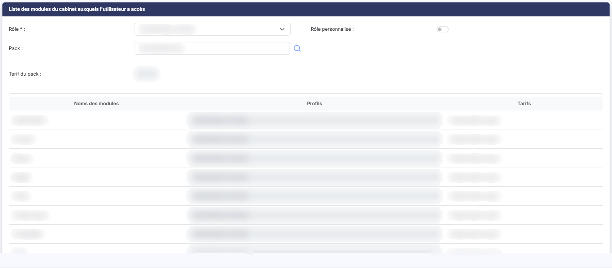<figcaption>
Rubrique « Liste des modules du cabinet auxquels l'utilisateur a accès »
</figcaption></figure>

<figure>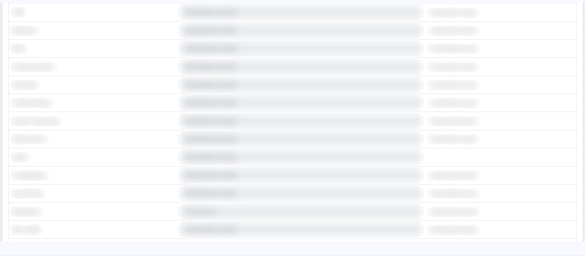<figcaption>
Rubrique « Liste des modules du cabinet auxquels l'utilisateur a accès »
</figcaption></figure>

<figure>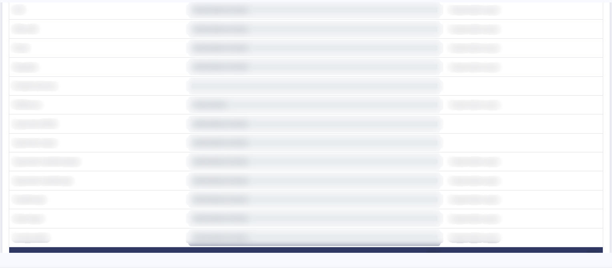<figcaption>
Rubrique « Liste des modules du cabinet auxquels l'utilisateur a accès »
</figcaption></figure>

| Champ                    | Ce qu'il faut savoir                                                                                                                                                                                                                                                                                                                                                                                                                                                                                                                     |
| ------------------------ | ---------------------------------------------------------------------------------------------------------------------------------------------------------------------------------------------------------------------------------------------------------------------------------------------------------------------------------------------------------------------------------------------------------------------------------------------------------------------------------------------------------------------------------------- |
| 1. **Rôle**              | Si vous avez paramétré des rôles, choisissez dans la liste celui que vous souhaitez affecter à l'utilisateur. Chaque module se voit alors affecter le profil contenu dans le rôle, et l'attribution d'un autre profil n'est plus possible. Ce champ est obligatoire lorsque l'interrupteur **Rôle personnalisé** est désactivé ; il perd son caractère obligatoire dès que cet interrupteur est activé.                                                                                                                                  |
| 2. **Rôle personnalisé** | Cet interrupteur est désactivé si un rôle a été affecté à l'utilisateur. Si vous l'activez, le rôle est abandonné et la liste des rôles revient à « Sélectionnez », mais le logiciel conserve les profils qui avaient été affectés ; vous pouvez alors choisir librement le profil de chaque module dans la colonne **Profils**, qui devient saisissable. Attention : dans une fiche en cours de création, cet interrupteur est activé — le rôle n'y est donc pas obligatoire, contrairement à ce qui se passe dans une fiche existante. |
| 3. **Pack**              | Ce champ permet de définir en une seule fois la liste des modules auxquels l'utilisateur aura accès. Pour les abonnés experts-comptables facturés selon les dossiers, il n'apparaît que pour les utilisateurs de sociétés gérées et il est obligatoire. Pour les abonnés experts-comptables facturés selon les utilisateurs, il est à renseigner pour affecter le pack dont bénéficient les collaborateurs concernés ; pour les utilisateurs de société gérée, il reste facultatif.                                                      |
| 4. **Tarif du pack**     | Ce champ n'est pas modifiable : il rappelle le tarif attaché au pack retenu.                                                                                                                                                                                                                                                                                                                                                                                                                                                             |

La liste qui suit contient tous les modules auxquels l'utilisateur peut potentiellement avoir accès lorsqu'il est connecté à la société du cabinet, avec pour chacun le profil retenu (colonne **Profils**) et le tarif appliqué (colonne **Tarifs**, qui indique « Compris dans le pack » pour les modules couverts par le pack et reste vide pour ceux qui ne sont pas facturés à l'utilisateur). Le total des tarifs est rappelé sous la liste. Si vous avez affecté un rôle à l'utilisateur, les profils de chaque module proviennent de ce rôle ; dans le cas contraire, vous pouvez modifier le profil de chaque module.

Le contenu de cette liste dépend du type d'utilisateur : elle présente l'ensemble des modules du cabinet pour un collaborateur, et seulement les quelques modules ouverts aux clients — « Agenda », « Boîte à lettres », « GED », « Messagerie » et « Plaquettes » — pour un utilisateur de société gérée.

## Rubrique « Liste des modules des sociétés gérées du cabinet auxquels l'utilisateur a accès »

<figure>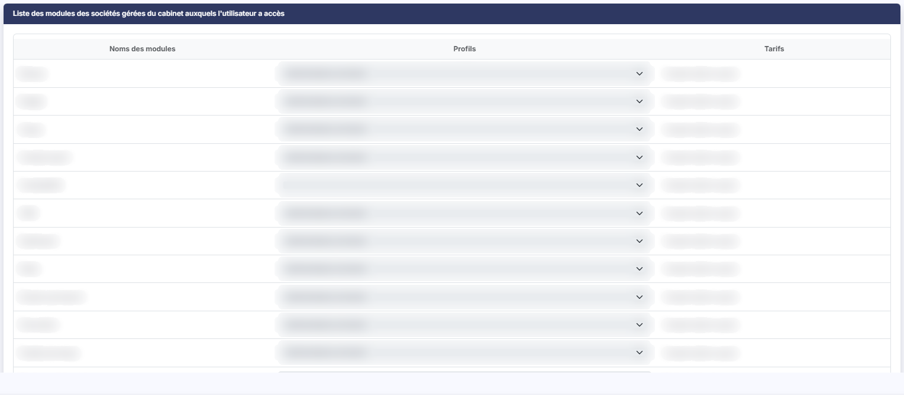<figcaption>
Rubrique « Liste des modules des sociétés gérées du cabinet auxquels l'utilisateur a accès »
</figcaption></figure>

Cette liste contient tous les modules auxquels l'utilisateur peut potentiellement avoir accès lorsqu'il est connecté à une société gérée. Elle se présente comme la précédente — colonnes **Noms des modules**, **Profils** et **Tarifs**, et total sous la liste — et son contenu ne dépend pas du type d'utilisateur. Si vous avez affecté un rôle à l'utilisateur, les profils proviennent de ce rôle ; dans le cas contraire, vous pouvez modifier le profil de chaque module.

## Rubrique « Liste des sociétés gérées auxquelles l'utilisateur a accès »

<figure>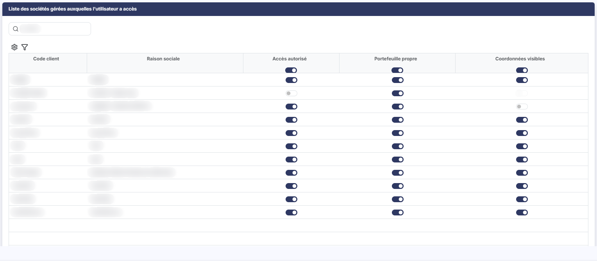<figcaption>
Rubrique « Liste des sociétés gérées auxquelles l'utilisateur a accès »
</figcaption></figure>

<figure>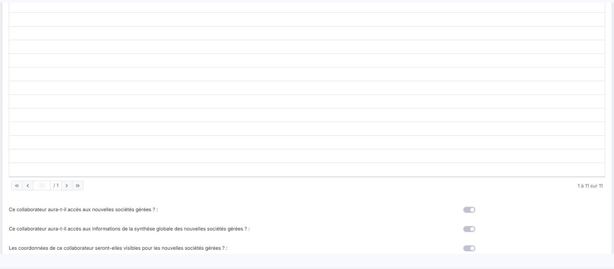<figcaption>
Rubrique « Liste des sociétés gérées auxquelles l'utilisateur a accès »
</figcaption></figure>

Par défaut, quand un nouvel utilisateur est créé, le logiciel ne lui donne accès à aucune société gérée ; c'est à vous d'activer l'accès pour chaque société à laquelle vous souhaitez le laisser se connecter.

Si vous avez un grand nombre de sociétés gérées, saisissez quelques caractères dans le champ **Société :** : le logiciel ne présente alors que les sociétés dont le code ou la raison sociale contiennent ces caractères (il n'y a plus de bouton \[Afficher]).

La liste présente le **Code client** et la **Raison sociale** de chaque société, puis les paramètres d'accès. Ces paramètres ne sont pas les mêmes selon le type de l'utilisateur, alors que le titre de la rubrique, lui, ne change pas.

**Cas d'un collaborateur du cabinet**

Vous disposez de trois paramètres par société gérée :

* **Accès autorisé** : la société figurera dans la liste de celles auxquelles l'utilisateur pourra se connecter ;
* **Portefeuille propre** : les données de la société figureront dans la synthèse du portefeuille de l'utilisateur ;
* **Coordonnées visibles** : les coordonnées de l'utilisateur seront visibles pour les clients de cette société, dans la fenêtre des contacts du tableau de bord.

Pour activer un même paramètre pour toutes les sociétés en une seule fois, utilisez l'interrupteur figurant dans le titre de la colonne.

Trois questions sont posées sous la liste, pour régler d'avance le sort des sociétés gérées qui seront créées plus tard : « Ce collaborateur aura-t-il accès aux nouvelles sociétés gérées ? », « Ce collaborateur aura-t-il accès aux informations de la synthèse globale des nouvelles sociétés gérées ? » et « Les coordonnées de ce collaborateur seront-elles visibles pour les nouvelles sociétés gérées ? ».

**Cas d'un utilisateur de société gérée**

Pour ces utilisateurs, qui correspondent aux clients en collaboratif, vous ne disposez que du paramètre **Accès autorisé**, et une seule question est posée sous la liste : « Ce collaborateur aura-t-il accès aux nouvelles sociétés gérées ? ».

## Rubrique « Accès à l'application »

<figure>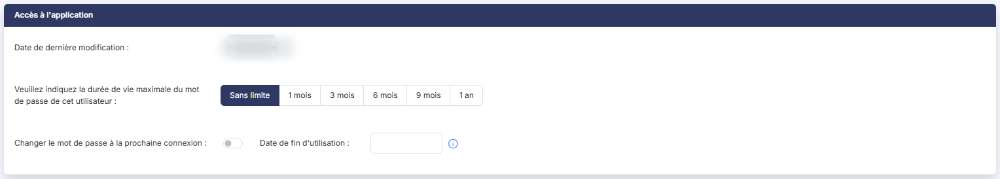<figcaption>
Rubrique « Accès à l'application »
</figcaption></figure>

<figure>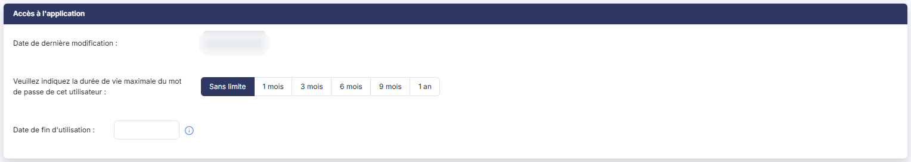<figcaption>
Rubrique « Accès à l'application »
</figcaption></figure>

| Champ                                                                                | Ce qu'il faut savoir                                                                                                                                                                                                                                                                                                                                                                                                                                                                                                       |
| ------------------------------------------------------------------------------------ | -------------------------------------------------------------------------------------------------------------------------------------------------------------------------------------------------------------------------------------------------------------------------------------------------------------------------------------------------------------------------------------------------------------------------------------------------------------------------------------------------------------------------- |
| 1. **Date de dernière modification**                                                 | Ce champ n'est pas modifiable ; c'est la date à laquelle le mot de passe a été changé pour la dernière fois.                                                                                                                                                                                                                                                                                                                                                                                                               |
| 2. **Veuillez indiquez la durée de vie maximale du mot de passe de cet utilisateur** | C'est la fréquence à laquelle le mot de passe sera invalidé et devra être modifié par l'utilisateur. Choisissez entre « Sans limite », « 1 mois », « 3 mois », « 6 mois », « 9 mois » et « 1 an ».                                                                                                                                                                                                                                                                                                                         |
| 3. **Changer le mot de passe à la prochaine connexion**                              | Interrupteur proposé seulement dans la fiche d'un utilisateur existant. Activé, l'utilisateur devra obligatoirement changer son mot de passe lors de sa prochaine connexion. L'administrateur peut ainsi lui imposer une mise à jour. L'administrateur ne choisit plus le mot de passe de l'utilisateur : celui-ci le choisit lui-même à partir du lien d'invitation. Pour un utilisateur qui a perdu son mot de passe, le menu « Autres actions » du pied de la fiche propose l'entrée « Réinitialiser le mot de passe ». |
| 4. **Date de fin d'utilisation**                                                     | Ce champ vous permet de programmer à l'avance la date au-delà de laquelle l'utilisateur ne pourra plus se connecter (par exemple pour un stagiaire, ou lorsque la date de départ de la personne est connue).                                                                                                                                                                                                                                                                                                               |
| **Attention**                                                                        | Cette note ne concerne que les abonnés experts-comptables facturés selon les utilisateurs. Cette date de fin interdit la connexion de l'utilisateur ; elle n'a aucune incidence sur la facturation. Pour désabonner un utilisateur, vous devez détruire sa fiche ou supprimer tous ses accès à tous les modules payants.                                                                                                                                                                                                   |

Si vous souhaitez conserver l'historique de vos utilisateurs sortis, vous pouvez créer un rôle intitulé « Rôle sans accès » qui, par exemple, ne contiendra que le module « Préférences ». Vous l'affectez ensuite aux utilisateurs ne devant plus avoir accès au logiciel : rien ne vous sera plus facturé pour eux après la fin du mois.

## Rubrique « Accès au compte »

<figure>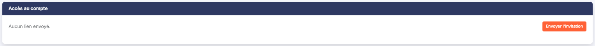<figcaption>
Rubrique « Accès au compte »
</figcaption></figure>

Cette rubrique n'apparaît que dans la fiche d'un utilisateur existant, jamais à la création. Elle suit les invitations envoyées à l'utilisateur pour qu'il choisisse lui-même son mot de passe. Tant qu'aucun lien n'a été envoyé, elle affiche « Aucun lien envoyé. » et le bouton \[Envoyer l'invitation]. Dès qu'une invitation a été envoyée, la rubrique présente le dernier envoi avec son statut (par exemple « Validée »), puis un tableau des envois, aux colonnes **Type** (« Invitation »), **Envoyée le**, **Par**, **Adresse**, **Valable jusqu'au**, **Consultée le**, **Validée le** et **Statut**.

## Rubrique « Champs dynamiques »

<figure>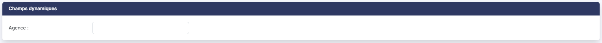<figcaption>
Rubrique « Champs dynamiques »
</figcaption></figure>

Cette rubrique présente les champs que vous avez ajoutés vous-même aux fiches de vos utilisateurs, avec le libellé que vous leur avez donné. Elle n'apparaît pas si vous n'avez défini aucun champ dynamique.

## Les boutons de la fiche

<figure>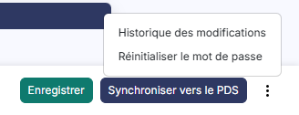<figcaption>
Rubrique « Entrée « Historique des modifications » du menu « Autres actions » »
</figcaption></figure>

<figure>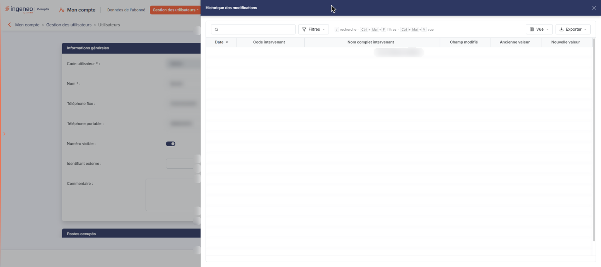<figcaption>
Rubrique « Entrée « Historique des modifications » du menu « Autres actions » »
</figcaption></figure>

bouton **\[Enregistrer]**

Ce bouton enregistre la fiche. C'est le seul bouton proposé, avec la flèche « Revenir en arrière » qui ramène à la liste, lorsque vous créez un utilisateur.

bouton **\[Synchroniser vers le PDS]**

Ce bouton n'est proposé que si le portail de services est actif pour votre abonnement, et seulement dans une fiche existante. Il déclare l'utilisateur sur le portail de services s'il n'y figure pas encore, et lui accorde l'accès à celles de ses sociétés qui y sont déjà déclarées.

**Entrée « Historique des modifications » du menu « Autres actions »**

Le menu « Autres actions » (les trois points, à droite du pied d'une fiche existante) propose cette entrée, qui ouvre à droite de l'écran un panneau présentant la liste des modifications successives apportées à la fiche de l'utilisateur : colonnes **Date**, **Code intervenant**, **Nom complet intervenant**, **Champ modifié**, **Ancienne valeur** et **Nouvelle valeur**, avec la barre « Rechercher un champ modifié… » et les boutons \[Filtres], \[Vue] et \[Exporter]. On referme le panneau par la croix de son en-tête. Cette entrée n'est proposée qu'aux utilisateurs qui en ont le droit. Le même menu propose l'entrée « Réinitialiser le mot de passe ».

**Flèche « Revenir en arrière »**

Cette flèche, placée à gauche du fil d'Ariane, revient à la liste des utilisateurs sans enregistrer les modifications en cours.
