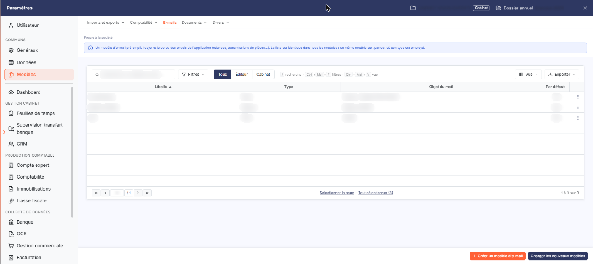
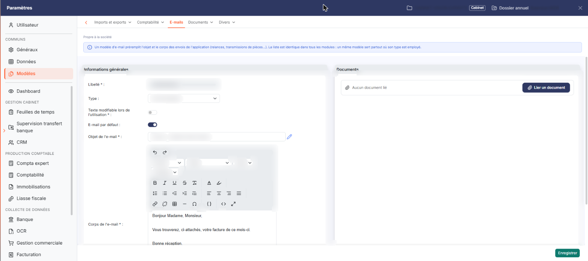

# E-mails


**Où le trouver :** Panneau **Paramètres** › **Modèles** › **E-mails**



**En bref** — Cet écran permet de préparer une fois pour toutes les objets et textes des e-mails envoyés par le logiciel (envoi de pièces, relance, création d'utilisateur…), proposés ensuite au moment de l'envoi.

* Pour créer un modèle : bouton \[Nouveau], renseignez le Libellé, le Type, l'Objet de l'e-mail et le Corps de l'e-mail, puis bouton \[Enregistrer].
* Pour récupérer les modèles préparés par Ingeneo Compta : bouton \[Charger les nouveaux modèles].
* Pour qu'un modèle soit proposé automatiquement : mettez « E-mail par défaut » à « Oui », puis bouton \[Enregistrer].


Cette option permet de définir les objets et les textes des e-mails que le logiciel envoie : envoi de pièces, relance, courrier client, envoi de déclarations, création d'un utilisateur, changement de mot de passe… Vous préparez ici le message une fois pour toutes, et vous le retrouvez ensuite proposé au moment de l'envoi.

<figure><figcaption>
Écran « E-mails » de la nouvelle interface
</figcaption></figure>

Chaque modèle est rattaché à un type d'envoi. Pour un même type, vous pouvez désigner le modèle que le logiciel proposera automatiquement : c'est le modèle « par défaut ».

Les modèles sont communs à tous les modules qui envoient des e-mails : vous retrouvez donc dans cette liste des modèles préparés depuis un autre module, et le type vous indique à quel envoi chacun est destiné.

**a) La liste des modèles**

La liste présente quatre colonnes :

| Champ                                      | Ce qu'il faut savoir                                                                                                                                                                                                                                                                                                                                                                                                                                                                                                                                                                                                                                                                                                                                                                                                                                                                                   |
| ------------------------------------------ | ------------------------------------------------------------------------------------------------------------------------------------------------------------------------------------------------------------------------------------------------------------------------------------------------------------------------------------------------------------------------------------------------------------------------------------------------------------------------------------------------------------------------------------------------------------------------------------------------------------------------------------------------------------------------------------------------------------------------------------------------------------------------------------------------------------------------------------------------------------------------------------------------------ |
| **Libellé**                                | Le nom que vous avez donné au modèle ; c'est sous ce nom que vous le reconnaîtrez au moment de l'envoi.                                                                                                                                                                                                                                                                                                                                                                                                                                                                                                                                                                                                                                                                                                                                                                                                |
| **Type**                                   | Le type d'envoi auquel le modèle est rattaché. Attention, cette colonne affiche le type sous une forme abrégée, qui n'est pas toujours celle du champ « Type » de la fiche du modèle : ainsi « Piece » dans la liste correspond à « Envoi de pièces » dans la fiche.                                                                                                                                                                                                                                                                                                                                                                                                                                                                                                                                                                                                                                   |
| **Objet du mail**                          | L'objet du message. Il s'agit de la même information que le champ « Objet de l'e-mail » de la fiche du modèle, sous un libellé différent.                                                                                                                                                                                                                                                                                                                                                                                                                                                                                                                                                                                                                                                                                                                                                              |
| **Par défaut**                             | 
« Oui » si ce modèle est celui que le logiciel proposera automatiquement pour son type d'envoi, « Non » dans le cas contraire. Les quatre colonnes sont triables : cliquez sur le titre de l'une d'elles pour trier la liste. Sur chaque ligne, trois pictogrammes vous permettent de modifier le modèle, de le supprimer, ou de le dupliquer pour créer un nouveau modèle à partir de celui-ci. bouton <strong>[Charger les nouveaux modèles]</strong> Il récupère dans votre fichier les modèles d'e-mails préparés par Ingeneo Compta qui n'y figurent pas encore, ou qui ont été mis à jour depuis leur chargement. bouton <strong>[Supprimer]</strong> Cochez dans la première colonne de la liste les modèles à supprimer, puis cliquez sur ce bouton. <strong>b) Rubrique « Informations générales »</strong>
                                                       |
| **Libellé**                                | 20 caractères au plus. C'est le nom sous lequel vous retrouverez le modèle dans la liste et au moment de l'envoi. Il ne se saisit qu'à la création : sur un modèle déjà enregistré, ce champ est grisé et ne peut plus être modifié.                                                                                                                                                                                                                                                                                                                                                                                                                                                                                                                                                                                                                                                                   |
| **Type**                                   | Le type d'envoi auquel le modèle est destiné, à choisir parmi « Changement de mot de passe », « Courrier client », « Création utilisateur », « Demandes infos client », « Envoi de pièces », « Envoi déclarations », « Envoi dossier CAC » et « Relance ». Cette liste ne comporte pas de valeur vide : un type est toujours affecté au modèle. À la création, elle est positionnée sur « Envoi de pièces ». Les envois déclenchés depuis le module lui-même utilisent les deux types « Création utilisateur » et « Changement de mot de passe » : préparez un modèle distinct pour chacun de ces deux envois.                                                                                                                                                                                                                                                                                         |
| **Texte modifiable lors de l'utilisation** | Mettez cette option à « Oui » si vous souhaitez pouvoir retoucher le message au moment de l'envoi. À « Non », le message vous est présenté en lecture seule et part tel quel. À la création, cette option est positionnée sur « Non ».                                                                                                                                                                                                                                                                                                                                                                                                                                                                                                                                                                                                                                                                 |
| **E-mail par défaut**                      | Mettez cette option à « Oui » pour que ce modèle soit celui que le logiciel propose automatiquement pour son type d'envoi. Un seul modèle peut être par défaut pour un même type : si un autre modèle du même type l'était déjà, le logiciel le repasse à « Non » lorsque vous enregistrez.                                                                                                                                                                                                                                                                                                                                                                                                                                                                                                                                                                                                            |
| **Objet de l'e-mail**                      | 
50 caractères au plus. C'est l'objet du message. Le pictogramme situé à droite du champ, dont l'infobulle indique « Insérer un champ dynamique », permet d'insérer dans l'objet une donnée que le logiciel remplacera par sa valeur réelle au moment de l'envoi. Il ouvre la fenêtre « Champs », qui présente trois rubriques que vous dépliez l'une après l'autre — une seule reste ouverte à la fois : • « Emetteur » : la civilité, le nom, le prénom et la fonction de l'émetteur ; • « Utilisateur destinataire » : le code abonné, la civilité, le nom, le prénom, le code utilisateur et le mot de passe ; • « Modèle » : la liste des documents. bouton <strong>[Annuler]</strong> : il ferme la fenêtre sans insérer de champ.
                                                                                                                                             |
| **Corps de l'e-mail**                      | Vous saisissez ici le texte du message dans un éditeur de texte enrichi qui vous permet de le mettre en forme : styles, format, police, taille, hauteur de ligne, gras, italique, souligné, listes, retraits, citation, alignements, liens, tableau, ligne horizontale, caractères spéciaux, ainsi que les commandes habituelles de couper, copier, coller, annuler et rétablir. Deux commandes permettent également de copier une mise en forme et de la supprimer, et deux autres de choisir la couleur du texte et la couleur d'arrière-plan. La commande « Insérer des champs » ouvre la même fenêtre « Champs » que le pictogramme de l'objet ; la commande « Source » affiche le texte sous sa forme brute, et les deux dernières commandes permettent de travailler en plein écran et d'afficher les blocs. La poignée située en bas à droite de l'éditeur permet d'agrandir la zone de saisie. |

**c) Rubrique « Documents »**

Cette rubrique permet de joindre au modèle des documents qui accompagneront l'e-mail à chacun de ses envois.

Pour chaque document joint, la grille indique sa description, le nom du fichier, la date et l'utilisateur qui l'a créé.

**d) Enregistrement de la fiche**

bouton **\[Enregistrer]** : il valide votre saisie.

bouton **\[Retour]** : il revient à la liste des modèles sans enregistrer.

## Autres vues de l'écran

<figure><figcaption>
Informations générales
</figcaption></figure>

<figure><figcaption>
Documents
</figcaption></figure>
