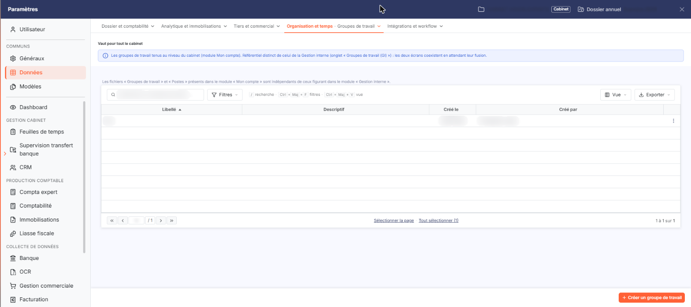
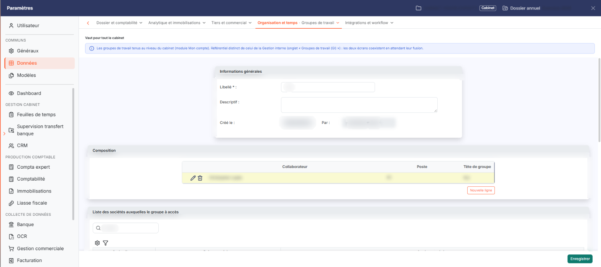
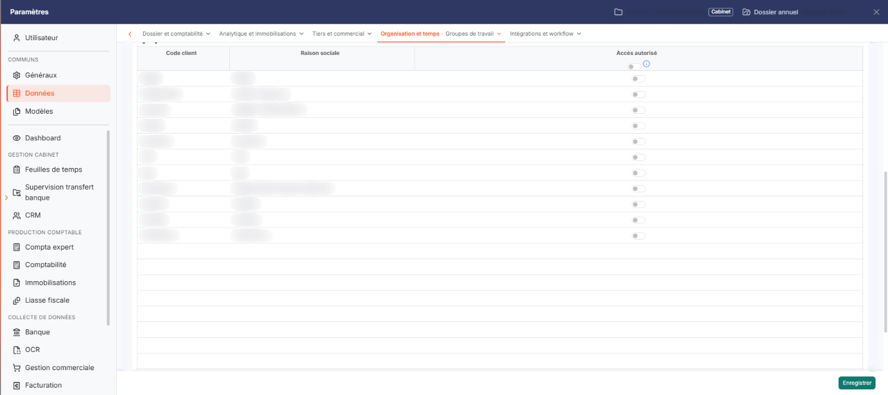

# Groupes de travail


**Où le trouver :** Panneau **Paramètres** › **Données** › **Organisation et temps** › **Groupes de travail**



**En bref** — Cet écran permet de réunir des collaborateurs du cabinet en groupes de travail et de choisir les sociétés gérées auxquelles chaque groupe a accès, sans les activer une à une.

* Pour créer un groupe : bouton \[Créer un groupe de travail], saisissez le Libellé, puis bouton \[Enregistrer].
* Pour en désigner les membres : rubrique « Composition », bouton \[Nouvelle ligne], choisissez le Collaborateur et le Poste, puis validez par le pictogramme « Coche verte ».
* Pour ouvrir des sociétés au groupe : activez Accès autorisé sur leur ligne, puis bouton \[Enregistrer].


Cet écran s'ouvre depuis le panneau Paramètres : onglet « Données », catégorie « Organisation et temps », puis « Groupes de travail » (et non « Groupes de travail (GI) », qui relève de la Gestion interne). Un bandeau rappelle qu'il vaut pour tout le cabinet.

<figure><figcaption>
Écran « Groupes de travail » de la nouvelle interface
</figcaption></figure>

Les groupes de travail sont composés des collaborateurs du cabinet . Cette option permet de créer ces groupes, d'en désigner les membres et de choisir les sociétés gérées auxquelles chaque groupe a accès.

Un groupe de travail sert à ouvrir des accès : les sociétés gérées rattachées au groupe deviennent accessibles à tous les collaborateurs qui le composent, sans avoir à les activer un par un dans la fiche de chacun. C'est l'intérêt du groupe : vous décrivez une fois pour toutes un ensemble de dossiers et l'équipe qui les suit.

Le logiciel rappelle au-dessus de la liste que les fichiers « Groupes de travail » et « Postes » du présent module sont indépendants de ceux du module « Gestion interne » : un groupe créé ici n'existe pas dans l'autre module, et inversement.

## La liste des groupes de travail

La liste présente quatre colonnes, toutes triables en cliquant sur leur titre : le **Libellé** du groupe, son **Descriptif**, la date à laquelle il a été créé (**Créé le**) et le nom de l'utilisateur qui l'a créé (**Créé par**). Au-dessus de la liste, un champ « Rechercher un groupe de travail… » et les boutons \[Filtres], \[Vue] et \[Exporter] permettent de chercher, de filtrer et de présenter la liste.

Il n'y a pas de case à cocher : un clic sur une ligne la sélectionne. Chaque ligne porte un bouton « Autres actions » (trois points) dont le menu propose « Modifier », qui ouvre la fiche du groupe, et « Supprimer ».

bouton **\[Créer un groupe de travail]**

Placé en bas à droite du panneau, ce bouton ouvre une fiche vierge pour créer un groupe de travail.

## La fiche d'un groupe de travail

<figure><figcaption>
Rubrique « La fiche d'un groupe de travail »
</figcaption></figure>

La fiche comporte trois rubriques, dans cet ordre : « Informations générales », « Composition » et « Liste des sociétés auxquelles le groupe à accès ».

## Rubrique « Informations générales »

| Champ          | Ce qu'il faut savoir                                                                                                                                                                                                            |
| -------------- | ------------------------------------------------------------------------------------------------------------------------------------------------------------------------------------------------------------------------------- |
| **Libellé**    | C'est le nom sous lequel le groupe est présenté partout ailleurs.                                                                                                                                                               |
| **Descriptif** | Vous y précisez librement l'objet du groupe.                                                                                                                                                                                    |
| **Créé le**    | **Par :** ces deux informations, affichées côte à côte, rappellent la date de création du groupe et le nom de l'utilisateur qui l'a créé. Elles ne se modifient pas, et n'apparaissent pas dans une fiche en cours de création. |

## Rubrique « Composition »

Cette rubrique liste les membres du groupe : le **Collaborateur**, le **Poste** qu'il occupe dans le groupe et s'il en est la **Tête de groupe**.

bouton **\[Nouvelle ligne]**

Ce bouton, placé sous la liste, ajoute un membre.

## Rubrique « Liste des sociétés auxquelles le groupe à accès »

<figure><figcaption>
Rubrique « Liste des sociétés auxquelles le groupe a accès »
</figcaption></figure>

Cette rubrique désigne les sociétés gérées sur lesquelles le groupe intervient. La liste présente le **Code client** et la **Raison sociale** de chaque société gérée, puis le paramètre **Accès autorisé**, à activer ou à désactiver pour chacune. À la création d'un groupe, toutes les sociétés sont désactivées.

L'interrupteur figurant dans le titre de la colonne **Accès autorisé** règle toutes les sociétés en une seule fois. Activé, il vaut aussi pour les sociétés gérées qui seront créées plus tard : le groupe aura accès à toutes vos sociétés gérées, sans que vous ayez à revenir sur cette fiche à chaque nouveau dossier. Le pictogramme d'information placé à côté rappelle cette particularité.

bouton **\[Enregistrer]**

Ce bouton enregistre la fiche du groupe.

**Chevron « Retour »**

Placé à gauche des onglets de catégorie du panneau, il revient à la liste des groupes de travail sans enregistrer les modifications en cours.
