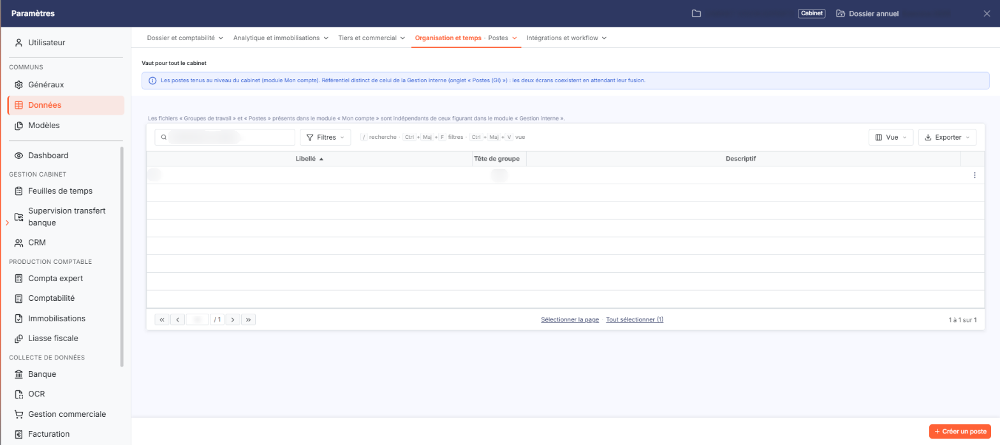
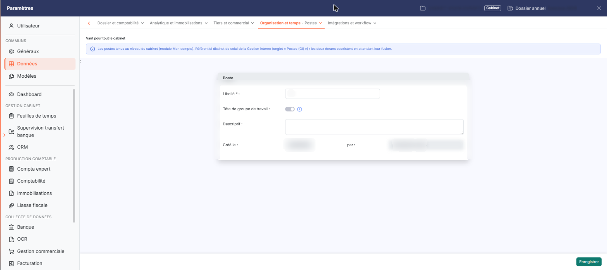

# Postes


**Où le trouver :** Panneau **Paramètres** › **Données** › **Organisation et temps** › **Postes**



**En bref** — Cet écran permet de créer les postes que peuvent occuper les collaborateurs du cabinet, ensuite affectés à chaque utilisateur. Il vaut pour tout le cabinet.

* Pour créer un poste : bouton \[Créer un poste], saisissez le Libellé, puis bouton \[Enregistrer].
* Pour modifier un poste : pictogramme « Autres actions » de sa ligne, puis « Modifier ».
* Pour supprimer des postes : sélectionnez-les, puis bouton \[Supprimer].


Cet écran s'ouvre depuis le panneau Paramètres : onglet « Données », catégorie « Organisation et temps », puis « Postes » (et non « Postes (GI) », qui relève de la Gestion interne). Un bandeau rappelle qu'il vaut pour tout le cabinet.

<figure><figcaption>
Écran « Postes » de la nouvelle interface
</figcaption></figure>

Les postes correspondent aux différentes fonctions que peuvent occuper les collaborateurs au sein du cabinet. Vous les créez dans cette option, puis vous affectez un poste à chaque utilisateur depuis le fichier des utilisateurs.

Un avertissement est rappelé au-dessus de la liste : « Les fichiers « Groupes de travail » et « Postes » présents dans le module « Mon compte » sont indépendants de ceux figurant dans le module « Gestion interne » ». Ce que vous saisissez ici n'alimente donc pas les fichiers de la Gestion interne, et réciproquement.

## Ce que présente la liste

<figure><figcaption>
Bouton [Créer un poste]
</figcaption></figure>

La liste présente trois colonnes : le **Libellé** du poste, la mention **Tête de groupe** et le **Descriptif**. Les colonnes **Libellé** et **Descriptif** peuvent être triées en cliquant sur leur titre. Au-dessus de la liste, un champ « Rechercher un poste… » et les boutons \[Filtres], \[Vue] et \[Exporter] permettent de chercher, de filtrer et de présenter la liste.

Il n'y a pas de case à cocher : un clic sur une ligne la sélectionne. Chaque ligne porte un bouton « Autres actions » (trois points) dont le menu propose « Modifier », qui ouvre la fiche du poste, et « Supprimer ».

bouton **\[Créer un poste]**

Placé en bas à droite du panneau, il ouvre une fiche vierge pour créer un poste.

bouton **\[Supprimer]**

Il se trouve dans le bandeau de sélection qui s'affiche quand vous avez sélectionné une ou plusieurs lignes en cliquant dessus : il supprime les postes sélectionnés. Vous pouvez donc en supprimer plusieurs en une seule fois.

## La fiche d'un poste

<figure><figcaption>
Rubrique « La fiche d'un poste »
</figcaption></figure>

| Champ                         | Ce qu'il faut savoir                                                                                                                                                                                                                                                                                                                                                                                                                                                                                                                                                                                                                                                                                                                                                                                                                                                                                                                                                                                                                                                                                                                                                                  |
| ----------------------------- | ------------------------------------------------------------------------------------------------------------------------------------------------------------------------------------------------------------------------------------------------------------------------------------------------------------------------------------------------------------------------------------------------------------------------------------------------------------------------------------------------------------------------------------------------------------------------------------------------------------------------------------------------------------------------------------------------------------------------------------------------------------------------------------------------------------------------------------------------------------------------------------------------------------------------------------------------------------------------------------------------------------------------------------------------------------------------------------------------------------------------------------------------------------------------------------- |
| **Libellé**                   | Trente caractères au maximum. C'est le libellé qui sera repris dans le fichier des utilisateurs, et celui qui s'affiche dans la liste. Deux postes ne peuvent pas porter le même libellé : le logiciel refuse l'enregistrement et vous invite à en choisir un autre. Ce contrôle ne porte que sur les postes du présent module, indépendamment de ceux de la Gestion interne.                                                                                                                                                                                                                                                                                                                                                                                                                                                                                                                                                                                                                                                                                                                                                                                                         |
| **Tête de groupe de travail** | 
Indiquez si le poste correspond, ou non, à une tête de groupe. Dans chaque groupe de travail, il faut au moins un utilisateur dont le poste est une tête de groupe. Ce champ n'est pas toujours modifiable. Lorsque le poste est déjà désigné comme tête de groupe dans au moins un groupe de travail, son libellé apparaît grisé, l'interrupteur devient inactif, et un pictogramme « Information » s'affiche à côté de lui. Son infobulle indique alors : « Ce poste est utilisé comme tête de groupe dans au moins une mission. » La condition réelle du verrouillage est l'appartenance du poste à la tête d'un <strong>groupe de travail</strong> du fichier « Groupes de travail » du présent module, et non à une mission de la Gestion interne : le champ redevient modifiable dès que le poste n'est plus tête d'aucun groupe de travail. En création, le champ est modifiable, sauf lorsqu'aucun autre poste n'est encore désigné comme tête de groupe : l'interrupteur est alors positionné sur « Oui » et rendu inactif, et un pictogramme « Information » s'affiche à côté de lui, dont l'infobulle indique : « Il doit exister au moins une tête de groupe. »
 |
| **Descriptif**                | Il vous permet de préciser en quelques mots le contenu du poste ; il est repris dans la liste.                                                                                                                                                                                                                                                                                                                                                                                                                                                                                                                                                                                                                                                                                                                                                                                                                                                                                                                                                                                                                                                                                        |

Sur la fiche d'un poste existant, le logiciel rappelle en outre la date de création du poste et le nom de l'utilisateur qui l'a créé. Ces deux informations ne se saisissent pas et n'apparaissent pas en création.

bouton **\[Enregistrer]**

Il enregistre le poste et referme la fiche.

**Chevron « Retour »**

Placé à gauche des onglets de catégorie du panneau, il ramène à la liste sans enregistrer les modifications en cours.
