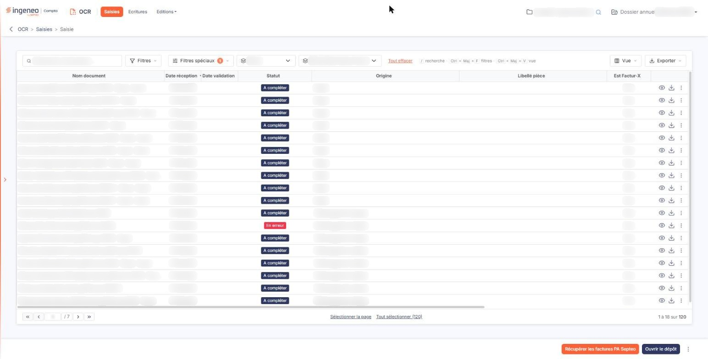

# Saisie simplifiée


**En bref** — La saisie simplifiée affiche la même liste de documents que la saisie standard.

* Pour traiter vos documents : utilisez cette liste comme celle de la saisie standard.


<figure><figcaption>
Écran « Saisie simplifiée » de la nouvelle interface
</figcaption></figure>

La saisie simplifiée affiche la même liste de documents que la saisie standard.
