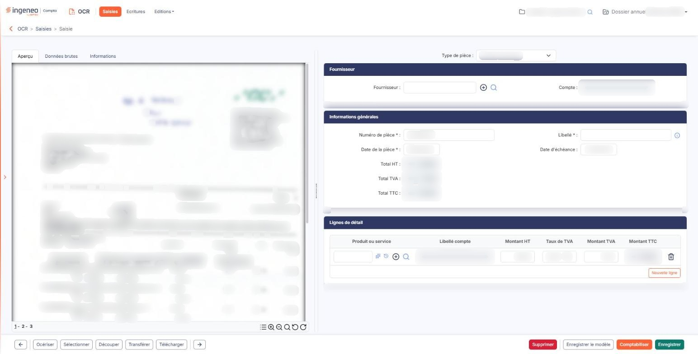
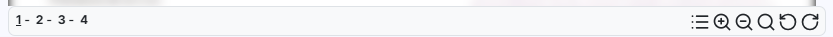

# Saisie standard - Autres actions sur les documents


**En bref** — La barre d'outils de l'aperçu d'un document ouvert permet d'afficher les zones du modèle, de zoomer et de faire pivoter la pièce pour en faciliter la lecture.

* Pour voir où le logiciel a lu chaque information : outil « Zones du modèle » ; un second clic masque les zones.
* Pour redresser un document numérisé dans le mauvais sens : outil « Pivoter dans le sens antihoraire » ou « Pivoter dans le sens horaire ».
* Pour agrandir ou réduire l'aperçu : outils « Zoom » et « Dézoom », puis « Zoom par défaut » pour revenir à l'affichage d'origine.


Lorsqu'un document est ouvert, la partie gauche de l'écran affiche son aperçu. Une barre de **six outils** (cinq sur une facture Factur-X, où l'outil « Zones du modèle » n'est pas proposé) accompagne cet aperçu et permet de manipuler le document pour en faciliter la lecture. Ils sont placés, de gauche à droite, dans l'ordre où ils sont décrits ci-dessous.

<figure><figcaption>
Écran « Saisie standard - Autres actions sur les documents » de la nouvelle interface
</figcaption></figure>

## Zones du modèle

<figure><figcaption>
Rubrique « Zones du modèle »
</figcaption></figure>

Le **premier outil** de la barre, dont l'infobulle indique **« Zones du modèle »**, fait apparaître sur la pièce, sous forme de rectangles de couleur, les **zones mémorisées par le modèle** appliqué au document. Vous voyez ainsi où le logiciel est allé chercher chaque information.

Un second clic les fait disparaître.

## Zoom

Utilisez **« Zoom »** pour agrandir l'aperçu, **« Dézoom »** pour le réduire, et **« Zoom par défaut »** pour revenir à l'affichage d'origine.

## Rotation

Si le document a été numérisé dans le mauvais sens, les **deux derniers outils** permettent de le redresser : **« Pivoter dans le sens antihoraire »** le fait tourner vers la gauche, **« Pivoter dans le sens horaire »** vers la droite.

## Document comportant plusieurs pages

L'aperçu présente le document en continu : **faites défiler** la partie gauche de l'écran pour atteindre les pages suivantes.

Ne confondez pas avec les **deux flèches qui encadrent la barre de commandes**, en bas de l'écran : leur infobulle annonce « Document précédent » et « Document suivant » : elles ne changent pas de page mais vous font passer au **document** précédent ou suivant de la liste des saisies, sans repasser par cette liste.
