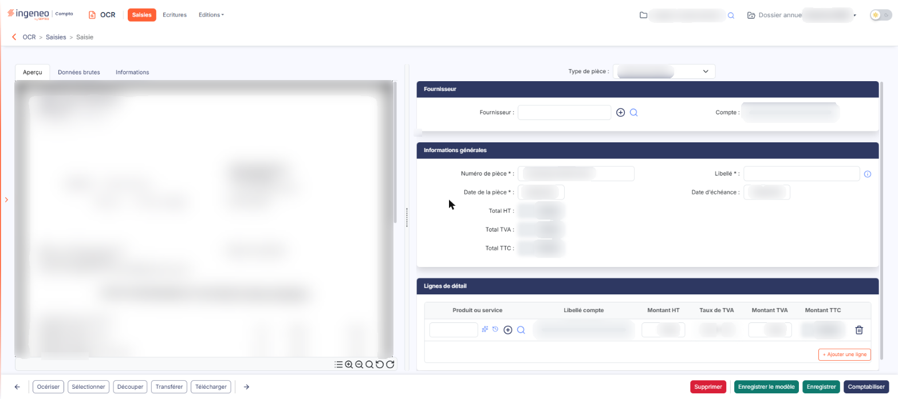
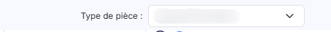
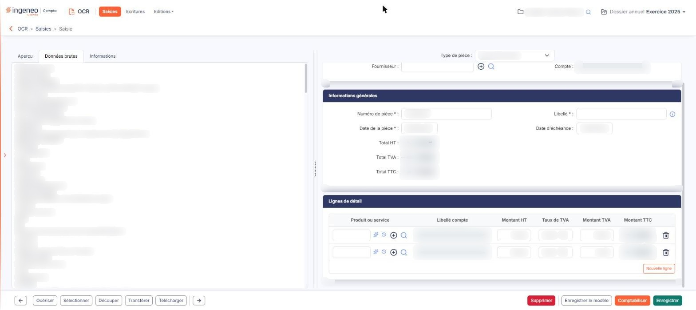
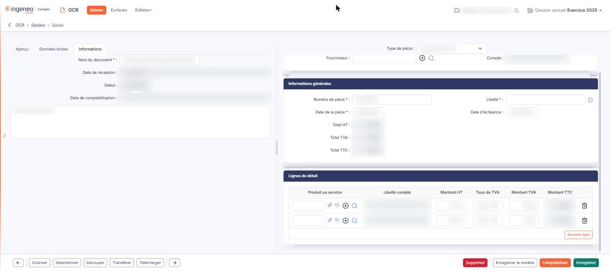
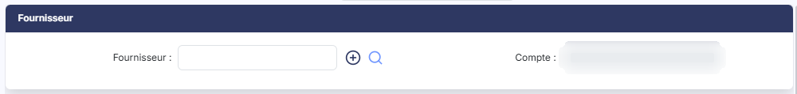
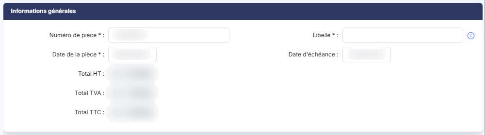
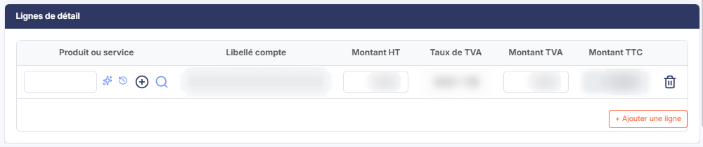

# Saisie standard - Traitement d'un document


**En bref** — Cet écran affiche la pièce à gauche et les informations extraites à droite : vous les contrôlez, complétez ce que le logiciel n'a pas su lire, puis comptabilisez la pièce.

* Pour commencer le traitement : choisissez le « Type de pièce » en haut à droite, puis contrôlez les rubriques « Fournisseur » ou « Client » et « Informations générales ».
* Pour ajouter une ligne d'écriture : bouton \[+ Ajouter une ligne], puis renseignez « Produit ou service », « Montant HT » et « Taux de TVA ».
* Pour reprendre la pièce plus tard : bouton \[Enregistrer] ; pour générer les écritures : bouton \[Comptabiliser].


Lorsque vous ouvrez un document depuis la liste des saisies, le logiciel affiche la pièce à gauche et les informations qu'il en a extraites à droite. Votre travail consiste à contrôler ces informations, à compléter ce que le logiciel n'a pas su lire, puis à comptabiliser la pièce.

<figure><figcaption>
Écran « Saisie standard - Traitement d'un document » de la nouvelle interface
</figcaption></figure>

## Choisir le type de pièce

<figure><figcaption>
Rubrique « Choisir le type de pièce »
</figcaption></figure>

La liste **« Type de pièce »** se trouve en haut à droite de l'écran. C'est le premier élément à renseigner.

La liste ne propose que les natures de pièces que vous avez activées dans la « Configuration » (panneau « Paramètres », rubrique « OCR »), plus le choix **« Autre document »**, toujours présent. Cinq natures peuvent être activées : « Facture fournisseur », « Avoir fournisseur », « Facture client », « Avoir client » et « Note de frais ». Si une nature vous manque, c'est là qu'elle s'active.

Le type retenu commande les rubriques affichées :

* une facture ou un avoir **fournisseur**, ainsi qu'une note de frais, font apparaître la rubrique « Fournisseur » ;
* une facture ou un avoir **client** font apparaître la rubrique « Client ».

## L'aperçu de la pièce

<figure><figcaption>
Rubrique « Onglet « Données brutes » »
</figcaption></figure>

<figure><figcaption>
Rubrique « Onglet « Informations » »
</figcaption></figure>

La partie gauche de l'écran propose les onglets suivants.

**Onglet « Aperçu »**

L'image de la pièce, accompagnée d'une barre d'outils qui permet d'afficher les zones du modèle, d'agrandir, de réduire, de revenir au zoom par défaut et de faire pivoter le document dans un sens ou dans l'autre. Ces commandes sont décrites dans la page « Autres actions sur les documents ».

**Onglet « Données brutes »**

Le texte que le logiciel a lu sur la pièce, tel qu'il l'a lu. Consultez-le lorsqu'une information n'a pas été reprise : si elle ne figure pas ici, c'est que l'océrisation ne l'a pas reconnue, et il faut la saisir vous-même.

**Onglet « Informations »**

Les caractéristiques du document lui-même :

* **Nom du document** — modifiable, obligatoire ;
* **Date de réception**, **Statut** et **Date de comptabilisation** — renseignés par le logiciel, non modifiables ;
* une large zone de saisie libre, portant le texte d'invite **« Descriptif de la pièce... »**, où vous pouvez consigner ce que vous voulez.

## Rubrique « Fournisseur » ou « Client »

<figure><figcaption>
Rubrique « Fournisseur »
</figcaption></figure>

Cette rubrique identifie le tiers de la pièce. Elle comporte deux champs.

**Fournisseur** (ou **Client**) — le tiers concerné. Deux commandes l'accompagnent : le pictogramme **« + »** ouvre à droite le panneau « Nouveau compte », qui sert à créer un nouveau compte auxiliaire (son pied porte le bouton **\[Annuler]** et le bouton **\[Enregistrer]**), et la **loupe** ouvre à droite le panneau « Recherche » parmi les comptes existants : un champ « Contenu recherché », un bouton **\[Nouveau compte auxiliaire]** et une liste à deux colonnes, « Numéro » et « Intitulé ».

**Compte** — le numéro de compte auxiliaire du tiers. Le logiciel le renseigne dès que le tiers est identifié ; vous ne le saisissez pas.

## Rubrique « Informations générales »

<figure><figcaption>
Rubrique « Informations générales »
</figcaption></figure>

Les champs suivis d'une astérisque sont obligatoires : la pièce ne pourra pas être comptabilisée tant qu'ils ne sont pas renseignés.

**Numéro de pièce** \* — le numéro porté sur la facture ou l'avoir.

**Libellé** \* — le libellé de la pièce. Une infobulle le précise : « Le libellé défini ici sera reporté dans les lignes de l'écriture comptable. » Si vous avez demandé le calcul automatique des libellés dans la « Configuration », le logiciel le compose selon la nomenclature que vous y avez définie.

**Date de la pièce** \* — la date d'émission. Un calendrier permet de la saisir, et une liste déroulante propose **toutes les dates que le logiciel a repérées dans le document**. Lorsqu'une même date figure à plusieurs endroits, la liste les distingue en faisant suivre la date de sa position — « 21/06/2026 - Position 1 », « 21/06/2026 - Position 2 » — afin que vous choisissiez la bonne. Une date rencontrée une seule fois s'affiche sans mention de position.

**Date d'échéance** — la date à laquelle le règlement est attendu, avec le même calendrier et la même liste de dates détectées. Ce champ n'est pas obligatoire : son libellé ne porte pas d'astérisque.

**Total HT**, **Total TVA** et **Total TTC** — les trois totaux de la pièce.

## Rubrique « Lignes de détail »

<figure><figcaption>
Rubrique « Lignes de détail »
</figcaption></figure>

C'est ici que se construit l'écriture comptable. Chaque ligne porte un compte et un montant.

**Produit ou service** — le compte à mouvementer. Le pictogramme **« + »** crée un compte, la **loupe** ouvre la recherche.

**Libellé compte** — renseigné par le logiciel d'après le compte retenu.

**Montant HT** — le montant hors taxes de la ligne.

**Taux de TVA** — à choisir parmi les codes TVA du dossier. La liste présente chacun d'eux sous la forme du taux suivi du code, par exemple « 20,00 - TN20 ».

**Montant TVA** — le montant de la taxe.

**Montant TTC** — calculé par le logiciel.

Le bouton **\[+ Ajouter une ligne]** ajoute une ligne ; la corbeille dont l'infobulle indique « Effacer », en fin de ligne, la supprime.

Deux commandes complètent la colonne « Produit ou service » et vous aident à choisir le compte :

**Historique des comptes utilisés** (pictogramme d'horloge fléchée) : les comptes déjà employés pour ce tiers.

**Assistance Intelligence Artificielle** (pictogramme d'étincelles) : le logiciel vous propose un compte à partir du contenu de la pièce.

## Les commandes du bas de l'écran

Chaque commande est soumise à un droit particulier : selon votre profil, certaines d'entre elles peuvent ne pas apparaître.

Les deux **flèches** qui encadrent la barre de commandes, dont les infobulles indiquent « Document précédent » et « Document suivant », vous font passer au document précédent ou au document suivant, sans repasser par la liste. Les commandes de suppression et de traitement final (\[Supprimer], \[Comptabiliser], \[Enregistrer]) sont regroupées à droite de la barre, séparées des commandes de lecture de la pièce.

bouton **\[Océriser]**

Relance la lecture de la pièce.

bouton **\[Transférer]**

Ouvre la fenêtre de transfert du document.

bouton **\[Télécharger]**

Récupère le fichier d'origine sur votre poste.

bouton **\[Enregistrer]**

Enregistre votre saisie sans comptabiliser la pièce. Vous pourrez la reprendre plus tard : elle reste dans la liste avec le statut « A compléter ».

bouton **\[Approbation]**

Il se trouve dans la barre juste avant la commande de comptabilisation, et il n'est affiché que lorsqu'un circuit d'approbation s'applique à la pièce. Il sert à donner votre accord sur la pièce.

bouton **\[Comptabiliser]**

Lance la comptabilisation de la pièce. Si un circuit d'approbation s'applique à la pièce, elle ne peut pas être comptabilisée tant qu'elle n'est pas approuvée : le logiciel répond « Une pièce non approuvée ne peut être comptabilisée. » (« Une facture non approuvée ne peut être comptabilisée. » pour une facture électronique). La commande d'approbation décrite ci-dessus permet de se prononcer.

bouton **\[Dévalidation]**

Ne s'affiche que sur une pièce déjà comptabilisée.

bouton **\[Statut électronique]**

Ne s'affiche que sur une facture électronique, et jamais en saisie simplifiée. Permet de faire évoluer le statut de la facture. Les statuts possibles sont décrits dans la page de l'écran de saisie.

bouton **\[Supprimer]**

Supprime le document du module.

**Flèche « Revenir en arrière »**

Elle se trouve à gauche du fil d'Ariane, en haut de l'écran (le bouton **\[Retour]** existe encore dans la page mais n'est plus affiché). Elle revient à la liste des documents sans enregistrer les modifications en cours.
