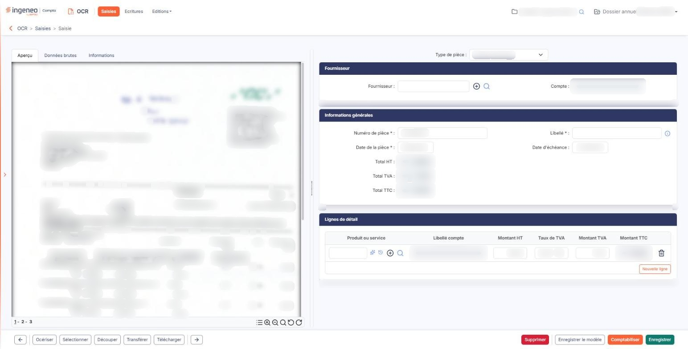

# Saisie standard - Validation d'un document


**En bref** — La comptabilisation génère les écritures d'un document au statut « A comptabiliser » et rend ses informations non modifiables, en tenant compte d'un éventuel circuit d'approbation.

* Pour comptabiliser une pièce complète : bouton \[Comptabiliser] ; si vous êtes le dernier approbateur, confirmez pour approuver et comptabiliser dans la foulée.
* Pour donner votre accord en tant qu'approbateur intermédiaire : bouton \[Approbation], qui approuve sans comptabiliser.
* Pour revenir sur une pièce comptabilisée : bouton \[Dévalidation].


La comptabilisation d'un document n'est possible que lorsque tous les champs obligatoires ont été renseignés — le document est alors au statut « A comptabiliser ».

<figure><figcaption>
Écran « Saisie standard - Validation d'un document » de la nouvelle interface
</figcaption></figure>

Elle a deux effets : **générer les écritures comptables**, et **rendre impossible la modification** des informations du document.

Le bouton **\[Comptabiliser]** reste affiché quel que soit le statut du document, tant qu'il n'est pas comptabilisé : ce n'est donc pas sa présence qui vous indique que la pièce est prête. Une fois le document comptabilisé, ce bouton est remplacé par le bouton **\[Dévalidation]**.

**Si un circuit d'approbation s'applique**

Lorsque le dossier utilise un circuit d'approbation, le document doit d'abord recevoir l'accord des personnes désignées. Il reste alors en attente de l'approbation du niveau en cours. Aucun statut particulier ne s'affiche : le document conserve celui qu'il portait.

Deux cas se présentent, selon votre place dans le circuit.

Si vous êtes le **dernier approbateur attendu**, le bouton **\[Comptabiliser]** enregistre votre approbation puis comptabilise le document dans la foulée : il n'y a pas de double manipulation à faire. Le logiciel vous demande d'abord de confirmer : « Vous êtes le dernier approbateur de cette pièce. Elle sera approuvée puis comptabilisée. Voulez-vous confirmer ? »

Si vous êtes un approbateur **intermédiaire**, vous donnez votre accord par le bouton **\[Approbation]**, qui approuve sans comptabiliser. Le bouton **\[Comptabiliser]** refuse alors d'agir et affiche « Une pièce non approuvée ne peut être comptabilisée. »

Le bouton **\[Approbation]** n'apparaît que lorsqu'un circuit d'approbation s'applique au document.

Le paramétrage des circuits se fait dans le panneau Paramètres, rubrique « Données », menu « Intégrations et workflow », écran « Circuits de validation ».

**Où partent les écritures**

Les écritures sont générées soit directement dans le module Comptabilité, si vous l'avez indiqué dans l'écran « Connexion comptabilité » du panneau Paramètres (rubrique « OCR »), soit dans le container d'écritures en vue d'un export ultérieur vers un autre logiciel — voir le menu « Ecritures ».

Précisions pour le module Comptabilité :

* l'export des écritures est toujours réalisé dans l'exercice paramétré comme exercice par défaut ;
* le PDF de la pièce est attaché à chaque ligne de l'écriture.

Si la comptabilisation automatique est activée dans l'écran « Configuration » du panneau Paramètres (rubrique « OCR »), vous pouvez désigner des journaux distincts pour les écritures automatiques — voir « Connexion comptabilité ». Cela facilite la révision, en séparant les écritures produites par le logiciel de celles qu'un utilisateur a comptabilisées.

**Ces deux journaux ne s'affichent sur l'écran « Connexion comptabilité » que si la comptabilisation automatique est activée.** Tant qu'elle ne l'est pas, ne les y cherchez pas : le logiciel ne les propose pas.

**Après la comptabilisation**

Le logiciel ouvre automatiquement le document suivant, s'il en existe un.
