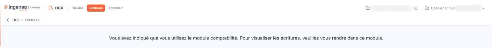

# Ecritures


**Où le trouver :** Menu **Ecritures**



**En bref** — Cet écran présente les écritures générées par le module lorsqu'elles ne partent pas directement dans le module de comptabilité.

* Pour utiliser cet écran : désactivez la question « Indiquez si vous souhaitez générer les écritures directement dans le module de comptabilité » (panneau Paramètres, rubrique « OCR », écran « Connexion comptabilité »).
* Si vous utilisez le module comptabilité : consultez les écritures dans ce module, comme l'indique le message affiché.


Cet écran n'est utile que si l'interrupteur de la question **Indiquez si vous souhaitez générer les écritures directement dans le module de comptabilité** est désactivé, dans le panneau Paramètres, rubrique « OCR », écran « Connexion comptabilité ».

<figure><figcaption>
Écran « Ecritures » de la nouvelle interface
</figcaption></figure>

Si cet interrupteur est activé, l'écran ne présente ni liste ni bouton : le logiciel affiche seulement le message « Vous avez indiqué que vous utilisez le module comptabilité. Pour visualiser les écritures, veuillez vous rendre dans ce module. »
