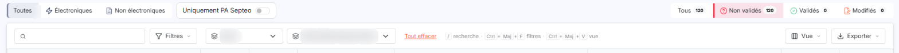
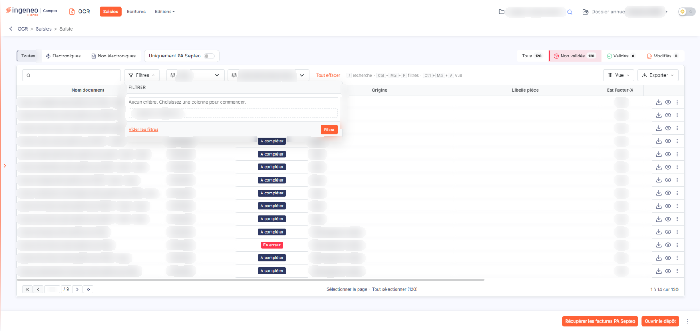
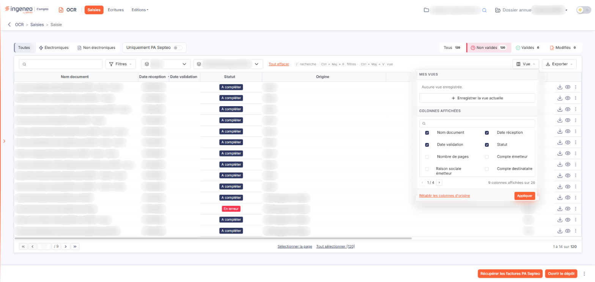
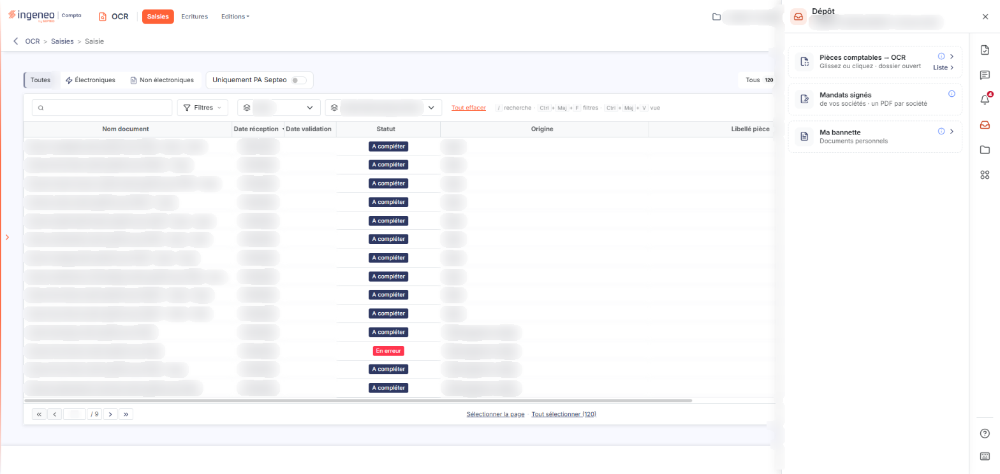
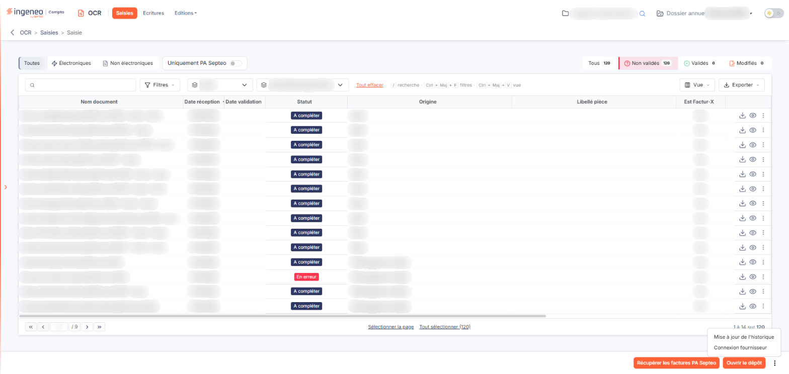

# OCR — présentation générale


**Où le trouver :** Menu **Saisies**



**En bref** — Le module OCR lit les pièces comptables reçues en PDF ou en image, en extrait le maximum d'informations et génère les écritures comptables correspondantes.

* Pour faire entrer des pièces dans le module : depuis l'onglet « Saisies », bouton \[Ouvrir le dépôt].
* Pour choisir les natures de pièces traitées : panneau « Paramètres », rubrique « OCR », onglet « Configuration », rubrique « Nature des documents traités ».


**Les natures de pièces traitées**

<figure><figcaption>
Écran « Saisies » de la nouvelle interface
</figcaption></figure>

Le module génère des écritures pour cinq natures de pièces : **facture fournisseur**, **avoir fournisseur**, **facture client**, **avoir client** et **note de frais**.

Vous indiquez celles que vous souhaitez traiter dans le panneau « Paramètres », rubrique « OCR », onglet « Configuration », rubrique « Nature des documents traités ».

**Comment les documents entrent dans le module**

La voie décrite ici est le **dépôt de fichiers**, depuis l'onglet « Saisies » (bouton **\[Ouvrir le dépôt]**).

La colonne « Origine » de la liste des documents indique par quelle voie chaque pièce est arrivée.

**L'organisation du module**

| Champ         | Ce qu'il faut savoir                       |
| ------------- | ------------------------------------------ |
| **Saisies**   | La liste des documents et leur traitement. |
| **Ecritures** | Les écritures générées.                    |
| **Editions**  | Le générateur d'états.                     |

La barre du module ne comporte plus que ces trois entrées. Le reste du paramétrage se trouve dans le panneau « Paramètres » : rubrique « OCR » (onglets « Configuration », « Connexion comptabilité » et « Utilisateurs »), rubrique « Généraux » (paramètres communs à plusieurs modules), rubrique « Données » (les référentiels utilisés pour générer les écritures — plan comptable, comptes auxiliaires, journaux, codes TVA, modes et délais de règlement, unités — ainsi que les circuits de validation) et rubrique « Modèles » (modèles d'import et d'export, modèles de pièces).

**Le compteur du tableau de bord**

Sur le tableau de bord, l'onglet « Synthèse portefeuille » affiche une vignette « Pièces OCR à traiter », qui indique un nombre de pièces et l'ancienneté de la plus ancienne. L'entrée « OCR » du menu des modules, à gauche, ne porte plus de pastille.

## Autres vues de l'écran

<figure><figcaption>
Filtrer la liste
</figcaption></figure>

<figure><figcaption>
Bouton [Ouvrir le dépôt]
</figcaption></figure>

<figure><figcaption>
Bouton [Filtrer]
</figcaption></figure>

<figure><figcaption>
Les colonnes disponibles en complément
</figcaption></figure>

<figure><figcaption>
Bouton [Ouvrir le dépôt]
</figcaption></figure>

<figure><figcaption>
Entrée « Connexion fournisseur » du menu « ⋮ »
</figcaption></figure>
