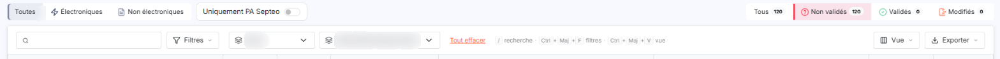
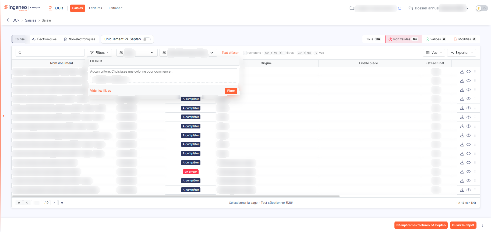
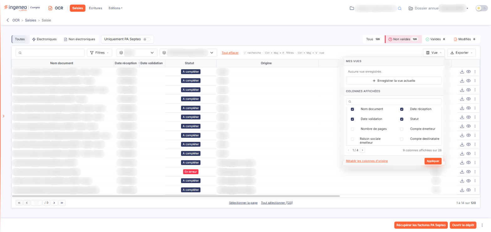
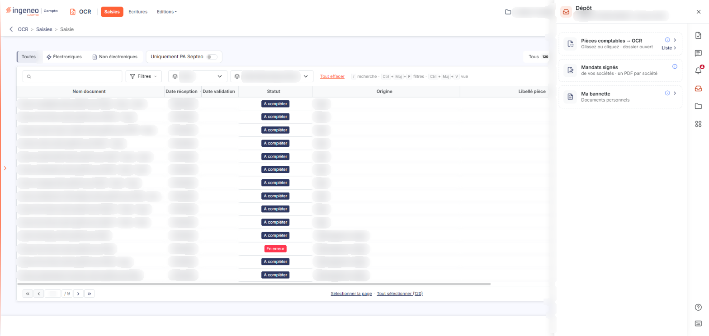
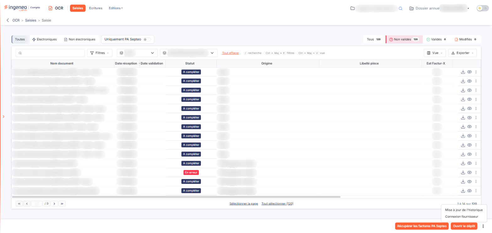

# Saisies


**Où le trouver :** Menu **Saisies**



**En bref** — Point d'entrée du module, cet écran liste les documents reçus et permet de les déposer, de les visualiser, de les océriser puis de générer les écritures comptables.

* Pour ajouter des documents : bouton \[Ouvrir le dépôt], puis glissez vos fichiers dans la zone « Pièces comptables → OCR » du panneau « Dépôt » ou cliquez dans la zone pour les choisir.
* Pour ouvrir un document et le traiter : menu « Autres actions » (trois points) de sa ligne, puis entrée « Modifier ».
* Pour restreindre la liste : bouton \[Filtres], ajoutez vos critères avec « + Ajouter un critère sur… », puis bouton \[Filtrer].


Cet écran est le point d'entrée du module. Il présente la liste des documents reçus et permet de les télécharger, de les visualiser, de les océriser, puis de générer les écritures comptables.

<figure><figcaption>
Écran « Saisies » de la nouvelle interface
</figcaption></figure>

Le dépôt (bouton \[Ouvrir le dépôt]) accepte les documents au format **PDF** ainsi que les **images**, dont le format **HEIC**, celui des photos prises avec un iPhone.

Les traitements portant sur plusieurs documents à la fois se lancent depuis la barre du bas de l'écran, qui affiche les boutons correspondants dès que des documents sont sélectionnés : un clic sur une ligne la sélectionne, Ctrl + clic en ajoute une autre, et les liens « Sélectionner la page » et « Tout sélectionner (n) », sous la grille, sélectionnent respectivement les lignes de la page affichée et tous les documents de la liste. Les traitements propres à un document se font en l'ouvrant, à l'aide de l'entrée « Modifier » du menu « Autres actions » (trois points) de sa ligne.

À droite de chaque ligne, trois commandes : « Télécharger » (flèche vers le bas) télécharge le document sur votre poste, « Afficher l'aperçu » (œil) en affiche l'aperçu, et « Autres actions » (trois points) ouvre un menu qui propose « Modifier », pour ouvrir le document et le traiter, et « Supprimer ».

**Filtrer la liste**

Une barre est disponible au-dessus de la grille : un champ « Rechercher un document… », le bouton \[Filtres], les listes « Statut » et « Statut électronique interne », puis le lien « Tout effacer ». Les boutons \[Vue] et \[Exporter] sont à l'extrémité droite de la même barre.

Au-dessus de cette barre, un bandeau de boutons de filtre rapide est toujours visible (il n'y a plus de bouton \[Filtres spéciaux]). À gauche, trois boutons « Toutes », « Électroniques » et « Non électroniques » : à l'ouverture de l'écran « Toutes » est retenu et la liste affiche tous les documents. À droite, quatre boutons d'état « Tous », « Non validés », « Validés » et « Modifiés ». Selon la société, un interrupteur est ajouté à côté du premier groupe (« Uniquement PA Septeo », ou « Uniquement le Portail de services »). Si la largeur manque, le bandeau passe sur deux lignes.

| Champ                                                                        | Ce qu'il faut savoir                                                                                                                                                                                                                                                                                                                                                                                                                                                                                                                                                                                                                                                                                                     |
| ---------------------------------------------------------------------------- | ------------------------------------------------------------------------------------------------------------------------------------------------------------------------------------------------------------------------------------------------------------------------------------------------------------------------------------------------------------------------------------------------------------------------------------------------------------------------------------------------------------------------------------------------------------------------------------------------------------------------------------------------------------------------------------------------------------------------ |
| **Boutons de gauche (« Toutes », « Électroniques », « Non électroniques »)** | « Électroniques » restreint la liste aux factures électroniques, « Non électroniques » aux autres documents, « Toutes » ne restreint rien. Le bouton retenu reste retenu : on en change en cliquant un autre, et « Toutes » sert à revenir à la liste complète.                                                                                                                                                                                                                                                                                                                                                                                                                                                          |
| **Etat**                                                                     | À droite du bandeau, quatre boutons : « Tous », « Non validés », « Validés » et « Modifiés ». Chacun porte un nombre, celui des documents qu'il afficherait ; ces nombres tiennent compte de la recherche, du volet \[Filtres] et des boutons de gauche, et se mettent à jour à chaque rechargement de la liste. À l'ouverture de l'écran, « Non validés » est sélectionné : seuls les documents non encore comptabilisés sont affichés. « Tous » affiche les documents quel que soit leur état ; le lien « Tout effacer » ramène aussi l'état sur « Tous ». Le bouton « Modifiés » n'est proposé qu'aux sociétés qui conservent des factures de plateforme agréée.                                                      |
| **Statut**                                                                   | Liste déroulante, intitulée « Statut » tant qu'aucune valeur n'est choisie, qui filtre sur l'état d'avancement du traitement (voir ci-dessous). La liste proposée dépend des boutons de gauche : avec « Électroniques », elle se réduit à « A compléter », « A comptabiliser », « Comptabilisé » et « Doublon » ; sinon elle propose « En erreur », « A traiter », « En traitement... », « A compléter », « A comptabiliser », « Comptabilisé » et « Doublon ».                                                                                                                                                                                                                                                          |
| **Statut électronique interne**                                              | Liste déroulante qui, pour les factures électroniques, filtre sur l'étape du cycle de vie de la facture. Elle propose « Prise en charge », « Approuvée », « Approuvée partiellement », « Suspendue », « Refusée » et « Mise en litige ».                                                                                                                                                                                                                                                                                                                                                                                                                                                                                 |
| **Uniquement PA Septeo**                                                     | Interrupteur placé dans le bandeau, à droite des boutons « Toutes / Électroniques / Non électroniques », qui restreint la liste aux pièces provenant de la plateforme agréée Septeo. Il n'est proposé que si la facturation électronique est activée pour la société.                                                                                                                                                                                                                                                                                                                                                                                                                                                    |
| **Uniquement le Portail de services**                                        | Pour une société servie par le Portail de services, cet interrupteur du même bandeau (accompagné d'un pictogramme d'information qui précise d'où la société reçoit ses factures électroniques) restreint la liste aux pièces reçues du Portail de services (colonne « Origine » : « Portail de services »). Une société qui n'est pas servie par le Portail de services ne le voit pas ; une société qui l'est et qui n'a plus de facture de plateforme agréée ne voit plus « Uniquement PA Septeo » ni le bouton « Modifiés ».                                                                                                                                                                                          |
| **Rechercher un document…**                                                  | 
Champ de recherche sur le nom du document ; la saisie devient un critère « Nom document Contient … » qui reste appliqué. bouton <strong>[Filtrer]</strong> Il se trouve dans le volet ouvert par le bouton [Filtres], où l'on ajoute des critères avec « + Ajouter un critère sur… » : il applique à la liste les critères que vous avez ajoutés. Le lien « Vider les filtres » du même volet les retire. <strong>Lien « Tout effacer »</strong> Il se trouve à droite des listes de la barre et retire les critères appliqués. <strong>Les colonnes de la grille</strong> Neuf colonnes sont affichées par défaut. Un ascenseur horizontal, sous la grille, permet d'atteindre les dernières :
 |
| **Nom document**                                                             | Le nom du fichier lors de son intégration, ou le nom modifié depuis.                                                                                                                                                                                                                                                                                                                                                                                                                                                                                                                                                                                                                                                     |
| **Date réception**                                                           | La date à laquelle le document est entré dans le module.                                                                                                                                                                                                                                                                                                                                                                                                                                                                                                                                                                                                                                                                 |
| **Date validation**                                                          | La date à laquelle les écritures ont été générées.                                                                                                                                                                                                                                                                                                                                                                                                                                                                                                                                                                                                                                                                       |
| **Statut**                                                                   | L'état d'avancement du traitement.                                                                                                                                                                                                                                                                                                                                                                                                                                                                                                                                                                                                                                                                                       |
| **Origine**                                                                  | La manière dont le document est arrivé.                                                                                                                                                                                                                                                                                                                                                                                                                                                                                                                                                                                                                                                                                  |
| **Libellé pièce**                                                            | Le libellé qui figurera dans les lignes d'écriture.                                                                                                                                                                                                                                                                                                                                                                                                                                                                                                                                                                                                                                                                      |
| **Est Factur-X**                                                             | Indique si le document est une facture au format Factur-X.                                                                                                                                                                                                                                                                                                                                                                                                                                                                                                                                                                                                                                                               |
| **Statut électronique interne**                                              | Pour une facture électronique, l'étape atteinte dans son cycle de vie.                                                                                                                                                                                                                                                                                                                                                                                                                                                                                                                                                                                                                                                   |
| **Statut électronique PA**                                                   | Pour une facture électronique, l'étape atteinte du côté de la plateforme agréée.                                                                                                                                                                                                                                                                                                                                                                                                                                                                                                                                                                                                                                         |

**Les colonnes disponibles en complément**

Dix-sept autres colonnes peuvent être ajoutées à l'aide du bouton \[Vue], en haut à droite de la grille : Nombre de pages, Compte émetteur, Raison sociale émetteur, Compte destinataire, Raison sociale destinataire, Date, Montant TTC, Montant HT, Montant de TVA, Type de pièce, Identificateur, Modèle, Date d'échéance, Numéro de pièce, Circuit de validation, Approbateur et Approuvé.

Le menu \[Vue], qui permet d'afficher ou de masquer des colonnes et d'enregistrer des vues, est commun à toutes les listes : il est décrit dans la page « Les listes ». Sur cet écran, son pied indique « 9 colonnes affichées sur 26 ».

**Exporter la liste**

Le bouton **\[Exporter]**, en haut à droite de la grille, ouvre un menu commun à toutes les listes : il est décrit dans la page « Les listes ».

**Les statuts d'un document**

Le statut indique où en est le traitement du document.

* **A traiter** : le document est arrivé, l'océrisation n'a pas encore eu lieu.
* **En traitement…** : l'océrisation est en cours.
* **A compléter** : le document a été océrisé mais il manque des informations pour pouvoir le comptabiliser.
* **A comptabiliser** : toutes les informations nécessaires sont réunies.
* **Comptabilisé** : les écritures ont été générées.
* **Doublon** : un document identique existe déjà.
* **En erreur** : le traitement du document a échoué.

**Les actions sur une sélection de documents**

bouton **\[Ouvrir le dépôt]**

Il se trouve dans la barre du bas, à gauche de \[Récupérer les factures PA Septeo]. Il ouvre un panneau latéral, à droite de l'écran, intitulé « Dépôt » (avec le nom du dossier et l'exercice), dont la première zone porte le titre « Pièces comptables → OCR » et l'indication « Glissez ou cliquez · dossier ouvert ». Ouvrez votre explorateur de fichiers, sélectionnez les fichiers souhaités et glissez-les dans cette zone, ou cliquez dans la zone pour les choisir ; le lien « Liste » de la zone mène à la liste des pièces déposées.

Les fichiers déposés sont d'abord conservés dans votre navigateur, puis envoyés un par un : si vous changez de page pendant l'envoi, celui-ci reprend sur la page suivante (message « Reprise de l'envoi de N fichiers déposés avant le changement de page. »), pendant une heure au plus. Une liste « Fichiers en cours d'envoi » apparaît en tête du panneau, avec l'état de chaque fichier et deux pictogrammes, « Réessayer l'envoi » et « Retirer de la file ». Si vous changez de dossier ou de société avant que l'envoi soit terminé, un bandeau propose le Bouton \[Envoyer] (vers le dossier du dépôt) ou le Bouton \[Abandonner]. Sur un exercice clôturé, le dépôt est refusé. Se déconnecter vide la file et la fenêtre de déconnexion prévient qu'un envoi est en cours.

bouton **\[Récupérer les factures PA Septeo]**

Il se trouve dans la barre du bas. Il va chercher les factures fournisseur reçues par la société auprès de la plateforme agréée Septeo et les enregistre dans la liste ; un compte rendu indique ensuite le nombre de factures enregistrées, ainsi que les flux en attente d'acquittement et les flux non exploitables en l'état. Il n'est proposé que si la facturation électronique est activée pour la société et le connecteur de la plateforme agréée actif, si la société ne reçoit pas ses factures par le Portail de services ni n'est gérée sur Ingeneo, et si votre profil vous y autorise.

bouton **\[Déplacer des factures PA Septeo]**

Il agit sur les documents sélectionnés : il apparaît dans la barre du bas dès qu'une ligne est sélectionnée. Il ouvre une fenêtre qui permet de déplacer vers un autre dossier annuel les factures provenant de la PA Septeo sélectionnées, si elles ne sont pas comptabilisées ; vous y choisissez le « Dossier annuel de destination », et la fenêtre indique qu'aucun autre dossier annuel ouvert n'est disponible lorsque c'est le cas. Il n'est proposé que si la facturation électronique est activée, le connecteur de la plateforme agréée actif, la société conserve des factures de plateforme agréée et votre profil vous y autorise.

**Entrée « Connexion fournisseur » du menu « ⋮ »**

Cette entrée se trouve dans le menu « ⋮ » (trois points) situé à l'extrémité droite de la barre du bas.

Le scraping des factures consiste à lire automatiquement les nouvelles factures émises par un fournisseur sur votre compte chez lui.

Une entrée « Importer » peut s'afficher dans le même menu : elle lance la collecte des factures chez les fournisseurs raccordés.

La récupération peut aussi être automatique — voir « Configuration » (panneau « Paramètres », rubrique « OCR »), rubrique « Scraping des pièces fournisseurs ».

**Entrée « Mise à jour de l'historique » du menu « ⋮ »**

Cette entrée du menu « ⋮ » de la barre du bas ouvre la fenêtre « Mise à jour de l'historique », qui annonce : « Cette opération analyse les écritures existantes et génère, pour chaque fournisseur, un historique des comptes de charge utilisés afin de pouvoir vous les proposer soit automatiquement s'il n'y en a qu'un seul, soit en cliquant sur le pictogramme « H » sur les lignes de détail. Cette fonctionnalité est notamment utile après des imports durant lesquels cette option n'aurait pas été utilisée. »

Une question vous est posée : **Souhaitez-vous supprimer de l'historique les comptes absents des écritures actuelles :** elle vaut « Non » par défaut et une infobulle l'accompagne.

Cliquez sur **\[Valider]** pour lancer l'opération, ou sur **\[Annuler]** pour y renoncer.

## Autres vues de l'écran

<figure><figcaption>
Filtrer la liste
</figcaption></figure>

<figure><figcaption>
Bouton [Ouvrir le dépôt]
</figcaption></figure>

<figure><figcaption>
Bouton [Filtrer]
</figcaption></figure>

<figure><figcaption>
Les colonnes disponibles en complément
</figcaption></figure>

<figure><figcaption>
Bouton [Ouvrir le dépôt]
</figcaption></figure>

<figure><figcaption>
Entrée « Connexion fournisseur » du menu « ⋮ »
</figcaption></figure>
