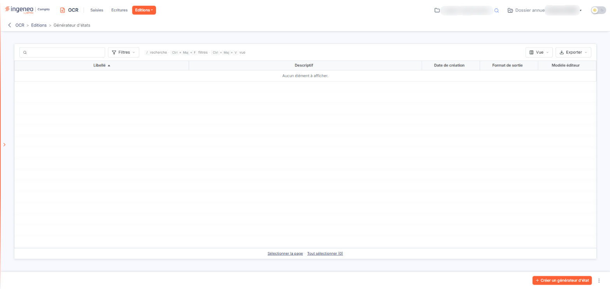
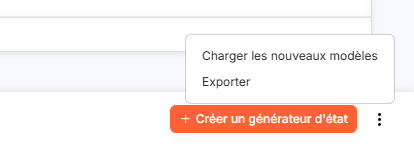
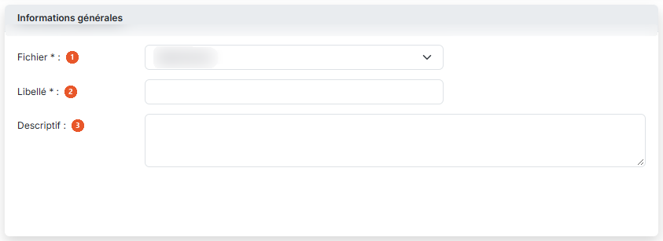
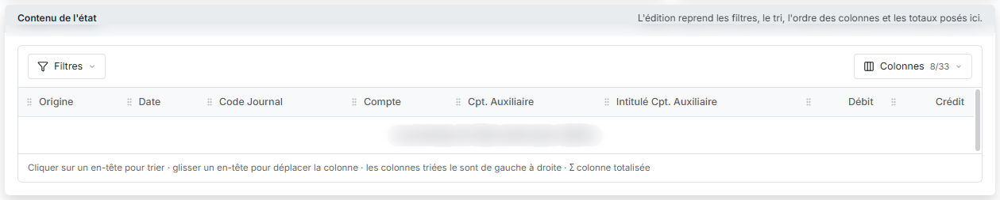
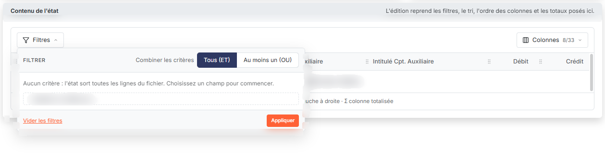
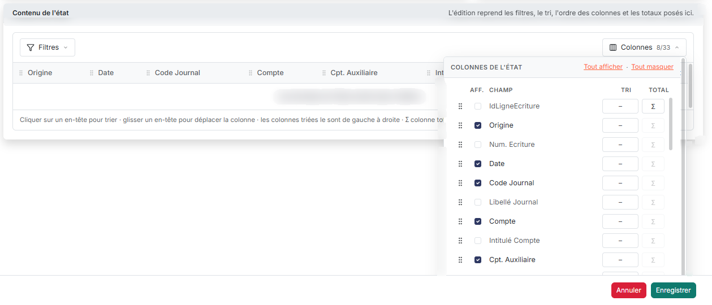
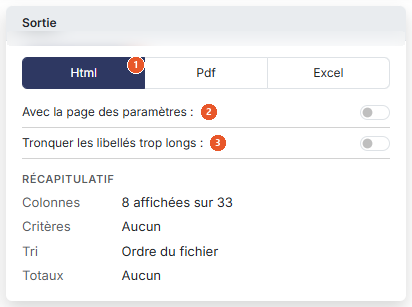
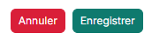

# Générateur d'états


**Où le trouver :** Menu **Editions › Générateur d'états**



**En bref** — Le générateur d'états vous permet de composer une édition à partir des données du module (fichier, colonnes, conditions, format), puis de la conserver pour la relancer plus tard.

* Pour créer un état : bouton \[Créer un générateur d'état], choisissez le « Fichier », saisissez le « Libellé », puis bouton \[Enregistrer].
* Pour choisir les colonnes éditées : bouton \[Colonnes] de la carte « Contenu de l'état », liens « Tout afficher » ou « Tout masquer », puis case « Aff. » ligne par ligne.
* Pour régler la sortie : choisissez le « Format de sortie » (« Html », « Pdf » ou « Excel »), puis bouton \[Enregistrer].


Le générateur d'états vous permet de composer vous-même une édition à partir des données du module, puis de la conserver pour la relancer plus tard. Vous désignez le fichier à éditer, les colonnes que vous souhaitez y voir et l'ordre dans lequel elles se présentent, les lignes à retenir, et le format du document produit.

<figure><figcaption>
Écran « Générateur d'états » de la nouvelle interface
</figcaption></figure>

L'option s'ouvre sur la liste des états que vous avez déjà enregistrés. Tant que vous n'en avez créé aucun, le logiciel affiche « Aucun élément à afficher. ».

## La liste des états

Elle présente cinq colonnes :

| Champ                | Ce qu'il faut savoir                        |
| -------------------- | ------------------------------------------- |
| **Libellé**          | Le nom que vous avez donné à l'état.        |
| **Descriptif**       | Le commentaire que vous y avez associé.     |
| **Date de création** | La date à laquelle l'état a été enregistré. |
| **Format de sortie** | Le format retenu pour l'impression.         |
| **Modèle éditeur**   | Dernière colonne de la liste.               |

Les pictogrammes situés au-dessus de la liste vous permettent de sélectionner les lignes, de choisir les colonnes affichées, de filtrer la liste et de l'imprimer.

## Les boutons de la liste

<figure><figcaption>
Bouton [Créer un générateur d'état]
</figcaption></figure>

<figure><figcaption>
Bouton [Charger les nouveaux modèles]
</figcaption></figure>

bouton **\[Créer un générateur d'état]**

Placé en bas à droite de l'écran, il ouvre à droite le panneau « Nouvel état », qui est la fiche d'un nouvel état (décrite ci-dessous).

bouton **\[Charger les nouveaux modèles]**

bouton **\[Exporter]**

bouton **\[Supprimer]**

## Rubrique « Informations générales »

<figure><figcaption>
Rubrique « Rubrique « Informations générales » »
</figcaption></figure>

| Champ             | Ce qu'il faut savoir                                                                                                                                                                                                                                                                                                                                                                                                            |
| ----------------- | ------------------------------------------------------------------------------------------------------------------------------------------------------------------------------------------------------------------------------------------------------------------------------------------------------------------------------------------------------------------------------------------------------------------------------- |
| 1. **Fichier**    | 
Zone obligatoire. C'est ce choix qui commande tout le reste de la fiche : le logiciel remplit ensuite la carte « Contenu de l'état » avec les champs du fichier retenu. Tant que vous n'avez rien retenu, la liste affiche « Sélectionnez ». Les fichiers proposés sont propres à ce module. Vous disposez ici de trois fichiers : « Connecteurs », « Container d'écritures » et « Historique des comptes utilisés ».
 |
| 2. **Libellé**    | Zone obligatoire. C'est sous ce nom que l'état apparaîtra dans la liste. La zone n'accepte que 22 caractères : au-delà, les caractères que vous frappez ne s'inscrivent pas, et le logiciel ne vous affiche aucun message.                                                                                                                                                                                                      |
| 3. **Descriptif** | Zone de texte facultative, dans laquelle vous précisez à quoi sert cet état.                                                                                                                                                                                                                                                                                                                                                    |

## Rubrique « Contenu de l'état »

<figure><figcaption>
Rubrique « Rubrique « Contenu de l'état » »
</figcaption></figure>

<figure><figcaption>
Bouton [Filtres]
</figcaption></figure>

<figure><figcaption>
Bouton [Colonnes]
</figcaption></figure>

Cette carte rappelle que « L'édition reprend les filtres, le tri, l'ordre des colonnes et les totaux posés ici. » Tant que vous n'avez pas choisi de fichier, elle affiche « Choisissez un fichier : ses champs apparaîtront ici. ». Dès que vous en choisissez un, elle présente un aperçu des colonnes de l'édition (« Les données de l'état sortent dans l'édition. »), surmonté de deux menus. Une phrase sous l'aperçu rappelle que l'on clique sur un en-tête pour trier, que l'on glisse un en-tête pour déplacer la colonne, que les colonnes triées le sont de gauche à droite et que le signe Σ marque une colonne totalisée.

bouton **\[Filtres]**

Il sert à poser des critères sur les lignes du fichier. Le menu propose « Combiner les critères », avec deux choix : « Tous (ET) », retenu à l'ouverture, pour que toutes les conditions soient respectées, ou « Au moins un (OU) », pour qu'une condition au moins le soit. Tant que rien n'est posé, il affiche « Aucun critère : l'état sort toutes les lignes du fichier. Choisissez un champ pour commencer. » ; il comporte ensuite la liste « + Ajouter un critère sur… », le lien « Vider les filtres » et le bouton **\[Appliquer]**.

bouton **\[Colonnes]**

Il indique le nombre de colonnes affichées, par exemple « 8/33 » sur le fichier « Container d'écritures », et ouvre la liste « Colonnes de l'état » : une ligne par champ du fichier, avec une poignée pour la déplacer, une case d'affichage (« Aff. »), le nom du champ (« Champ »), un choix de tri (« Tri ») et une totalisation (« Total »), ainsi que les liens « Tout afficher » et « Tout masquer ». La totalisation, marquée par le signe Σ, n'est proposée que pour les champs qui portent un nombre.

## Rubrique « Sortie »

<figure><figcaption>
Rubrique « Rubrique « Sortie » »
</figcaption></figure>

| Champ                                    | Ce qu'il faut savoir                                                                                                                                                                                                                                                      |
| ---------------------------------------- | ------------------------------------------------------------------------------------------------------------------------------------------------------------------------------------------------------------------------------------------------------------------------- |
| 1. **Format de sortie**                  | Trois boutons « Html », « Pdf » et « Excel », placés en tête de la carte. Le logiciel vous propose d'office « Html ».                                                                                                                                                     |
| 2. **Avec la page des paramètres**       | 
Interrupteur, désactivé d'office. Il vous est proposé quel que soit le format. La composition de la carte change avec le format retenu. Choisissez donc d'abord le format de sortie : le logiciel ne vous présente ensuite que les réglages qui s'y appliquent.
 |
| 3. **Tronquer les libellés trop longs**  | Interrupteur, désactivé d'office. Il n'est proposé qu'avec le format « Html ».                                                                                                                                                                                            |
| **Masquer les entêtes et pieds de page** | Interrupteur, désactivé d'office. Il n'est proposé qu'avec les formats « Pdf » et « Excel ».                                                                                                                                                                              |
| **Orientation**                          | « Portrait » (choix par défaut) ou « Paysage ». Proposé avec le seul format « Pdf ».                                                                                                                                                                                      |

Sous ces réglages, un « Récapitulatif » résume l'état en cours de composition : « Colonnes » (par exemple « 8 affichées sur 33 »), « Critères », « Tri » (« Ordre du fichier » tant qu'aucun tri n'est posé) et « Totaux ».

## Les boutons de la fiche

<figure><figcaption>
Bouton [Enregistrer]
</figcaption></figure>

<figure><figcaption>
Bouton [Annuler]
</figcaption></figure>

bouton **\[Enregistrer]**

Il conserve l'état avec l'ensemble de ses paramètres, pour que vous puissiez le relancer par la suite.

bouton **\[Annuler]**

Il referme le panneau sans rien enregistrer. Si vous avez déjà saisi ou choisi quelque chose, le logiciel vous demande de confirmer l'abandon (« Les modifications non enregistrées de cet état seront perdues. »), avec les boutons \[Annuler] et \[Confirmer] ; vous retrouvez ensuite la liste de vos états.
