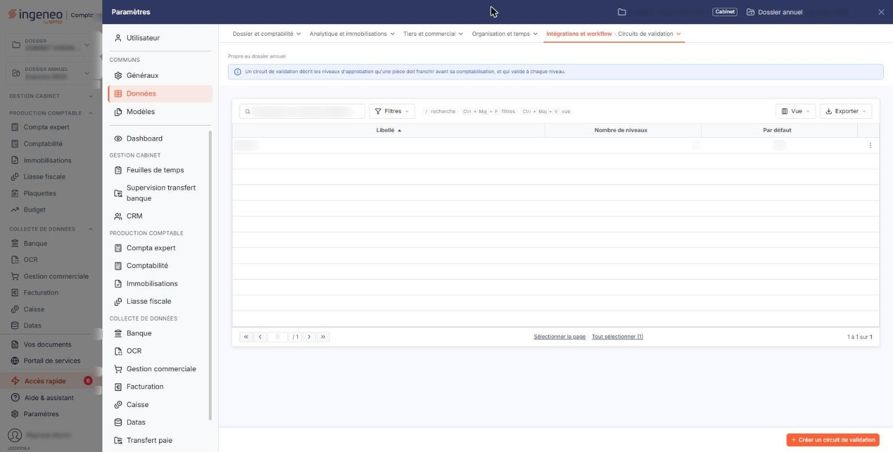
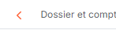
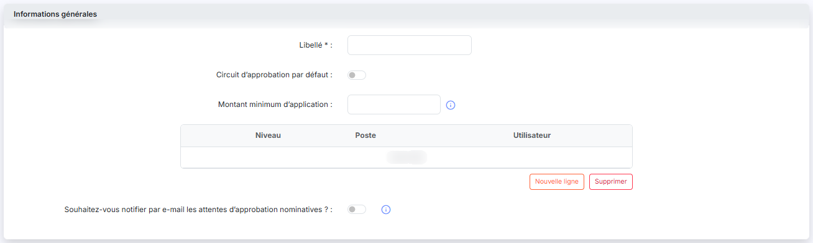

# Circuits d’approbation


**Où le trouver :** Panneau **Paramètres**



**En bref** — Un circuit d'approbation soumet une pièce à l'accord d'une ou plusieurs personnes, niveau par niveau, avant sa comptabilisation.

* Pour créer un circuit : bouton \[Nouveau], saisissez le « Libellé », puis bouton \[Enregistrer].
* Pour ajouter un niveau d'approbation : bouton \[Nouvelle ligne], choisissez un poste ou un utilisateur, puis pictogramme « Valider ».
* Pour n'approuver que les pièces importantes : renseignez le « Montant minimum d'application », puis bouton \[Enregistrer].


Un circuit d'approbation permet de soumettre une pièce à l'accord d'une ou plusieurs personnes avant qu'elle ne soit comptabilisée.

<figure><figcaption>
Écran « Circuits d’approbation » de la nouvelle interface
</figcaption></figure>

Dans la nouvelle interface, cet écran s'ouvre depuis le panneau « Paramètres » : onglet **Données**, rubrique **Intégrations et workflow**, entrée **Circuits de validation**. Un bandeau rappelle en tête de l'écran ce qu'est un circuit de validation. Le panneau emploie le mot « validation » là où cette page parle d'« approbation » : il s'agit du même écran.

Vous définissez ici autant de circuits que nécessaire. Chacun se compose de **niveaux d'approbation successifs** : à chaque niveau, une personne doit donner son accord pour que la pièce passe au niveau suivant.

La grille présente la liste des circuits existants, avec pour chacun son **Libellé**, son **Nombre de niveaux** et l'indication **Par défaut**. Les pictogrammes présents sur chaque ligne, « Modifier » (un crayon) et « Supprimer » (une corbeille), permettent de modifier ou de supprimer un circuit.

En bas de l'écran, le bouton **\[Nouveau]** crée un circuit et le bouton **\[Supprimer]** supprime ceux que vous avez cochés.

**Créer ou modifier un circuit**

Le formulaire tient dans une seule rubrique, **Informations générales**, dont les éléments sont décrits ci-dessous dans leur ordre d'affichage.

## Libellé

C'est le nom sous lequel le circuit apparaîtra dans la liste. Choisissez-le suffisamment explicite pour le distinguer des autres.

Ce champ est obligatoire : il est suivi d'une astérisque à l'écran.

## Circuit d'approbation par défaut

Un interrupteur indique si ce circuit doit s'appliquer par défaut aux pièces du dossier : activé, il s'applique ; désactivé, il ne s'applique pas.

## Montant minimum d'application

Vous pouvez définir un montant à partir duquel le circuit d'approbation s'appliquera. En d'autres termes, si le total TTC de la pièce est inférieur au montant indiqué, elle sera approuvée automatiquement.

Si vous n'entrez pas de montant, toutes les factures, quel que soit leur montant TTC, devront être approuvées.

Ce texte est également accessible à l'écran : un pictogramme « Information » suit le champ et l'affiche lorsque vous cliquez dessus.

## Les niveaux d'approbation

Chaque niveau désigne qui doit donner son accord. Vous disposez de deux manières de le faire :

| Champ              | Ce qu'il faut savoir                                                                               |
| ------------------ | -------------------------------------------------------------------------------------------------- |
| **Un poste**       | L'approbation est attendue d'un poste générique. Toute personne occupant ce poste peut l'accorder. |
| **Un utilisateur** | L'approbation est attendue d'une personne nommée.                                                  |

Les niveaux s'enchaînent dans l'ordre indiqué : le niveau 2 n'est sollicité qu'une fois le niveau 1 accordé.

Le tableau des niveaux porte trois colonnes — **Niveau**, **Poste** et **Utilisateur** — et affiche « Liste vide » tant qu'aucun niveau n'est défini.

Ses deux boutons lui sont propres : bouton **\[Nouvelle ligne]** ajoute un niveau, bouton **\[Supprimer]** retire ceux que vous avez cochés. Ne confondez pas ce dernier avec le bouton de même nom situé en bas de l'écran, qui supprime des circuits.

Lorsque vous cliquez sur bouton **\[Nouvelle ligne]**, le logiciel ajoute une ligne au tableau. Il attribue lui-même le numéro de la colonne **Niveau**, qui n'est pas modifiable : les niveaux se numérotent donc dans leur ordre de création. Les colonnes **Poste** et **Utilisateur** sont deux listes déroulantes ; vous renseignez l'une ou l'autre. La ligne porte enfin une case à cocher (infobulle « Sélectionner »), qui sert à la désigner pour le bouton **\[Supprimer]**, et deux pictogrammes : « Valider », qui valide la ligne saisie, et « Effacer », qui l'abandonne. Une fois la ligne validée, le pictogramme « Valider » est remplacé par « Modifier » (un crayon), qui permet de la reprendre.

Un niveau doit désigner **soit** un poste, **soit** un utilisateur — jamais les deux, jamais aucun. Si vous ne respectez pas cette règle, le logiciel affiche le message « Vous devez choisir un poste ou un utilisateur. »

## Notification par e-mail

<figure><figcaption>
Rubrique « Chevron « Retour » »
</figcaption></figure>

**Souhaitez-vous notifier par e-mail les attentes d'approbation nominatives ?**

Si l'interrupteur est activé, lorsqu'une approbation est attendue par un utilisateur nommé (et non un poste générique), ledit utilisateur recevra un e-mail d'information.

Les approbations attendues d'un poste ne donnent pas lieu à notification.

**Les actions disponibles**

bouton **\[Enregistrer]**

Il enregistre le circuit.

**Chevron « Retour »**

Le bouton **\[Retour]** n'est plus affiché dans la fiche : le chevron « Retour », à gauche de la barre d'onglets du panneau, revient à la liste. Si le circuit a été modifié, le logiciel demande une confirmation (« Modifications non enregistrées ») : bouton **\[Continuer sans enregistrer]** abandonne les modifications en cours.

**Pictogramme « Modifier »**

Il ouvre le circuit pour le modifier.

**Pictogramme « Supprimer »**

Il supprime le circuit.

La création, la modification et la suppression d'un circuit sont soumises à des droits distincts : selon votre profil, certaines de ces actions peuvent ne pas vous être proposées.

## Autres vues de l'écran

<figure><figcaption>
Créer ou modifier un circuit
</figcaption></figure>
