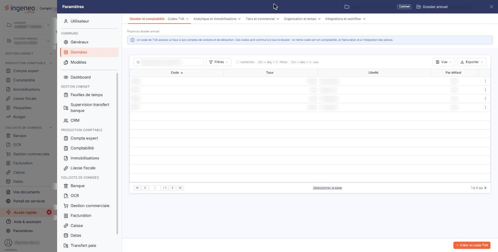
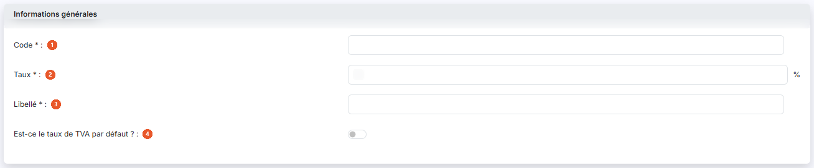
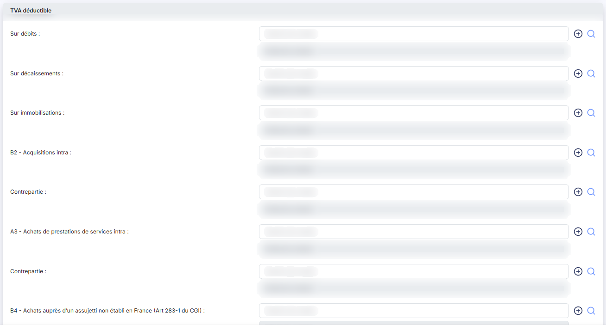
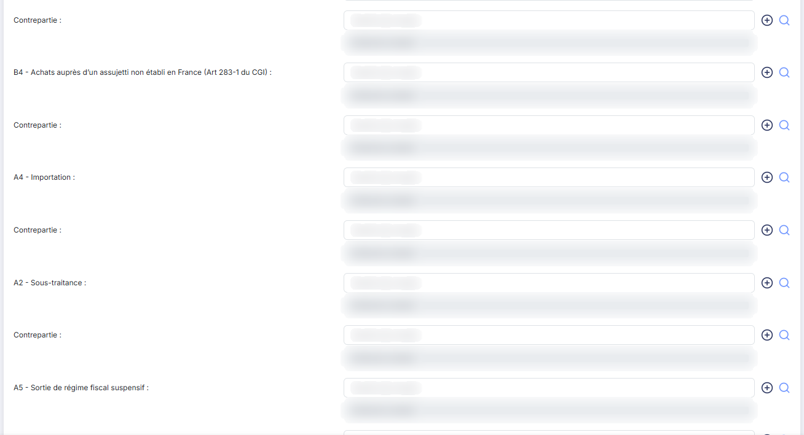
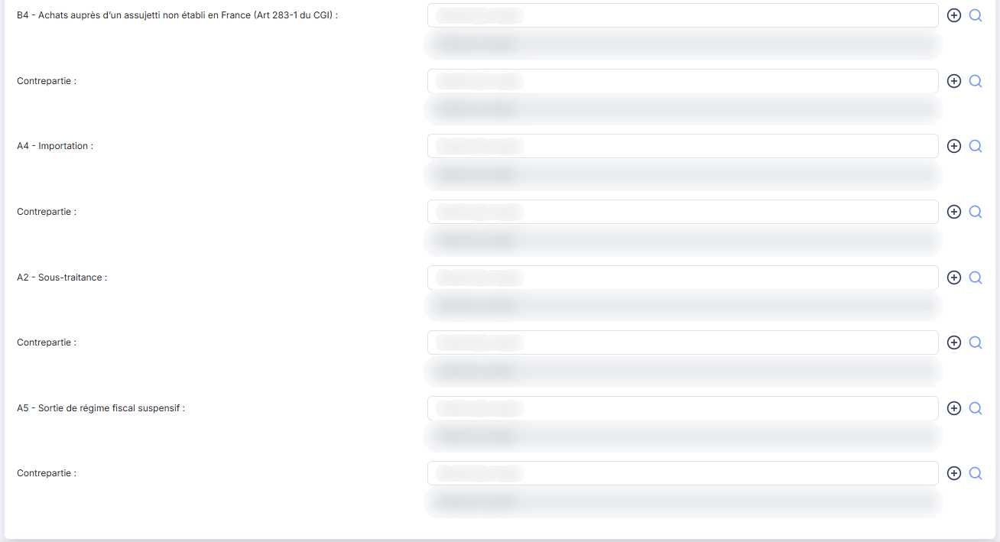
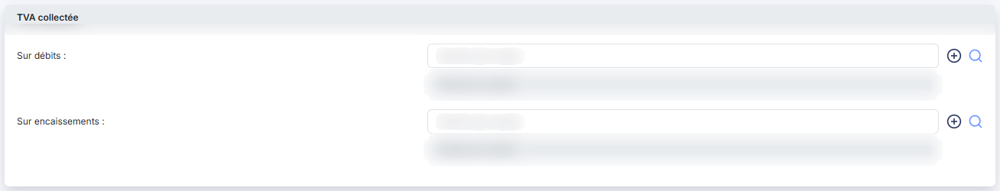

# Codes TVA


**Où le trouver :** Panneau **Paramètres** › **Données** › **Dossier et comptabilité** › **Codes TVA**



**En bref** — Cet écran gère les codes TVA utilisés par plusieurs modules, avec leur taux et les comptes de TVA déductible et collectée à employer lors de la génération des écritures.

* Pour créer un code TVA : bouton \[Nouveau], renseignez « Code », « Taux » et « Libellé » ainsi que les comptes de TVA, puis bouton \[Enregistrer].
* Pour proposer un code d'office : réglez « Est-ce le taux de TVA par défaut ? » sur Oui, puis bouton \[Enregistrer].


Les codes TVA sont utilisés par plusieurs modules du logiciel.

<figure><figcaption>
Écran « Codes TVA » de la nouvelle interface
</figcaption></figure>

Un code TVA ne peut pas être supprimé s'il est utilisé par un compte général ou un compte auxiliaire (y compris au titre de son accélérateur de saisie), par un article ou un prix de vente, par une ligne d'article d'une pièce commerciale, par le paramétrage comptable de l'OCR au titre de la TVA autoliquidée, ou par un régime de TVA comme code de remplacement.

La liste des codes TVA comporte quatre colonnes : « Code », « Taux », « Libellé » et « Par défaut ». Sur chaque ligne, trois pictogrammes vous permettent de « Modifier », de « Supprimer » ou de « Dupliquer » le code. Le bouton **\[Nouveau]**, sous la liste, ouvre le formulaire de création.

Le formulaire de création et celui de modification présentent les mêmes rubriques et les mêmes champs. Tous deux se terminent par les boutons bouton **\[Enregistrer]** et bouton **\[Retour]**.

## Rubrique « Informations générales »

<figure><figcaption>
Rubrique « Informations générales »
</figcaption></figure>

| Champ                                     | Ce qu'il faut savoir                                                                                                                                                 |
| ----------------------------------------- | -------------------------------------------------------------------------------------------------------------------------------------------------------------------- |
| 1. **Code**                               | Il doit être unique.                                                                                                                                                 |
| 2. **Taux**                               | Il s'exprime en pourcentage.                                                                                                                                         |
| 3. **Libellé**                            | —                                                                                                                                                                    |
| 4. **Est-ce le taux de TVA par défaut ?** | Réglez ce paramètre sur Oui pour affecter le code TVA en cours à chaque fois qu'un code TVA est demandé. La colonne « Par défaut » de la liste en reprend la valeur. |

## Rubrique « TVA déductible »

<figure><figcaption>
Rubrique « TVA déductible »
</figcaption></figure>

<figure><figcaption>
Rubrique « TVA déductible »
</figcaption></figure>

<figure><figcaption>
Rubrique « TVA déductible »
</figcaption></figure>

Il faut indiquer tous les numéros de comptes qui devront être utilisés lors de la génération d'écritures liées à ce code TVA pour la TVA déductible ainsi que les comptes de contrepartie lorsque c'est nécessaire.

La rubrique prévoit neuf comptes, dans cet ordre :

* **Sur débits**
* **Sur décaissements**
* **Sur immobilisations**
* **B2 - Acquisitions intra**
* **A3 - Achats de prestations de services intra**
* **B4 - Achats auprès d’un assujetti non établi en France (Art 283-1 du CGI)**
* **A4 - Importation**
* **A2 - Sous-traitance**
* **A5 - Sortie de régime fiscal suspensif**

Les six derniers comptes, de « B2 - Acquisitions intra » à « A5 - Sortie de régime fiscal suspensif », sont accompagnés d'un compte de **Contrepartie**. Les trois premiers n'en ont pas.

## Rubrique « TVA collectée »

<figure><figcaption>
Rubrique « TVA collectée »
</figcaption></figure>

Il faut indiquer tous les numéros de comptes qui devront être utilisés lors de la génération d'écritures liées à ce code TVA pour la TVA collectée.

La rubrique prévoit deux comptes : **Sur débits** et **Sur encaissements**.
