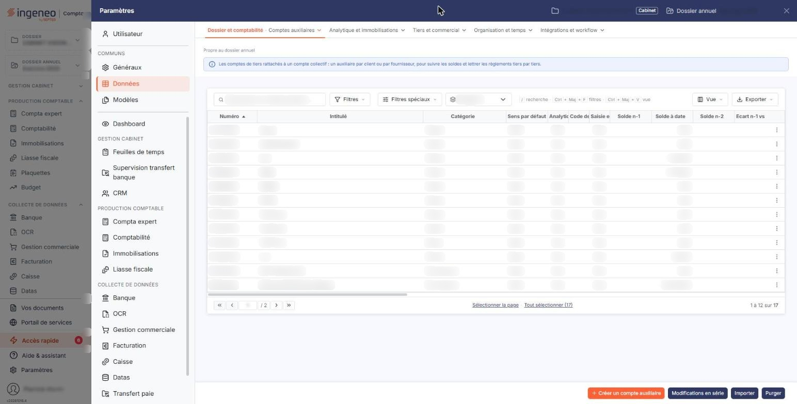
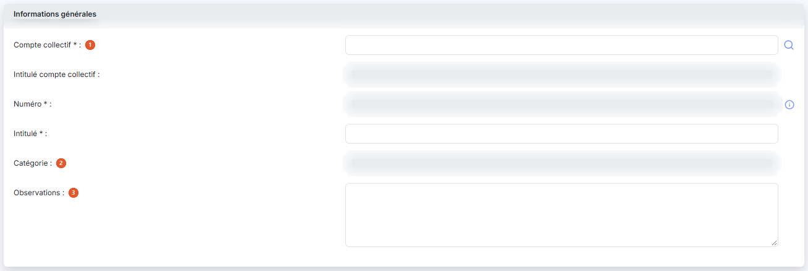
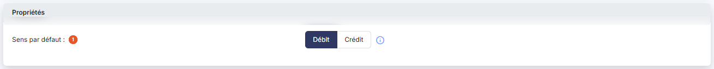
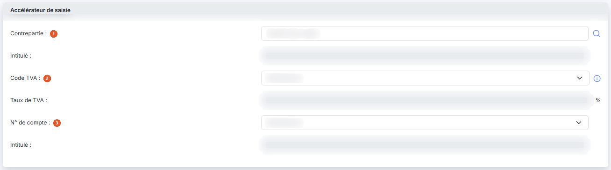
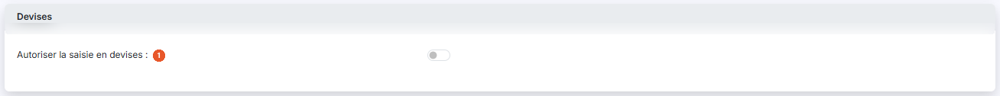
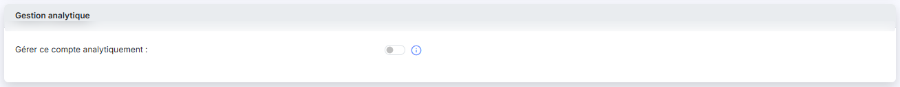

# Comptes auxiliaires


**Où le trouver :** Panneau **Paramètres** › **Données** › **Dossier et comptabilité** › **Comptes auxiliaires**



**En bref** — Cet écran administre les comptes auxiliaires (clients, fournisseurs, salariés, divers) de l'exercice en cours, avec leurs adresses, propriétés, coordonnées bancaires et règles d'approbation.

* Pour retrouver des comptes : saisissez un numéro, choisissez une catégorie, puis bouton \[Filtrer].
* Pour compléter l'adresse d'un tiers à partir de son Siren : renseignez le « N° de Siren », puis bouton \[Lire Siren].
* Pour modifier plusieurs comptes à la fois : bouton \[Modifications en série].


Cette option permet d'administrer les comptes auxiliaires de l'exercice (dossier annuel) en cours.

<figure><figcaption>
Écran « Comptes auxiliaires » de la nouvelle interface
</figcaption></figure>

Vous pouvez filtrer l'affichage des comptes de votre plan comptable en saisissant un numéro de compte, en choisissant une catégorie (clients, fournisseurs, salariés ou divers) et en n’affichant que les comptes mouvementés ou tous les comptes. Pour appliquer vos critères, cliquez sur le bouton **\[Filtrer]**.

La suppression d’un compte n'est possible qu'à la condition qu’aucune écriture n’ait été passée sur l’exercice pour le compte concerné.

## Rubrique « Informations générales »

<figure><figcaption>
Rubrique « Informations générales »
</figcaption></figure>

| Champ                            | Ce qu'il faut savoir                                                                                                                                                                                                                                                                                                                                                                                                                                                                                                                                                                                                                                                                                                        |
| -------------------------------- | --------------------------------------------------------------------------------------------------------------------------------------------------------------------------------------------------------------------------------------------------------------------------------------------------------------------------------------------------------------------------------------------------------------------------------------------------------------------------------------------------------------------------------------------------------------------------------------------------------------------------------------------------------------------------------------------------------------------------- |
| 1. **Compte collectif**          | Le compte collectif doit obligatoirement être renseigné. Un compte auxiliaire est obligatoirement rattaché à un seul compte collectif.                                                                                                                                                                                                                                                                                                                                                                                                                                                                                                                                                                                      |
| 2. **Catégorie**                 | 
La catégorie est automatiquement renseignée en fonction du compte collectif auquel vous avez rattaché le compte. L’application gère 4 catégories de comptes auxiliaires : Clients / Fournisseurs / Salariés et Divers.
                                                                                                                                                                                                                                                                                                                                                                                                                                                                                            |
| 3. **Observations**              | 
Zone de texte libre. Les zones <strong>Créé le</strong> et <strong>Par</strong> sont des zones d'affichage renseignées par le logiciel.
                                                                                                                                                                                                                                                                                                                                                                                                                                                                                                                                                                           |
| **Intitulé du compte collectif** | Il est affiché automatiquement pour contrôle.                                                                                                                                                                                                                                                                                                                                                                                                                                                                                                                                                                                                                                                                               |
| **Numéro de compte**             | 
Le numéro de compte doit être unique et n’est plus modifiable après création du compte. Si dans la page « Paramètres généraux » vous avez indiqué un préfixe, il est automatiquement proposé en fonction de la catégorie de compte que le logiciel a détecté à l'aide du compte collectif. En effet, un compte auxiliaire ne peut être rattaché qu'à une seule catégorie de comptes collectifs. Le compte collectif qui est associé au compte auxiliaire sera donc modifiable en saisie pourvu que le nouveau compte collectif soit de la même catégorie (clients, fournisseurs, salariés ou divers). Le logiciel vous propose le préfixe que vous avez éventuellement paramétré dans les paramètres généraux.
 |
| **Intitulé du compte**           | Ce champ pourra être automatiquement repris dans les libellés d'écritures et est modifiable à tout moment.                                                                                                                                                                                                                                                                                                                                                                                                                                                                                                                                                                                                                  |
| **N° de TVA intracommunautaire** | Ce numéro unique à chaque entreprise est désormais obligatoire sur toutes les factures aussi bien pour l'émetteur que pour le destinataire. Il est également utilisé dans Ingeneo Compta pour la reconnaissance des fournisseurs dans le module OCR.                                                                                                                                                                                                                                                                                                                                                                                                                                                                        |
| **N° de Siren**                  | 
Champ facultatif. Si vous renseignez le Siren, le bouton bouton <strong>[Lire Siren]</strong> qui utilise une API, renseignera automatiquement une adresse qu'il intitulera « Adresse principale ». <strong>Forme juridique</strong>, <strong>Code DGFIP</strong>, <strong>Code juridique usuel</strong>, <strong>Capital</strong> et <strong>Code NAF</strong> : champs de la rubrique.
                                                                                                                                                                                                                                                                                                                          |
| **Mode de règlement**            | Champ facultatif. Il s'agit du mode de règlement par défaut qui sera repris en différents lieux du logiciel. Les valeurs proposées sont « Chèques », « Carte bancaire », « Prélèvement », « Virement » et « Espèces ».                                                                                                                                                                                                                                                                                                                                                                                                                                                                                                      |
| **Soumis à TVA autoliquidée**    | Ce champ est notamment utile pour générer les écritures d'autoliquidation de la TVA intracommunautaire dans le module OCR lorsqu'un fournisseur est situé dans la zone CEE. Les valeurs proposées sont « Non soumis », « Acquisitions intracommunautaires de biens », « Prestations de services intracommunautaires », « Importations hors EU » et « Sous-traitance BTP ».                                                                                                                                                                                                                                                                                                                                                  |

## Rubrique « Adresses »

Un compte auxiliaire peut contenir autant d'adresses que vous le souhaitez. Chaque adresse doit contenir au moins un intitulé, un nom de contact et sa civilité.

Lorsque vous indiquez qu'une adresse est l'adresse par défaut, c'est elle qui sera affectée lors de la création de toute nouvelle pièce commerciale.

Le « Code Officiel Géographique Insee » est nécessaire pour la DAS2.

Les adresses sont communes aux fichiers clients et comptes auxiliaires.

## Rubrique « Propriétés »

<figure><figcaption>
Rubrique « Propriétés »
</figcaption></figure>

**Sens par défaut** : définit si lors de la saisie le curseur sera positionné par défaut sur un montant au débit ou un montant au crédit.

Si la catégorie est « Fournisseurs », le sens par défaut se positionne automatiquement sur « Crédit ».

Si la catégorie est « Clients », le sens par défaut se positionne automatiquement sur « Débit ».

Si la catégorie est « Salariés », le sens par défaut se positionne automatiquement sur « Crédit ».

Si la catégorie est « Divers », le sens par défaut se positionne automatiquement sur « Débit ».

## Rubrique « Accélérateur de saisie »

<figure><figcaption>
Rubrique « Accélérateur de saisie »
</figcaption></figure>

Cette fonctionnalité est disponible dans la saisie en journal si elle a été activée pour le journal considéré. Elle est particulièrement utile pour les écritures récurrentes.

Vous avez la possibilité de définir un accélérateur de saisie qui générera automatiquement une écriture lorsque le compte de votre formulaire sera saisi sur la première ligne d’un mouvement.

| Champ               | Ce qu'il faut savoir                                                                                                             |
| ------------------- | -------------------------------------------------------------------------------------------------------------------------------- |
| 1. **Contrepartie** | Définit le compte utilisé pour générer l’écriture.                                                                               |
| 2. **Code TVA**     | Si un code et un taux sont renseignés, l’écriture générée comprend une ligne de TVA dont le montant est calculé automatiquement. |
| 3. **N° de compte** | Choisissez parmi les comptes de TVA celui qui devra être repris dans l'écriture.                                                 |

## Rubrique « Prestataire »

Cette rubrique n'est disponible que pour les comptes auxiliaire de catégorie « Fournisseurs ».

| Champ                                          | Ce qu'il faut savoir                                                                                                                                                                                                                          |
| ---------------------------------------------- | --------------------------------------------------------------------------------------------------------------------------------------------------------------------------------------------------------------------------------------------- |
| **Prestataire de services au sens de la DAS2** | Si le compte auxiliaire correspond à un prestataire de services, vous pouvez répondre « Oui » pour l’intégrer à votre déclaration DAS2. Entrez ensuite la profession et s'il s'agit d'une « Personne morale » ou d'une « Personne physique ». |
| **Prestataire de services au sens de la TVA**  | Cette option est à activer pour les prestataires de services qui n'ont pas opté pour la TVA sur les débits.                                                                                                                                   |

## Rubrique « Coordonnées bancaires »

Vous avez la possibilité de créer autant de banques que nécessaire pour un tiers.

**Banque par défaut** : si vous répondez « Oui », c'est cette banque qui vous sera systématiquement proposée pour le tiers en question à chaque fois que cela sera nécessaire.

**Référence unique de mandat** et **Date de signature de mandat :** ces deux champs sont utilisés pour déclencher les prélèvements automatiques. Reportez-vous à l'aide traitant de ce sujet pour plus d'informations.

## Rubrique « Devises »

<figure><figcaption>
Rubrique « Devises »
</figcaption></figure>

| Champ                                 | Ce qu'il faut savoir                                                                                                                                                                                                                                                                       |
| ------------------------------------- | ------------------------------------------------------------------------------------------------------------------------------------------------------------------------------------------------------------------------------------------------------------------------------------------ |
| 1. **Autoriser la saisie en devises** | 
Si cette option est activée, vous pourrez saisir, dans ce compte, des écritures dans d'autres devises que la devise locale indiquée dans la page « Multimodules ». Pour saisir des écritures en devises, il faut que cette même option soit activée dans les journaux concernés.
 |
| **Devise par défaut pour ce compte**  | Cette option n'est affichée que si vous avez autorisé la saisie en devises. Choisissez dans le sélecteur la devise qui sera proposée par défaut lors de la saisie d'une écriture sur ce compte. La devise pourra être modifiée lors de la saisie de chaque écriture.                       |

## Rubrique « Approbation »

Cette rubrique n'est disponible que pour les comptes auxiliaires de catégorie « Fournisseurs ». Elle comporte deux interrupteurs, activés ou désactivés : **Les factures de ce fournisseurs doivent-elles être approuvées automatiquement ?** et **Souhaitez-vous attribuer un circuit d’approbation particulier pour ce fournisseur ?**

Les circuits d'approbation se paramètrent dans la page « Circuits d’approbation ».

## Rubrique « Soldes »

Cette rubrique contient un certain nombre de valeurs (Solde n-1, Solde n-2, Ecart n vs n-1 et Ecart n-1 vs n-2) qui sont calculées et mises à jour par le logiciel au moment où vous entrez dans la fiche du compte.

## Rubrique « Documents »

Cette rubrique présente les documents rattachés au compte, dans une liste comportant les colonnes **Description**, **Nom du fichier**, **Date** et **Créé par**.

Trois boutons permettent d'y ajouter un document : bouton **\[Nouveau doc depuis mon poste]**, bouton **\[Nouveau doc depuis la GED]** et bouton **\[Nouveau doc depuis l'OCR]**.

## Bouton \[Modifications en série]

<figure><figcaption>
Bouton [Modifications en série]
</figcaption></figure>

Ce bouton permet d'opérer simultanément les mêmes modifications à une sélection de comptes.

* **Rubrique « Sélection »**\
  Vous devez tout d'abord indiquer si les comptes à modifier sont ceux que vous avez sélectionnés dans la liste à l'aide des boîtes à cocher ou si vous souhaitez définir des filtres pour opérer une sélection.\
  Si vous n'avez coché aucun compte dans la liste, le choix est automatiquement positionné sur « Définir des filtres ».
* **Rubrique « Comptes à modifier »**\
  Vous devez indiquer une catégorie de comptes auxiliaires, vous pouvez indiquer une fourchette de comptes ou une série de comptes et de racines de comptes.\
  Les modifications seront appliquées à la liste la plus restrictive (en d'autres termes, pour être concerné, le compte devra respecter chacune des conditions).
* **Rubrique « Eléments à modifier »**\
  Vous disposez d'une série de paramètres, présents dans la fiche de chaque compte, pour lesquels vous pouvez indiquer de ne pas les modifier ou de choisir une valeur. Vos choix seront affectés à tous les comptes de la sélection. En fonction de vos choix, pour certains paramètres, des valeurs complémentaires peuvent être demandées.\
  Reportez-vous à l'aide ci-dessus pour plus d'information sur le fonctionnement de tous les paramètres.

## Bouton \[Purger]

<figure><figcaption>
Bouton [Purger]
</figcaption></figure>

Cette option permet de supprimer tous les comptes auxiliaires pour, par exemple, charger un autre modèle de plan comptable.

Seuls les comptes non mouvementés dans l'exercice en cours et non utilisés dans les paramétrages sont supprimés.

## Autres vues de l'écran

<figure><figcaption>
Gestion analytique
</figcaption></figure>
