# Paramètres OCR — où les trouver


**Où le trouver :** Panneau **Paramètres** › **OCR** › **Configuration**



**En bref** — Cette page indique où se trouvent désormais les écrans de paramétrage du module OCR, répartis dans le panneau Paramètres.

* Pour régler le comportement du module : rubrique « OCR » du panneau, onglet Configuration, à renseigner en premier.
* Pour définir où partent les écritures : rubrique « OCR », onglet Connexion comptabilité.


Les écrans de paramétrage du module OCR ne sont plus dans la barre du module : la rubrique « Paramètres » n'y existe plus. Ils sont dans le panneau Paramètres, où ils se répartissent ainsi.

<figure>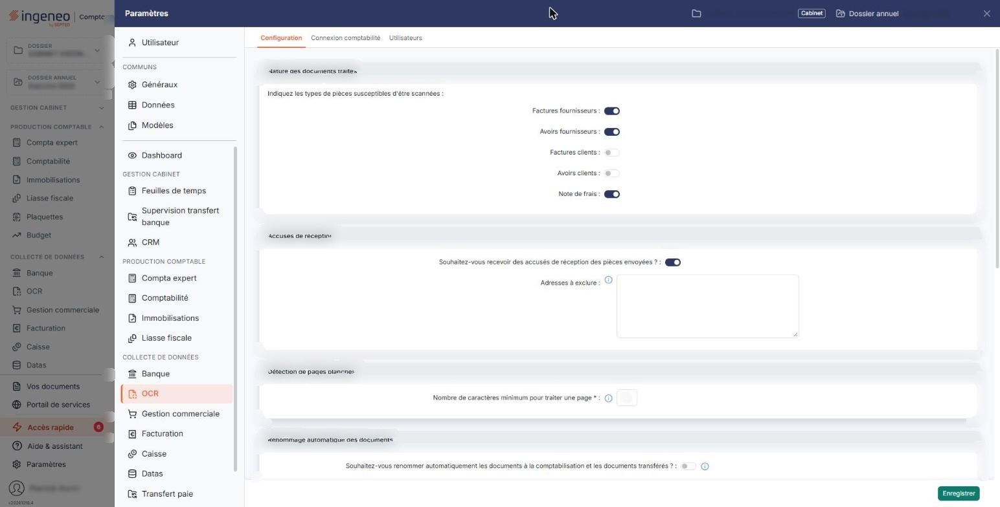<figcaption>
Écran « Configuration » de la nouvelle interface
</figcaption></figure>

**Dans la rubrique « OCR » du panneau** (barre latérale du panneau, section « Collecte de données » ; elle n'est proposée que lorsque vous travaillez dans le module OCR), trois onglets :

* **Configuration** (anciennement « Paramètres généraux ») : le comportement du module. Vous y indiquez les natures de pièces que vous traitez, l'envoi d'accusés de réception, la détection des pages blanches, le renommage automatique des documents, le calcul du libellé des écritures, l'archivage dans la GED, la récupération des pièces chez vos fournisseurs, la visualisation de l'écriture au moment de la comptabilisation, la comptabilisation automatique des pièces complètes et les circuits d'approbation.
* **Connexion comptabilité** : le lien avec votre comptabilité, qui détermine où partent les écritures générées.
* **Utilisateurs** : la fiche de chaque utilisateur du cabinet. Une seule de ses rubriques, « Note de frais », concerne l'OCR ; les autres portent sur les informations générales de l'utilisateur, ses postes, ses feuilles de temps et ses absences.

**Dans les autres rubriques du panneau**, avec les écrans des autres modules :

* **Modèles › Imports et exports › « Pièces OCR »** (anciennement « Modèles de pièces ») : les modèles de reconnaissance. Un modèle mémorise la disposition des informations sur les pièces d'un fournisseur, afin que les suivantes soient lues automatiquement.
* **Modèles › Imports et exports › « Écritures »** (anciennement « Modèles d'import » et « Modèles d'export ») : les modèles d'import et d'export de fichiers, dans un écran commun à plusieurs modules, avec un filtre Tous / Import / Export.
* **Données › Tiers et commercial › « Unités »** : les unités employées avec les quantités dans les écritures.
* **Généraux › Configuration** (anciennement « Multimodules ») : les paramètres communs à plusieurs modules du logiciel.

L'onglet **Configuration** de la rubrique « OCR » est l'écran à renseigner en premier : plusieurs autres écrans du module en dépendent. Ainsi, la liste des types de pièces proposée lors du traitement d'un document ne contient que les natures que vous y avez activées, augmentées du choix « Autre document », qui est toujours proposé.

## Autres vues de l'écran

<figure>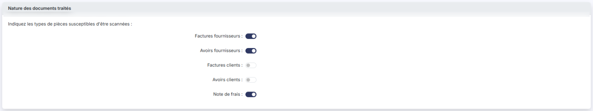<figcaption>
Nature des documents traités
</figcaption></figure>

<figure>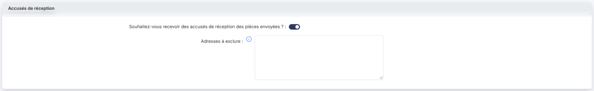<figcaption>
Accusés de réception
</figcaption></figure>

<figure>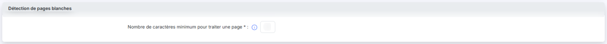<figcaption>
Détection de pages blanches
</figcaption></figure>

<figure>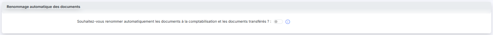<figcaption>
Renommage automatique des documents
</figcaption></figure>

<figure>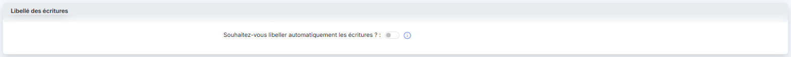<figcaption>
Libellé des écritures
</figcaption></figure>

<figure>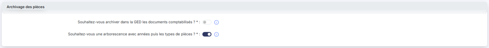<figcaption>
Archivage des pièces
</figcaption></figure>

<figure>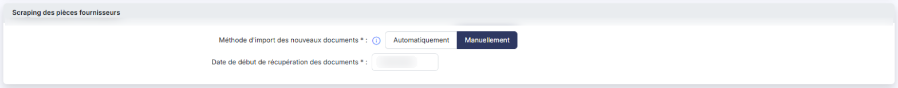<figcaption>
Scraping des pièces fournisseurs
</figcaption></figure>

<figure>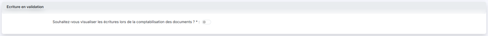<figcaption>
Ecriture en validation
</figcaption></figure>

<figure>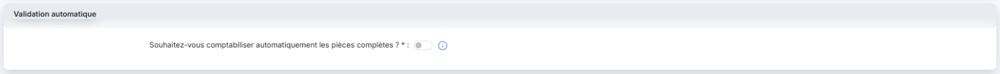<figcaption>
Validation automatique
</figcaption></figure>

<figure>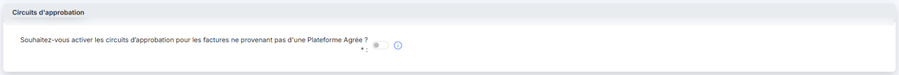<figcaption>
Circuits d'approbation
</figcaption></figure>
