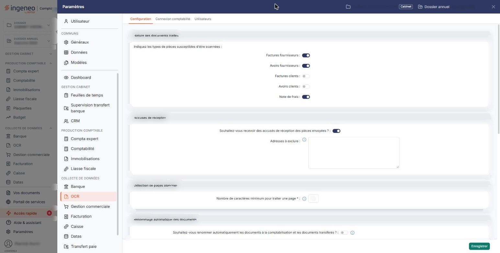
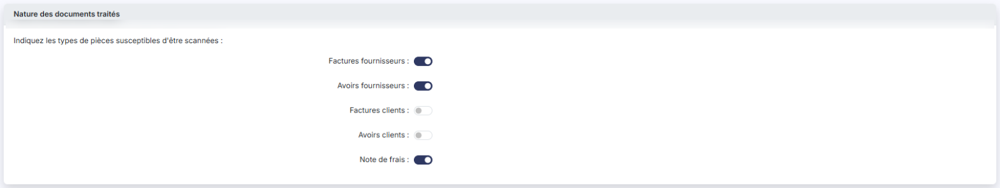
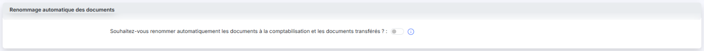
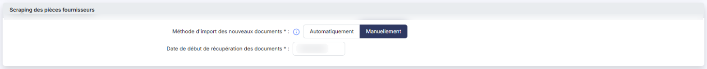
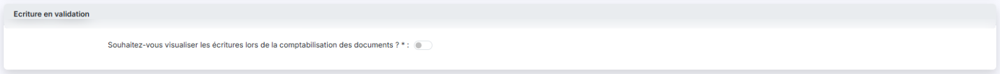
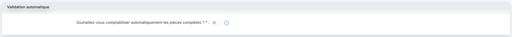
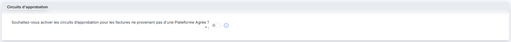

# Configuration


**Où le trouver :** Panneau **Paramètres** › **OCR** › **Configuration**



**En bref** — L'écran « Configuration » rassemble les paramètres du module pour la société gérée : natures de pièces, accusés de réception, renommage, libellés, archivage, scraping et comptabilisation automatique.

* Pour limiter les propositions du logiciel : rubrique « Nature des documents traités », retenez les seules pièces que vous océrisez, puis bouton \[Enregistrer].
* Pour comptabiliser sans intervention les pièces complètes : rubrique « Validation automatique », activez l'interrupteur, puis bouton \[Enregistrer].
* Pour supprimer automatiquement les pages blanches : indiquez un « Nombre de caractères minimum pour traiter une page », puis bouton \[Enregistrer].


Cet écran, appelé « Configuration », s'ouvre depuis le panneau Paramètres (rubrique « OCR », premier onglet). Il rassemble les paramètres du module pour la société gérée. L'écran est découpé en dix rubriques, et le bouton **\[Enregistrer]** situé en bas de l'écran les enregistre toutes en une seule fois. Plusieurs paramètres sont accompagnés d'un pictogramme « Information » : le survol de ce pictogramme rappelle l'effet du paramètre.

<figure><figcaption>
Écran « Configuration » de la nouvelle interface
</figcaption></figure>

## Nature des documents traités

<figure><figcaption>
Rubrique « Nature des documents traités »
</figcaption></figure>

Le module est capable de générer des écritures pour cinq natures de pièces : **facture fournisseur**, **avoir fournisseur**, **facture client**, **avoir client** et **note de frais**.

Dans la grande majorité des cas, seules les pièces fournisseurs sont océrisées. L'océrisation des pièces clients ne vous sera utile que si vous n'utilisez ni le module Gestion commerciale ni le module Facturation, et que votre logiciel émettant les factures ne permet pas de générer des écritures comptables.

Préciser quelles pièces sont susceptibles d'être océrisées diminue le nombre d'options lors de l'océrisation et rend donc les propositions plus précises.

## Accusés de réception

<figure><figcaption>
Rubrique « Accusés de réception »
</figcaption></figure>

**Souhaitez-vous recevoir des accusés de réception des pièces envoyées ?** activez l'interrupteur pour qu'un accusé de réception soit adressé aux émetteurs des pièces reçues par e-mail.

Selon votre réponse, le logiciel vous pose ensuite une question différente.

**Si l'interrupteur est activé**, une seule zone s'affiche :

**Adresses à exclure** : renseignez ici les éventuelles adresses e-mail des émetteurs qui ne doivent **pas** recevoir d'accusés de réception. Indiquez toutes les adresses concernées séparées par des points-virgules.

**Si l'interrupteur est désactivé**, la zone précédente disparaît et une seconde question la remplace :

**Souhaitez-vous cependant envoyer un accusé à seulement certaines adresses e-mails ?** activez l'interrupteur pour n'adresser d'accusé qu'à une liste choisie. Une zone **Adresses :** apparaît alors, où vous saisissez ces adresses, là encore séparées par des points-virgules.

Les deux zones ne sont donc **jamais affichées en même temps** : la première exclut des destinataires d'un envoi général, la seconde autorise des destinataires malgré l'absence d'envoi général.

## Détection de pages blanches

<figure><figcaption>
Rubrique « Détection de pages blanches »
</figcaption></figure>

Si des pages blanches, ou ne contenant que très peu de données — un simple numéro de page par exemple —, ont été envoyées, vous pouvez en demander la destruction automatique.

**Nombre de caractères minimum pour traiter une page** \* : si dans une page le nombre de caractères détectés est inférieur à la valeur indiquée ici, la page sera automatiquement supprimée.

Indiquez **0** si vous ne souhaitez aucune suppression automatique.

Si un document se retrouve sans aucune page, il est détruit.

## Renommage automatique des documents

<figure><figcaption>
Rubrique « Renommage automatique des documents »
</figcaption></figure>

**Souhaitez-vous renommer automatiquement les documents à la comptabilisation et les documents transférés ?** si vous activez l'interrupteur, vous définissez une nomenclature de renommage appliquée à tous les documents, au moment de la comptabilisation et du transfert.

Pour incorporer un élément dans le nom, cliquez sur son cadre, qui passe alors en foncé, et saisissez, le cas échéant, l'information complémentaire attendue.

| Champ              | Ce qu'il faut savoir                                                                                                           |
| ------------------ | ------------------------------------------------------------------------------------------------------------------------------ |
| **Ancien libellé** | Le nom du document avant renommage. La nomenclature ne peut pas contenir ce seul élément — cela reviendrait à ne pas renommer. |
| **Date**           | La date, ou seulement une partie, selon le format à choisir dans le sélecteur.                                                 |

**Les autres éléments** — N° de pièce, N° de compte tiers, Raison sociale tiers, N° de SIREN tiers, N° de TVA intra tiers, Code de l'émetteur (société gérée) et Montant TTC — n'appellent aucune information complémentaire.

À droite, un sélecteur permet de choisir un **caractère de séparation** facultatif, inscrit entre tous les éléments : **Aucun**, **Espace**, **Tiret (-)**, **Point**, **+**, **Souligné (\_)** ou **Slash (/)**.

Au fur et à mesure de vos modifications, l'**aperçu** montre un exemple du nom obtenu.

## Libellé des écritures

<figure><figcaption>
Rubrique « Libellé des écritures »
</figcaption></figure>

**Souhaitez-vous libeller automatiquement les écritures ?** si vous activez l'interrupteur, vous définissez de la même manière une nomenclature pour le libellé des écritures générées. Ce libellé a une taille maximale de **35 caractères**.

Si vous ne l'activez pas, le libellé des écritures reste celui que vous avez saisi lors du traitement de la pièce.

**Texte libre** : vous saisissez le texte à intégrer au libellé.

**Les autres éléments** — Type de pièce, N° de compte, Raison sociale et Nom du document — n'appellent aucune information complémentaire.

Le caractère de séparation et l'aperçu fonctionnent comme pour le renommage des documents.

## Archivage des pièces

<figure><figcaption>
Rubrique « Archivage des pièces »
</figcaption></figure>

\*\*Souhaitez-vous archiver dans la GED les documents comptabilisés ? \*\*\* si vous activez l'interrupteur, une copie de chaque pièce comptabilisée est enregistrée dans la GED de la société gérée.

\*\*Souhaitez-vous une arborescence avec années puis les types de pièces ? \*\*\* vous indiquez ainsi le type d'arborescence à créer : soit un répertoire par année civile avec un sous-répertoire par type de pièce, soit un répertoire par type de pièce avec des sous-répertoires par année civile.

## Scraping des pièces fournisseurs

<figure><figcaption>
Rubrique « Scraping des pièces fournisseurs »
</figcaption></figure>

| Champ                                                                                          | Ce qu'il faut savoir                                                                                                                                                                                                                                                                                                                                                                                                                                                                                                                                        |
| ---------------------------------------------------------------------------------------------- | ----------------------------------------------------------------------------------------------------------------------------------------------------------------------------------------------------------------------------------------------------------------------------------------------------------------------------------------------------------------------------------------------------------------------------------------------------------------------------------------------------------------------------------------------------------- |
| 
1. <strong>Méthode d'import des nouveaux documents</strong> <em>Obligatoire</em>
     | 
Si vous avez paramétré des comptes fournisseurs dont vous souhaitez récupérer les factures — voir l'entrée « Connexion fournisseur » du menu « ⋮ » (trois points) de la barre du bas de la liste « Saisies » —, ce paramètre définit la manière dont ces pièces sont récupérées. Si vous choisissez « Automatiquement », les nouveaux documents seront ajoutés quotidiennement sans opération de votre part. Si vous choisissez « Manuellement », vous devrez déclencher l'import vous-même à l'aide de l'entrée « Importer » du même menu « ⋮ ».
 |
| 
2. <strong>Date de début de récupération des documents</strong> <em>Obligatoire</em>
 | Les entreprises laissent leurs factures à disposition pour des durées variables. Pour ne pas récupérer un historique trop ancien, indiquez la date à partir de laquelle vous souhaitez récupérer vos factures.                                                                                                                                                                                                                                                                                                                                              |

## Ecriture en validation

<figure><figcaption>
Rubrique « Ecriture en validation »
</figcaption></figure>

\*\*Souhaitez-vous visualiser les écritures lors de la comptabilisation des documents ? \*\*\* si vous activez l'interrupteur, à chaque comptabilisation d'une pièce le logiciel affiche l'écriture qu'il a générée, et vous pouvez la modifier comme si vous l'ouvriez depuis le module « Comptabilité ».

## Validation automatique

<figure><figcaption>
Rubrique « Validation automatique »
</figcaption></figure>

\*\*Souhaitez-vous comptabiliser automatiquement les pièces complètes ? \*\*\* si vous activez l'interrupteur, toutes les pièces dont **tous les champs ont été reconnus** lors de l'océrisation seront automatiquement comptabilisées et les écritures générées simultanément, sans intervention de votre part.

Une exception : les pièces pour lesquelles un **doublon est détecté** ne sont jamais comptabilisées automatiquement.

Vous pouvez alors, dans l'option « Connexion comptabilité », indiquer des **journaux différents** pour les écritures générées automatiquement et pour celles comptabilisées par un utilisateur — ce qui facilite la révision des écritures automatiques.

## Enregistrer vos choix

bouton **\[Enregistrer]**

C'est la seule commande de l'écran : elle enregistre l'ensemble des rubriques en une fois. Tant que vous ne l'avez pas actionnée, aucune de vos modifications n'est conservée.

## Autres vues de l'écran

<figure><figcaption>
Circuits d'approbation
</figcaption></figure>
